Shotgun metagenome analysis in R: MAG taxonomy (GTDB-Tk) and community
function (eggNOG-mapper)
================

- [1. Upstream processing](#1-upstream-processing)
  - [1.1 Pipeline and settings](#11-pipeline-and-settings)
  - [1.2 From reads to MAGs](#12-from-reads-to-mags)
  - [1.3 GTDB and GTDB-Tk](#13-gtdb-and-gtdb-tk)
  - [1.4 Outputs used in R](#14-outputs-used-in-r)
  - [1.5 Functional annotation](#15-functional-annotation)
  - [1.6 phyloseq objects](#16-phyloseq-objects)
- [2. Sample design](#2-sample-design)
- [3. Raw abundance (GTDB-Tk MAGs)](#3-raw-abundance-gtdb-tk-mags)
- [4. Library size](#4-library-size)
- [5. Alpha rarefaction](#5-alpha-rarefaction)
- [6. Alpha diversity](#6-alpha-diversity)
- [7. Relative abundance](#7-relative-abundance)
  - [7.1 gender](#71-gender)
  - [7.2 fecal_color](#72-fecal_color)
  - [7.3 fecal_odor](#73-fecal_odor)
- [8. Beta diversity (Bray–Curtis
  PCoA)](#8-beta-diversity-braycurtis-pcoa)
- [9. PERMANOVA by level](#9-permanova-by-level)
  - [9.1 gender](#91-gender)
  - [9.2 fecal_color](#92-fecal_color)
  - [9.3 fecal_odor](#93-fecal_odor)
- [10. Differential abundance
  (ANCOM-BC2)](#10-differential-abundance-ancom-bc2)
  - [10.1 gender: male vs female](#101-gender-male-vs-female)
  - [10.2 fecal_color: Abnormally Dark vs
    Normal](#102-fecal_color-abnormally-dark-vs-normal)
  - [10.3 fecal_odor](#103-fecal_odor)
- [11. Summary of the taxonomic
  analysis](#11-summary-of-the-taxonomic-analysis)
- [12. Functional analysis (COG, EC, Pfam, KEGG KO, KEGG Module, KEGG
  Pathway)](#12-functional-analysis-cog-ec-pfam-kegg-ko-kegg-module-kegg-pathway)
  - [12.1 Functional alpha diversity](#121-functional-alpha-diversity)
  - [12.2 Functional beta diversity](#122-functional-beta-diversity)
  - [12.3 Functional PERMANOVA](#123-functional-permanova)
  - [12.4 Functional differential abundance
    (ANCOM-BC2)](#124-functional-differential-abundance-ancom-bc2)
  - [12.5 Summary of the functional
    analysis](#125-summary-of-the-functional-analysis)
- [13. Tools and libraries](#13-tools-and-libraries)
- [References](#references)

This tutorial takes shotgun metagenomes from raw reads on the HPCC to
statistical results in R, using nf-core/mag \[1, 2\]. It covers two
views of the community:

- **Who is there:** metagenome-assembled genomes (MAGs), refined with
  DAS Tool \[3\] and named by GTDB-Tk \[4\] with the Genome Taxonomy
  Database (GTDB) \[5\].
- **What it can do:** all assembled genes, annotated by eggNOG-mapper
  \[6\] into six functional groups (Section 1.5).

Each section gives a short code example, the result and a brief
interpretation.

**Data:** 30 canine faecal metagenomes with three conditions (Section
2):

1.  **gender:** female or male;
2.  **fecal_color:** Normal or Abnormally Dark;
3.  **fecal_odor:** Normal, Moderately Unpleasant or Unpleasant.

------------------------------------------------------------------------

# 1. Upstream processing

Everything before R runs on the MSU HPCC in three stages, with scripts
in [`scripts/`](scripts):

1.  **nf-core/mag 5.5.0:** read QC, host removal, assembly, binning, MAG
    refinement, quality and taxonomy (Sections 1.1–1.4);
2.  **functional annotation** of every assembled gene (Section 1.5);
3.  **phyloseq objects** for R (Section 1.6).

## 1.1 Pipeline and settings

nf-core/mag \[1, 2\] is a Nextflow \[7\] pipeline maintained by the
nf-core community \[8\]. Version 5.5.0 processed the paired-end Illumina
reads with these tools and settings:

| Step                  | Tool                                               | Setting                                                                                                                                                                                                          |
|-----------------------|----------------------------------------------------|------------------------------------------------------------------------------------------------------------------------------------------------------------------------------------------------------------------|
| Read QC               | fastp \[9\]                                        | trims adapters and low-quality bases; drops reads shorter than 50 bp (`--reads_minlength 50`)                                                                                                                    |
| PhiX and host removal | Bowtie2 \[10\]                                     | removes PhiX (default) and host reads, using one combined reference: dog ROS_Cfam_1.0 (GCF_014441545.1) and its mitogenome (NC_002008.4), human T2T-CHM13v2.0 (GCF_009914755.1) and its mitogenome (NC_012920.1) |
| Assembly              | MEGAHIT \[11\]                                     | assembles each sample separately; metaSPAdes is not run (`--skip_spades`)                                                                                                                                        |
| Gene prediction       | Prodigal \[12\]                                    | predicts protein-coding genes on every assembly (default)                                                                                                                                                        |
| Binning               | MetaBAT2 \[13\], MaxBin2 \[14\], MetaBinner \[15\] | `--binning_map_mode group`: reads of every sample in a group are mapped to every assembly of that group; CONCOCT, COMEBin and SemiBin2 are not run                                                               |
| Domain classification | Tiara \[16\]                                       | `--bin_domain_classification` labels each bin prokaryotic or eukaryotic, and eukaryotic bins are kept out of GTDB-Tk; unbinned contigs are left out of later steps (`--exclude_unbins_from_postbinning`)         |
| Bin refinement        | DAS Tool \[3\]                                     | `--refine_bins_dastool`; only the refined bins continue (`--postbinning_input refined_bins_only`)                                                                                                                |
| MAG quality           | CheckM2 \[17\]                                     | `--run_checkm2`; BUSCO is switched off (`--run_busco false`)                                                                                                                                                     |
| MAG taxonomy          | GTDB-Tk \[4, 18\]                                  | GTDB release 232, the mag default; a MAG is classified only if its completeness is ≥ 50% and its contamination ≤ 10% (defaults)                                                                                  |
| Output                |                                                    | `GenomeBinning/`, `Taxonomy/GTDB-Tk/`, `Annotation/Prodigal/`, `QC_shortreads/`                                                                                                                                  |

The pipeline runs as a SLURM job in the format recommended by ICER and
the MSU Bioinformatics Core \[19, 20\]. The job holds only the Nextflow
head process (2 CPUs, 16 GB); Nextflow sends each pipeline step to SLURM
as a separate job.

**Step 1. Install Nextflow** (one time, on a development node):

``` bash
module load Java    # Java 17 or later ('module spider Java')
curl -s https://get.nextflow.io | bash && mkdir -p ~/bin && mv nextflow ~/bin/
nextflow -version
```

**Step 2. Build the host reference** (one time). nf-core/mag takes one
host file (`--host_fasta`), so
[`prep_references.sh`](scripts/prep_references.sh) joins the dog and
human genomes and mitogenomes into one FASTA, prefixing names with
`dog_` or `human_`. Set `REF_DIR`, then submit:

``` bash
sbatch prep_references.sh
```

**Step 3. Write the samplesheet.**
[`make_samplesheet.py`](scripts/make_samplesheet.py) builds the
nf-core/mag samplesheet
(`sample,run,group,short_reads_1,short_reads_2,long_reads`) from a
folder of FASTQ files and a table with the columns `run_accession`,
`sample` and `group`:

``` bash
python3 make_samplesheet.py --fastq-dir /mnt/scratch/$USER/raw \
    --metadata runs.tsv --out samplesheet.csv
```

With `--binning_map_mode group`, a group of *n* samples costs *n*² read
mappings, so the script warns about groups larger than 20 samples.

**Step 4. Prepare the job script**
[`run_mag.slurm`](scripts/run_mag.slurm). Its core writes the cluster
configuration and starts the pipeline:

``` bash
#!/bin/bash --login
#SBATCH --job-name=nfcore_mag
#SBATCH --time=7-00:00:00
#SBATCH --cpus-per-task=2
#SBATCH --mem=16G
#SBATCH --output=logs/%x_%j.log

# Run folder, samplesheet, outdir, workdir and host reference
RUN_DIR=/mnt/scratch/$USER/mag
SAMPLESHEET=$RUN_DIR/samplesheet.csv
OUTDIR=$RUN_DIR/results
WORKDIR=$RUN_DIR/work
HOST_FASTA=/mnt/research/YOUR_LAB/refs/host/dog_human_host.fna
PIPELINE_DIR=/mnt/scratch/$USER/pipelines/nf-core-mag-5.5.0

# Cluster configuration: each pipeline step becomes a SLURM job
cat > hpcc.config <<EOF
process {
    executor       = 'slurm'
    resourceLimits = [ cpus: 128, memory: 1900.GB, time: 168.h ]
    errorStrategy  = { task.exitStatus in [137,140,143] ? 'retry' : 'finish' }
    maxRetries     = 2
    withName: '.*:BOWTIE2_HOST_REMOVAL_BUILD' { cpus = 16; memory = 64.GB; time = 24.h }
    withName: '.*:MEGAHIT' { cpus = 32; memory = { 120.GB * task.attempt }; time = { 48.h * task.attempt } }
}
singularity { enabled = true; autoMounts = true }
EOF

# Run nf-core/mag 5.5.0
nextflow run $PIPELINE_DIR -profile singularity -c hpcc.config -work-dir $WORKDIR -resume \
--input $SAMPLESHEET \
--outdir $OUTDIR \
--host_fasta $HOST_FASTA \
--reads_minlength 50 \
--skip_spades \
--binning_map_mode group \
--skip_concoct --skip_comebin --skip_semibin \
--bin_domain_classification \
--exclude_unbins_from_postbinning \
--refine_bins_dastool \
--postbinning_input refined_bins_only \
--run_busco false \
--run_checkm2
```

The full script also downloads the pipeline code and checks that the
system Apptainer is used. Set `ACCOUNT` to run the jobs under a specific
account, such as the ICER Data Machine.

**Step 5. Submit and follow the job:**

``` bash
sbatch run_mag.slurm
squeue -u $USER
tail -f logs/nfcore_mag_*.log
```

If the run fails or reaches the 7-day limit, submit again: with the same
`WORKDIR`, `-resume` skips finished steps.

**Notes.**

- The Bowtie2 index of the 5.5 Gbp dog + human reference is built on the
  first run (64 GB, 24 h).
- GTDB-Tk downloads the very large release 232 package into the work
  folder on the first run; check your scratch quota.
- Delete the work folder once the results are checked; scratch is purged
  after 45 days without access.

## 1.2 From reads to MAGs

**Assembly.** MEGAHIT \[11\] assembles each sample with a succinct de
Bruijn graph over a range of *k*-mer sizes. Prodigal \[12\] predicts the
protein-coding genes on every contig; these genes are annotated in
Section 1.5.

**Binning.** Binning sorts contigs into **bins**, each meant to be one
genome, using sequence composition (tetranucleotide frequencies) and
coverage across samples (contigs of one genome rise and fall together).
The three binners combine these signals differently:

|                | MetaBAT2 \[13\]                                               | MaxBin2 \[14\]                                                 | MetaBinner \[15\]                                                                         |
|----------------|---------------------------------------------------------------|----------------------------------------------------------------|-------------------------------------------------------------------------------------------|
| Algorithm      | graph-based clustering of composition and abundance distances | expectation-maximisation, seeded with single-copy marker genes | an ensemble of *k*-means clusterings on several feature sets, combined using marker genes |
| Coverage input | depth per sample (`jgi_summarize_bam_contig_depths`)          | abundance per sample                                           | depth per sample                                                                          |

**Refinement.** DAS Tool \[3\] scores all bins by their single-copy
genes and keeps a **non-redundant set of the best bins**, so each contig
is in at most one refined bin. With
`--postbinning_input refined_bins_only`, every MAG in the analysis is a
DAS Tool bin.

**Quality and abundance.** CheckM2 \[17\] estimates each MAG’s
completeness and contamination with machine-learning models; GTDB-Tk
classifies MAGs that are ≥ 50% complete and ≤ 10% contaminated.
nf-core/mag reports each MAG’s **median contig depth** per sample
(`bin_depths_summary.tsv`), which Section 1.6 converts to estimated
reads.

``` bash
cd $OUTDIR
ls GenomeBinning/DASTool/bins | head                  # refined MAGs (MEGAHIT-<binner>Refined-<sample>.*)
head -3 GenomeBinning/bin_summary.tsv                 # depths, CheckM2 completeness and contamination
head -3 GenomeBinning/depths/bins/bin_depths_summary.tsv   # median contig depth per MAG and sample
```

## 1.3 GTDB and GTDB-Tk

**GTDB** \[5\] defines taxa from genomes: ranks come from a phylogeny of
conserved single-copy proteins and from average nucleotide identity
(ANI), normalised by relative evolutionary divergence. Its names differ
from NCBI in three ways seen in this dataset:

- **Placeholder names.** A lineage without a validly published name
  receives a placeholder, such as the genera `UMGS1590` and `UBA9414` or
  the species `UMGS1590 sp900553245` and `Fusobacterium_A sp900555845`
  (named after a reference genome accession).
- **Alphabetic suffixes.** When an NCBI taxon is not monophyletic, GTDB
  splits it and labels the parts with suffixes: the genera `Blautia` and
  `Blautia_A`, `Fusobacterium_A`, or the phylum `Bacillota_I` next to
  `Bacillota`.
- **Seven fixed ranks.** Each lineage is written
  `d__;p__;c__;o__;f__;g__;s__`. A rank that cannot be assigned stays
  empty, for example `s__` for a new species.

**GTDB-Tk** \[4, 18\] places each MAG in the GTDB reference tree using
120 bacterial (or 53 archaeal) marker genes. A MAG gets a species name
when its ANI to the species’ representative genome is within the species
radius (usually 95%); otherwise it is named to the lowest supported
rank. GTDB **release 232** (R11-RS232, April 2026; 901,341 genomes in
199,923 species clusters), the nf-core/mag 5.5.0 default (`--gtdb_db`),
was used with GTDB-Tk 2.7.2.

``` bash
cut -f1,2 $OUTDIR/Taxonomy/GTDB-Tk/gtdbtk_summary.tsv | head   # MAG and GTDB lineage d__;p__;...;s__
```

## 1.4 Outputs used in R

| File                                               | Content                                             | Used for              |
|----------------------------------------------------|-----------------------------------------------------|-----------------------|
| `GenomeBinning/depths/bins/bin_depths_summary.tsv` | median contig depth of each MAG in each sample      | MAG abundance         |
| `GenomeBinning/bin_summary.tsv`                    | CheckM2 completeness, contamination and genome size | MAG size              |
| `Taxonomy/GTDB-Tk/gtdbtk_summary.tsv`              | GTDB classification of each MAG                     | taxonomy              |
| `Annotation/Prodigal/MEGAHIT/<sample>/`            | proteins and gene coordinates of each assembly      | functional annotation |
| `GenomeBinning/depths/contigs/`                    | depth of every contig in each sample                | gene abundance        |
| `QC_shortreads/fastp/`                             | fastp reports                                       | mean read length      |

``` bash
ls $OUTDIR/GenomeBinning/depths/bins $OUTDIR/Taxonomy/GTDB-Tk $OUTDIR/Annotation/Prodigal/MEGAHIT
Rscript 7_create_phyloseq.R     # reads these files and writes phyloseq/ps_taxa.rds and ps_function.rds (Section 1.6)
```

## 1.5 Functional annotation

Function is measured on **every gene assembled from a sample**, binned
or not, so it describes the whole community. Gene abundance comes from
the contig depths that nf-core/mag already computed; no reads are mapped
again.

### eggNOG and eggNOG-mapper

**eggNOG 5.0** \[21\] is a database of orthologous groups (OGs): genes
in different organisms that descend from one ancestral gene and usually
keep its function. It holds 4.4 million OGs at 379 taxonomic levels,
built from 5,090 organisms (4,445 bacteria, 168 archaea, 477 eukaryotes)
and 2,502 viruses, each OG with an alignment, phylogeny, HMM and
functional annotations.

**eggNOG-mapper** (`emapper.py`) \[6, 22\] annotates proteins by
orthology. This workflow uses eggNOG-mapper **v2** with the eggNOG 5.0
database (the last v2 release is 2.1.15); the newer eggNOG-mapper v3
targets eggNOG 7 and does not work with eggNOG 5 data. Annotation runs
in two phases:

1.  **Search.** Each protein is searched against eggNOG with DIAMOND
    \[23\] (default; MMseqs2 and HMMER are alternatives). Its best hit
    that passes the e-value, score, identity and coverage thresholds is
    the **seed ortholog**.
2.  **Annotation.** The orthologs of the seed, from the narrowest OG up
    to the annotation level, are collected and their functional terms
    are transferred. Using orthologs rather than all similar sequences
    avoids copying functions from diverged paralogs.

The output, `<sample>.emapper.annotations`, has one row per protein with
columns such as `eggNOG_OGs`, `KEGG_ko`, `KEGG_Module`, `KEGG_Pathway`,
`EC`, `PFAMs` and `CAZy`. Four options restrict annotation to bacterial
function while still searching the whole database, so a host or diet
protein finds its true best hit and stays unannotated:

| Option                      | Effect                                                                 |
|-----------------------------|------------------------------------------------------------------------|
| `--tax_scope bacteria`      | only OGs at or below Bacteria are used                                 |
| `--target_taxa 2`           | functions are transferred only from bacterial (NCBI taxon 2) orthologs |
| `--excluded_taxa 1117,1090` | … excluding Cyanobacteria (1117) and Chlorobi (1090)                   |
| `--dbmem`                   | loads the annotation database (about 44 GB) into memory for speed      |

### The six functional groups

The analysis uses six groups, each a different way of describing gene
function:

| Group            | ID example | What it describes                                                                                                                                                                                               | Source                               |
|------------------|------------|-----------------------------------------------------------------------------------------------------------------------------------------------------------------------------------------------------------------|--------------------------------------|
| **COG**          | COG0513    | an NCBI Cluster of Orthologous Genes; COG 2024 has 4,981 COGs from 2,296 prokaryotic species (2,103 bacteria, 193 archaea)                                                                                      | `COG####` IDs in `eggNOG_OGs` \[24\] |
| **EC**           | 1.1.1.1    | an enzyme class by the reaction it catalyses (class.subclass.sub-subclass.serial), from the Enzyme Commission of the IUBMB                                                                                      | `EC` \[25\]                          |
| **Pfam**         | ABC_tran   | a protein family or domain, each built as a profile hidden Markov model from a curated seed alignment (release 37.0: 21,979 families); a protein can carry several domains; Pfam is now served through InterPro | `PFAMs` \[26\]                       |
| **KEGG KO**      | K00001     | KEGG Orthology: molecular functions represented as functional orthologs, each manually defined in KEGG networks and identified by a K number; the most specific KEGG level                                      | `KEGG_ko` \[27\]                     |
| **KEGG Module**  | M00001     | a manually curated functional unit defined by a logical expression of KOs, such as a pathway segment or a complex                                                                                               | `KEGG_Module` \[27\]                 |
| **KEGG Pathway** | ko00010    | a pathway map of molecular interaction, reaction and relation networks, created manually from published literature, such as glycolysis/gluconeogenesis; the broadest KEGG level                                 | `KEGG_Pathway` \[27\]                |

COG gives a broad, prokaryote-focused view of conserved function; EC
describes catalytic activity; Pfam describes protein architecture; and
the KEGG groups form a hierarchy (KO → Module → Pathway) that describes
metabolism. The groups are analysed and reported in this order. A gene
can belong to several terms in a group.

### Running the annotation

| Script                                                   | How to run               | Purpose                                                                             |
|----------------------------------------------------------|--------------------------|-------------------------------------------------------------------------------------|
| [`func_config.sh`](scripts/func_config.sh)               | edit once                | paths to the mag output, samplesheet, eggNOG database and output folder             |
| [`setup_eggnog_taxa.sh`](scripts/setup_eggnog_taxa.sh)   | `bash` (once)            | adds the NCBI taxonomy files that `--target_taxa` and `--excluded_taxa` need        |
| [`1_prepare.sh`](scripts/1_prepare.sh)                   | `bash`                   | checks software, database and inputs; writes `func_manifest.tsv`                    |
| [`2_annotate.slurm`](scripts/2_annotate.slurm)           | `sbatch --array=1-30%20` | `emapper.py` on each sample’s Prodigal proteins (16 CPUs, 96 GB, ≤ 24 h per sample) |
| [`3_merge.slurm`](scripts/3_merge.slurm)                 | `sbatch`                 | sample × function tables                                                            |
| [`4_build_exclusions.sh`](scripts/4_build_exclusions.sh) | `bash` (internet)        | list of non-bacterial terms from KEGG BRITE, Pfam clans and COG 2024                |
| [`5_filter.slurm`](scripts/5_filter.slurm)               | `sbatch`                 | bacteria-only tables                                                                |
| [`6_name_features.sh`](scripts/6_name_features.sh)       | `bash` (internet)        | official name for every ID                                                          |

``` bash
bash setup_eggnog_taxa.sh                # once
bash 1_prepare.sh                        # prints the next commands
sbatch --array=1 2_annotate.slurm        # test on one sample
sbatch --array=1-30%20 2_annotate.slurm  # all samples, 20 at a time
sbatch 3_merge.slurm
bash 4_build_exclusions.sh               # then review excluded_features.tsv
sbatch 5_filter.slurm
bash 6_name_features.sh
```

**Function tables.** Each gene takes the depth of its contig. A gene
with *n* terms in a group gives 1/*n* of its value to each term, summed
per term. Three versions are written: summed depth (`depth_`), depth per
million (`dpm_`), and estimated reads, gene depth × gene length ÷ mean
read length (`estreads_`, used in R).

**Bacteria-only filter** (`5_filter.slurm`), in three layers:

- **Gene origin:** genes on contigs that Tiara \[16\] labels eukaryotic,
  archaeal or organellar, or whose eggNOG lineage is not bacterial (or
  is Cyanobacteria or Chlorobi), are removed.
- **Gene function:** genes whose KOs (or, without a KO, Pfams) are all
  photosynthesis, eukaryote or organelle terms are removed.
- **Terms:** such terms are dropped from the remaining genes before the
  1/*n* split.

The excluded terms (`excluded_features.tsv`, from KEGG BRITE \[27\],
Pfam clans \[26\] and COG 2024 \[24\]) should be reviewed before
filtering.

**Official names** (`6_name_features.sh`). Each ID gets its exact
current name from KEGG (`rest.kegg.jp/list`), ExPASy ENZYME \[25\]
(IUBMB name), NCBI COG 2024 (`cog-24.def.tab`) or the Pfam clans file.
IDs without one are removed and listed in `unmapped_features.tsv`.

## 1.6 phyloseq objects

[`7_create_phyloseq.R`](scripts/7_create_phyloseq.R) builds the phyloseq
\[28\] objects, restricted to the samples in the metadata:

| Object            | Abundance (raw estimated reads)                               | tax_table                                                         |
|-------------------|---------------------------------------------------------------|-------------------------------------------------------------------|
| `ps_taxa.rds`     | median MAG depth × MAG size (CheckM2) ÷ mean read length      | GTDB Domain … Species; ranks without an assignment are left blank |
| `ps_function.rds` | `estreads_<category>.tsv` from the named bacteria-only tables | ID, NAME                                                          |

`ps_function.rds` is a list of six objects: KEGG_KO, KEGG_Module,
KEGG_Pathway, Pfam, EC and COG.

``` r
library(phyloseq)
ps_taxa     <- readRDS("phyloseq/ps_taxa.rds")
ps_function <- readRDS("phyloseq/ps_function.rds")
ps_taxa
names(ps_function)
```

**Why estimated reads.** nf-core/mag reports depth, not read counts, for
MAGs. Multiplying depth by genome (or gene) length and dividing by the
mean read length gives the number of reads that cover the MAG or gene.
These values sit on a count scale, so they can be rarefied and used in
ANCOM-BC2, but they remain estimates, not observed counts.

Sections 2–12 are produced by
[`8_metagenome_analysis.R`](scripts/8_metagenome_analysis.R), which
follows the same steps as the 16S rRNA tutorial. It uses phyloseq
\[28\], microViz \[29\], microbiome \[30\], vegan \[31\] and ANCOMBC
\[32\].

------------------------------------------------------------------------

# 2. Sample design

``` r
design <- read.delim("data/metadata.tsv")                   # Sample, fecal_color, fecal_odor, gender
design$fecal_odor <- factor(design$fecal_odor,
                            levels = c("Normal", "Moderately Unpleasant", "Unpleasant"))  # Normal = reference
```

| Condition   | Group                 | Samples | IDs                                                                                              |
|:------------|:----------------------|--------:|:-------------------------------------------------------------------------------------------------|
| gender      | female                |      21 | S1, S2, S3, S4, S6, S7, S8, S10, S11, S14, S15, S16, S17, S18, S19, S20, S23, S24, S26, S29, S30 |
| gender      | male                  |       9 | S5, S9, S12, S13, S21, S22, S25, S27, S28                                                        |
| fecal_color | Normal                |      16 | S5, S10, S12, S16, S18, S19, S20, S21, S22, S23, S24, S25, S26, S27, S28, S30                    |
| fecal_color | Abnormally Dark       |      14 | S1, S2, S3, S4, S6, S7, S8, S9, S11, S13, S14, S15, S17, S29                                     |
| fecal_odor  | Normal                |      13 | S16, S18, S19, S20, S21, S22, S23, S24, S25, S26, S27, S28, S30                                  |
| fecal_odor  | Moderately Unpleasant |       8 | S2, S3, S4, S5, S6, S7, S10, S12                                                                 |
| fecal_odor  | Unpleasant            |       9 | S1, S8, S9, S11, S13, S14, S15, S17, S29                                                         |

Table 1. Sample design (data/metadata.tsv); the first level of each
condition is the reference

Table 1 lists, for each condition, its groups, the number of samples and
the sample IDs. Every sample appears once per condition. Throughout the
tutorial the conditions are analysed one at a time and always reported
in the same order:

1.  **gender:** female (n = 21), male (n = 9); one comparison, female vs
    male.
2.  **fecal_color:** Normal (n = 16), Abnormally Dark (n = 14); one
    comparison, Normal vs Abnormally Dark.
3.  **fecal_odor:** Normal (n = 13), Moderately Unpleasant (n = 8),
    Unpleasant (n = 9); three levels, so three pairwise comparisons:
    Normal vs Moderately Unpleasant, Normal vs Unpleasant, and
    Moderately Unpleasant vs Unpleasant.

| fecal_color     | Normal | Moderately Unpleasant | Unpleasant |
|:----------------|-------:|----------------------:|-----------:|
| Normal          |     13 |                     3 |          0 |
| Abnormally Dark |      0 |                     5 |          9 |

Table 2. Samples by fecal_color (rows) and fecal_odor (columns)

The two faecal conditions overlap strongly (Table 2): every Normal-odor
sample has Normal colour and every Unpleasant sample is Abnormally Dark;
only Moderately Unpleasant mixes both colours. Differences found for one
of these two conditions may therefore reflect the other, and the two
cannot be separated with these samples.

------------------------------------------------------------------------

# 3. Raw abundance (GTDB-Tk MAGs)

``` r
ps <- readRDS("phyloseq/ps_taxa.rds") |>
  subset_taxa(Domain == "Bacteria")                       # bacterial MAGs only
ps_genus <- ps |> tax_agg(rank = "Genus") |> ps_get()     # one table per level
```

| Level   | Taxa | Estimated reads | % of reads | Most abundant                                                           |
|:--------|-----:|:----------------|-----------:|:------------------------------------------------------------------------|
| Phylum  |    5 | 2,473,410,387   |      100.0 | Bacillota_I; Bacillota; Actinomycetota                                  |
| Class   |    8 | 2,473,410,387   |      100.0 | Bacilli_A; Clostridia; Coriobacteriia                                   |
| Order   |   11 | 2,473,410,387   |      100.0 | Erysipelotrichales; Lachnospirales; Coriobacteriales                    |
| Family  |   17 | 2,473,410,387   |      100.0 | Erysipelotrichaceae; Lachnospiraceae; Coriobacteriaceae                 |
| Genus   |   38 | 1,905,185,434   |       77.0 | Allobaculum; Collinsella; Faecalibaculum                                |
| Species |   57 | 1,472,017,727   |       59.5 | Allobaculum mucilyticum; Collinsella intestinalis; UMGS1590 sp900553245 |

Table 3. Taxa and estimated reads per level
(results/gtdbtk/raw_counts_gtdbtk.xlsx)

The workbook `raw_counts_gtdbtk.xlsx` holds the raw (not rarefied, not
transformed) estimated reads: one sheet per MAG table
(`features_unfiltered`, `features_filtered`) and one per level, Phylum
to Species. **Table 3** summarises the level sheets: the number of taxa,
the estimated reads they hold, their share of all reads, and the three
most abundant taxa.

- **MAGs.** All 497 MAGs are Bacteria, so the Bacteria filter removed 0
  and **497 MAGs** remain. DAS Tool kept 213 MetaBAT2, 153 MaxBin2 and
  131 MetaBinner bins; each sample’s assembly contributed 11–22 MAGs.
- **Estimated reads.** **2,473,410,387 in total**, from 43,051,677 (S15)
  to 170,203,318 (S4) per sample. With group-mode binning, each sample’s
  reads are mapped to every assembly in its group, so a sample has reads
  on 414–495 of the 497 MAGs, not only on its own.
- **Classification (Table 3, `% of reads`).** Phylum to Family hold 100%
  of reads because every MAG is named to Family. 451 MAGs (77.0% of
  reads) have a genus and 377 (59.5% of reads) a species; MAGs with a
  blank rank drop out of that level’s table.
- **Composition (Table 3, `Most abundant`).** Bacillota_I (55.7%),
  Bacillota (28.9%) and Actinomycetota (15.1%) hold almost all reads.
  Bacillota_I is the GTDB split of Bacillota that contains
  Erysipelotrichaceae (Section 1.3), the leading family.
- **Redundant MAGs.** MAGs are not dereplicated: the same genome
  recovered from several samples appears as several MAGs (for example,
  29 MAGs of *Collinsella intestinalis*), and a read can be counted in
  MAGs from different assemblies. Estimated reads are therefore a
  relative measure, not a count of sequenced reads; the level tables sum
  them per taxon.

------------------------------------------------------------------------

# 4. Library size

``` r
lib <- data.frame(reads = sample_sums(ps), sample_data(ps))
wilcox.test(reads ~ gender, data = lib, exact = FALSE)             # two levels: one test
wilcox.test(reads ~ fecal_color, data = lib, exact = FALSE)
# fecal_odor (three levels): the same test for each pair of levels
```

Figure 1 shows the estimated reads of every sample as a bar, one panel
per condition. Bars are coloured by group and sorted so that each group
sits together, and the subtitle gives the nominal Wilcoxon rank-sum p of
each comparison. Table 4 gives the minimum, median and maximum per
group, and Table 5 the tests.

<div class="figure" style="text-align: center">

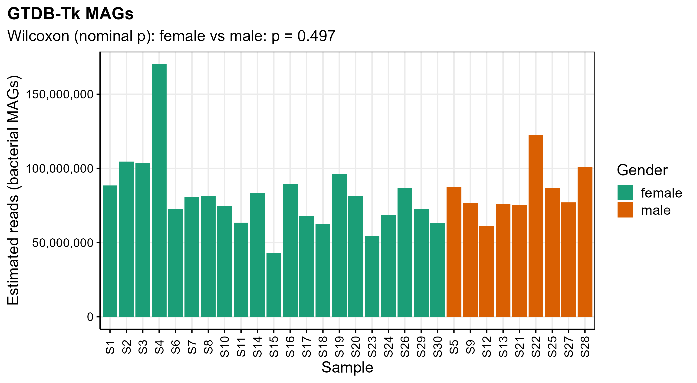
<p class="caption">
Figure 1a. Library size by gender.
</p>

</div>

<div class="figure" style="text-align: center">

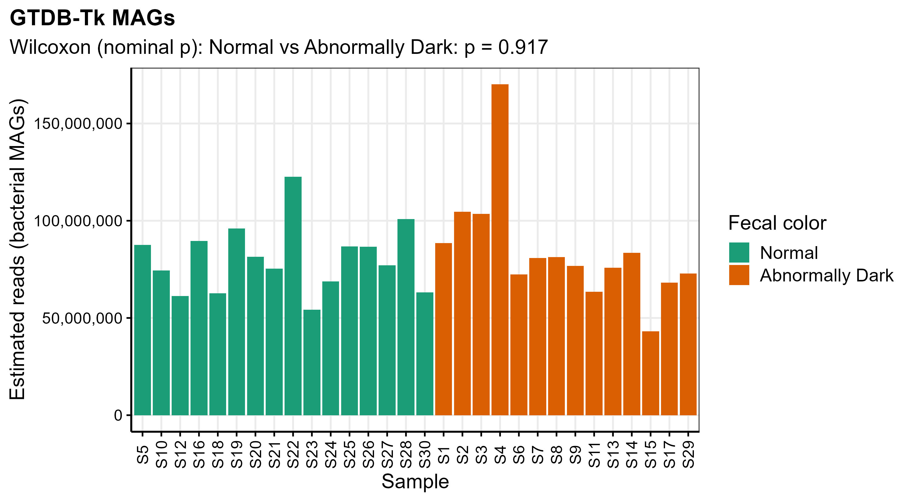
<p class="caption">
Figure 1b. Library size by fecal_color.
</p>

</div>

<div class="figure" style="text-align: center">

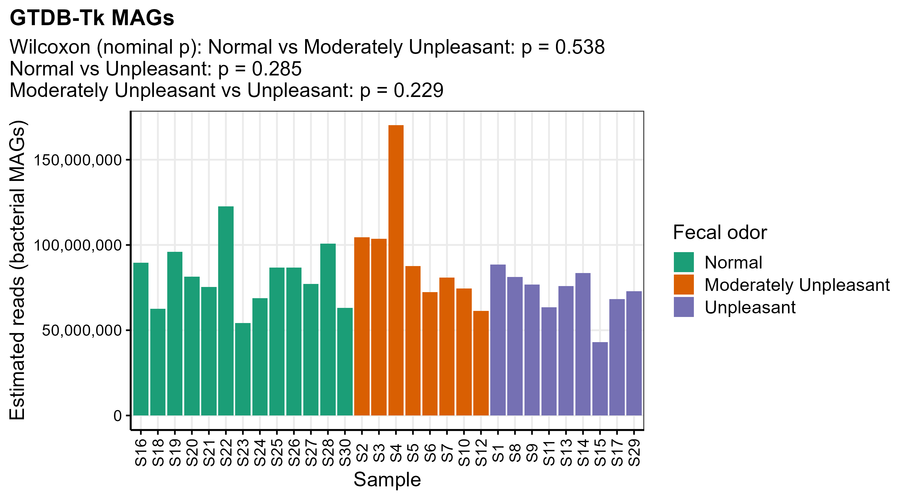
<p class="caption">
Figure 1c. Library size by fecal_odor.
</p>

</div>

| Condition   | Group                 |   n | Min        | Median     | Max         |
|:------------|:----------------------|----:|:-----------|:-----------|:------------|
| gender      | female                |  21 | 43,051,677 | 80,835,988 | 170,203,318 |
| gender      | male                  |   9 | 61,260,729 | 77,104,719 | 122,656,193 |
| fecal_color | Normal                |  16 | 54,173,173 | 79,283,200 | 122,656,193 |
| fecal_color | Abnormally Dark       |  14 | 43,051,677 | 78,771,460 | 170,203,318 |
| fecal_odor  | Normal                |  13 | 54,173,173 | 81,461,682 | 122,656,193 |
| fecal_odor  | Moderately Unpleasant |   8 | 61,260,729 | 84,229,797 | 170,203,318 |
| fecal_odor  | Unpleasant            |   9 | 43,051,677 | 75,825,473 | 88,444,928  |

Table 4. Estimated reads per sample by group

| Condition   | Comparison                          | p     |
|:------------|:------------------------------------|:------|
| gender      | female vs male                      | 0.497 |
| fecal_color | Normal vs Abnormally Dark           | 0.917 |
| fecal_odor  | Normal vs Moderately Unpleasant     | 0.538 |
| fecal_odor  | Normal vs Unpleasant                | 0.285 |
| fecal_odor  | Moderately Unpleasant vs Unpleasant | 0.229 |

Table 5. Wilcoxon rank-sum tests of library size (nominal p)

- **gender (Figure 1a).** Median reads: female 80.8 M, male 77.1 M;
  female vs male p = 0.497.
- **fecal_color (Figure 1b).** Median reads: Normal 79.3 M, Abnormally
  Dark 78.8 M; Normal vs Abnormally Dark p = 0.917.
- **fecal_odor (Figure 1c).** Median reads: Normal 81.5 M, Moderately
  Unpleasant 84.2 M, Unpleasant 75.8 M; Normal vs Moderately Unpleasant
  p = 0.538; Normal vs Unpleasant p = 0.285; Moderately Unpleasant vs
  Unpleasant p = 0.229.

Estimated reads vary 4.0-fold across samples, from S15 to S4 (the
tallest bar; gender female, fecal_color Abnormally Dark, fecal_odor
Moderately Unpleasant), but no comparison is significant in any
condition (all p ≥ 0.229): there is no evidence that depth differs
between groups. The depth range itself is handled by rarefaction for
alpha diversity (Section 5) and by bias correction in ANCOM-BC2 (Section
10).

------------------------------------------------------------------------

# 5. Alpha rarefaction

``` r
otu <- t(as(otu_table(ps), "matrix"))                   # samples in rows
# expected features per sample at each depth, and the depth that reaches 80% of observed
sat <- sapply(rownames(otu), function(s) {
  d <- round(10^seq(0, log10(sum(otu[s, ])), length.out = 400))
  d[which(vegan::rarefy(otu[s, ], sample = d) >= 0.8 * sum(otu[s, ] > 0))[1]]
})
sat_point <- max(sat)                                   # saturation point (dashed line)
ps_rare <- rarefy_even_depth(ps, sample.size = min(sample_sums(ps)), rngseed = 2026)
# script: rarefy_ps(ps, min(sample_sums(ps))): the same draw without replacement, made with rhyper()
```

A rarefaction curve shows how many features (MAGs) are expected in a
random subsample of a given number of reads, computed with vegan \[31\].
A curve that flattens means that more reads add few new MAGs. The
**saturation point** is the depth at which every sample reaches 80% of
its observed MAGs: each sample’s saturation depth is the smallest depth
at which its curve reaches 80% of its observed MAGs, and the largest of
these is the saturation point.

Figure 2 draws one curve per sample, coloured by group, one panel per
condition. The x axis is untransformed estimated reads, limited to the
low range where the curves bend; the dashed line marks the saturation
point. The rarefaction depth (the smallest sample) lies far beyond this
range and is given in the caption.

<div class="figure" style="text-align: center">

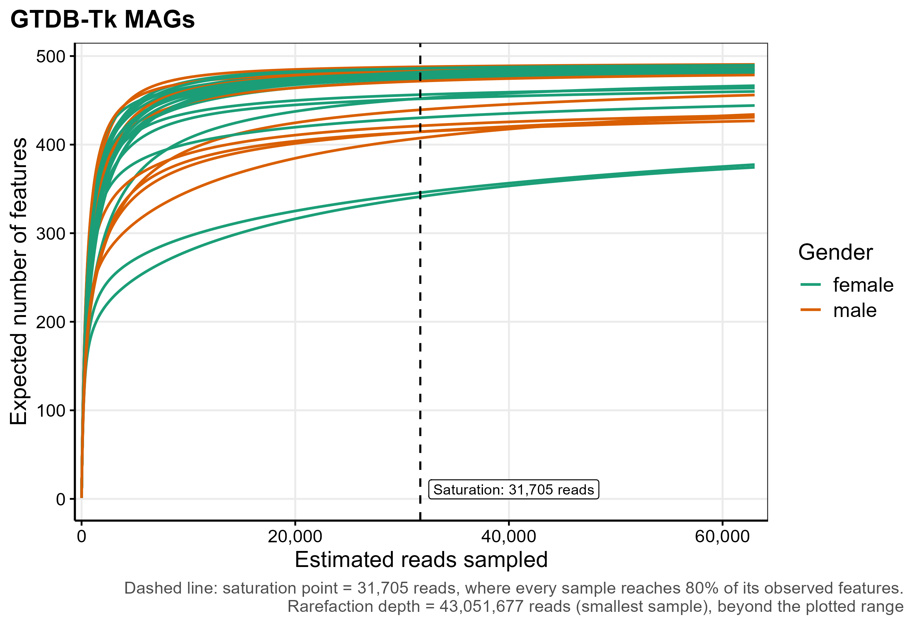
<p class="caption">
Figure 2a. Rarefaction curves by gender.
</p>

</div>

<div class="figure" style="text-align: center">

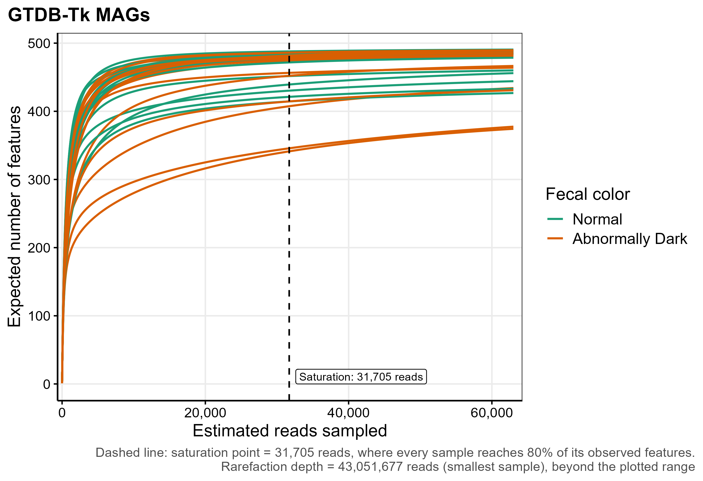
<p class="caption">
Figure 2b. Rarefaction curves by fecal_color.
</p>

</div>

<div class="figure" style="text-align: center">

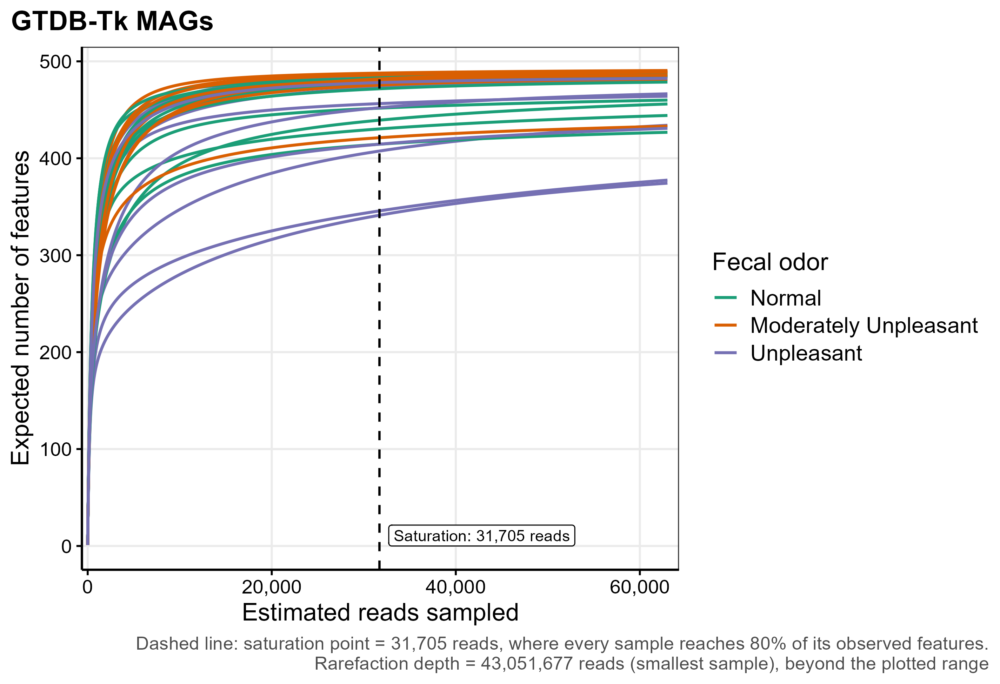
<p class="caption">
Figure 2c. Rarefaction curves by fecal_odor.
</p>

</div>

| sample_id | gender | fecal_color     | fecal_odor | total_reads | observed | saturation_depth |
|:----------|:-------|:----------------|:-----------|:------------|---------:|:-----------------|
| S1        | female | Abnormally Dark | Unpleasant | 88,444,928  |      432 | 31,705           |
| S11       | female | Abnormally Dark | Unpleasant | 63,391,810  |      414 | 27,463           |
| S13       | male   | Abnormally Dark | Unpleasant | 75,825,473  |      464 | 16,089           |
| S9        | male   | Abnormally Dark | Unpleasant | 76,706,933  |      461 | 8,960            |
| S22       | male   | Normal          | Normal     | 122,656,193 |      481 | 8,567            |

Table 6. Samples with the largest saturation depths
(results/gtdbtk/rarefaction_saturation_depth.csv)

| Condition   | Group                 |   n | Observed MAGs (median) | Observed MAGs (min-max) | Saturation depth (median) | Saturation depth (max) |
|:------------|:----------------------|----:|-----------------------:|:------------------------|:--------------------------|:-----------------------|
| gender      | female                |  21 |                  490.0 | 414-495                 | 3,220                     | 31,705                 |
| gender      | male                  |   9 |                  481.0 | 452-493                 | 5,042                     | 16,089                 |
| fecal_color | Normal                |  16 |                  489.5 | 452-494                 | 3,138                     | 8,567                  |
| fecal_color | Abnormally Dark       |  14 |                  486.5 | 414-495                 | 3,533                     | 31,705                 |
| fecal_odor  | Normal                |  13 |                  489.0 | 452-494                 | 3,028                     | 8,567                  |
| fecal_odor  | Moderately Unpleasant |   8 |                  492.0 | 453-495                 | 3,234                     | 5,042                  |
| fecal_odor  | Unpleasant            |   9 |                  475.0 | 414-492                 | 6,960                     | 31,705                 |

Table 7. Observed MAGs and saturation depth by group

Table 6 lists the five samples that need the most reads to saturate,
with their groups; Table 7 gives, per group, the median and range of
observed MAGs and the median and largest saturation depth.

- **Saturation point.** Half of the samples reach 80% of their observed
  MAGs within 3,234 reads (range 1,745–31,705). The saturation point,
  **31,705 reads**, is set by S1, followed by S11 (27,463). These two
  samples have the fewest observed MAGs (432 and 414) and form the two
  lowest curves in every panel.

- **gender (Figure 2a).** Median observed MAGs and saturation depth:
  female 490 MAGs and 3,220 reads; male 481 MAGs and 5,042 reads. The
  two lowest curves are both female samples; the other curves of both
  groups overlap.

- **fecal_color (Figure 2b).** Median observed MAGs and saturation
  depth: Normal 489.5 MAGs and 3,138 reads; Abnormally Dark 486.5 MAGs
  and 3,533 reads. The two lowest curves are both Abnormally Dark
  samples; the other curves of both groups overlap.

- **fecal_odor (Figure 2c).** Median observed MAGs and saturation depth:
  Normal 489 MAGs and 3,028 reads; Moderately Unpleasant 492 MAGs and
  3,234 reads; Unpleasant 475 MAGs and 6,960 reads. Unpleasant samples
  have fewer MAGs and saturate later than the other two groups, and
  include the four samples that need the most reads (Table 6). The two
  lowest curves are both Unpleasant samples; the other curves of all
  three groups overlap.

- **Rarefaction depth.** The data are rarefied to the smallest sample,
  43,051,677 reads, more than 1,000 times the saturation point. All
  curves are flat there, so rarefying keeps essentially all observed
  MAGs. Rarefied data are used only for alpha diversity (Section 6).

------------------------------------------------------------------------

# 6. Alpha diversity

``` r
alpha <- ps_rare |>
  ps_calc_richness(rank = "unique", index = "observed", varname = "Observed") |>
  ps_calc_richness(rank = "unique", index = "chao1", varname = "Chao1") |>
  ps_calc_diversity(rank = "unique", index = "shannon", varname = "Shannon") |>
  ps_calc_diversity(rank = "unique", index = "gini_simpson", varname = "Simpson") |>
  samdat_tbl()
alpha$Pielou <- microbiome::evenness(ps_rare, index = "pielou")$pielou
alpha$`Low-abundance rarity` <- microbiome::rarity(ps_rare, index = "low_abundance")$low_abundance
wilcox.test(Shannon ~ gender, data = alpha, exact = FALSE)        # one test per pair of levels
# script: a <- alpha_values(ps_rare); alpha_tests(a, "gender") etc., all six indices
```

Alpha diversity describes each sample on its own, from the data rarefied
to 43,051,677 reads (Section 5). Six indices cover three aspects:

| Index                | Aspect    | Meaning                                                                        |
|----------------------|-----------|--------------------------------------------------------------------------------|
| Observed             | richness  | number of MAGs present                                                         |
| Chao1                | richness  | estimated total MAGs, adding unseen ones from singletons and doubletons        |
| Shannon              | diversity | richness and evenness together; higher = more diverse                          |
| Simpson              | diversity | Gini–Simpson, 1 − Σ*p*²: chance that two random reads come from different MAGs |
| Pielou               | evenness  | Shannon ÷ ln(Observed); 1 = all MAGs equally abundant                          |
| Low-abundance rarity | rarity    | share of reads in MAGs below 0.2% relative abundance                           |

Figure 3 shows one panel per index for each condition: a box (median and
interquartile range) per group, with one point per sample. The p-value
above the boxes is a two-sided Wilcoxon rank-sum test, nominal; for
fecal_odor, the three brackets give the three pairwise comparisons.
Table 8 lists the group medians and Table 9 all p-values.

<div class="figure" style="text-align: center">

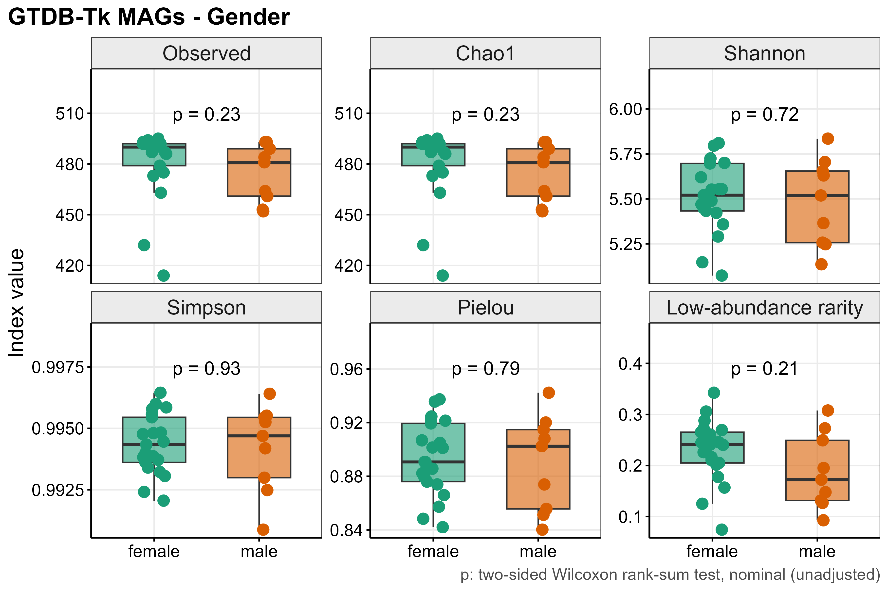
<p class="caption">
Figure 3a. Alpha diversity by gender.
</p>

</div>

<div class="figure" style="text-align: center">

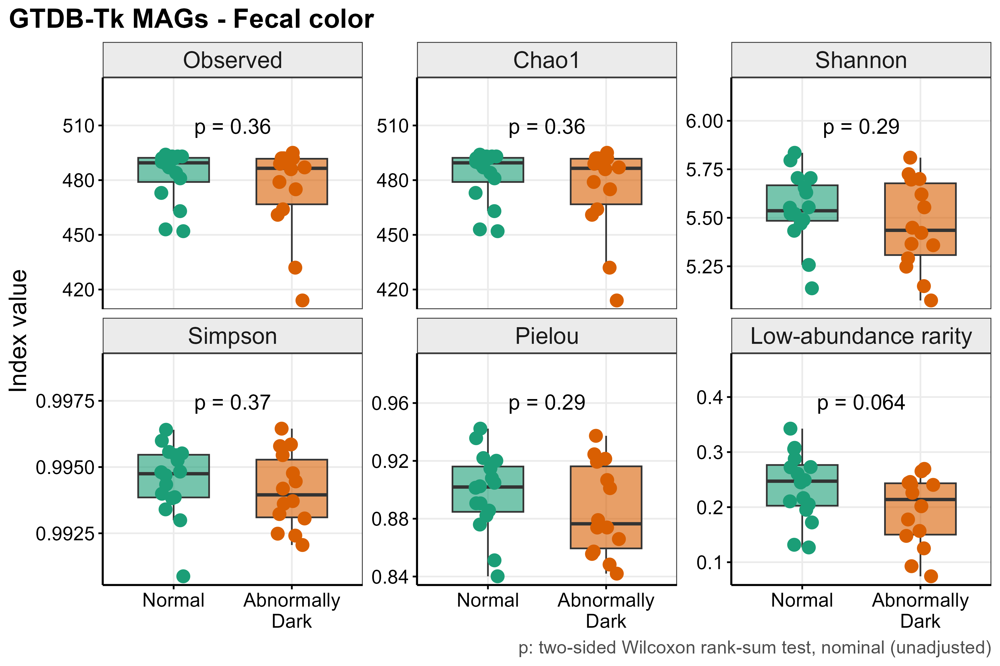
<p class="caption">
Figure 3b. Alpha diversity by fecal_color.
</p>

</div>

<div class="figure" style="text-align: center">

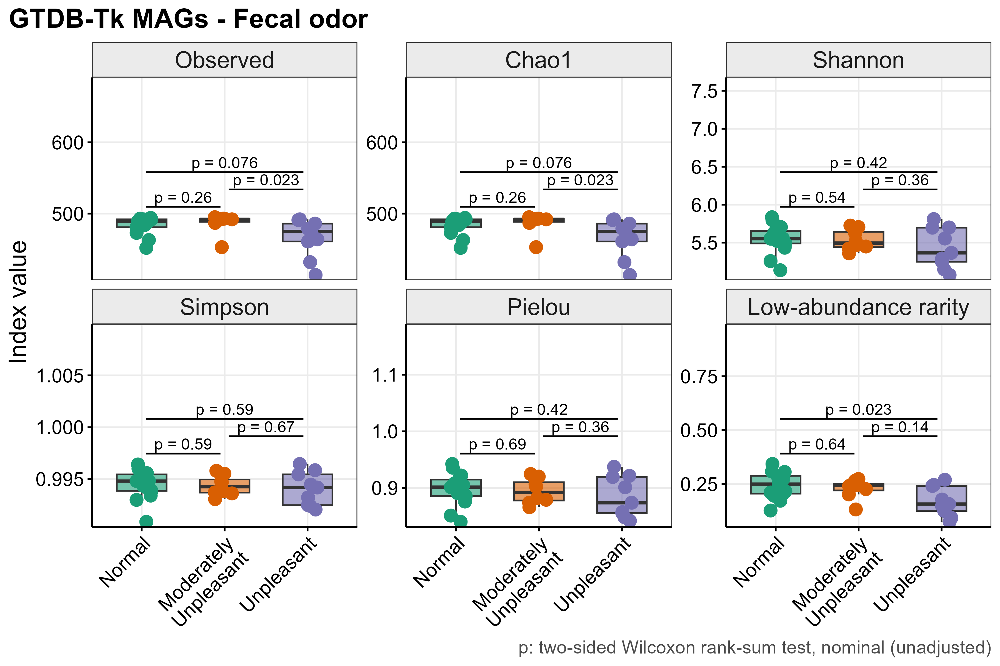
<p class="caption">
Figure 3c. Alpha diversity by fecal_odor.
</p>

</div>

| Condition   | Group                 |   n | Observed | Chao1 | Shannon | Simpson | Pielou | Low-abundance rarity |
|:------------|:----------------------|----:|:---------|:------|:--------|:--------|:-------|:---------------------|
| gender      | female                |  21 | 490.0    | 490.0 | 5.521   | 0.9943  | 0.891  | 0.241                |
| gender      | male                  |   9 | 481.0    | 481.0 | 5.519   | 0.9947  | 0.902  | 0.172                |
| fecal_color | Normal                |  16 | 489.5    | 489.5 | 5.536   | 0.9947  | 0.902  | 0.247                |
| fecal_color | Abnormally Dark       |  14 | 486.5    | 486.5 | 5.436   | 0.9940  | 0.876  | 0.214                |
| fecal_odor  | Normal                |  13 | 489.0    | 489.0 | 5.552   | 0.9948  | 0.901  | 0.249                |
| fecal_odor  | Moderately Unpleasant |   8 | 492.0    | 492.0 | 5.495   | 0.9943  | 0.892  | 0.242                |
| fecal_odor  | Unpleasant            |   9 | 475.0    | 475.0 | 5.365   | 0.9942  | 0.874  | 0.157                |

Table 8. Median alpha diversity by group (rarefied data)

| Condition   | Comparison                          | Observed | Chao1 | Shannon | Simpson | Pielou | Low-abundance rarity |
|:------------|:------------------------------------|:---------|:------|:--------|:--------|:-------|:---------------------|
| gender      | female vs male                      | 0.228    | 0.228 | 0.717   | 0.928   | 0.786  | 0.205                |
| fecal_color | Normal vs Abnormally Dark           | 0.358    | 0.358 | 0.289   | 0.371   | 0.289  | 0.064                |
| fecal_odor  | Normal vs Moderately Unpleasant     | 0.258    | 0.258 | 0.538   | 0.587   | 0.690  | 0.638                |
| fecal_odor  | Normal vs Unpleasant                | 0.076    | 0.076 | 0.423   | 0.593   | 0.423  | 0.023                |
| fecal_odor  | Moderately Unpleasant vs Unpleasant | 0.023    | 0.023 | 0.361   | 0.665   | 0.361  | 0.136                |

Table 9. Two-sided Wilcoxon rank-sum p-values (nominal) for each
comparison and index

- **gender (Figure 3a).** No index differs between female and male (p =
  0.205 to 0.928). Comparisons with p \< 0.10: none.
- **fecal_color (Figure 3b).** No index differs between Normal and
  Abnormally Dark (p = 0.064 to 0.371). Comparisons with p \< 0.10
  (Chao1, identical to Observed, not repeated): Low-abundance rarity
  lower in Abnormally Dark than Normal (p = 0.064). The two lowest
  Observed and Chao1 values are Abnormally Dark samples (S11 and S1,
  Section 5).
- **fecal_odor (Figure 3c).** p = 0.023 to 0.690 across the three
  comparisons. Comparisons with p \< 0.10 (Chao1 not repeated): Observed
  lower in Unpleasant than Normal (p = 0.076); Low-abundance rarity
  lower in Unpleasant than Normal (p = 0.023); Observed lower in
  Unpleasant than Moderately Unpleasant (p = 0.023). Unpleasant samples
  therefore have fewer MAGs than Moderately Unpleasant samples and less
  of their reads in rare MAGs than Normal samples, while Shannon,
  Simpson and Pielou do not differ: richness and rarity change, not
  diversity or evenness.

Only 3 of the 30 tests have p \< 0.05 (Observed and Chao1 for Moderately
Unpleasant vs Unpleasant, low-abundance rarity for Normal vs
Unpleasant), all for fecal_odor, and these p-values are not adjusted for
the 30 tests, so they are best read as leads, not firm differences.
Chao1 equals Observed for every sample because the estimated reads
contain no singletons or doubletons, so the two panels look alike.

------------------------------------------------------------------------

# 7. Relative abundance

``` r
ps_genus |> comp_barplot(tax_level = "Genus", n_taxa = 15, facet_by = "gender")      # per sample
ps_genus |> tax_transform("compositional") |> ps_get() |>
  merge_samples(group = "gender") |> comp_barplot(tax_level = "Genus", n_taxa = 15)  # per group
```

Relative abundance is each taxon’s share of a sample’s estimated reads,
computed among the taxa kept at that level. At Genus and Species, MAGs
without a name at that rank are left out (Section 3), so these shares
describe only the named part of the community: 77.0% of reads at Genus
and 59.5% at Species.

Two kinds of stacked bar chart are shown for each condition:

- **Overview (Figures 4, 6 and 8):** one panel per level, Phylum to
  Species, with one bar per group showing the **mean relative
  abundance** of the 15 most abundant taxa; the rest are merged into
  *Other* (grey).
- **Per sample (Figures 5, 7 and 9):** one chart per level, one bar per
  sample, faceted by group, with the same 15 taxa and colours.

Table 10 gives the group means of the five most abundant taxa at Phylum,
Family, Genus and Species
(`results/gtdbtk/relative_abundance_by_group.csv` has every taxon and
level for all three conditions).

## 7.1 gender

``` r
# Figure 4: mean relative abundance per group, one panel per level (script: relative_abundance_panel())
ps_genus |> tax_transform("compositional", rank = "unique") |> ps_get() |>
  merge_samples(group = "gender") |> comp_barplot(tax_level = "Genus", n_taxa = 15)
# Figure 5: one bar per sample, faceted by group (script: plot_relative_abundance_samples())
ps_genus |> comp_barplot(tax_level = "Genus", n_taxa = 15, facet_by = "gender")
```

<div class="figure" style="text-align: center">

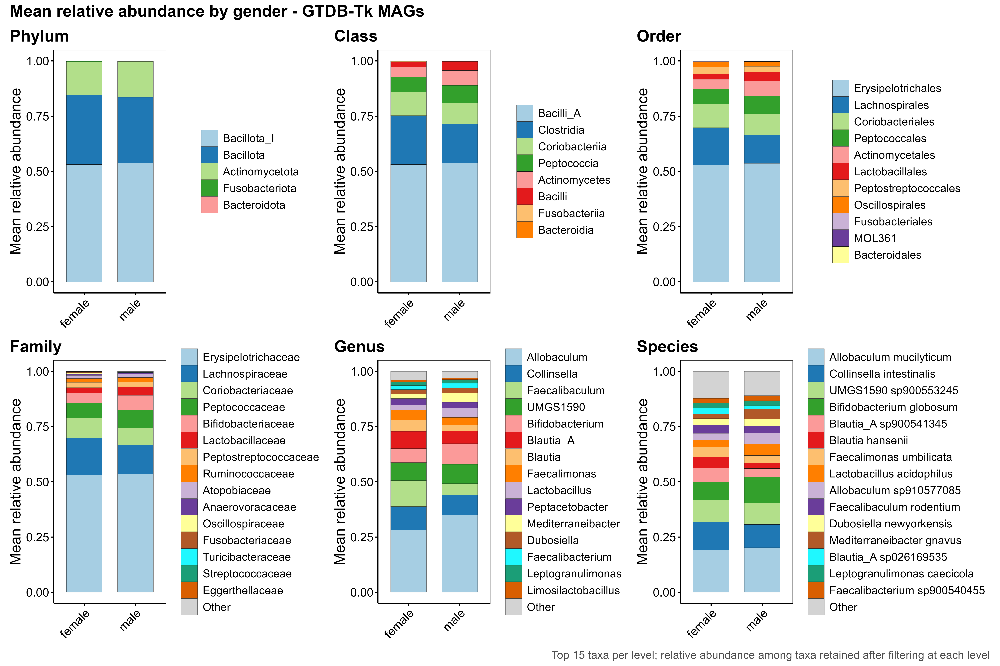
<p class="caption">
Figure 4. Mean relative abundance of the 15 most abundant taxa per
level, female vs male.
</p>

</div>

| Level   | Taxon                    | female | male |
|:--------|:-------------------------|:-------|:-----|
| Phylum  | Bacillota_I              | 53.1   | 53.7 |
| Phylum  | Bacillota                | 31.4   | 29.8 |
| Phylum  | Actinomycetota           | 15.1   | 16.2 |
| Phylum  | Fusobacteriota           | 0.2    | 0.1  |
| Phylum  | Bacteroidota             | 0.1    | 0.1  |
| Family  | Erysipelotrichaceae      | 53.0   | 53.6 |
| Family  | Lachnospiraceae          | 16.8   | 12.9 |
| Family  | Coriobacteriaceae        | 9.2    | 7.8  |
| Family  | Peptococcaceae           | 6.8    | 8.0  |
| Family  | Bifidobacteriaceae       | 4.5    | 6.8  |
| Genus   | Allobaculum              | 28.1   | 35.0 |
| Genus   | Collinsella              | 10.7   | 9.0  |
| Genus   | Faecalibaculum           | 11.7   | 5.2  |
| Genus   | UMGS1590                 | 8.2    | 8.8  |
| Genus   | Bifidobacterium          | 6.3    | 9.3  |
| Species | Allobaculum mucilyticum  | 19.1   | 20.2 |
| Species | Collinsella intestinalis | 12.7   | 10.5 |
| Species | Bifidobacterium globosum | 8.2    | 11.7 |
| Species | UMGS1590 sp900553245     | 10.1   | 9.8  |
| Species | Blautia_A sp900541345    | 6.1    | 3.9  |

Table 10a. Mean relative abundance (%) of the five most abundant taxa
per level, by gender

<div class="figure" style="text-align: center">

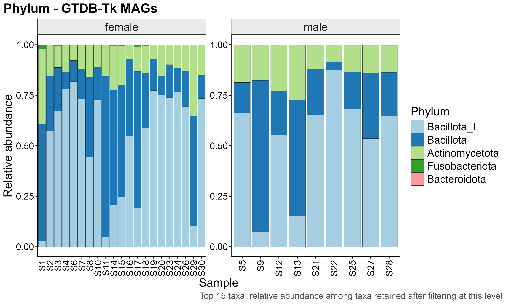
<p class="caption">
Figure 5a. Relative abundance per sample at Phylum level, by gender.
</p>

</div>

<div class="figure" style="text-align: center">

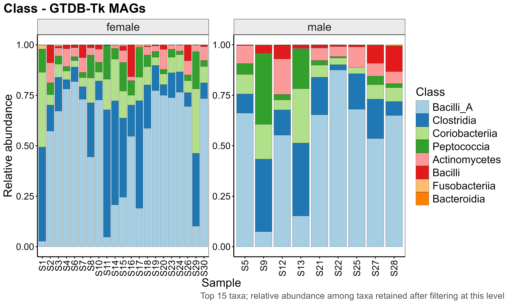
<p class="caption">
Figure 5b. Relative abundance per sample at Class level, by gender.
</p>

</div>

<div class="figure" style="text-align: center">

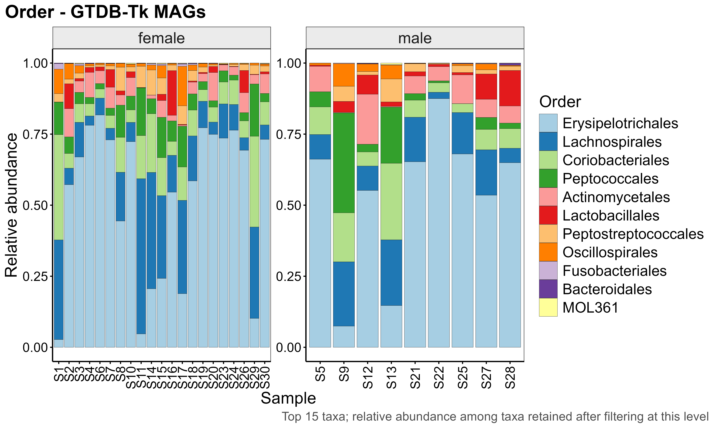
<p class="caption">
Figure 5c. Relative abundance per sample at Order level, by gender.
</p>

</div>

<div class="figure" style="text-align: center">

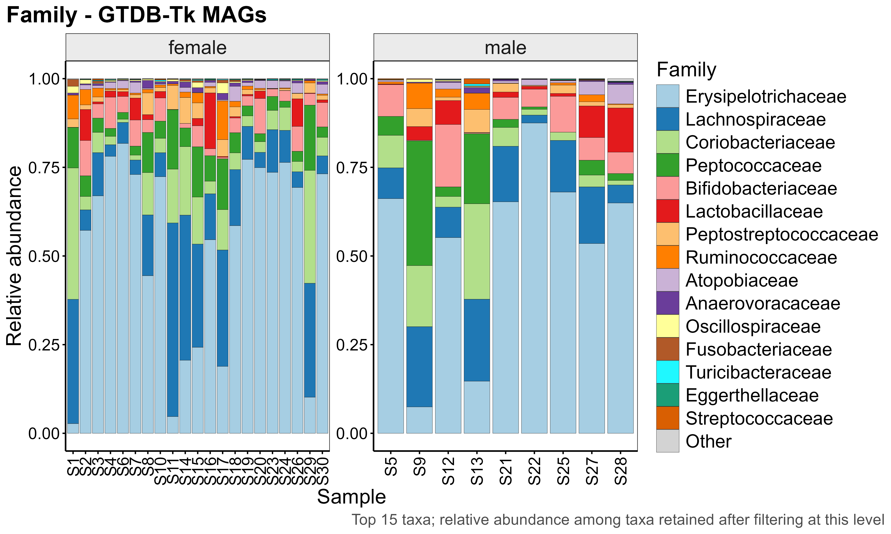
<p class="caption">
Figure 5d. Relative abundance per sample at Family level, by gender.
</p>

</div>

<div class="figure" style="text-align: center">

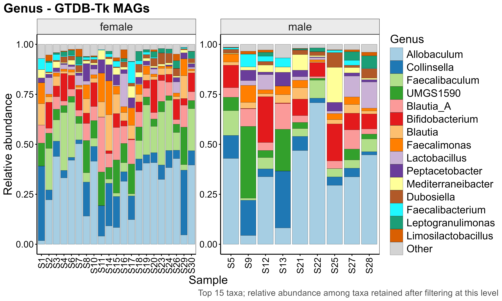
<p class="caption">
Figure 5e. Relative abundance per sample at Genus level, by gender.
</p>

</div>

<div class="figure" style="text-align: center">

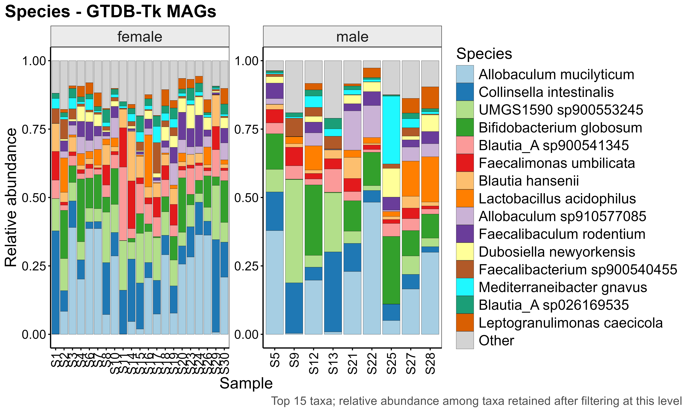
<p class="caption">
Figure 5f. Relative abundance per sample at Species level, by gender.
</p>

</div>

**Overview (Figure 4, Table 10a).** Female and male bars are nearly
identical at Phylum, Class and Order and differ by a few percentage
points at Family; the larger differences are at Genus and Species:

- **Phylum.** Bacillota_I (female 53.1%, male 53.7%), Bacillota (31.4%
  vs 29.8%) and Actinomycetota (15.1% vs 16.2%) make up almost the whole
  community; Fusobacteriota and Bacteroidota are below 0.5%.
- **Family.** Erysipelotrichaceae dominates both groups (53.0% vs
  53.6%). Lachnospiraceae is higher in females (16.8% vs 12.9%) and
  Bifidobacteriaceae in males (4.5% vs 6.8%).
- **Genus.** The largest differences appear here: *Allobaculum* (28.1%
  vs 35.0%) and *Bifidobacterium* (6.3% vs 9.3%) are higher in males,
  *Faecalibaculum* in females (11.7% vs 5.2%).
- **Species.** *Allobaculum mucilyticum* is the most abundant species in
  both groups (19.1% vs 20.2%); *Bifidobacterium globosum* is higher in
  males (8.2% vs 11.7%) and *Collinsella intestinalis* in females (12.7%
  vs 10.5%).

**Per sample (Figure 5).** Samples differ far more within each group
than the two group means differ from each other. Bacillota_I
(Erysipelotrichaceae, Bacilli_A) is the largest phylum in 22 of 30
samples, but in 8 samples it is below 25% and Bacillota (mainly
Lachnospiraceae, Clostridia) is the largest phylum instead, with
Actinomycetota often second: female S1 (2.7%), S11 (4.8%), S29 (10.2%),
S17 (19.0%), S14 (20.7%), S15 (24.5%); male S9 (7.4%), S13 (15.3%). All
eight are Abnormally Dark and Unpleasant (Sections 7.2 and 7.3), so this
pattern follows the faecal conditions rather than gender. At Genus and
Species, each sample has its own mix; for example, Peptococcaceae
(UMGS1590) makes up about a third of S9, and *Mediterraneibacter gnavus*
a quarter of S25.

Group means are descriptive; whether any taxon differs between female
and male is tested with ANCOM-BC2 (Section 10).

## 7.2 fecal_color

``` r
# Figure 6: mean relative abundance per group, one panel per level (script: relative_abundance_panel())
ps_genus |> tax_transform("compositional", rank = "unique") |> ps_get() |>
  merge_samples(group = "fecal_color") |> comp_barplot(tax_level = "Genus", n_taxa = 15)
# Figure 7: one bar per sample, faceted by group (script: plot_relative_abundance_samples())
ps_genus |> comp_barplot(tax_level = "Genus", n_taxa = 15, facet_by = "fecal_color")
```

<div class="figure" style="text-align: center">


<p class="caption">
Figure 6. Mean relative abundance of the 15 most abundant taxa per
level, Normal vs Abnormally Dark.
</p>

</div>

| Level   | Taxon                    | Normal | Abnormally Dark |
|:--------|:-------------------------|:-------|:----------------|
| Phylum  | Bacillota_I              | 68.3   | 36.2            |
| Phylum  | Bacillota                | 18.8   | 44.8            |
| Phylum  | Actinomycetota           | 12.8   | 18.6            |
| Phylum  | Fusobacteriota           | 0.1    | 0.4             |
| Phylum  | Bacteroidota             | 0.1    | 0.1             |
| Family  | Erysipelotrichaceae      | 68.2   | 36.1            |
| Family  | Lachnospiraceae          | 9.4    | 22.8            |
| Family  | Coriobacteriaceae        | 4.0    | 14.2            |
| Family  | Peptococcaceae           | 3.2    | 11.6            |
| Family  | Bifidobacteriaceae       | 6.5    | 3.6             |
| Genus   | Allobaculum              | 40.4   | 18.5            |
| Genus   | Collinsella              | 5.6    | 15.4            |
| Genus   | Faecalibaculum           | 11.5   | 7.8             |
| Genus   | UMGS1590                 | 4.4    | 12.9            |
| Genus   | Blautia_A                | 5.3    | 9.3             |
| Species | Allobaculum mucilyticum  | 25.9   | 12.0            |
| Species | Collinsella intestinalis | 7.8    | 16.8            |
| Species | UMGS1590 sp900553245     | 6.1    | 14.5            |
| Species | Bifidobacterium globosum | 11.9   | 6.3             |
| Species | Blautia_A sp900541345    | 4.2    | 6.9             |

Table 10b. Mean relative abundance (%) of the five most abundant taxa
per level, by fecal_color

<div class="figure" style="text-align: center">

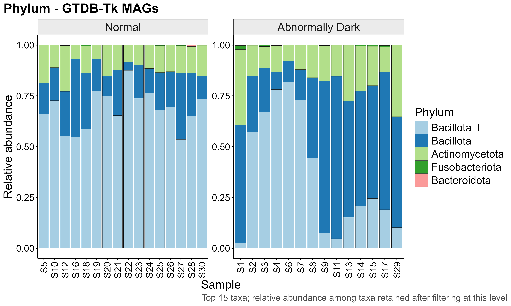
<p class="caption">
Figure 7a. Relative abundance per sample at Phylum level, by
fecal_color.
</p>

</div>

<div class="figure" style="text-align: center">

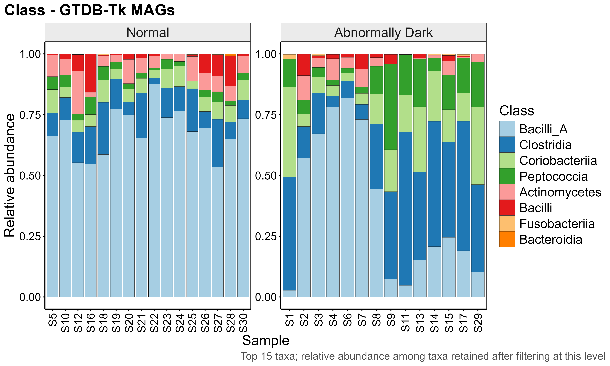
<p class="caption">
Figure 7b. Relative abundance per sample at Class level, by fecal_color.
</p>

</div>

<div class="figure" style="text-align: center">

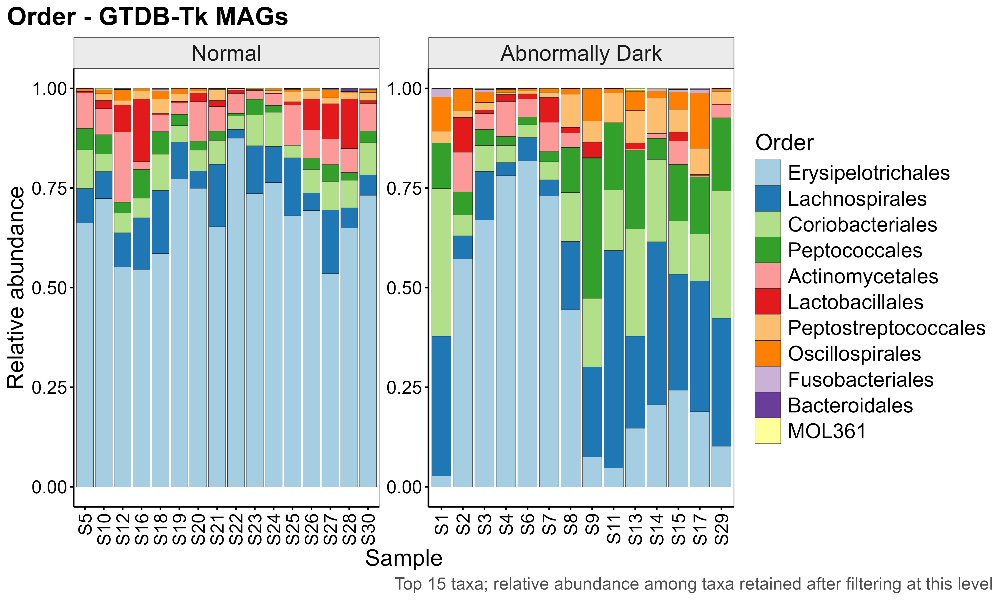
<p class="caption">
Figure 7c. Relative abundance per sample at Order level, by fecal_color.
</p>

</div>

<div class="figure" style="text-align: center">

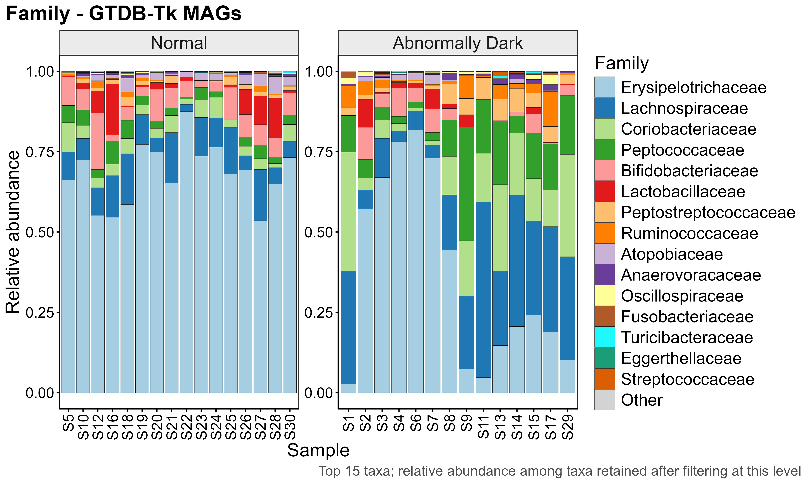
<p class="caption">
Figure 7d. Relative abundance per sample at Family level, by
fecal_color.
</p>

</div>

<div class="figure" style="text-align: center">

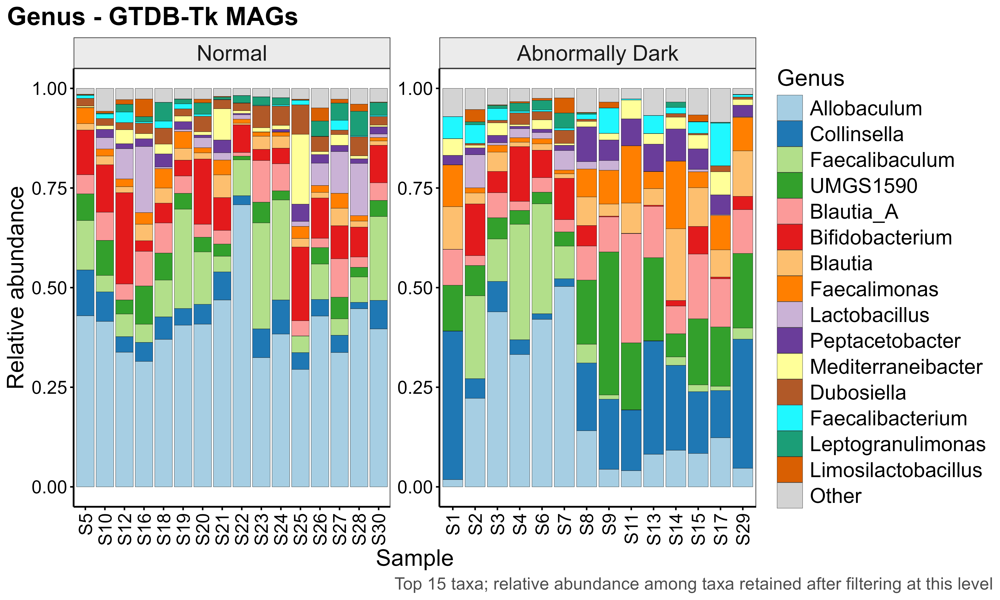
<p class="caption">
Figure 7e. Relative abundance per sample at Genus level, by fecal_color.
</p>

</div>

<div class="figure" style="text-align: center">

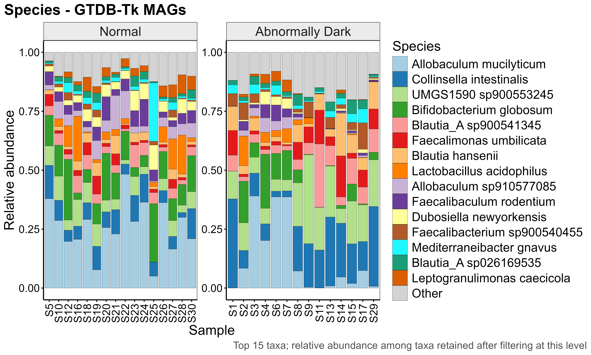
<p class="caption">
Figure 7f. Relative abundance per sample at Species level, by
fecal_color.
</p>

</div>

**Overview (Figure 6, Table 10b).** Unlike gender, fecal_color separates
the two groups clearly from Phylum down; values are Normal vs Abnormally
Dark:

- **Phylum.** Bacillota_I falls (68.3% vs 36.2%), while Bacillota rises
  (18.8% vs 44.8%) and Actinomycetota rises slightly (12.8% vs 18.6%).
- **Class and Family.** The drop in Bacilli_A is the drop in
  Erysipelotrichaceae (68.2% vs 36.1%). It is offset by Lachnospiraceae
  (9.4% vs 22.8%), Coriobacteriaceae (4.0% vs 14.2%) and Peptococcaceae
  (3.2% vs 11.6%); Bifidobacteriaceae goes the other way (6.5% vs 3.6%).
- **Genus.** *Allobaculum* falls (40.4% vs 18.5%) and *Bifidobacterium*
  falls (9.3% vs 4.8%), while *Collinsella* (5.6% vs 15.4%) and UMGS1590
  (4.4% vs 12.9%) rise.
- **Species.** The same pattern at species level: *Allobaculum
  mucilyticum* (25.9% vs 12.0%) and *Bifidobacterium globosum* (11.9% vs
  6.3%) are lower, *Collinsella intestinalis* (7.8% vs 16.8%) and
  UMGS1590 sp900553245 (6.1% vs 14.5%) higher in Abnormally Dark.

**Per sample (Figure 7).** The group means hide a split within the
Abnormally Dark group. Every Normal sample is dominated by Bacillota_I
(53.6% to 87.5%), and so are 5 Abnormally Dark samples (S2, S3, S4, S6,
S7); S8 (44.5%) is intermediate. All 8 samples with less than 25%
Bacillota_I are Abnormally Dark: S1 (2.7%), S11 (4.8%), S9 (7.4%), S29
(10.2%), S13 (15.3%), S17 (19.0%), S14 (20.7%), S15 (24.5%). In these
samples Lachnospiraceae (Clostridia), Coriobacteriaceae (*Collinsella*)
and Peptococcaceae (UMGS1590) replace Erysipelotrichaceae
(*Allobaculum*). The difference in means is therefore driven by 8 of the
14 Abnormally Dark samples, not by a shift shared by all of them. These
samples are the Unpleasant ones (Section 7.3, Table 2). ANCOM-BC2 tests
these differences formally (Section 10).

## 7.3 fecal_odor

``` r
# Figure 8: mean relative abundance per group, one panel per level (script: relative_abundance_panel())
ps_genus |> tax_transform("compositional", rank = "unique") |> ps_get() |>
  merge_samples(group = "fecal_odor") |> comp_barplot(tax_level = "Genus", n_taxa = 15)
# Figure 9: one bar per sample, faceted by group (script: plot_relative_abundance_samples())
ps_genus |> comp_barplot(tax_level = "Genus", n_taxa = 15, facet_by = "fecal_odor")
```

<div class="figure" style="text-align: center">

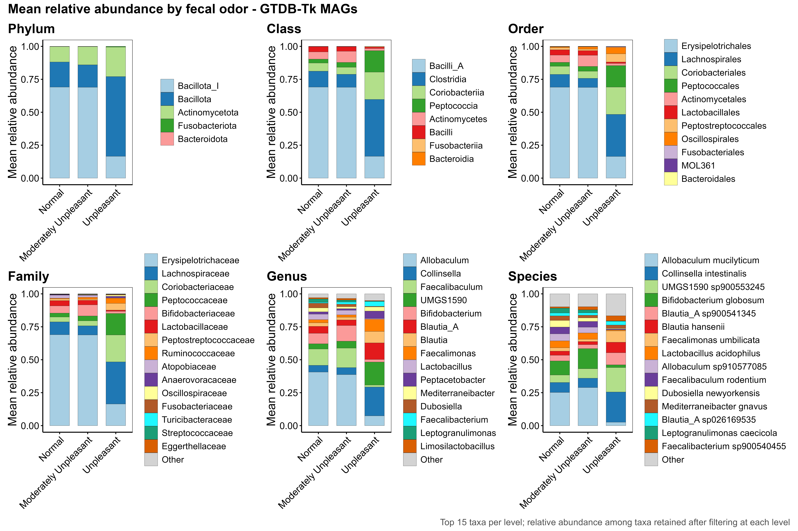
<p class="caption">
Figure 8. Mean relative abundance of the 15 most abundant taxa per
level, Normal vs Moderately Unpleasant vs Unpleasant.
</p>

</div>

| Level   | Taxon                    | Normal | Moderately Unpleasant | Unpleasant |
|:--------|:-------------------------|:-------|:----------------------|:-----------|
| Phylum  | Bacillota_I              | 69.1   | 68.9                  | 16.6       |
| Phylum  | Bacillota                | 19.0   | 17.0                  | 60.5       |
| Phylum  | Actinomycetota           | 11.7   | 13.8                  | 22.4       |
| Phylum  | Fusobacteriota           | 0.1    | 0.1                   | 0.5        |
| Phylum  | Bacteroidota             | 0.1    | 0.1                   | 0.1        |
| Family  | Erysipelotrichaceae      | 69.0   | 68.8                  | 16.4       |
| Family  | Lachnospiraceae          | 9.7    | 6.9                   | 31.9       |
| Family  | Coriobacteriaceae        | 3.7    | 3.8                   | 20.5       |
| Family  | Peptococcaceae           | 3.0    | 3.7                   | 16.3       |
| Family  | Bifidobacteriaceae       | 5.5    | 8.5                   | 1.7        |
| Genus   | Allobaculum              | 40.7   | 38.7                  | 7.5        |
| Genus   | Collinsella              | 5.1    | 5.3                   | 21.8       |
| Genus   | Faecalibaculum           | 12.4   | 14.8                  | 1.5        |
| Genus   | UMGS1590                 | 4.0    | 5.2                   | 17.5       |
| Genus   | Blautia_A                | 5.3    | 4.2                   | 12.5       |
| Species | Allobaculum mucilyticum  | 25.2   | 28.9                  | 2.6        |
| Species | Collinsella intestinalis | 7.5    | 7.1                   | 22.9       |
| Species | UMGS1590 sp900553245     | 5.7    | 7.2                   | 18.6       |
| Species | Bifidobacterium globosum | 10.6   | 15.2                  | 2.0        |
| Species | Blautia_A sp900541345    | 4.3    | 3.0                   | 9.2        |

Table 10c. Mean relative abundance (%) of the five most abundant taxa
per level, by fecal_odor

<div class="figure" style="text-align: center">

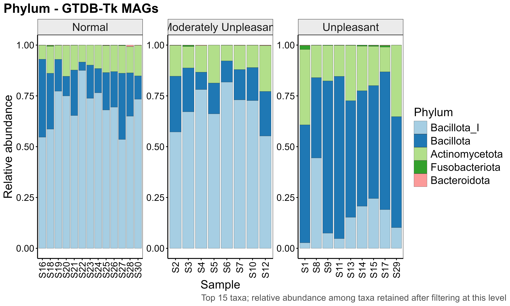
<p class="caption">
Figure 9a. Relative abundance per sample at Phylum level, by fecal_odor.
</p>

</div>

<div class="figure" style="text-align: center">

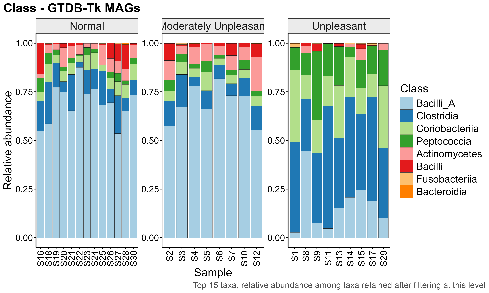
<p class="caption">
Figure 9b. Relative abundance per sample at Class level, by fecal_odor.
</p>

</div>

<div class="figure" style="text-align: center">

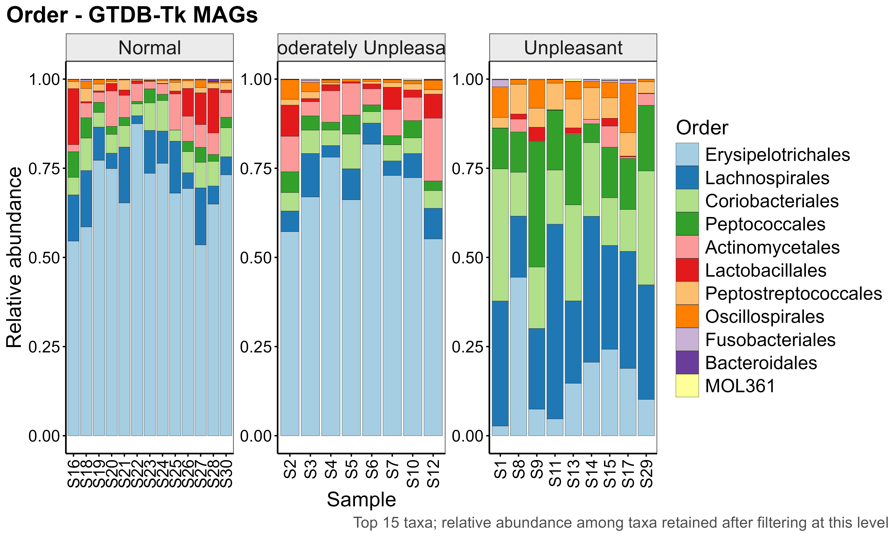
<p class="caption">
Figure 9c. Relative abundance per sample at Order level, by fecal_odor.
</p>

</div>

<div class="figure" style="text-align: center">

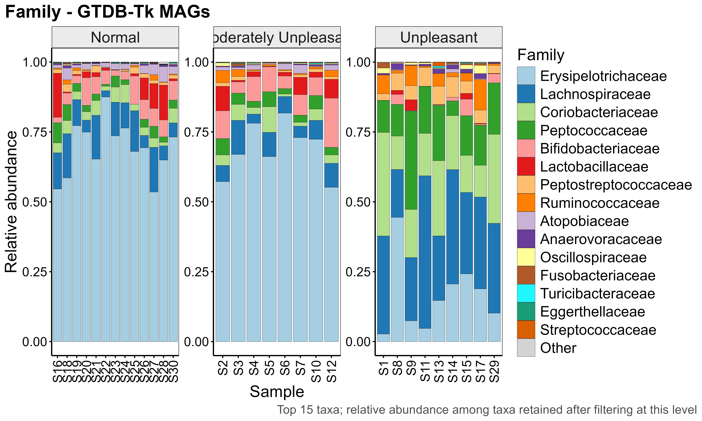
<p class="caption">
Figure 9d. Relative abundance per sample at Family level, by fecal_odor.
</p>

</div>

<div class="figure" style="text-align: center">

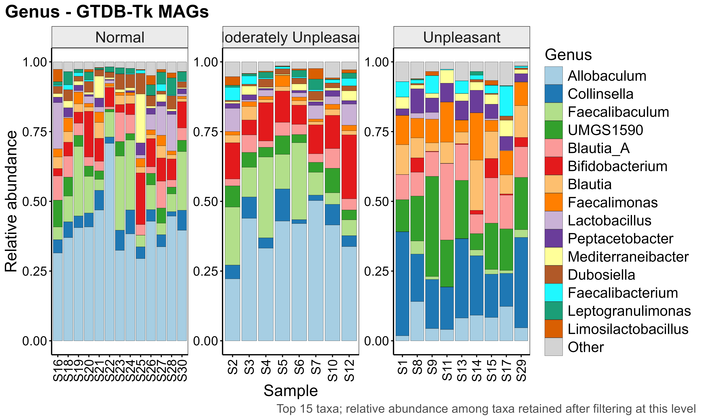
<p class="caption">
Figure 9e. Relative abundance per sample at Genus level, by fecal_odor.
</p>

</div>

<div class="figure" style="text-align: center">

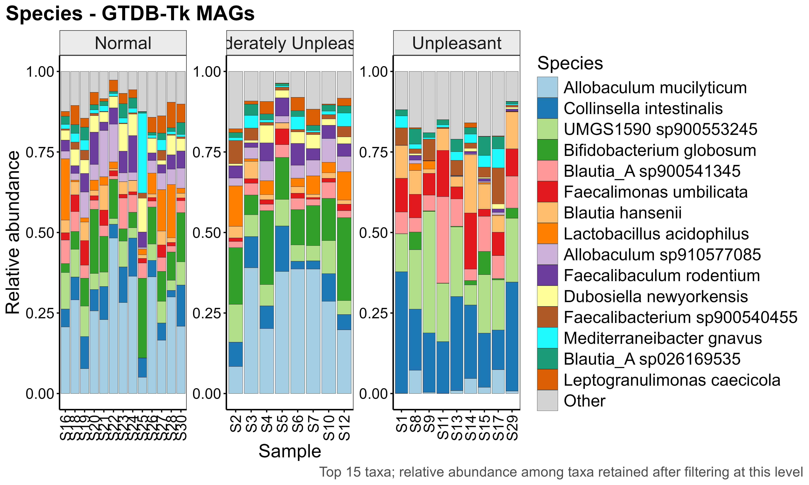
<p class="caption">
Figure 9f. Relative abundance per sample at Species level, by
fecal_odor.
</p>

</div>

**Overview (Figure 8, Table 10c).** Normal and Moderately Unpleasant are
almost identical at every level; Unpleasant is the group that differs.
Values are Normal, Moderately Unpleasant and Unpleasant:

- **Phylum.** Bacillota_I 69.1%, 68.9% and 16.6%; Bacillota 19.0%, 17.0%
  and 60.5%; Actinomycetota 11.7%, 13.8% and 22.4%. In Unpleasant
  samples Bacillota replaces Bacillota_I as the main phylum.
- **Family.** Erysipelotrichaceae 69.0%, 68.8% and 16.4%, against
  Lachnospiraceae 9.7%, 6.9% and 31.9%, Coriobacteriaceae 3.7%, 3.8% and
  20.5% and Peptococcaceae 3.0%, 3.7% and 16.3%. Bifidobacteriaceae is
  lowest in Unpleasant (5.5%, 8.5% and 1.7%).
- **Genus.** *Allobaculum* 40.7%, 38.7% and 7.5% and *Faecalibaculum*
  12.4%, 14.8% and 1.5% almost disappear in Unpleasant, while
  *Collinsella* 5.1%, 5.3% and 21.8%, UMGS1590 4.0%, 5.2% and 17.5% and
  *Blautia_A* 5.3%, 4.2% and 12.5% rise.
- **Species.** *Allobaculum mucilyticum* 25.2%, 28.9% and 2.6% and
  *Bifidobacterium globosum* 10.6%, 15.2% and 2.0% against *Collinsella
  intestinalis* 7.5%, 7.1% and 22.9% and UMGS1590 sp900553245 5.7%, 7.2%
  and 18.6%.

**Per sample (Figure 9).** Here the per-sample bars match the group
means. Bacillota_I dominates every Normal sample (53.6% to 87.5%) and
every Moderately Unpleasant sample (55.3% to 81.8%), but no Unpleasant
sample (2.7% to 44.5%). All 8 samples with less than 25% Bacillota_I are
Unpleasant: S1 (2.7%), S11 (4.8%), S9 (7.4%), S29 (10.2%), S13 (15.3%),
S17 (19.0%), S14 (20.7%), S15 (24.5%); the ninth, S8, is intermediate.
The Abnormally Dark split seen in Section 7.2 is the same split: the
Abnormally Dark samples low in Bacillota_I are the Unpleasant ones, and
those that look Normal are Moderately Unpleasant (Table 2). ANCOM-BC2
tests each pairwise comparison (Section 10).

------------------------------------------------------------------------

# 8. Beta diversity (Bray–Curtis PCoA)

``` r
ps |> tax_transform("compositional", rank = "unique") |>   # MAG-level relative abundance
  dist_calc("bray") |> ord_calc(method = "PCoA") |>
  ord_plot(colour = "gender")                              # also "fecal_color", "fecal_odor"
# script: b <- pcoa_bray(ps); plot_pcoa(b, "gender", ...)
```

Beta diversity compares samples with each other. The Bray–Curtis
dissimilarity between two samples is 0 when they have the same MAGs in
the same proportions and 1 when they share none. It is computed here on
the relative abundance of all 497 MAGs (not rarefied), and principal
coordinates analysis (PCoA) places the samples in two dimensions so that
distances between points approximate these dissimilarities.

Figure 10 shows the same ordination three times, coloured by each
condition. Each point is a sample, labelled with its ID; the axis titles
give the share of the variation captured by each axis, and the dashed
outline encloses all samples of a group (rounded convex hull). Table 11
gives, for each group, the range and median of the samples’ MDS1
coordinates.

<div class="figure" style="text-align: center">

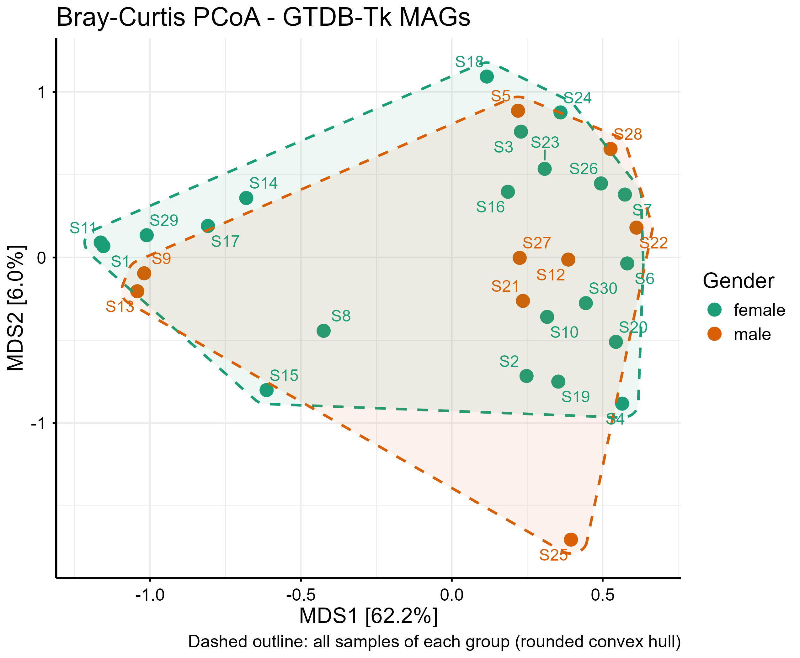
<p class="caption">
Figure 10a. Bray-Curtis PCoA of bacterial MAGs, coloured by gender.
</p>

</div>

<div class="figure" style="text-align: center">

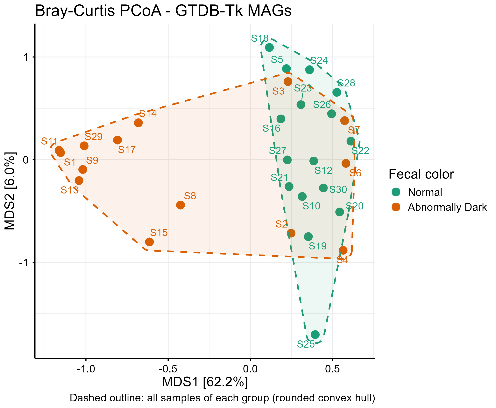
<p class="caption">
Figure 10b. Bray-Curtis PCoA of bacterial MAGs, coloured by fecal_color.
</p>

</div>

<div class="figure" style="text-align: center">

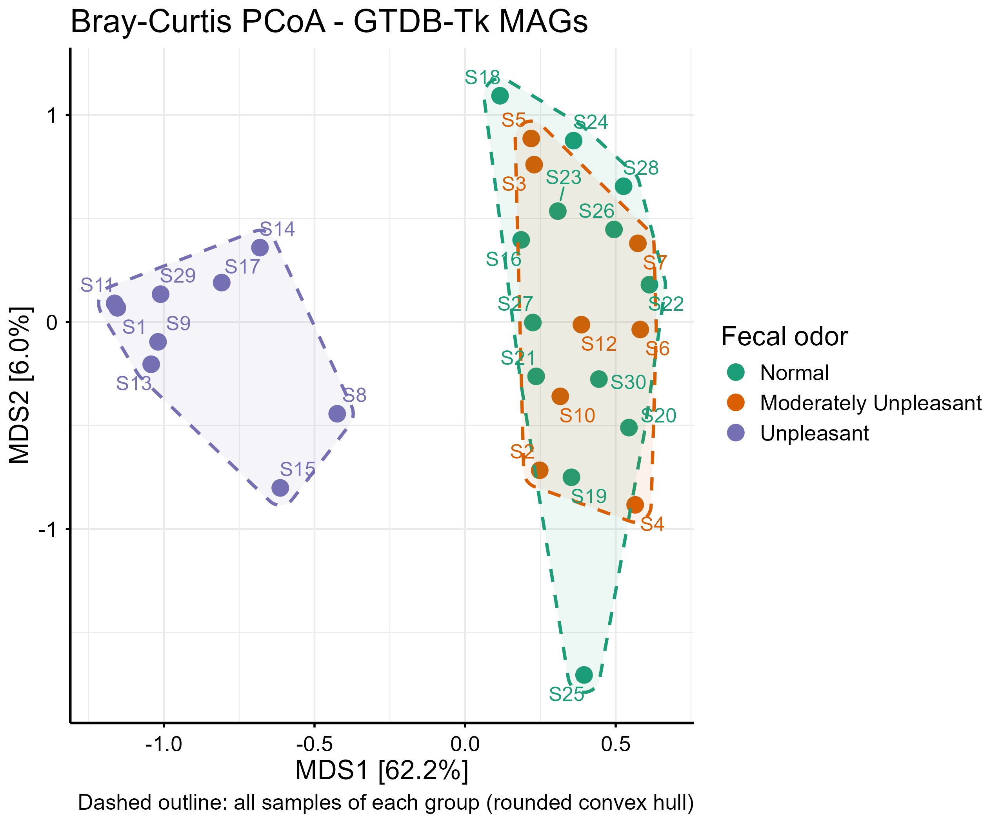
<p class="caption">
Figure 10c. Bray-Curtis PCoA of bacterial MAGs, coloured by fecal_odor.
</p>

</div>

| Condition   | Group                 |   n | MDS1 min | MDS1 median | MDS1 max |
|:------------|:----------------------|----:|:---------|:------------|:---------|
| gender      | female                |  21 | -1.16    | 0.25        | 0.58     |
| gender      | male                  |   9 | -1.04    | 0.24        | 0.61     |
| fecal_color | Normal                |  16 | 0.12     | 0.36        | 0.61     |
| fecal_color | Abnormally Dark       |  14 | -1.16    | -0.65       | 0.58     |
| fecal_odor  | Normal                |  13 | 0.12     | 0.36        | 0.61     |
| fecal_odor  | Moderately Unpleasant |   8 | 0.22     | 0.35        | 0.58     |
| fecal_odor  | Unpleasant            |   9 | -1.16    | -1.01       | -0.42    |

Table 11. MDS1 coordinates of the samples in each group
(results/gtdbtk/pcoa_bray_coordinates.csv)

MDS1 captures 62.2% of the variation and MDS2 6.0%, so the main
structure lies along MDS1. The samples fall into two clusters on this
axis with no sample between them: 9 samples on the left (MDS1 -1.16 to
-0.42) and the other 21 on the right (0.12 to 0.61). The left cluster is
the group low in Bacillota_I (Section 7).

- **gender (Figure 10a).** Female (-1.16 to 0.58) and male (-1.04 to
  0.61) samples occur in both clusters and their hulls largely overlap;
  gender does not structure the community.
- **fecal_color (Figure 10b).** All Normal samples are in the right
  cluster (MDS1 0.12 to 0.61). Abnormally Dark samples spread across
  both clusters (-1.16 to 0.58): 9 on the left and 5 (S2, S3, S4, S6,
  S7) among the Normal samples, so the two hulls overlap on the right.
- **fecal_odor (Figure 10c).** The left cluster is exactly the 9
  Unpleasant samples (-1.16 to -0.42), and its hull does not touch the
  others. Normal (0.12 to 0.61) and Moderately Unpleasant (0.22 to 0.58)
  are intermixed in the right cluster, with the Moderately Unpleasant
  hull lying almost entirely within the Normal one.

Along MDS2, S25 (gender male, fecal_color Normal, fecal_odor Normal)
lies apart from all other samples, at the bottom of every panel; it
carries an unusually large share of *Mediterraneibacter gnavus* (Section
7.1). Whether these patterns are statistically supported is tested with
PERMANOVA (Section 9).

------------------------------------------------------------------------

# 9. PERMANOVA by level

``` r
d <- ps |> tax_transform("compositional", rank = "unique") |> dist_calc("bray")
d |> dist_permanova(variables = "gender", n_perms = 9999, seed = 2026) |> perm_get()  # PERMANOVA
d |> dist_bdisp(variables = "gender") |> bdisp_get()                                  # PERMDISP
```

PERMANOVA \[33\] tests whether the groups differ in their centre
(centroid) in Bray–Curtis space, that is, in overall community
composition. R² is the share of the variation between samples explained
by the condition. A significant PERMANOVA can also arise when groups
differ only in spread, so PERMDISP \[34\] tests the spread (distance of
each sample to its group centroid) separately. Both use 9,999
permutations, so the smallest possible p is 0.0001. The tests are run on
all MAGs and on each level from Phylum to Species, and p-values are
Benjamini–Hochberg adjusted across these seven tests (p_adj) \[35\].
Each PERMANOVA table below has one row per level: the number of features
(MAGs or taxa) tested, R² as a percentage, the PERMANOVA p and p_adj,
and the PERMDISP p and p_adj.

## 9.1 gender

``` r
d  <- ps |> tax_transform("compositional", rank = "unique") |> dist_calc("bray")   # all MAGs; repeated per level
d |> dist_permanova(variables = "gender", n_perms = 9999, seed = 2026) |> perm_get()
bd <- d |> dist_bdisp(variables = "gender", method = "centroid") |> bdisp_get()
vegan::permutest(bd$gender$model, permutations = 9999)          # PERMDISP p
# script: permanova_bray(ps, "All features", "gender"); p_adj = p.adjust(p, "BH") over the 7 tests
```

<table>
<caption>
Table 12a. PERMANOVA and PERMDISP by gender (Bray-Curtis, 9,999
permutations; p_adj = BH across levels)
</caption>
<thead>
<tr>
<th align="center">
Level
</th>
<th align="center">
Features
</th>
<th align="center">
R² (%)
</th>
<th align="center">
p
</th>
<th align="center">
p_adj
</th>
<th align="center">
PERMDISP p
</th>
<th align="center">
PERMDISP p_adj
</th>
</tr>
</thead>
<tbody>
<tr>
<td align="center">
All features
</td>
<td align="center">
497
</td>
<td align="center">
2.50
</td>
<td align="center">
0.4796
</td>
<td align="center">
0.7730
</td>
<td align="center">
0.9371
</td>
<td align="center">
0.9492
</td>
</tr>
<tr>
<td align="center">
Phylum
</td>
<td align="center">
5
</td>
<td align="center">
0.20
</td>
<td align="center">
0.8750
</td>
<td align="center">
0.8750
</td>
<td align="center">
0.5004
</td>
<td align="center">
0.9492
</td>
</tr>
<tr>
<td align="center">
Class
</td>
<td align="center">
8
</td>
<td align="center">
1.00
</td>
<td align="center">
0.6616
</td>
<td align="center">
0.7730
</td>
<td align="center">
0.7030
</td>
<td align="center">
0.9492
</td>
</tr>
<tr>
<td align="center">
Order
</td>
<td align="center">
11
</td>
<td align="center">
1.10
</td>
<td align="center">
0.6626
</td>
<td align="center">
0.7730
</td>
<td align="center">
0.6811
</td>
<td align="center">
0.9492
</td>
</tr>
<tr>
<td align="center">
Family
</td>
<td align="center">
17
</td>
<td align="center">
1.20
</td>
<td align="center">
0.6540
</td>
<td align="center">
0.7730
</td>
<td align="center">
0.7047
</td>
<td align="center">
0.9492
</td>
</tr>
<tr>
<td align="center">
Genus
</td>
<td align="center">
38
</td>
<td align="center">
2.80
</td>
<td align="center">
0.4106
</td>
<td align="center">
0.7730
</td>
<td align="center">
0.9492
</td>
<td align="center">
0.9492
</td>
</tr>
<tr>
<td align="center">
Species
</td>
<td align="center">
57
</td>
<td align="center">
2.70
</td>
<td align="center">
0.4708
</td>
<td align="center">
0.7730
</td>
<td align="center">
0.3998
</td>
<td align="center">
0.9492
</td>
</tr>
</tbody>
</table>

- **Composition.** Gender explains only 0.2–2.8% of the variation at any
  level (2.5% for all 497 MAGs), and no test is significant (p =
  0.4106–0.8750; p_adj ≥ 0.7730).
- **Spread.** PERMDISP is not significant at any level (p =
  0.3998–0.9492), so female and male samples are equally variable.

This agrees with the overlapping hulls in Figure 10a and the similar
group means in Section 7.1: gender is not associated with community
composition in these samples.

## 9.2 fecal_color

``` r
d  <- ps |> tax_transform("compositional", rank = "unique") |> dist_calc("bray")   # all MAGs; repeated per level
d |> dist_permanova(variables = "fecal_color", n_perms = 9999, seed = 2026) |> perm_get()
bd <- d |> dist_bdisp(variables = "fecal_color", method = "centroid") |> bdisp_get()
vegan::permutest(bd$fecal_color$model, permutations = 9999)          # PERMDISP p
# script: permanova_bray(ps, "All features", "fecal_color"); p_adj = p.adjust(p, "BH") over the 7 tests
```

<table>
<caption>
Table 12b. PERMANOVA and PERMDISP by fecal_color (Bray-Curtis, 9,999
permutations; p_adj = BH across levels)
</caption>
<thead>
<tr>
<th align="center">
Level
</th>
<th align="center">
Features
</th>
<th align="center">
R² (%)
</th>
<th align="center">
p
</th>
<th align="center">
p_adj
</th>
<th align="center">
PERMDISP p
</th>
<th align="center">
PERMDISP p_adj
</th>
</tr>
</thead>
<tbody>
<tr>
<td align="center">
All features
</td>
<td align="center">
497
</td>
<td align="center">
26.40
</td>
<td align="center">
0.0002
</td>
<td align="center">
0.0004
</td>
<td align="center">
0.0001
</td>
<td align="center">
0.0001
</td>
</tr>
<tr>
<td align="center">
Phylum
</td>
<td align="center">
5
</td>
<td align="center">
36.10
</td>
<td align="center">
0.0006
</td>
<td align="center">
0.0006
</td>
<td align="center">
0.0001
</td>
<td align="center">
0.0001
</td>
</tr>
<tr>
<td align="center">
Class
</td>
<td align="center">
8
</td>
<td align="center">
35.10
</td>
<td align="center">
0.0003
</td>
<td align="center">
0.0004
</td>
<td align="center">
0.0001
</td>
<td align="center">
0.0001
</td>
</tr>
<tr>
<td align="center">
Order
</td>
<td align="center">
11
</td>
<td align="center">
33.30
</td>
<td align="center">
0.0003
</td>
<td align="center">
0.0004
</td>
<td align="center">
0.0001
</td>
<td align="center">
0.0001
</td>
</tr>
<tr>
<td align="center">
Family
</td>
<td align="center">
17
</td>
<td align="center">
33.70
</td>
<td align="center">
0.0003
</td>
<td align="center">
0.0004
</td>
<td align="center">
0.0001
</td>
<td align="center">
0.0001
</td>
</tr>
<tr>
<td align="center">
Genus
</td>
<td align="center">
38
</td>
<td align="center">
27.90
</td>
<td align="center">
0.0003
</td>
<td align="center">
0.0004
</td>
<td align="center">
0.0001
</td>
<td align="center">
0.0001
</td>
</tr>
<tr>
<td align="center">
Species
</td>
<td align="center">
57
</td>
<td align="center">
22.90
</td>
<td align="center">
0.0004
</td>
<td align="center">
0.0005
</td>
<td align="center">
0.0009
</td>
<td align="center">
0.0009
</td>
</tr>
</tbody>
</table>

- **Composition.** fecal_color explains 22.9–36.1% of the variation
  (26.4% for all MAGs, highest at Phylum), and every level is
  significant (p_adj 0.0004 to 0.0006).
- **Spread.** PERMDISP is also significant at every level (p_adj 0.0001
  to 0.0009): Abnormally Dark samples lie much farther from their
  centroid than Normal samples (mean distance to centroid for all MAGs
  0.387 vs 0.225).

The Abnormally Dark group is spread across both PCoA clusters (Figure
10b), so part of the PERMANOVA signal comes from this larger spread
rather than from a shift of the whole group. fecal_color is associated
with composition, but the result should be read together with fecal_odor
(Section 9.3, Table 2).

## 9.3 fecal_odor

``` r
d  <- ps |> tax_transform("compositional", rank = "unique") |> dist_calc("bray")   # all MAGs; repeated per level
d |> dist_permanova(variables = "fecal_odor", n_perms = 9999, seed = 2026) |> perm_get()  # all three groups in one test
bd <- d |> dist_bdisp(variables = "fecal_odor", method = "centroid") |> bdisp_get()
vegan::permutest(bd$fecal_odor$model, permutations = 9999)          # PERMDISP p
# script: permanova_bray(ps, "All features", "fecal_odor"); p_adj = p.adjust(p, "BH") over the 7 tests
```

<table>
<caption>
Table 12c. PERMANOVA and PERMDISP by fecal_odor, all three groups
together (Bray-Curtis, 9,999 permutations; p_adj = BH across levels)
</caption>
<thead>
<tr>
<th align="center">
Level
</th>
<th align="center">
Features
</th>
<th align="center">
R² (%)
</th>
<th align="center">
p
</th>
<th align="center">
p_adj
</th>
<th align="center">
PERMDISP p
</th>
<th align="center">
PERMDISP p_adj
</th>
</tr>
</thead>
<tbody>
<tr>
<td align="center">
All features
</td>
<td align="center">
497
</td>
<td align="center">
59.80
</td>
<td align="center">
0.0001
</td>
<td align="center">
0.0001
</td>
<td align="center">
0.0154
</td>
<td align="center">
0.0270
</td>
</tr>
<tr>
<td align="center">
Phylum
</td>
<td align="center">
5
</td>
<td align="center">
81.30
</td>
<td align="center">
0.0001
</td>
<td align="center">
0.0001
</td>
<td align="center">
0.1718
</td>
<td align="center">
0.2405
</td>
</tr>
<tr>
<td align="center">
Class
</td>
<td align="center">
8
</td>
<td align="center">
79.70
</td>
<td align="center">
0.0001
</td>
<td align="center">
0.0001
</td>
<td align="center">
0.0036
</td>
<td align="center">
0.0084
</td>
</tr>
<tr>
<td align="center">
Order
</td>
<td align="center">
11
</td>
<td align="center">
76.80
</td>
<td align="center">
0.0001
</td>
<td align="center">
0.0001
</td>
<td align="center">
0.0004
</td>
<td align="center">
0.0014
</td>
</tr>
<tr>
<td align="center">
Family
</td>
<td align="center">
17
</td>
<td align="center">
76.90
</td>
<td align="center">
0.0001
</td>
<td align="center">
0.0001
</td>
<td align="center">
0.0004
</td>
<td align="center">
0.0014
</td>
</tr>
<tr>
<td align="center">
Genus
</td>
<td align="center">
38
</td>
<td align="center">
64.30
</td>
<td align="center">
0.0001
</td>
<td align="center">
0.0001
</td>
<td align="center">
0.5263
</td>
<td align="center">
0.5263
</td>
</tr>
<tr>
<td align="center">
Species
</td>
<td align="center">
57
</td>
<td align="center">
52.80
</td>
<td align="center">
0.0001
</td>
<td align="center">
0.0001
</td>
<td align="center">
0.3283
</td>
<td align="center">
0.3830
</td>
</tr>
</tbody>
</table>

- **Composition.** fecal_odor explains the most variation of the three
  conditions: 52.8–81.3% (59.8% for all MAGs, 81.3% at Phylum), with p =
  0.0001 at every level, the smallest value 9,999 permutations can give.
- **Spread.** PERMDISP is significant for All features, Class, Order,
  and Family (p_adj 0.0014 to 0.0270), where Unpleasant samples are the
  most spread out (mean distance to centroid for Family 0.201 vs 0.118
  Normal and 0.109 Moderately Unpleasant). It is not significant for
  Phylum, Genus, and Species (p_adj 0.2405 to 0.5263), where R² is still
  52.8–81.3%.

At these levels the groups have similar spread, so the large R² reflects
a genuine difference in composition. Together with Figure 10c, where the
Unpleasant samples form a separate cluster, this points to Unpleasant as
the group that differs. The test compares all three groups at once; it
does not say which pairs differ. Differences between pairs of groups are
tested for individual taxa with ANCOM-BC2 (Section 10).

------------------------------------------------------------------------

# 10. Differential abundance (ANCOM-BC2)

``` r
res <- ANCOMBC::ancombc2(data = ps, tax_level = "Genus", fix_formula = "gender",
                         p_adj_method = "holm", prv_cut = 0.10, pseudo_sens = TRUE)
res$res   # lfc_, q_, diff_ and passed_ss_ columns for male vs female (one run per comparison, below)
```

ANCOM-BC2 \[32\] tests each taxon for a difference in abundance between
two groups. It estimates and removes the sample-specific sampling bias
of compositional data and reports, per taxon, a bias-corrected
**log-fold change** (LFC, natural log, second group vs reference; LFC \>
0 means higher in the second group).

- **Comparisons.** One per pair of groups, in this order: male vs
  female; Abnormally Dark vs Normal; and, for fecal_odor, Moderately
  Unpleasant vs Normal, Unpleasant vs Normal and Unpleasant vs
  Moderately Unpleasant.
- **Bias.** The sampling bias is estimated from all bacterial MAGs and
  the tests run on the taxa of each level.
- **Fits.** Taxa present in 10% of samples or fewer are skipped by the
  primary fit and refitted with a pseudo-count of 1, so every taxon is
  tested.
- **Adjustment.** q-values are Holm-adjusted over the taxa of each level
  \[36\]. Each taxon also gets a nominal Wilcoxon rank-sum p for
  comparison.
- **Robust.** A taxon counts as robust when q \< 0.05 *and* it passes
  the pseudo-count sensitivity analysis.

For each comparison, a summary table gives per level the number of taxa
tested, how many have Wilcoxon p \< 0.05, how many reach q \< 0.05, how
many of those are robust, and in which group the robust taxa are higher.
Each level then has a table of the ten lowest-p taxa (mean relative
abundance per group, number of samples in which the taxon is present,
LFC, p, q, Wilcoxon p, robust or not) and a figure of the five lowest-p
taxa, shown regardless of significance, as per-sample relative abundance
(%) with the LFC, p and q in each panel title.

## 10.1 gender: male vs female

``` r
ps_ab <- ps |>
  ps_filter(gender %in% c("female", "male")) |>                       # only the two groups compared
  ps_mutate(gender = factor(gender, levels = c("female", "male")))      # female = reference
res <- ANCOMBC::ancombc2(data = ps_ab, tax_level = "Genus", fix_formula = "gender",
                         p_adj_method = "holm", prv_cut = 0.10, pseudo_sens = TRUE)
res$res   # lfc_, p_, q_ and passed_ss_ columns: male vs female
# script: run_ancombc2_safe(ps_genus, "Genus", contrasts$gender, bias_ps = ps)
#         bias from all MAGs, pseudo-count refit, top-5 boxplots with plot_top_features()
```

<table>
<caption>
Table 13. ANCOM-BC2 summary per level, male vs female
(results/gtdbtk/ancombc2_results_by_level_gender.xlsx, sheet ‘Summary’)
</caption>
<thead>
<tr>
<th align="center">
Level
</th>
<th align="center">
Tested
</th>
<th align="center">
Pseudo-count fit
</th>
<th align="center">
Wilcoxon p \< 0.05
</th>
<th align="center">
q \< 0.05
</th>
<th align="center">
Robust
</th>
<th align="center">
Higher in male
</th>
<th align="center">
Higher in female
</th>
</tr>
</thead>
<tbody>
<tr>
<td align="center">
Phylum
</td>
<td align="center">
5
</td>
<td align="center">
0
</td>
<td align="center">
0
</td>
<td align="center">
0
</td>
<td align="center">
0
</td>
<td align="center">
0
</td>
<td align="center">
0
</td>
</tr>
<tr>
<td align="center">
Class
</td>
<td align="center">
8
</td>
<td align="center">
0
</td>
<td align="center">
0
</td>
<td align="center">
0
</td>
<td align="center">
0
</td>
<td align="center">
0
</td>
<td align="center">
0
</td>
</tr>
<tr>
<td align="center">
Order
</td>
<td align="center">
11
</td>
<td align="center">
0
</td>
<td align="center">
0
</td>
<td align="center">
0
</td>
<td align="center">
0
</td>
<td align="center">
0
</td>
<td align="center">
0
</td>
</tr>
<tr>
<td align="center">
Family
</td>
<td align="center">
17
</td>
<td align="center">
0
</td>
<td align="center">
1
</td>
<td align="center">
0
</td>
<td align="center">
0
</td>
<td align="center">
0
</td>
<td align="center">
0
</td>
</tr>
<tr>
<td align="center">
Genus
</td>
<td align="center">
38
</td>
<td align="center">
0
</td>
<td align="center">
1
</td>
<td align="center">
0
</td>
<td align="center">
0
</td>
<td align="center">
0
</td>
<td align="center">
0
</td>
</tr>
<tr>
<td align="center">
Species
</td>
<td align="center">
57
</td>
<td align="center">
0
</td>
<td align="center">
5
</td>
<td align="center">
0
</td>
<td align="center">
0
</td>
<td align="center">
0
</td>
<td align="center">
0
</td>
</tr>
</tbody>
</table>

All taxa were tested in the primary fit, with the bias estimated from
497 MAGs. Few taxa have even a nominal Wilcoxon p \< 0.05 (7 across all
levels), and **no taxon reaches q \< 0.05 at any level** (Table 13).

#### Phylum

<table>
<caption>
Table 14a. ANCOM-BC2, Phylum, male vs female (5 taxa; ten lowest p).
Present = samples with reads, female/male.
</caption>
<thead>
<tr>
<th align="center">
Taxon
</th>
<th align="center">
female %
</th>
<th align="center">
male %
</th>
<th align="center">
Present
</th>
<th align="center">
LFC
</th>
<th align="center">
p
</th>
<th align="center">
q
</th>
<th align="center">
Wilcoxon p
</th>
<th align="center">
Robust
</th>
<th align="center">
Fit
</th>
</tr>
</thead>
<tbody>
<tr>
<td align="center">
Bacteroidota
</td>
<td align="center">
0.0819
</td>
<td align="center">
0.1224
</td>
<td align="center">
21/6
</td>
<td align="center">
0.68
</td>
<td align="center">
0.2152
</td>
<td align="center">
1.0000
</td>
<td align="center">
0.2577
</td>
<td align="center">
no
</td>
<td align="center">
primary
</td>
</tr>
<tr>
<td align="center">
Actinomycetota
</td>
<td align="center">
15.1421
</td>
<td align="center">
16.2461
</td>
<td align="center">
21/9
</td>
<td align="center">
0.27
</td>
<td align="center">
0.4719
</td>
<td align="center">
1.0000
</td>
<td align="center">
0.3419
</td>
<td align="center">
no
</td>
<td align="center">
primary
</td>
</tr>
<tr>
<td align="center">
Bacillota_I
</td>
<td align="center">
53.1124
</td>
<td align="center">
53.7458
</td>
<td align="center">
21/9
</td>
<td align="center">
0.24
</td>
<td align="center">
0.5557
</td>
<td align="center">
1.0000
</td>
<td align="center">
0.5871
</td>
<td align="center">
no
</td>
<td align="center">
primary
</td>
</tr>
<tr>
<td align="center">
Bacillota
</td>
<td align="center">
31.4139
</td>
<td align="center">
29.7942
</td>
<td align="center">
21/9
</td>
<td align="center">
0.07
</td>
<td align="center">
0.8721
</td>
<td align="center">
1.0000
</td>
<td align="center">
0.8563
</td>
<td align="center">
no
</td>
<td align="center">
primary
</td>
</tr>
<tr>
<td align="center">
Fusobacteriota
</td>
<td align="center">
0.2496
</td>
<td align="center">
0.0915
</td>
<td align="center">
18/8
</td>
<td align="center">
-0.05
</td>
<td align="center">
0.9354
</td>
<td align="center">
1.0000
</td>
<td align="center">
0.8384
</td>
<td align="center">
no
</td>
<td align="center">
primary
</td>
</tr>
</tbody>
</table>

<div class="figure" style="text-align: center">

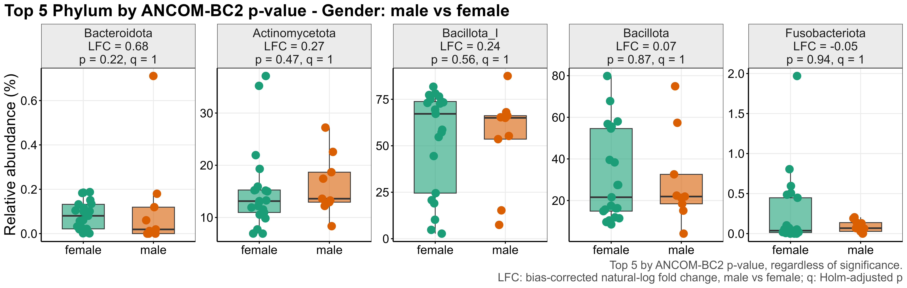
<p class="caption">
Figure 11a. Five lowest-p taxa at Phylum level (ANCOM-BC2), male vs
female.
</p>

</div>

**No phylum differs** (all q = 1). Bacillota_I has the same mean in both
groups (LFC 0.24, q = 1.0000), and the lowest p, Bacteroidota (LFC 0.68,
q = 1.0000), is far from significant.

#### Class

<table>
<caption>
Table 14b. ANCOM-BC2, Class, male vs female (8 taxa; ten lowest p).
Present = samples with reads, female/male.
</caption>
<thead>
<tr>
<th align="center">
Taxon
</th>
<th align="center">
female %
</th>
<th align="center">
male %
</th>
<th align="center">
Present
</th>
<th align="center">
LFC
</th>
<th align="center">
p
</th>
<th align="center">
q
</th>
<th align="center">
Wilcoxon p
</th>
<th align="center">
Robust
</th>
<th align="center">
Fit
</th>
</tr>
</thead>
<tbody>
<tr>
<td align="center">
Bacilli
</td>
<td align="center">
2.4977
</td>
<td align="center">
4.1128
</td>
<td align="center">
21/9
</td>
<td align="center">
1.41
</td>
<td align="center">
0.0300
</td>
<td align="center">
0.2403
</td>
<td align="center">
0.1353
</td>
<td align="center">
no
</td>
<td align="center">
primary
</td>
</tr>
<tr>
<td align="center">
Bacteroidia
</td>
<td align="center">
0.0819
</td>
<td align="center">
0.1224
</td>
<td align="center">
21/6
</td>
<td align="center">
0.68
</td>
<td align="center">
0.2442
</td>
<td align="center">
1.0000
</td>
<td align="center">
0.2577
</td>
<td align="center">
no
</td>
<td align="center">
primary
</td>
</tr>
<tr>
<td align="center">
Peptococcia
</td>
<td align="center">
6.7775
</td>
<td align="center">
8.0099
</td>
<td align="center">
21/9
</td>
<td align="center">
-0.66
</td>
<td align="center">
0.4359
</td>
<td align="center">
1.0000
</td>
<td align="center">
0.3899
</td>
<td align="center">
no
</td>
<td align="center">
primary
</td>
</tr>
<tr>
<td align="center">
Actinomycetes
</td>
<td align="center">
4.4587
</td>
<td align="center">
6.7512
</td>
<td align="center">
21/9
</td>
<td align="center">
0.48
</td>
<td align="center">
0.4541
</td>
<td align="center">
1.0000
</td>
<td align="center">
0.2579
</td>
<td align="center">
no
</td>
<td align="center">
primary
</td>
</tr>
<tr>
<td align="center">
Bacilli_A
</td>
<td align="center">
53.1124
</td>
<td align="center">
53.7458
</td>
<td align="center">
21/9
</td>
<td align="center">
0.24
</td>
<td align="center">
0.5966
</td>
<td align="center">
1.0000
</td>
<td align="center">
0.5871
</td>
<td align="center">
no
</td>
<td align="center">
primary
</td>
</tr>
<tr>
<td align="center">
Coriobacteriia
</td>
<td align="center">
10.6834
</td>
<td align="center">
9.4949
</td>
<td align="center">
21/9
</td>
<td align="center">
0.04
</td>
<td align="center">
0.9368
</td>
<td align="center">
1.0000
</td>
<td align="center">
0.7514
</td>
<td align="center">
no
</td>
<td align="center">
primary
</td>
</tr>
<tr>
<td align="center">
Fusobacteriia
</td>
<td align="center">
0.2496
</td>
<td align="center">
0.0915
</td>
<td align="center">
18/8
</td>
<td align="center">
-0.05
</td>
<td align="center">
0.9383
</td>
<td align="center">
1.0000
</td>
<td align="center">
0.8384
</td>
<td align="center">
no
</td>
<td align="center">
primary
</td>
</tr>
<tr>
<td align="center">
Clostridia
</td>
<td align="center">
22.1387
</td>
<td align="center">
17.6716
</td>
<td align="center">
21/9
</td>
<td align="center">
0.00
</td>
<td align="center">
0.9961
</td>
<td align="center">
1.0000
</td>
<td align="center">
0.8920
</td>
<td align="center">
no
</td>
<td align="center">
primary
</td>
</tr>
</tbody>
</table>

<div class="figure" style="text-align: center">

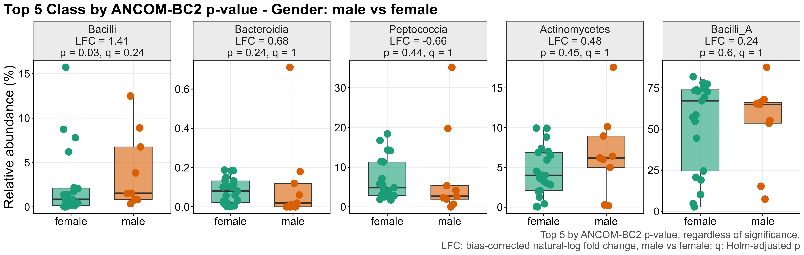
<p class="caption">
Figure 11b. Five lowest-p taxa at Class level (ANCOM-BC2), male vs
female.
</p>

</div>

**No class reaches q \< 0.05.** Only Bacilli has a nominal p below 0.05
(LFC 1.41, q = 0.2403), and its Wilcoxon p is 0.1353.

#### Order

<table>
<caption>
Table 14c. ANCOM-BC2, Order, male vs female (11 taxa; ten lowest p).
Present = samples with reads, female/male.
</caption>
<thead>
<tr>
<th align="center">
Taxon
</th>
<th align="center">
female %
</th>
<th align="center">
male %
</th>
<th align="center">
Present
</th>
<th align="center">
LFC
</th>
<th align="center">
p
</th>
<th align="center">
q
</th>
<th align="center">
Wilcoxon p
</th>
<th align="center">
Robust
</th>
<th align="center">
Fit
</th>
</tr>
</thead>
<tbody>
<tr>
<td align="center">
Lactobacillales
</td>
<td align="center">
2.4977
</td>
<td align="center">
4.1128
</td>
<td align="center">
21/9
</td>
<td align="center">
1.41
</td>
<td align="center">
0.0314
</td>
<td align="center">
0.3453
</td>
<td align="center">
0.1353
</td>
<td align="center">
no
</td>
<td align="center">
primary
</td>
</tr>
<tr>
<td align="center">
Bacteroidales
</td>
<td align="center">
0.0819
</td>
<td align="center">
0.1224
</td>
<td align="center">
21/6
</td>
<td align="center">
0.68
</td>
<td align="center">
0.2488
</td>
<td align="center">
1.0000
</td>
<td align="center">
0.2577
</td>
<td align="center">
no
</td>
<td align="center">
primary
</td>
</tr>
<tr>
<td align="center">
Peptococcales
</td>
<td align="center">
6.7775
</td>
<td align="center">
8.0099
</td>
<td align="center">
21/9
</td>
<td align="center">
-0.66
</td>
<td align="center">
0.4381
</td>
<td align="center">
1.0000
</td>
<td align="center">
0.3899
</td>
<td align="center">
no
</td>
<td align="center">
primary
</td>
</tr>
<tr>
<td align="center">
Actinomycetales
</td>
<td align="center">
4.4587
</td>
<td align="center">
6.7512
</td>
<td align="center">
21/9
</td>
<td align="center">
0.48
</td>
<td align="center">
0.4579
</td>
<td align="center">
1.0000
</td>
<td align="center">
0.2579
</td>
<td align="center">
no
</td>
<td align="center">
primary
</td>
</tr>
<tr>
<td align="center">
Peptostreptococcales
</td>
<td align="center">
3.0467
</td>
<td align="center">
2.5777
</td>
<td align="center">
21/9
</td>
<td align="center">
-0.44
</td>
<td align="center">
0.6010
</td>
<td align="center">
1.0000
</td>
<td align="center">
0.4972
</td>
<td align="center">
no
</td>
<td align="center">
primary
</td>
</tr>
<tr>
<td align="center">
Erysipelotrichales
</td>
<td align="center">
53.0011
</td>
<td align="center">
53.6442
</td>
<td align="center">
21/9
</td>
<td align="center">
0.24
</td>
<td align="center">
0.6060
</td>
<td align="center">
1.0000
</td>
<td align="center">
0.5871
</td>
<td align="center">
no
</td>
<td align="center">
primary
</td>
</tr>
<tr>
<td align="center">
Oscillospirales
</td>
<td align="center">
2.3041
</td>
<td align="center">
2.1536
</td>
<td align="center">
21/9
</td>
<td align="center">
-0.19
</td>
<td align="center">
0.7926
</td>
<td align="center">
1.0000
</td>
<td align="center">
0.6838
</td>
<td align="center">
no
</td>
<td align="center">
primary
</td>
</tr>
<tr>
<td align="center">
MOL361
</td>
<td align="center">
0.1114
</td>
<td align="center">
0.1016
</td>
<td align="center">
21/8
</td>
<td align="center">
-0.13
</td>
<td align="center">
0.8329
</td>
<td align="center">
1.0000
</td>
<td align="center">
0.2579
</td>
<td align="center">
no
</td>
<td align="center">
primary
</td>
</tr>
<tr>
<td align="center">
Lachnospirales
</td>
<td align="center">
16.7879
</td>
<td align="center">
12.9404
</td>
<td align="center">
21/9
</td>
<td align="center">
0.04
</td>
<td align="center">
0.9372
</td>
<td align="center">
1.0000
</td>
<td align="center">
0.8920
</td>
<td align="center">
no
</td>
<td align="center">
primary
</td>
</tr>
<tr>
<td align="center">
Coriobacteriales
</td>
<td align="center">
10.6834
</td>
<td align="center">
9.4949
</td>
<td align="center">
21/9
</td>
<td align="center">
0.04
</td>
<td align="center">
0.9376
</td>
<td align="center">
1.0000
</td>
<td align="center">
0.7514
</td>
<td align="center">
no
</td>
<td align="center">
primary
</td>
</tr>
</tbody>
</table>

<div class="figure" style="text-align: center">

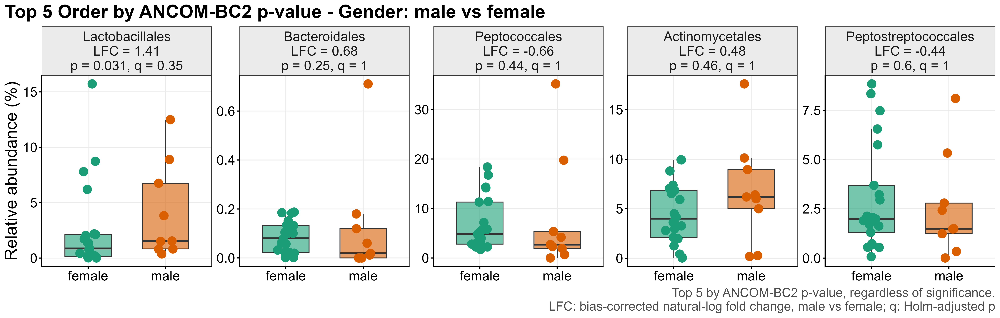
<p class="caption">
Figure 11c. Five lowest-p taxa at Order level (ANCOM-BC2), male vs
female.
</p>

</div>

**No order reaches q \< 0.05.** Lactobacillales, the order of Bacilli,
has the lowest p (LFC 1.41, q = 0.3453); all other orders have q = 1.

#### Family

<table>
<caption>
Table 14d. ANCOM-BC2, Family, male vs female (17 taxa; ten lowest p).
Present = samples with reads, female/male.
</caption>
<thead>
<tr>
<th align="center">
Taxon
</th>
<th align="center">
female %
</th>
<th align="center">
male %
</th>
<th align="center">
Present
</th>
<th align="center">
LFC
</th>
<th align="center">
p
</th>
<th align="center">
q
</th>
<th align="center">
Wilcoxon p
</th>
<th align="center">
Robust
</th>
<th align="center">
Fit
</th>
</tr>
</thead>
<tbody>
<tr>
<td align="center">
Muribaculaceae
</td>
<td align="center">
0.0559
</td>
<td align="center">
0.1157
</td>
<td align="center">
18/5
</td>
<td align="center">
1.18
</td>
<td align="center">
0.0473
</td>
<td align="center">
0.8046
</td>
<td align="center">
0.5847
</td>
<td align="center">
no
</td>
<td align="center">
primary
</td>
</tr>
<tr>
<td align="center">
Lactobacillaceae
</td>
<td align="center">
2.4501
</td>
<td align="center">
3.9193
</td>
<td align="center">
21/9
</td>
<td align="center">
1.31
</td>
<td align="center">
0.1097
</td>
<td align="center">
1.0000
</td>
<td align="center">
0.2393
</td>
<td align="center">
no
</td>
<td align="center">
primary
</td>
</tr>
<tr>
<td align="center">
Oscillospiraceae
</td>
<td align="center">
0.5503
</td>
<td align="center">
0.1934
</td>
<td align="center">
21/8
</td>
<td align="center">
-0.89
</td>
<td align="center">
0.1626
</td>
<td align="center">
1.0000
</td>
<td align="center">
0.0266
</td>
<td align="center">
no
</td>
<td align="center">
primary
</td>
</tr>
<tr>
<td align="center">
Anaerovoracaceae
</td>
<td align="center">
0.6852
</td>
<td align="center">
0.3944
</td>
<td align="center">
21/9
</td>
<td align="center">
-1.04
</td>
<td align="center">
0.2292
</td>
<td align="center">
1.0000
</td>
<td align="center">
0.0776
</td>
<td align="center">
no
</td>
<td align="center">
primary
</td>
</tr>
<tr>
<td align="center">
Peptococcaceae
</td>
<td align="center">
6.7775
</td>
<td align="center">
8.0099
</td>
<td align="center">
21/9
</td>
<td align="center">
-0.66
</td>
<td align="center">
0.4446
</td>
<td align="center">
1.0000
</td>
<td align="center">
0.3899
</td>
<td align="center">
no
</td>
<td align="center">
primary
</td>
</tr>
<tr>
<td align="center">
Bifidobacteriaceae
</td>
<td align="center">
4.4587
</td>
<td align="center">
6.7512
</td>
<td align="center">
21/9
</td>
<td align="center">
0.48
</td>
<td align="center">
0.4688
</td>
<td align="center">
1.0000
</td>
<td align="center">
0.2579
</td>
<td align="center">
no
</td>
<td align="center">
primary
</td>
</tr>
<tr>
<td align="center">
Streptococcaceae
</td>
<td align="center">
0.0476
</td>
<td align="center">
0.1934
</td>
<td align="center">
18/7
</td>
<td align="center">
0.66
</td>
<td align="center">
0.5108
</td>
<td align="center">
1.0000
</td>
<td align="center">
0.9277
</td>
<td align="center">
no
</td>
<td align="center">
primary
</td>
</tr>
<tr>
<td align="center">
Erysipelotrichaceae
</td>
<td align="center">
53.0011
</td>
<td align="center">
53.6442
</td>
<td align="center">
21/9
</td>
<td align="center">
0.24
</td>
<td align="center">
0.6223
</td>
<td align="center">
1.0000
</td>
<td align="center">
0.5871
</td>
<td align="center">
no
</td>
<td align="center">
primary
</td>
</tr>
<tr>
<td align="center">
Peptostreptococcaceae
</td>
<td align="center">
2.3614
</td>
<td align="center">
2.1833
</td>
<td align="center">
21/9
</td>
<td align="center">
-0.34
</td>
<td align="center">
0.6973
</td>
<td align="center">
1.0000
</td>
<td align="center">
0.6186
</td>
<td align="center">
no
</td>
<td align="center">
primary
</td>
</tr>
<tr>
<td align="center">
Turicibacteraceae
</td>
<td align="center">
0.1114
</td>
<td align="center">
0.1016
</td>
<td align="center">
21/8
</td>
<td align="center">
-0.13
</td>
<td align="center">
0.8371
</td>
<td align="center">
1.0000
</td>
<td align="center">
0.2579
</td>
<td align="center">
no
</td>
<td align="center">
primary
</td>
</tr>
</tbody>
</table>

<div class="figure" style="text-align: center">

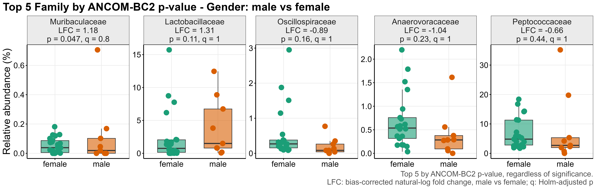
<p class="caption">
Figure 11d. Five lowest-p taxa at Family level (ANCOM-BC2), male vs
female.
</p>

</div>

**No family reaches q \< 0.05.** Muribaculaceae has the lowest p (LFC
1.18, q = 0.8046) but is present in 18 of 21 female and 5 of 9 male
samples, and its male mean rests mainly on one sample (S28).
Oscillospiraceae is the only family with Wilcoxon p \< 0.05 (0.0266),
but its bias-corrected change is not significant (LFC -0.89, q =
1.0000).

#### Genus

<table>
<caption>
Table 14e. ANCOM-BC2, Genus, male vs female (38 taxa; ten lowest p).
Present = samples with reads, female/male.
</caption>
<thead>
<tr>
<th align="center">
Taxon
</th>
<th align="center">
female %
</th>
<th align="center">
male %
</th>
<th align="center">
Present
</th>
<th align="center">
LFC
</th>
<th align="center">
p
</th>
<th align="center">
q
</th>
<th align="center">
Wilcoxon p
</th>
<th align="center">
Robust
</th>
<th align="center">
Fit
</th>
</tr>
</thead>
<tbody>
<tr>
<td align="center">
Cetobacterium_A
</td>
<td align="center">
0.1214
</td>
<td align="center">
0.0000
</td>
<td align="center">
5/1
</td>
<td align="center">
-3.28
</td>
<td align="center">
0.0062
</td>
<td align="center">
0.2347
</td>
<td align="center">
0.3646
</td>
<td align="center">
no
</td>
<td align="center">
primary
</td>
</tr>
<tr>
<td align="center">
Roseburia
</td>
<td align="center">
0.0088
</td>
<td align="center">
0.0007
</td>
<td align="center">
5/3
</td>
<td align="center">
-2.01
</td>
<td align="center">
0.0092
</td>
<td align="center">
0.3398
</td>
<td align="center">
0.8161
</td>
<td align="center">
no
</td>
<td align="center">
primary
</td>
</tr>
<tr>
<td align="center">
Amulumruptor
</td>
<td align="center">
0.0789
</td>
<td align="center">
0.1523
</td>
<td align="center">
18/5
</td>
<td align="center">
1.18
</td>
<td align="center">
0.0486
</td>
<td align="center">
1.0000
</td>
<td align="center">
0.6488
</td>
<td align="center">
no
</td>
<td align="center">
primary
</td>
</tr>
<tr>
<td align="center">
Lactobacillus
</td>
<td align="center">
2.3810
</td>
<td align="center">
4.2145
</td>
<td align="center">
21/9
</td>
<td align="center">
1.31
</td>
<td align="center">
0.1303
</td>
<td align="center">
1.0000
</td>
<td align="center">
0.2393
</td>
<td align="center">
no
</td>
<td align="center">
primary
</td>
</tr>
<tr>
<td align="center">
Avimicrobium
</td>
<td align="center">
0.0189
</td>
<td align="center">
0.0061
</td>
<td align="center">
18/8
</td>
<td align="center">
-0.83
</td>
<td align="center">
0.1503
</td>
<td align="center">
1.0000
</td>
<td align="center">
0.1291
</td>
<td align="center">
no
</td>
<td align="center">
primary
</td>
</tr>
<tr>
<td align="center">
Faecousia
</td>
<td align="center">
0.6516
</td>
<td align="center">
0.2193
</td>
<td align="center">
21/8
</td>
<td align="center">
-0.89
</td>
<td align="center">
0.1648
</td>
<td align="center">
1.0000
</td>
<td align="center">
0.0236
</td>
<td align="center">
no
</td>
<td align="center">
primary
</td>
</tr>
<tr>
<td align="center">
Ligilactobacillus
</td>
<td align="center">
0.1157
</td>
<td align="center">
0.0805
</td>
<td align="center">
16/8
</td>
<td align="center">
1.34
</td>
<td align="center">
0.1969
</td>
<td align="center">
1.0000
</td>
<td align="center">
0.1954
</td>
<td align="center">
no
</td>
<td align="center">
primary
</td>
</tr>
<tr>
<td align="center">
Ileibacterium
</td>
<td align="center">
0.4767
</td>
<td align="center">
0.4556
</td>
<td align="center">
21/9
</td>
<td align="center">
0.67
</td>
<td align="center">
0.2128
</td>
<td align="center">
1.0000
</td>
<td align="center">
0.6838
</td>
<td align="center">
no
</td>
<td align="center">
primary
</td>
</tr>
<tr>
<td align="center">
Gallibacter
</td>
<td align="center">
0.8642
</td>
<td align="center">
0.4622
</td>
<td align="center">
21/9
</td>
<td align="center">
-1.04
</td>
<td align="center">
0.2304
</td>
<td align="center">
1.0000
</td>
<td align="center">
0.0703
</td>
<td align="center">
no
</td>
<td align="center">
primary
</td>
</tr>
<tr>
<td align="center">
Mediterraneibacter
</td>
<td align="center">
1.9723
</td>
<td align="center">
4.1904
</td>
<td align="center">
21/9
</td>
<td align="center">
0.55
</td>
<td align="center">
0.3675
</td>
<td align="center">
1.0000
</td>
<td align="center">
0.4417
</td>
<td align="center">
no
</td>
<td align="center">
primary
</td>
</tr>
</tbody>
</table>

<div class="figure" style="text-align: center">

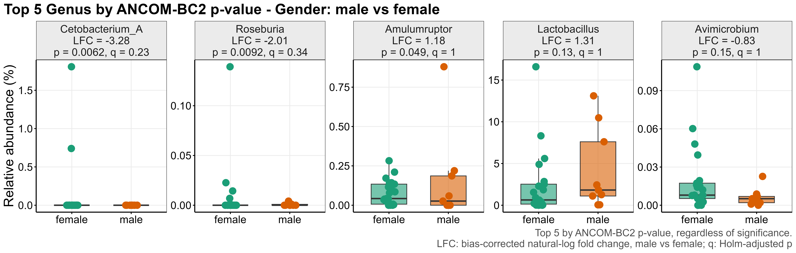
<p class="caption">
Figure 11e. Five lowest-p taxa at Genus level (ANCOM-BC2), male vs
female.
</p>

</div>

**No genus reaches q \< 0.05.** The two lowest p-values belong to rare
genera: *Cetobacterium_A* (LFC -3.28, q = 0.2347; present in 5 of 21
female and 1 of 9 male samples) and *Roseburia* (LFC -2.01, q = 0.3398;
5 of 21 female and 3 of 9 male). Their boxplots show that a few female
samples carry them.

#### Species

<table>
<caption>
Table 14f. ANCOM-BC2, Species, male vs female (57 taxa; ten lowest p).
Present = samples with reads, female/male.
</caption>
<thead>
<tr>
<th align="center">
Taxon
</th>
<th align="center">
female %
</th>
<th align="center">
male %
</th>
<th align="center">
Present
</th>
<th align="center">
LFC
</th>
<th align="center">
p
</th>
<th align="center">
q
</th>
<th align="center">
Wilcoxon p
</th>
<th align="center">
Robust
</th>
<th align="center">
Fit
</th>
</tr>
</thead>
<tbody>
<tr>
<td align="center">
Cetobacterium_A sp934085975
</td>
<td align="center">
0.1333
</td>
<td align="center">
0.0001
</td>
<td align="center">
5/1
</td>
<td align="center">
-3.28
</td>
<td align="center">
0.0050
</td>
<td align="center">
0.2828
</td>
<td align="center">
0.3646
</td>
<td align="center">
no
</td>
<td align="center">
primary
</td>
</tr>
<tr>
<td align="center">
Dubosiella sp910585105
</td>
<td align="center">
0.0254
</td>
<td align="center">
0.0520
</td>
<td align="center">
17/8
</td>
<td align="center">
0.96
</td>
<td align="center">
0.0386
</td>
<td align="center">
1.0000
</td>
<td align="center">
0.1467
</td>
<td align="center">
no
</td>
<td align="center">
primary
</td>
</tr>
<tr>
<td align="center">
Amulumruptor sp900539915
</td>
<td align="center">
0.0571
</td>
<td align="center">
0.0975
</td>
<td align="center">
18/5
</td>
<td align="center">
1.06
</td>
<td align="center">
0.0546
</td>
<td align="center">
1.0000
</td>
<td align="center">
0.5538
</td>
<td align="center">
no
</td>
<td align="center">
primary
</td>
</tr>
<tr>
<td align="center">
Bifidobacterium pullorum_B
</td>
<td align="center">
0.0029
</td>
<td align="center">
0.0126
</td>
<td align="center">
14/7
</td>
<td align="center">
1.14
</td>
<td align="center">
0.0809
</td>
<td align="center">
1.0000
</td>
<td align="center">
0.1990
</td>
<td align="center">
no
</td>
<td align="center">
primary
</td>
</tr>
<tr>
<td align="center">
Bifidobacterium animalis_B
</td>
<td align="center">
0.0551
</td>
<td align="center">
0.0667
</td>
<td align="center">
19/7
</td>
<td align="center">
0.69
</td>
<td align="center">
0.0961
</td>
<td align="center">
1.0000
</td>
<td align="center">
0.6505
</td>
<td align="center">
no
</td>
<td align="center">
primary
</td>
</tr>
<tr>
<td align="center">
Lactobacillus acidophilus
</td>
<td align="center">
3.0681
</td>
<td align="center">
5.2649
</td>
<td align="center">
21/9
</td>
<td align="center">
1.33
</td>
<td align="center">
0.1105
</td>
<td align="center">
1.0000
</td>
<td align="center">
0.2579
</td>
<td align="center">
no
</td>
<td align="center">
primary
</td>
</tr>
<tr>
<td align="center">
Avimicrobium sp934845495
</td>
<td align="center">
0.0231
</td>
<td align="center">
0.0074
</td>
<td align="center">
18/8
</td>
<td align="center">
-0.83
</td>
<td align="center">
0.1217
</td>
<td align="center">
1.0000
</td>
<td align="center">
0.0665
</td>
<td align="center">
no
</td>
<td align="center">
primary
</td>
</tr>
<tr>
<td align="center">
Ligilactobacillus animalis
</td>
<td align="center">
0.1417
</td>
<td align="center">
0.1045
</td>
<td align="center">
16/8
</td>
<td align="center">
1.34
</td>
<td align="center">
0.1873
</td>
<td align="center">
1.0000
</td>
<td align="center">
0.1802
</td>
<td align="center">
no
</td>
<td align="center">
primary
</td>
</tr>
<tr>
<td align="center">
Faecousia sp937890525
</td>
<td align="center">
0.2791
</td>
<td align="center">
0.0782
</td>
<td align="center">
21/8
</td>
<td align="center">
-0.73
</td>
<td align="center">
0.2028
</td>
<td align="center">
1.0000
</td>
<td align="center">
0.0374
</td>
<td align="center">
no
</td>
<td align="center">
primary
</td>
</tr>
<tr>
<td align="center">
Faecousia sp963560135
</td>
<td align="center">
0.5445
</td>
<td align="center">
0.1734
</td>
<td align="center">
21/8
</td>
<td align="center">
-0.80
</td>
<td align="center">
0.2167
</td>
<td align="center">
1.0000
</td>
<td align="center">
0.0266
</td>
<td align="center">
no
</td>
<td align="center">
primary
</td>
</tr>
</tbody>
</table>

<div class="figure" style="text-align: center">

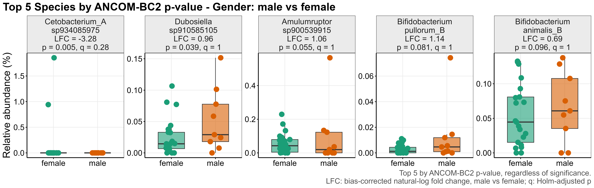
<p class="caption">
Figure 11f. Five lowest-p taxa at Species level (ANCOM-BC2), male vs
female.
</p>

</div>

**No species reaches q \< 0.05.** *Cetobacterium_A* sp934085975 (LFC
-3.28, q = 0.2828) repeats the genus result, and the other top species
are below 0.1% in both groups.

**gender overall.** No taxon differs between female and male at any
level. The lowest p-values come from rare taxa carried by a few samples,
and the abundant taxa (Bacillota_I, *Allobaculum*, *Collinsella*) have
nearly equal means. This agrees with PERMANOVA (Section 9.1) and the
PCoA (Figure 10a).

## 10.2 fecal_color: Abnormally Dark vs Normal

``` r
ps_ab <- ps |>
  ps_filter(fecal_color %in% c("Normal", "Abnormally Dark")) |>                       # only the two groups compared
  ps_mutate(fecal_color = factor(fecal_color, levels = c("Normal", "Abnormally Dark")))      # Normal = reference
res <- ANCOMBC::ancombc2(data = ps_ab, tax_level = "Genus", fix_formula = "fecal_color",
                         p_adj_method = "holm", prv_cut = 0.10, pseudo_sens = TRUE)
res$res   # lfc_, p_, q_ and passed_ss_ columns: Abnormally Dark vs Normal
# script: run_ancombc2_safe(ps_genus, "Genus", contrasts$fecal_color, bias_ps = ps)
```

<table>
<caption>
Table 15. ANCOM-BC2 summary per level, Abnormally Dark vs Normal
(results/gtdbtk/ancombc2_results_by_level_fecal_color.xlsx, sheet
‘Summary’)
</caption>
<thead>
<tr>
<th align="center">
Level
</th>
<th align="center">
Tested
</th>
<th align="center">
Pseudo-count fit
</th>
<th align="center">
Wilcoxon p \< 0.05
</th>
<th align="center">
q \< 0.05
</th>
<th align="center">
Robust
</th>
<th align="center">
Higher in Abnormally Dark
</th>
<th align="center">
Higher in Normal
</th>
</tr>
</thead>
<tbody>
<tr>
<td align="center">
Phylum
</td>
<td align="center">
5
</td>
<td align="center">
0
</td>
<td align="center">
4
</td>
<td align="center">
2
</td>
<td align="center">
0
</td>
<td align="center">
0
</td>
<td align="center">
0
</td>
</tr>
<tr>
<td align="center">
Class
</td>
<td align="center">
8
</td>
<td align="center">
0
</td>
<td align="center">
6
</td>
<td align="center">
0
</td>
<td align="center">
0
</td>
<td align="center">
0
</td>
<td align="center">
0
</td>
</tr>
<tr>
<td align="center">
Order
</td>
<td align="center">
11
</td>
<td align="center">
0
</td>
<td align="center">
8
</td>
<td align="center">
1
</td>
<td align="center">
1
</td>
<td align="center">
1
</td>
<td align="center">
0
</td>
</tr>
<tr>
<td align="center">
Family
</td>
<td align="center">
17
</td>
<td align="center">
0
</td>
<td align="center">
12
</td>
<td align="center">
0
</td>
<td align="center">
0
</td>
<td align="center">
0
</td>
<td align="center">
0
</td>
</tr>
<tr>
<td align="center">
Genus
</td>
<td align="center">
38
</td>
<td align="center">
0
</td>
<td align="center">
21
</td>
<td align="center">
0
</td>
<td align="center">
0
</td>
<td align="center">
0
</td>
<td align="center">
0
</td>
</tr>
<tr>
<td align="center">
Species
</td>
<td align="center">
57
</td>
<td align="center">
0
</td>
<td align="center">
31
</td>
<td align="center">
0
</td>
<td align="center">
0
</td>
<td align="center">
0
</td>
<td align="center">
0
</td>
</tr>
</tbody>
</table>

All taxa at every level were tested in the primary fit (no pseudo-count
fit was needed), with the bias estimated from 496 MAGs. Many taxa have
Wilcoxon p \< 0.05, but after Holm adjustment only a few reach q \< 0.05
and only one is robust (Table 15).

#### Phylum

<table>
<caption>
Table 16a. ANCOM-BC2, Phylum, Abnormally Dark vs Normal (5 taxa; ten
lowest p). Present = samples with reads, Normal/Abnormally Dark.
</caption>
<thead>
<tr>
<th align="center">
Taxon
</th>
<th align="center">
Normal %
</th>
<th align="center">
Abnormally Dark %
</th>
<th align="center">
Present
</th>
<th align="center">
LFC
</th>
<th align="center">
p
</th>
<th align="center">
q
</th>
<th align="center">
Wilcoxon p
</th>
<th align="center">
Robust
</th>
<th align="center">
Fit
</th>
</tr>
</thead>
<tbody>
<tr>
<td align="center">
Bacillota_I
</td>
<td align="center">
68.2816
</td>
<td align="center">
36.1833
</td>
<td align="center">
16/14
</td>
<td align="center">
-0.96
</td>
<td align="center">
0.0083
</td>
<td align="center">
0.0416
</td>
<td align="center">
0.0106
</td>
<td align="center">
no
</td>
<td align="center">
primary
</td>
</tr>
<tr>
<td align="center">
Fusobacteriota
</td>
<td align="center">
0.0669
</td>
<td align="center">
0.3567
</td>
<td align="center">
13/13
</td>
<td align="center">
1.58
</td>
<td align="center">
0.0120
</td>
<td align="center">
0.0478
</td>
<td align="center">
0.0177
</td>
<td align="center">
no
</td>
<td align="center">
primary
</td>
</tr>
<tr>
<td align="center">
Bacillota
</td>
<td align="center">
18.7833
</td>
<td align="center">
44.8077
</td>
<td align="center">
16/14
</td>
<td align="center">
0.89
</td>
<td align="center">
0.0289
</td>
<td align="center">
0.0867
</td>
<td align="center">
0.0094
</td>
<td align="center">
no
</td>
<td align="center">
primary
</td>
</tr>
<tr>
<td align="center">
Actinomycetota
</td>
<td align="center">
12.7614
</td>
<td align="center">
18.5726
</td>
<td align="center">
16/14
</td>
<td align="center">
0.44
</td>
<td align="center">
0.2099
</td>
<td align="center">
0.4198
</td>
<td align="center">
0.0483
</td>
<td align="center">
no
</td>
<td align="center">
primary
</td>
</tr>
<tr>
<td align="center">
Bacteroidota
</td>
<td align="center">
0.1067
</td>
<td align="center">
0.0796
</td>
<td align="center">
14/13
</td>
<td align="center">
0.04
</td>
<td align="center">
0.9404
</td>
<td align="center">
0.9404
</td>
<td align="center">
0.8843
</td>
<td align="center">
no
</td>
<td align="center">
primary
</td>
</tr>
</tbody>
</table>

<div class="figure" style="text-align: center">

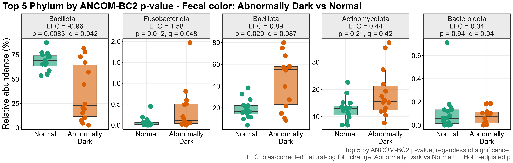
<p class="caption">
Figure 12a. Five lowest-p taxa at Phylum level (ANCOM-BC2), Abnormally
Dark vs Normal.
</p>

</div>

- **Bacillota_I** is lower in Abnormally Dark (LFC -0.96, q = 0.0416)
  and **Fusobacteriota** higher (LFC 1.58, q = 0.0478). Both reach q \<
  0.05 but fail the sensitivity analysis, so neither is robust.
- **Bacillota** is higher in Abnormally Dark (LFC 0.89, q = 0.0867) but
  does not reach q \< 0.05.

#### Class

<table>
<caption>
Table 16b. ANCOM-BC2, Class, Abnormally Dark vs Normal (8 taxa; ten
lowest p). Present = samples with reads, Normal/Abnormally Dark.
</caption>
<thead>
<tr>
<th align="center">
Taxon
</th>
<th align="center">
Normal %
</th>
<th align="center">
Abnormally Dark %
</th>
<th align="center">
Present
</th>
<th align="center">
LFC
</th>
<th align="center">
p
</th>
<th align="center">
q
</th>
<th align="center">
Wilcoxon p
</th>
<th align="center">
Robust
</th>
<th align="center">
Fit
</th>
</tr>
</thead>
<tbody>
<tr>
<td align="center">
Peptococcia
</td>
<td align="center">
3.2109
</td>
<td align="center">
11.6459
</td>
<td align="center">
16/14
</td>
<td align="center">
1.48
</td>
<td align="center">
0.0099
</td>
<td align="center">
0.0792
</td>
<td align="center">
0.0050
</td>
<td align="center">
no
</td>
<td align="center">
primary
</td>
</tr>
<tr>
<td align="center">
Bacilli_A
</td>
<td align="center">
68.2816
</td>
<td align="center">
36.1833
</td>
<td align="center">
16/14
</td>
<td align="center">
-0.96
</td>
<td align="center">
0.0128
</td>
<td align="center">
0.0895
</td>
<td align="center">
0.0106
</td>
<td align="center">
no
</td>
<td align="center">
primary
</td>
</tr>
<tr>
<td align="center">
Fusobacteriia
</td>
<td align="center">
0.0669
</td>
<td align="center">
0.3567
</td>
<td align="center">
13/13
</td>
<td align="center">
1.58
</td>
<td align="center">
0.0138
</td>
<td align="center">
0.0895
</td>
<td align="center">
0.0177
</td>
<td align="center">
no
</td>
<td align="center">
primary
</td>
</tr>
<tr>
<td align="center">
Actinomycetes
</td>
<td align="center">
6.5426
</td>
<td align="center">
3.5509
</td>
<td align="center">
16/14
</td>
<td align="center">
-1.31
</td>
<td align="center">
0.0169
</td>
<td align="center">
0.0895
</td>
<td align="center">
0.0358
</td>
<td align="center">
no
</td>
<td align="center">
primary
</td>
</tr>
<tr>
<td align="center">
Clostridia
</td>
<td align="center">
11.7512
</td>
<td align="center">
31.1384
</td>
<td align="center">
16/14
</td>
<td align="center">
0.94
</td>
<td align="center">
0.0386
</td>
<td align="center">
0.1546
</td>
<td align="center">
0.0106
</td>
<td align="center">
no
</td>
<td align="center">
primary
</td>
</tr>
<tr>
<td align="center">
Coriobacteriia
</td>
<td align="center">
6.2189
</td>
<td align="center">
15.0217
</td>
<td align="center">
16/14
</td>
<td align="center">
0.79
</td>
<td align="center">
0.0728
</td>
<td align="center">
0.2184
</td>
<td align="center">
0.0235
</td>
<td align="center">
no
</td>
<td align="center">
primary
</td>
</tr>
<tr>
<td align="center">
Bacilli
</td>
<td align="center">
3.8212
</td>
<td align="center">
2.0235
</td>
<td align="center">
16/14
</td>
<td align="center">
-0.76
</td>
<td align="center">
0.2782
</td>
<td align="center">
0.5564
</td>
<td align="center">
0.4176
</td>
<td align="center">
no
</td>
<td align="center">
primary
</td>
</tr>
<tr>
<td align="center">
Bacteroidia
</td>
<td align="center">
0.1067
</td>
<td align="center">
0.0796
</td>
<td align="center">
14/13
</td>
<td align="center">
0.04
</td>
<td align="center">
0.9419
</td>
<td align="center">
0.9419
</td>
<td align="center">
0.8843
</td>
<td align="center">
no
</td>
<td align="center">
primary
</td>
</tr>
</tbody>
</table>

<div class="figure" style="text-align: center">

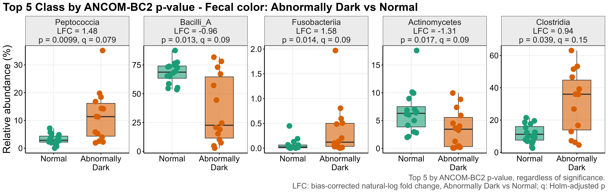
<p class="caption">
Figure 12b. Five lowest-p taxa at Class level (ANCOM-BC2), Abnormally
Dark vs Normal.
</p>

</div>

**No class reaches q \< 0.05.** The lowest p-values are Peptococcia (LFC
1.48, q = 0.0792) and Bacilli_A (LFC -0.96, q = 0.0895), the classes of
UMGS1590 and *Allobaculum*.

#### Order

<table>
<caption>
Table 16c. ANCOM-BC2, Order, Abnormally Dark vs Normal (11 taxa; ten
lowest p). Present = samples with reads, Normal/Abnormally Dark.
</caption>
<thead>
<tr>
<th align="center">
Taxon
</th>
<th align="center">
Normal %
</th>
<th align="center">
Abnormally Dark %
</th>
<th align="center">
Present
</th>
<th align="center">
LFC
</th>
<th align="center">
p
</th>
<th align="center">
q
</th>
<th align="center">
Wilcoxon p
</th>
<th align="center">
Robust
</th>
<th align="center">
Fit
</th>
</tr>
</thead>
<tbody>
<tr>
<td align="center">
Oscillospirales
</td>
<td align="center">
0.8211
</td>
<td align="center">
3.9021
</td>
<td align="center">
16/14
</td>
<td align="center">
1.61
</td>
<td align="center">
0.0028
</td>
<td align="center">
0.0311
</td>
<td align="center">
0.0013
</td>
<td align="center">
yes
</td>
<td align="center">
primary
</td>
</tr>
<tr>
<td align="center">
Peptococcales
</td>
<td align="center">
3.2109
</td>
<td align="center">
11.6459
</td>
<td align="center">
16/14
</td>
<td align="center">
1.48
</td>
<td align="center">
0.0108
</td>
<td align="center">
0.1076
</td>
<td align="center">
0.0050
</td>
<td align="center">
no
</td>
<td align="center">
primary
</td>
</tr>
<tr>
<td align="center">
Fusobacteriales
</td>
<td align="center">
0.0669
</td>
<td align="center">
0.3567
</td>
<td align="center">
13/13
</td>
<td align="center">
1.58
</td>
<td align="center">
0.0147
</td>
<td align="center">
0.1319
</td>
<td align="center">
0.0177
</td>
<td align="center">
no
</td>
<td align="center">
primary
</td>
</tr>
<tr>
<td align="center">
Erysipelotrichales
</td>
<td align="center">
68.1769
</td>
<td align="center">
36.0707
</td>
<td align="center">
16/14
</td>
<td align="center">
-0.96
</td>
<td align="center">
0.0148
</td>
<td align="center">
0.1319
</td>
<td align="center">
0.0106
</td>
<td align="center">
no
</td>
<td align="center">
primary
</td>
</tr>
<tr>
<td align="center">
Peptostreptococcales
</td>
<td align="center">
1.5325
</td>
<td align="center">
4.4757
</td>
<td align="center">
16/14
</td>
<td align="center">
1.43
</td>
<td align="center">
0.0183
</td>
<td align="center">
0.1319
</td>
<td align="center">
0.0094
</td>
<td align="center">
no
</td>
<td align="center">
primary
</td>
</tr>
<tr>
<td align="center">
Actinomycetales
</td>
<td align="center">
6.5426
</td>
<td align="center">
3.5509
</td>
<td align="center">
16/14
</td>
<td align="center">
-1.31
</td>
<td align="center">
0.0183
</td>
<td align="center">
0.1319
</td>
<td align="center">
0.0358
</td>
<td align="center">
no
</td>
<td align="center">
primary
</td>
</tr>
<tr>
<td align="center">
Coriobacteriales
</td>
<td align="center">
6.2189
</td>
<td align="center">
15.0217
</td>
<td align="center">
16/14
</td>
<td align="center">
0.79
</td>
<td align="center">
0.0784
</td>
<td align="center">
0.3920
</td>
<td align="center">
0.0235
</td>
<td align="center">
no
</td>
<td align="center">
primary
</td>
</tr>
<tr>
<td align="center">
Lachnospirales
</td>
<td align="center">
9.3976
</td>
<td align="center">
22.7606
</td>
<td align="center">
16/14
</td>
<td align="center">
0.82
</td>
<td align="center">
0.0836
</td>
<td align="center">
0.3920
</td>
<td align="center">
0.0235
</td>
<td align="center">
no
</td>
<td align="center">
primary
</td>
</tr>
<tr>
<td align="center">
Lactobacillales
</td>
<td align="center">
3.8212
</td>
<td align="center">
2.0235
</td>
<td align="center">
16/14
</td>
<td align="center">
-0.76
</td>
<td align="center">
0.2819
</td>
<td align="center">
0.8457
</td>
<td align="center">
0.4176
</td>
<td align="center">
no
</td>
<td align="center">
primary
</td>
</tr>
<tr>
<td align="center">
MOL361
</td>
<td align="center">
0.1048
</td>
<td align="center">
0.1127
</td>
<td align="center">
16/13
</td>
<td align="center">
-0.31
</td>
<td align="center">
0.5630
</td>
<td align="center">
1.0000
</td>
<td align="center">
0.2891
</td>
<td align="center">
no
</td>
<td align="center">
primary
</td>
</tr>
</tbody>
</table>

<div class="figure" style="text-align: center">

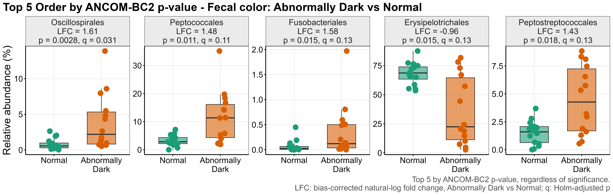
<p class="caption">
Figure 12c. Five lowest-p taxa at Order level (ANCOM-BC2), Abnormally
Dark vs Normal.
</p>

</div>

- **Oscillospirales is robustly higher in Abnormally Dark** (LFC 1.61, q
  = 0.0311); it is the only robust result for fecal_color.
- Erysipelotrichales, the order of *Allobaculum*, falls from about 68%
  to 36% (Section 7.2) but is not significant (LFC -0.96, q = 0.1319).

#### Family

<table>
<caption>
Table 16d. ANCOM-BC2, Family, Abnormally Dark vs Normal (17 taxa; ten
lowest p). Present = samples with reads, Normal/Abnormally Dark.
</caption>
<thead>
<tr>
<th align="center">
Taxon
</th>
<th align="center">
Normal %
</th>
<th align="center">
Abnormally Dark %
</th>
<th align="center">
Present
</th>
<th align="center">
LFC
</th>
<th align="center">
p
</th>
<th align="center">
q
</th>
<th align="center">
Wilcoxon p
</th>
<th align="center">
Robust
</th>
<th align="center">
Fit
</th>
</tr>
</thead>
<tbody>
<tr>
<td align="center">
Atopobiaceae
</td>
<td align="center">
2.0663
</td>
<td align="center">
0.8006
</td>
<td align="center">
16/14
</td>
<td align="center">
-1.98
</td>
<td align="center">
0.0043
</td>
<td align="center">
0.0726
</td>
<td align="center">
0.0094
</td>
<td align="center">
no
</td>
<td align="center">
primary
</td>
</tr>
<tr>
<td align="center">
Oscillospiraceae
</td>
<td align="center">
0.1566
</td>
<td align="center">
0.7708
</td>
<td align="center">
15/14
</td>
<td align="center">
1.49
</td>
<td align="center">
0.0054
</td>
<td align="center">
0.0871
</td>
<td align="center">
0.0011
</td>
<td align="center">
no
</td>
<td align="center">
primary
</td>
</tr>
<tr>
<td align="center">
Ruminococcaceae
</td>
<td align="center">
0.6645
</td>
<td align="center">
3.1314
</td>
<td align="center">
16/14
</td>
<td align="center">
1.64
</td>
<td align="center">
0.0064
</td>
<td align="center">
0.0965
</td>
<td align="center">
0.0057
</td>
<td align="center">
no
</td>
<td align="center">
primary
</td>
</tr>
<tr>
<td align="center">
Eggerthellaceae
</td>
<td align="center">
0.1212
</td>
<td align="center">
0.0511
</td>
<td align="center">
16/11
</td>
<td align="center">
-1.33
</td>
<td align="center">
0.0106
</td>
<td align="center">
0.1481
</td>
<td align="center">
0.0057
</td>
<td align="center">
no
</td>
<td align="center">
primary
</td>
</tr>
<tr>
<td align="center">
Peptococcaceae
</td>
<td align="center">
3.2109
</td>
<td align="center">
11.6459
</td>
<td align="center">
16/14
</td>
<td align="center">
1.48
</td>
<td align="center">
0.0143
</td>
<td align="center">
0.1861
</td>
<td align="center">
0.0050
</td>
<td align="center">
no
</td>
<td align="center">
primary
</td>
</tr>
<tr>
<td align="center">
Fusobacteriaceae
</td>
<td align="center">
0.0669
</td>
<td align="center">
0.3567
</td>
<td align="center">
13/13
</td>
<td align="center">
1.58
</td>
<td align="center">
0.0182
</td>
<td align="center">
0.2184
</td>
<td align="center">
0.0177
</td>
<td align="center">
no
</td>
<td align="center">
primary
</td>
</tr>
<tr>
<td align="center">
Peptostreptococcaceae
</td>
<td align="center">
1.1600
</td>
<td align="center">
3.6200
</td>
<td align="center">
16/14
</td>
<td align="center">
1.51
</td>
<td align="center">
0.0194
</td>
<td align="center">
0.2184
</td>
<td align="center">
0.0073
</td>
<td align="center">
no
</td>
<td align="center">
primary
</td>
</tr>
<tr>
<td align="center">
Bifidobacteriaceae
</td>
<td align="center">
6.5426
</td>
<td align="center">
3.5509
</td>
<td align="center">
16/14
</td>
<td align="center">
-1.31
</td>
<td align="center">
0.0239
</td>
<td align="center">
0.2390
</td>
<td align="center">
0.0358
</td>
<td align="center">
no
</td>
<td align="center">
primary
</td>
</tr>
<tr>
<td align="center">
Erysipelotrichaceae
</td>
<td align="center">
68.1769
</td>
<td align="center">
36.0707
</td>
<td align="center">
16/14
</td>
<td align="center">
-0.96
</td>
<td align="center">
0.0250
</td>
<td align="center">
0.2390
</td>
<td align="center">
0.0106
</td>
<td align="center">
no
</td>
<td align="center">
primary
</td>
</tr>
<tr>
<td align="center">
Anaerovoracaceae
</td>
<td align="center">
0.3725
</td>
<td align="center">
0.8557
</td>
<td align="center">
16/14
</td>
<td align="center">
1.27
</td>
<td align="center">
0.0403
</td>
<td align="center">
0.3221
</td>
<td align="center">
0.0643
</td>
<td align="center">
no
</td>
<td align="center">
primary
</td>
</tr>
</tbody>
</table>

<div class="figure" style="text-align: center">

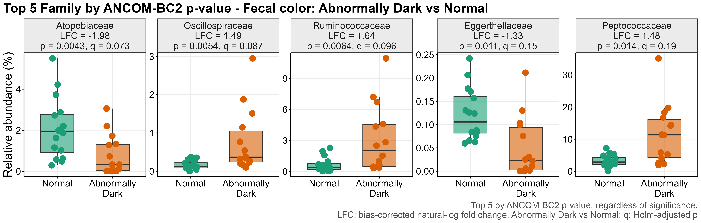
<p class="caption">
Figure 12d. Five lowest-p taxa at Family level (ANCOM-BC2), Abnormally
Dark vs Normal.
</p>

</div>

**No family reaches q \< 0.05.** Atopobiaceae is lower in Abnormally
Dark (LFC -1.98, q = 0.0726); Oscillospiraceae (LFC 1.49, q = 0.0871)
and Ruminococcaceae (LFC 1.64, q = 0.0965), the two families of
Oscillospirales, are higher.

#### Genus

<table>
<caption>
Table 16e. ANCOM-BC2, Genus, Abnormally Dark vs Normal (38 taxa; ten
lowest p). Present = samples with reads, Normal/Abnormally Dark.
</caption>
<thead>
<tr>
<th align="center">
Taxon
</th>
<th align="center">
Normal %
</th>
<th align="center">
Abnormally Dark %
</th>
<th align="center">
Present
</th>
<th align="center">
LFC
</th>
<th align="center">
p
</th>
<th align="center">
q
</th>
<th align="center">
Wilcoxon p
</th>
<th align="center">
Robust
</th>
<th align="center">
Fit
</th>
</tr>
</thead>
<tbody>
<tr>
<td align="center">
Alitiscatomonas
</td>
<td align="center">
0.0127
</td>
<td align="center">
0.1246
</td>
<td align="center">
13/14
</td>
<td align="center">
2.18
</td>
<td align="center">
0.0017
</td>
<td align="center">
0.0628
</td>
<td align="center">
0.0005
</td>
<td align="center">
no
</td>
<td align="center">
primary
</td>
</tr>
<tr>
<td align="center">
Dubosiella
</td>
<td align="center">
3.2147
</td>
<td align="center">
0.9484
</td>
<td align="center">
16/14
</td>
<td align="center">
-1.97
</td>
<td align="center">
0.0020
</td>
<td align="center">
0.0735
</td>
<td align="center">
0.0003
</td>
<td align="center">
no
</td>
<td align="center">
primary
</td>
</tr>
<tr>
<td align="center">
Negativibacillus
</td>
<td align="center">
0.0701
</td>
<td align="center">
0.3575
</td>
<td align="center">
13/14
</td>
<td align="center">
2.21
</td>
<td align="center">
0.0027
</td>
<td align="center">
0.0980
</td>
<td align="center">
0.0011
</td>
<td align="center">
no
</td>
<td align="center">
primary
</td>
</tr>
<tr>
<td align="center">
Faecousia
</td>
<td align="center">
0.2147
</td>
<td align="center">
0.8730
</td>
<td align="center">
15/14
</td>
<td align="center">
1.49
</td>
<td align="center">
0.0059
</td>
<td align="center">
0.2061
</td>
<td align="center">
0.0020
</td>
<td align="center">
no
</td>
<td align="center">
primary
</td>
</tr>
<tr>
<td align="center">
Roseburia
</td>
<td align="center">
0.0006
</td>
<td align="center">
0.0129
</td>
<td align="center">
3/5
</td>
<td align="center">
2.13
</td>
<td align="center">
0.0060
</td>
<td align="center">
0.2061
</td>
<td align="center">
0.2401
</td>
<td align="center">
no
</td>
<td align="center">
primary
</td>
</tr>
<tr>
<td align="center">
Faecalibacterium
</td>
<td align="center">
0.8311
</td>
<td align="center">
3.0468
</td>
<td align="center">
16/14
</td>
<td align="center">
1.62
</td>
<td align="center">
0.0088
</td>
<td align="center">
0.2897
</td>
<td align="center">
0.0083
</td>
<td align="center">
no
</td>
<td align="center">
primary
</td>
</tr>
<tr>
<td align="center">
Granulimonas
</td>
<td align="center">
0.2906
</td>
<td align="center">
0.1216
</td>
<td align="center">
16/13
</td>
<td align="center">
-1.84
</td>
<td align="center">
0.0097
</td>
<td align="center">
0.3096
</td>
<td align="center">
0.0083
</td>
<td align="center">
no
</td>
<td align="center">
primary
</td>
</tr>
<tr>
<td align="center">
Adlercreutzia
</td>
<td align="center">
0.1714
</td>
<td align="center">
0.0721
</td>
<td align="center">
16/11
</td>
<td align="center">
-1.33
</td>
<td align="center">
0.0114
</td>
<td align="center">
0.3520
</td>
<td align="center">
0.0044
</td>
<td align="center">
no
</td>
<td align="center">
primary
</td>
</tr>
<tr>
<td align="center">
Leptogranulimonas
</td>
<td align="center">
2.2605
</td>
<td align="center">
0.8425
</td>
<td align="center">
16/14
</td>
<td align="center">
-1.81
</td>
<td align="center">
0.0135
</td>
<td align="center">
0.4061
</td>
<td align="center">
0.0134
</td>
<td align="center">
no
</td>
<td align="center">
primary
</td>
</tr>
<tr>
<td align="center">
Cetobacterium_A
</td>
<td align="center">
0.0000
</td>
<td align="center">
0.1821
</td>
<td align="center">
1/5
</td>
<td align="center">
3.21
</td>
<td align="center">
0.0141
</td>
<td align="center">
0.4099
</td>
<td align="center">
0.0373
</td>
<td align="center">
no
</td>
<td align="center">
primary
</td>
</tr>
</tbody>
</table>

<div class="figure" style="text-align: center">

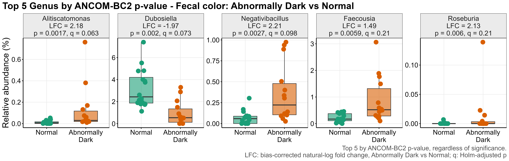
<p class="caption">
Figure 12e. Five lowest-p taxa at Genus level (ANCOM-BC2), Abnormally
Dark vs Normal.
</p>

</div>

**No genus reaches q \< 0.05.** The lowest p-values are
*Alitiscatomonas* (LFC 2.18, q = 0.0628; fails the sensitivity
analysis), *Dubosiella* (LFC -1.97, q = 0.0735) and *Negativibacillus*
(LFC 2.21, q = 0.0980; fails the sensitivity analysis). *Roseburia* is
in the top 5 only because of one sample (0.14%); it is present in 3 of
16 Normal and 5 of 14 Abnormally Dark samples.

#### Species

<table>
<caption>
Table 16f. ANCOM-BC2, Species, Abnormally Dark vs Normal (57 taxa; ten
lowest p). Present = samples with reads, Normal/Abnormally Dark.
</caption>
<thead>
<tr>
<th align="center">
Taxon
</th>
<th align="center">
Normal %
</th>
<th align="center">
Abnormally Dark %
</th>
<th align="center">
Present
</th>
<th align="center">
LFC
</th>
<th align="center">
p
</th>
<th align="center">
q
</th>
<th align="center">
Wilcoxon p
</th>
<th align="center">
Robust
</th>
<th align="center">
Fit
</th>
</tr>
</thead>
<tbody>
<tr>
<td align="center">
Alitiscatomonas aceti
</td>
<td align="center">
0.0182
</td>
<td align="center">
0.1396
</td>
<td align="center">
13/14
</td>
<td align="center">
2.18
</td>
<td align="center">
0.0011
</td>
<td align="center">
0.0636
</td>
<td align="center">
0.0008
</td>
<td align="center">
no
</td>
<td align="center">
primary
</td>
</tr>
<tr>
<td align="center">
Dubosiella newyorkensis
</td>
<td align="center">
4.5069
</td>
<td align="center">
1.3602
</td>
<td align="center">
16/14
</td>
<td align="center">
-1.98
</td>
<td align="center">
0.0013
</td>
<td align="center">
0.0721
</td>
<td align="center">
0.0006
</td>
<td align="center">
no
</td>
<td align="center">
primary
</td>
</tr>
<tr>
<td align="center">
Faecalimonas sp900551895
</td>
<td align="center">
0.0064
</td>
<td align="center">
0.1544
</td>
<td align="center">
16/13
</td>
<td align="center">
2.68
</td>
<td align="center">
0.0020
</td>
<td align="center">
0.1080
</td>
<td align="center">
0.0188
</td>
<td align="center">
no
</td>
<td align="center">
primary
</td>
</tr>
<tr>
<td align="center">
Negativibacillus sp000435195
</td>
<td align="center">
0.0976
</td>
<td align="center">
0.4301
</td>
<td align="center">
13/14
</td>
<td align="center">
2.21
</td>
<td align="center">
0.0020
</td>
<td align="center">
0.1080
</td>
<td align="center">
0.0022
</td>
<td align="center">
no
</td>
<td align="center">
primary
</td>
</tr>
<tr>
<td align="center">
Allobaculum sp910577085
</td>
<td align="center">
5.2198
</td>
<td align="center">
1.7064
</td>
<td align="center">
16/14
</td>
<td align="center">
-1.93
</td>
<td align="center">
0.0021
</td>
<td align="center">
0.1120
</td>
<td align="center">
0.0030
</td>
<td align="center">
no
</td>
<td align="center">
primary
</td>
</tr>
<tr>
<td align="center">
Faecalibaculum rodentium
</td>
<td align="center">
5.0401
</td>
<td align="center">
1.8683
</td>
<td align="center">
16/14
</td>
<td align="center">
-1.70
</td>
<td align="center">
0.0028
</td>
<td align="center">
0.1469
</td>
<td align="center">
0.0015
</td>
<td align="center">
no
</td>
<td align="center">
primary
</td>
</tr>
<tr>
<td align="center">
Faecousia sp963560135
</td>
<td align="center">
0.1848
</td>
<td align="center">
0.7171
</td>
<td align="center">
15/14
</td>
<td align="center">
1.52
</td>
<td align="center">
0.0039
</td>
<td align="center">
0.1967
</td>
<td align="center">
0.0094
</td>
<td align="center">
no
</td>
<td align="center">
primary
</td>
</tr>
<tr>
<td align="center">
Allobaculum mucilyticum
</td>
<td align="center">
25.8838
</td>
<td align="center">
12.0278
</td>
<td align="center">
16/14
</td>
<td align="center">
-1.57
</td>
<td align="center">
0.0058
</td>
<td align="center">
0.2885
</td>
<td align="center">
0.0150
</td>
<td align="center">
no
</td>
<td align="center">
primary
</td>
</tr>
<tr>
<td align="center">
Faecalibacterium sp937880095
</td>
<td align="center">
0.0013
</td>
<td align="center">
0.0238
</td>
<td align="center">
2/6
</td>
<td align="center">
1.86
</td>
<td align="center">
0.0062
</td>
<td align="center">
0.3039
</td>
<td align="center">
0.0580
</td>
<td align="center">
no
</td>
<td align="center">
primary
</td>
</tr>
<tr>
<td align="center">
Faecalibacterium sp900540455
</td>
<td align="center">
1.1513
</td>
<td align="center">
3.4535
</td>
<td align="center">
16/14
</td>
<td align="center">
1.62
</td>
<td align="center">
0.0062
</td>
<td align="center">
0.3039
</td>
<td align="center">
0.0119
</td>
<td align="center">
no
</td>
<td align="center">
primary
</td>
</tr>
</tbody>
</table>

<div class="figure" style="text-align: center">

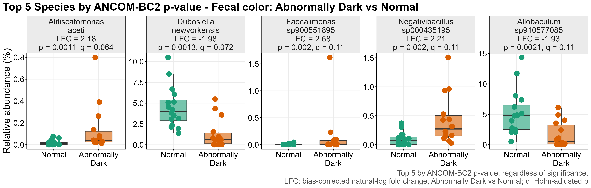
<p class="caption">
Figure 12f. Five lowest-p taxa at Species level (ANCOM-BC2), Abnormally
Dark vs Normal.
</p>

</div>

**No species reaches q \< 0.05.** *Alitiscatomonas aceti* (LFC 2.18, q =
0.0636) and *Dubosiella newyorkensis* (LFC -1.98, q = 0.0721) repeat the
genus results, and *Allobaculum* sp910577085 is lower in Abnormally Dark
(LFC -1.93, q = 0.1120).

**fecal_color overall.** Apart from Oscillospirales, no taxon is
robustly different, although Section 7.2 showed large differences in
group means (for example, *Allobaculum* 40% vs 19%). Those differences
come from 8 of the 14 Abnormally Dark samples, all of them Unpleasant
(Section 7.3), while the other Abnormally Dark samples resemble Normal
ones; this spread within the group, visible in every boxplot, weakens a
two-group test. The direction of the near-significant results
(Bacillota_I, Erysipelotrichales and *Dubosiella* lower; Peptococcia,
Oscillospirales and several Lachnospiraceae and Ruminococcaceae genera
higher in Abnormally Dark) agrees with Sections 7–9.

## 10.3 fecal_odor

fecal_odor has three levels, so ANCOM-BC2 is run for each pair of
groups, using only the samples of those two groups.

### 10.3.1 Moderately Unpleasant vs Normal

``` r
ps_ab <- ps |>
  ps_filter(fecal_odor %in% c("Normal", "Moderately Unpleasant")) |>                       # only the two groups compared
  ps_mutate(fecal_odor = factor(fecal_odor, levels = c("Normal", "Moderately Unpleasant")))      # Normal = reference
res <- ANCOMBC::ancombc2(data = ps_ab, tax_level = "Genus", fix_formula = "fecal_odor",
                         p_adj_method = "holm", prv_cut = 0.10, pseudo_sens = TRUE)
res$res   # lfc_, p_, q_ and passed_ss_ columns: Moderately Unpleasant vs Normal
# script: run_ancombc2_safe(ps_genus, "Genus", contrasts$fecal_odor__Moderately_Unpleasant_vs_Normal, bias_ps = ps)
```

<table>
<caption>
Table 17. ANCOM-BC2 summary per level, Moderately Unpleasant vs Normal
(results/gtdbtk/ancombc2_results_by_level_fecal_odor_Moderately_Unpleasant_vs_Normal.xlsx,
sheet ‘Summary’)
</caption>
<thead>
<tr>
<th align="center">
Level
</th>
<th align="center">
Tested
</th>
<th align="center">
Pseudo-count fit
</th>
<th align="center">
Wilcoxon p \< 0.05
</th>
<th align="center">
q \< 0.05
</th>
<th align="center">
Robust
</th>
<th align="center">
Higher in Moderately Unpleasant
</th>
<th align="center">
Higher in Normal
</th>
</tr>
</thead>
<tbody>
<tr>
<td align="center">
Phylum
</td>
<td align="center">
5
</td>
<td align="center">
0
</td>
<td align="center">
0
</td>
<td align="center">
0
</td>
<td align="center">
0
</td>
<td align="center">
0
</td>
<td align="center">
0
</td>
</tr>
<tr>
<td align="center">
Class
</td>
<td align="center">
8
</td>
<td align="center">
0
</td>
<td align="center">
0
</td>
<td align="center">
0
</td>
<td align="center">
0
</td>
<td align="center">
0
</td>
<td align="center">
0
</td>
</tr>
<tr>
<td align="center">
Order
</td>
<td align="center">
11
</td>
<td align="center">
0
</td>
<td align="center">
1
</td>
<td align="center">
0
</td>
<td align="center">
0
</td>
<td align="center">
0
</td>
<td align="center">
0
</td>
</tr>
<tr>
<td align="center">
Family
</td>
<td align="center">
17
</td>
<td align="center">
0
</td>
<td align="center">
2
</td>
<td align="center">
0
</td>
<td align="center">
0
</td>
<td align="center">
0
</td>
<td align="center">
0
</td>
</tr>
<tr>
<td align="center">
Genus
</td>
<td align="center">
38
</td>
<td align="center">
0
</td>
<td align="center">
5
</td>
<td align="center">
1
</td>
<td align="center">
0
</td>
<td align="center">
0
</td>
<td align="center">
0
</td>
</tr>
<tr>
<td align="center">
Species
</td>
<td align="center">
57
</td>
<td align="center">
0
</td>
<td align="center">
5
</td>
<td align="center">
1
</td>
<td align="center">
0
</td>
<td align="center">
0
</td>
<td align="center">
0
</td>
</tr>
</tbody>
</table>

This comparison uses the 21 Normal and Moderately Unpleasant samples;
all taxa were tested in the primary fit, with the bias estimated from
497 MAGs. Only 2 taxa reach q \< 0.05, and **none is robust** (Table
17).

##### Phylum

<table>
<caption>
Table 18a. ANCOM-BC2, Phylum, Moderately Unpleasant vs Normal (5 taxa;
ten lowest p). Present = samples with reads, Normal/Moderately
Unpleasant.
</caption>
<thead>
<tr>
<th align="center">
Taxon
</th>
<th align="center">
Normal %
</th>
<th align="center">
Moderately Unpleasant %
</th>
<th align="center">
Present
</th>
<th align="center">
LFC
</th>
<th align="center">
p
</th>
<th align="center">
q
</th>
<th align="center">
Wilcoxon p
</th>
<th align="center">
Robust
</th>
<th align="center">
Fit
</th>
</tr>
</thead>
<tbody>
<tr>
<td align="center">
Bacteroidota
</td>
<td align="center">
0.1113
</td>
<td align="center">
0.0971
</td>
<td align="center">
12/7
</td>
<td align="center">
0.74
</td>
<td align="center">
0.1555
</td>
<td align="center">
0.7773
</td>
<td align="center">
0.5144
</td>
<td align="center">
no
</td>
<td align="center">
primary
</td>
</tr>
<tr>
<td align="center">
Actinomycetota
</td>
<td align="center">
11.6916
</td>
<td align="center">
13.8331
</td>
<td align="center">
13/8
</td>
<td align="center">
0.18
</td>
<td align="center">
0.4376
</td>
<td align="center">
1.0000
</td>
<td align="center">
0.5382
</td>
<td align="center">
no
</td>
<td align="center">
primary
</td>
</tr>
<tr>
<td align="center">
Fusobacteriota
</td>
<td align="center">
0.0764
</td>
<td align="center">
0.0984
</td>
<td align="center">
11/7
</td>
<td align="center">
0.15
</td>
<td align="center">
0.7839
</td>
<td align="center">
1.0000
</td>
<td align="center">
0.9134
</td>
<td align="center">
no
</td>
<td align="center">
primary
</td>
</tr>
<tr>
<td align="center">
Bacillota_I
</td>
<td align="center">
69.1035
</td>
<td align="center">
68.9431
</td>
<td align="center">
13/8
</td>
<td align="center">
0.03
</td>
<td align="center">
0.9062
</td>
<td align="center">
1.0000
</td>
<td align="center">
1.0000
</td>
<td align="center">
no
</td>
<td align="center">
primary
</td>
</tr>
<tr>
<td align="center">
Bacillota
</td>
<td align="center">
19.0172
</td>
<td align="center">
17.0283
</td>
<td align="center">
13/8
</td>
<td align="center">
-0.01
</td>
<td align="center">
0.9617
</td>
<td align="center">
1.0000
</td>
<td align="center">
0.5870
</td>
<td align="center">
no
</td>
<td align="center">
primary
</td>
</tr>
</tbody>
</table>

<div class="figure" style="text-align: center">

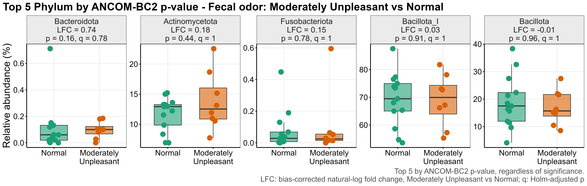
<p class="caption">
Figure 13a. Five lowest-p taxa at Phylum level (ANCOM-BC2), Moderately
Unpleasant vs Normal.
</p>

</div>

**No phylum differs** (q ≥ 0.7773). Bacillota_I has the same mean in
both groups (69.1% vs 68.9%; LFC 0.03, q = 1.0000).

##### Class

<table>
<caption>
Table 18b. ANCOM-BC2, Class, Moderately Unpleasant vs Normal (8 taxa;
ten lowest p). Present = samples with reads, Normal/Moderately
Unpleasant.
</caption>
<thead>
<tr>
<th align="center">
Taxon
</th>
<th align="center">
Normal %
</th>
<th align="center">
Moderately Unpleasant %
</th>
<th align="center">
Present
</th>
<th align="center">
LFC
</th>
<th align="center">
p
</th>
<th align="center">
q
</th>
<th align="center">
Wilcoxon p
</th>
<th align="center">
Robust
</th>
<th align="center">
Fit
</th>
</tr>
</thead>
<tbody>
<tr>
<td align="center">
Actinomycetes
</td>
<td align="center">
5.5067
</td>
<td align="center">
8.4687
</td>
<td align="center">
13/8
</td>
<td align="center">
0.49
</td>
<td align="center">
0.1141
</td>
<td align="center">
0.9128
</td>
<td align="center">
0.0888
</td>
<td align="center">
no
</td>
<td align="center">
primary
</td>
</tr>
<tr>
<td align="center">
Peptococcia
</td>
<td align="center">
2.9617
</td>
<td align="center">
3.6709
</td>
<td align="center">
13/8
</td>
<td align="center">
0.65
</td>
<td align="center">
0.1543
</td>
<td align="center">
1.0000
</td>
<td align="center">
0.4470
</td>
<td align="center">
no
</td>
<td align="center">
primary
</td>
</tr>
<tr>
<td align="center">
Bacteroidia
</td>
<td align="center">
0.1113
</td>
<td align="center">
0.0971
</td>
<td align="center">
12/7
</td>
<td align="center">
0.74
</td>
<td align="center">
0.1576
</td>
<td align="center">
1.0000
</td>
<td align="center">
0.5144
</td>
<td align="center">
no
</td>
<td align="center">
primary
</td>
</tr>
<tr>
<td align="center">
Bacilli
</td>
<td align="center">
3.9974
</td>
<td align="center">
3.5074
</td>
<td align="center">
13/8
</td>
<td align="center">
0.51
</td>
<td align="center">
0.3734
</td>
<td align="center">
1.0000
</td>
<td align="center">
0.5870
</td>
<td align="center">
no
</td>
<td align="center">
primary
</td>
</tr>
<tr>
<td align="center">
Coriobacteriia
</td>
<td align="center">
6.1849
</td>
<td align="center">
5.3643
</td>
<td align="center">
13/8
</td>
<td align="center">
-0.11
</td>
<td align="center">
0.6309
</td>
<td align="center">
1.0000
</td>
<td align="center">
0.3282
</td>
<td align="center">
no
</td>
<td align="center">
primary
</td>
</tr>
<tr>
<td align="center">
Clostridia
</td>
<td align="center">
12.0580
</td>
<td align="center">
9.8499
</td>
<td align="center">
13/8
</td>
<td align="center">
-0.10
</td>
<td align="center">
0.6932
</td>
<td align="center">
1.0000
</td>
<td align="center">
0.4915
</td>
<td align="center">
no
</td>
<td align="center">
primary
</td>
</tr>
<tr>
<td align="center">
Fusobacteriia
</td>
<td align="center">
0.0764
</td>
<td align="center">
0.0984
</td>
<td align="center">
11/7
</td>
<td align="center">
0.15
</td>
<td align="center">
0.7849
</td>
<td align="center">
1.0000
</td>
<td align="center">
0.9134
</td>
<td align="center">
no
</td>
<td align="center">
primary
</td>
</tr>
<tr>
<td align="center">
Bacilli_A
</td>
<td align="center">
69.1035
</td>
<td align="center">
68.9431
</td>
<td align="center">
13/8
</td>
<td align="center">
0.03
</td>
<td align="center">
0.9086
</td>
<td align="center">
1.0000
</td>
<td align="center">
1.0000
</td>
<td align="center">
no
</td>
<td align="center">
primary
</td>
</tr>
</tbody>
</table>

<div class="figure" style="text-align: center">

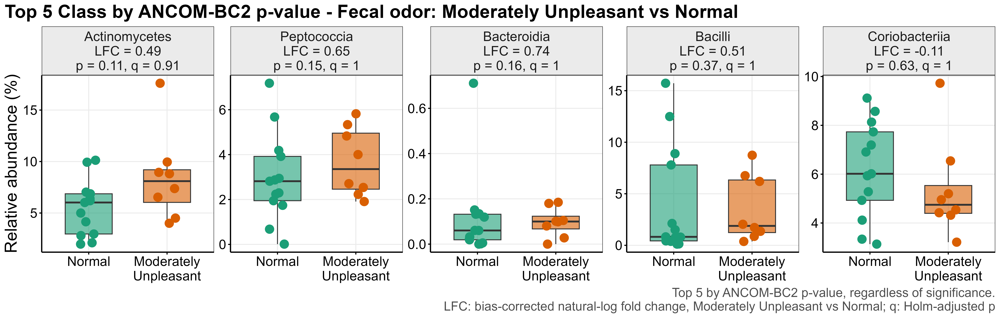
<p class="caption">
Figure 13b. Five lowest-p taxa at Class level (ANCOM-BC2), Moderately
Unpleasant vs Normal.
</p>

</div>

**No class reaches q \< 0.05.** The lowest p, Actinomycetes (LFC 0.49, q
= 0.9128), is far from significant.

##### Order

<table>
<caption>
Table 18c. ANCOM-BC2, Order, Moderately Unpleasant vs Normal (11 taxa;
ten lowest p). Present = samples with reads, Normal/Moderately
Unpleasant.
</caption>
<thead>
<tr>
<th align="center">
Taxon
</th>
<th align="center">
Normal %
</th>
<th align="center">
Moderately Unpleasant %
</th>
<th align="center">
Present
</th>
<th align="center">
LFC
</th>
<th align="center">
p
</th>
<th align="center">
q
</th>
<th align="center">
Wilcoxon p
</th>
<th align="center">
Robust
</th>
<th align="center">
Fit
</th>
</tr>
</thead>
<tbody>
<tr>
<td align="center">
Oscillospirales
</td>
<td align="center">
0.6800
</td>
<td align="center">
1.8162
</td>
<td align="center">
13/8
</td>
<td align="center">
1.13
</td>
<td align="center">
0.0074
</td>
<td align="center">
0.0814
</td>
<td align="center">
0.0125
</td>
<td align="center">
no
</td>
<td align="center">
primary
</td>
</tr>
<tr>
<td align="center">
Actinomycetales
</td>
<td align="center">
5.5067
</td>
<td align="center">
8.4687
</td>
<td align="center">
13/8
</td>
<td align="center">
0.49
</td>
<td align="center">
0.1147
</td>
<td align="center">
1.0000
</td>
<td align="center">
0.0888
</td>
<td align="center">
no
</td>
<td align="center">
primary
</td>
</tr>
<tr>
<td align="center">
Peptococcales
</td>
<td align="center">
2.9617
</td>
<td align="center">
3.6709
</td>
<td align="center">
13/8
</td>
<td align="center">
0.65
</td>
<td align="center">
0.1546
</td>
<td align="center">
1.0000
</td>
<td align="center">
0.4470
</td>
<td align="center">
no
</td>
<td align="center">
primary
</td>
</tr>
<tr>
<td align="center">
Bacteroidales
</td>
<td align="center">
0.1113
</td>
<td align="center">
0.0971
</td>
<td align="center">
12/7
</td>
<td align="center">
0.74
</td>
<td align="center">
0.1579
</td>
<td align="center">
1.0000
</td>
<td align="center">
0.5144
</td>
<td align="center">
no
</td>
<td align="center">
primary
</td>
</tr>
<tr>
<td align="center">
MOL361
</td>
<td align="center">
0.0967
</td>
<td align="center">
0.0977
</td>
<td align="center">
13/8
</td>
<td align="center">
-0.55
</td>
<td align="center">
0.3098
</td>
<td align="center">
1.0000
</td>
<td align="center">
0.4915
</td>
<td align="center">
no
</td>
<td align="center">
primary
</td>
</tr>
<tr>
<td align="center">
Lactobacillales
</td>
<td align="center">
3.9974
</td>
<td align="center">
3.5074
</td>
<td align="center">
13/8
</td>
<td align="center">
0.51
</td>
<td align="center">
0.3736
</td>
<td align="center">
1.0000
</td>
<td align="center">
0.5870
</td>
<td align="center">
no
</td>
<td align="center">
primary
</td>
</tr>
<tr>
<td align="center">
Peptostreptococcales
</td>
<td align="center">
1.6588
</td>
<td align="center">
1.1322
</td>
<td align="center">
13/8
</td>
<td align="center">
-0.61
</td>
<td align="center">
0.3794
</td>
<td align="center">
1.0000
</td>
<td align="center">
0.2050
</td>
<td align="center">
no
</td>
<td align="center">
primary
</td>
</tr>
<tr>
<td align="center">
Lachnospirales
</td>
<td align="center">
9.7193
</td>
<td align="center">
6.9015
</td>
<td align="center">
13/8
</td>
<td align="center">
-0.23
</td>
<td align="center">
0.4183
</td>
<td align="center">
1.0000
</td>
<td align="center">
0.2321
</td>
<td align="center">
no
</td>
<td align="center">
primary
</td>
</tr>
<tr>
<td align="center">
Coriobacteriales
</td>
<td align="center">
6.1849
</td>
<td align="center">
5.3643
</td>
<td align="center">
13/8
</td>
<td align="center">
-0.11
</td>
<td align="center">
0.6319
</td>
<td align="center">
1.0000
</td>
<td align="center">
0.3282
</td>
<td align="center">
no
</td>
<td align="center">
primary
</td>
</tr>
<tr>
<td align="center">
Fusobacteriales
</td>
<td align="center">
0.0764
</td>
<td align="center">
0.0984
</td>
<td align="center">
11/7
</td>
<td align="center">
0.15
</td>
<td align="center">
0.7850
</td>
<td align="center">
1.0000
</td>
<td align="center">
0.9134
</td>
<td align="center">
no
</td>
<td align="center">
primary
</td>
</tr>
</tbody>
</table>

<div class="figure" style="text-align: center">

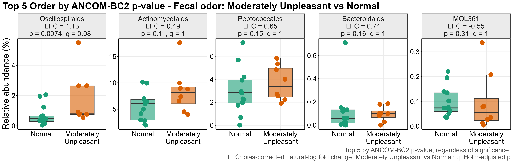
<p class="caption">
Figure 13c. Five lowest-p taxa at Order level (ANCOM-BC2), Moderately
Unpleasant vs Normal.
</p>

</div>

**No order reaches q \< 0.05.** Oscillospirales has the lowest p and is
higher in Moderately Unpleasant (LFC 1.13, q = 0.0814), the same
direction as for fecal_color (Section 10.2).

##### Family

<table>
<caption>
Table 18d. ANCOM-BC2, Family, Moderately Unpleasant vs Normal (17 taxa;
ten lowest p). Present = samples with reads, Normal/Moderately
Unpleasant.
</caption>
<thead>
<tr>
<th align="center">
Taxon
</th>
<th align="center">
Normal %
</th>
<th align="center">
Moderately Unpleasant %
</th>
<th align="center">
Present
</th>
<th align="center">
LFC
</th>
<th align="center">
p
</th>
<th align="center">
q
</th>
<th align="center">
Wilcoxon p
</th>
<th align="center">
Robust
</th>
<th align="center">
Fit
</th>
</tr>
</thead>
<tbody>
<tr>
<td align="center">
Oscillospiraceae
</td>
<td align="center">
0.1394
</td>
<td align="center">
0.3616
</td>
<td align="center">
12/8
</td>
<td align="center">
1.02
</td>
<td align="center">
0.0111
</td>
<td align="center">
0.1889
</td>
<td align="center">
0.0125
</td>
<td align="center">
no
</td>
<td align="center">
primary
</td>
</tr>
<tr>
<td align="center">
Ruminococcaceae
</td>
<td align="center">
0.5406
</td>
<td align="center">
1.4546
</td>
<td align="center">
13/8
</td>
<td align="center">
1.19
</td>
<td align="center">
0.0165
</td>
<td align="center">
0.2643
</td>
<td align="center">
0.0390
</td>
<td align="center">
no
</td>
<td align="center">
primary
</td>
</tr>
<tr>
<td align="center">
Streptococcaceae
</td>
<td align="center">
0.0232
</td>
<td align="center">
0.0968
</td>
<td align="center">
11/7
</td>
<td align="center">
1.80
</td>
<td align="center">
0.0236
</td>
<td align="center">
0.3541
</td>
<td align="center">
0.1797
</td>
<td align="center">
no
</td>
<td align="center">
primary
</td>
</tr>
<tr>
<td align="center">
Bifidobacteriaceae
</td>
<td align="center">
5.5067
</td>
<td align="center">
8.4687
</td>
<td align="center">
13/8
</td>
<td align="center">
0.49
</td>
<td align="center">
0.1397
</td>
<td align="center">
1.0000
</td>
<td align="center">
0.0888
</td>
<td align="center">
no
</td>
<td align="center">
primary
</td>
</tr>
<tr>
<td align="center">
Peptococcaceae
</td>
<td align="center">
2.9617
</td>
<td align="center">
3.6709
</td>
<td align="center">
13/8
</td>
<td align="center">
0.65
</td>
<td align="center">
0.1675
</td>
<td align="center">
1.0000
</td>
<td align="center">
0.4470
</td>
<td align="center">
no
</td>
<td align="center">
primary
</td>
</tr>
<tr>
<td align="center">
Muribaculaceae
</td>
<td align="center">
0.1045
</td>
<td align="center">
0.0890
</td>
<td align="center">
12/7
</td>
<td align="center">
0.71
</td>
<td align="center">
0.1843
</td>
<td align="center">
1.0000
</td>
<td align="center">
0.5144
</td>
<td align="center">
no
</td>
<td align="center">
primary
</td>
</tr>
<tr>
<td align="center">
Atopobiaceae
</td>
<td align="center">
2.3402
</td>
<td align="center">
1.4534
</td>
<td align="center">
13/8
</td>
<td align="center">
-0.49
</td>
<td align="center">
0.2206
</td>
<td align="center">
1.0000
</td>
<td align="center">
0.2050
</td>
<td align="center">
no
</td>
<td align="center">
primary
</td>
</tr>
<tr>
<td align="center">
Turicibacteraceae
</td>
<td align="center">
0.0967
</td>
<td align="center">
0.0977
</td>
<td align="center">
13/8
</td>
<td align="center">
-0.55
</td>
<td align="center">
0.3208
</td>
<td align="center">
1.0000
</td>
<td align="center">
0.4915
</td>
<td align="center">
no
</td>
<td align="center">
primary
</td>
</tr>
<tr>
<td align="center">
Peptostreptococcaceae
</td>
<td align="center">
1.2662
</td>
<td align="center">
0.8309
</td>
<td align="center">
13/8
</td>
<td align="center">
-0.58
</td>
<td align="center">
0.4072
</td>
<td align="center">
1.0000
</td>
<td align="center">
0.2616
</td>
<td align="center">
no
</td>
<td align="center">
primary
</td>
</tr>
<tr>
<td align="center">
Lactobacillaceae
</td>
<td align="center">
3.9742
</td>
<td align="center">
3.4107
</td>
<td align="center">
13/8
</td>
<td align="center">
0.58
</td>
<td align="center">
0.4230
</td>
<td align="center">
1.0000
</td>
<td align="center">
0.7445
</td>
<td align="center">
no
</td>
<td align="center">
primary
</td>
</tr>
</tbody>
</table>

<div class="figure" style="text-align: center">

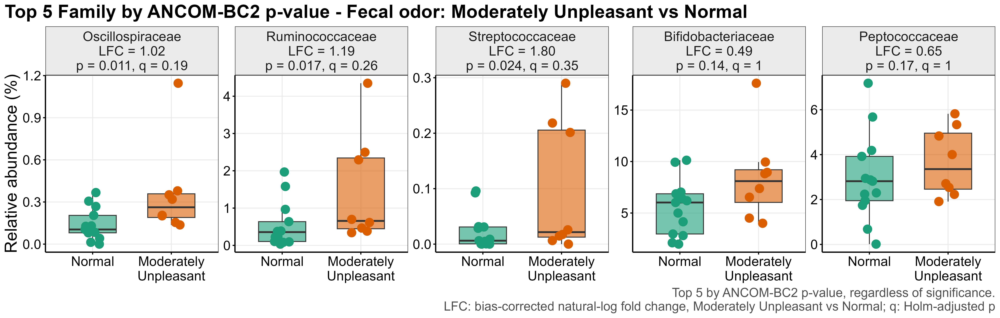
<p class="caption">
Figure 13d. Five lowest-p taxa at Family level (ANCOM-BC2), Moderately
Unpleasant vs Normal.
</p>

</div>

**No family reaches q \< 0.05.** Oscillospiraceae (LFC 1.02, q = 0.1889)
and Ruminococcaceae (LFC 1.19, q = 0.2643), the families of
Oscillospirales, have the lowest p-values.

##### Genus

<table>
<caption>
Table 18e. ANCOM-BC2, Genus, Moderately Unpleasant vs Normal (38 taxa;
ten lowest p). Present = samples with reads, Normal/Moderately
Unpleasant.
</caption>
<thead>
<tr>
<th align="center">
Taxon
</th>
<th align="center">
Normal %
</th>
<th align="center">
Moderately Unpleasant %
</th>
<th align="center">
Present
</th>
<th align="center">
LFC
</th>
<th align="center">
p
</th>
<th align="center">
q
</th>
<th align="center">
Wilcoxon p
</th>
<th align="center">
Robust
</th>
<th align="center">
Fit
</th>
</tr>
</thead>
<tbody>
<tr>
<td align="center">
Alitiscatomonas
</td>
<td align="center">
0.0073
</td>
<td align="center">
0.0458
</td>
<td align="center">
10/8
</td>
<td align="center">
1.91
</td>
<td align="center">
0.0005
</td>
<td align="center">
0.0172
</td>
<td align="center">
0.0010
</td>
<td align="center">
no
</td>
<td align="center">
primary
</td>
</tr>
<tr>
<td align="center">
Faecousia
</td>
<td align="center">
0.1872
</td>
<td align="center">
0.5058
</td>
<td align="center">
12/8
</td>
<td align="center">
1.02
</td>
<td align="center">
0.0115
</td>
<td align="center">
0.4243
</td>
<td align="center">
0.0082
</td>
<td align="center">
no
</td>
<td align="center">
primary
</td>
</tr>
<tr>
<td align="center">
Avimicrobium
</td>
<td align="center">
0.0058
</td>
<td align="center">
0.0123
</td>
<td align="center">
11/7
</td>
<td align="center">
0.89
</td>
<td align="center">
0.0133
</td>
<td align="center">
0.4788
</td>
<td align="center">
0.0756
</td>
<td align="center">
no
</td>
<td align="center">
primary
</td>
</tr>
<tr>
<td align="center">
Faecalibacterium
</td>
<td align="center">
0.6713
</td>
<td align="center">
1.7021
</td>
<td align="center">
13/8
</td>
<td align="center">
1.20
</td>
<td align="center">
0.0200
</td>
<td align="center">
0.7012
</td>
<td align="center">
0.0272
</td>
<td align="center">
no
</td>
<td align="center">
primary
</td>
</tr>
<tr>
<td align="center">
Streptococcus
</td>
<td align="center">
0.0315
</td>
<td align="center">
0.1412
</td>
<td align="center">
11/7
</td>
<td align="center">
1.80
</td>
<td align="center">
0.0238
</td>
<td align="center">
0.8080
</td>
<td align="center">
0.1573
</td>
<td align="center">
no
</td>
<td align="center">
primary
</td>
</tr>
<tr>
<td align="center">
Negativibacillus
</td>
<td align="center">
0.0556
</td>
<td align="center">
0.2545
</td>
<td align="center">
10/8
</td>
<td align="center">
1.65
</td>
<td align="center">
0.0303
</td>
<td align="center">
1.0000
</td>
<td align="center">
0.0124
</td>
<td align="center">
no
</td>
<td align="center">
primary
</td>
</tr>
<tr>
<td align="center">
Dubosiella
</td>
<td align="center">
3.5368
</td>
<td align="center">
1.8490
</td>
<td align="center">
13/8
</td>
<td align="center">
-0.70
</td>
<td align="center">
0.0880
</td>
<td align="center">
1.0000
</td>
<td align="center">
0.0272
</td>
<td align="center">
no
</td>
<td align="center">
primary
</td>
</tr>
<tr>
<td align="center">
Limosilactobacillus
</td>
<td align="center">
0.9227
</td>
<td align="center">
1.2067
</td>
<td align="center">
13/8
</td>
<td align="center">
1.20
</td>
<td align="center">
0.1035
</td>
<td align="center">
1.0000
</td>
<td align="center">
0.2321
</td>
<td align="center">
no
</td>
<td align="center">
primary
</td>
</tr>
<tr>
<td align="center">
Enterocloster
</td>
<td align="center">
0.0101
</td>
<td align="center">
0.0117
</td>
<td align="center">
10/7
</td>
<td align="center">
0.69
</td>
<td align="center">
0.1311
</td>
<td align="center">
1.0000
</td>
<td align="center">
0.2450
</td>
<td align="center">
no
</td>
<td align="center">
primary
</td>
</tr>
<tr>
<td align="center">
Cetobacterium_A
</td>
<td align="center">
0.0000
</td>
<td align="center">
0.0926
</td>
<td align="center">
1/2
</td>
<td align="center">
3.44
</td>
<td align="center">
0.1312
</td>
<td align="center">
1.0000
</td>
<td align="center">
0.2585
</td>
<td align="center">
no
</td>
<td align="center">
primary
</td>
</tr>
</tbody>
</table>

<div class="figure" style="text-align: center">

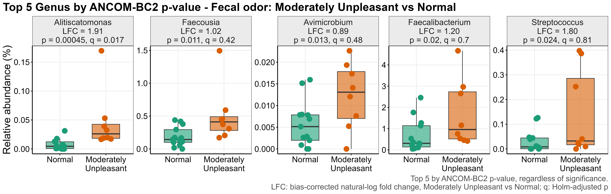
<p class="caption">
Figure 13e. Five lowest-p taxa at Genus level (ANCOM-BC2), Moderately
Unpleasant vs Normal.
</p>

</div>

- ***Alitiscatomonas*** is higher in Moderately Unpleasant (LFC 1.91, q
  = 0.0172) and is the only genus with q \< 0.05, but it fails the
  sensitivity analysis, so it is not robust. Its abundance is very low
  in both groups (0.007% vs 0.046%).
- *Faecousia*, *Avimicrobium*, *Faecalibacterium* and *Streptococcus*
  follow, all with q ≥ 0.4243.

##### Species

<table>
<caption>
Table 18f. ANCOM-BC2, Species, Moderately Unpleasant vs Normal (57 taxa;
ten lowest p). Present = samples with reads, Normal/Moderately
Unpleasant.
</caption>
<thead>
<tr>
<th align="center">
Taxon
</th>
<th align="center">
Normal %
</th>
<th align="center">
Moderately Unpleasant %
</th>
<th align="center">
Present
</th>
<th align="center">
LFC
</th>
<th align="center">
p
</th>
<th align="center">
q
</th>
<th align="center">
Wilcoxon p
</th>
<th align="center">
Robust
</th>
<th align="center">
Fit
</th>
</tr>
</thead>
<tbody>
<tr>
<td align="center">
Alitiscatomonas aceti
</td>
<td align="center">
0.0124
</td>
<td align="center">
0.0658
</td>
<td align="center">
10/8
</td>
<td align="center">
1.91
</td>
<td align="center">
0.0005
</td>
<td align="center">
0.0294
</td>
<td align="center">
0.0016
</td>
<td align="center">
no
</td>
<td align="center">
primary
</td>
</tr>
<tr>
<td align="center">
Faecousia sp963560135
</td>
<td align="center">
0.1652
</td>
<td align="center">
0.6409
</td>
<td align="center">
12/8
</td>
<td align="center">
1.39
</td>
<td align="center">
0.0035
</td>
<td align="center">
0.1941
</td>
<td align="center">
0.0153
</td>
<td align="center">
no
</td>
<td align="center">
primary
</td>
</tr>
<tr>
<td align="center">
Avimicrobium sp934845495
</td>
<td align="center">
0.0091
</td>
<td align="center">
0.0176
</td>
<td align="center">
11/7
</td>
<td align="center">
0.89
</td>
<td align="center">
0.0154
</td>
<td align="center">
0.8467
</td>
<td align="center">
0.0756
</td>
<td align="center">
no
</td>
<td align="center">
primary
</td>
</tr>
<tr>
<td align="center">
Faecalibacterium sp900540455
</td>
<td align="center">
0.9905
</td>
<td align="center">
2.3506
</td>
<td align="center">
13/8
</td>
<td align="center">
1.20
</td>
<td align="center">
0.0213
</td>
<td align="center">
1.0000
</td>
<td align="center">
0.0272
</td>
<td align="center">
no
</td>
<td align="center">
primary
</td>
</tr>
<tr>
<td align="center">
Streptococcus lutetiensis
</td>
<td align="center">
0.0448
</td>
<td align="center">
0.1771
</td>
<td align="center">
11/7
</td>
<td align="center">
1.80
</td>
<td align="center">
0.0244
</td>
<td align="center">
1.0000
</td>
<td align="center">
0.1190
</td>
<td align="center">
no
</td>
<td align="center">
primary
</td>
</tr>
<tr>
<td align="center">
Negativibacillus sp000435195
</td>
<td align="center">
0.0828
</td>
<td align="center">
0.3701
</td>
<td align="center">
10/8
</td>
<td align="center">
1.65
</td>
<td align="center">
0.0311
</td>
<td align="center">
1.0000
</td>
<td align="center">
0.0224
</td>
<td align="center">
no
</td>
<td align="center">
primary
</td>
</tr>
<tr>
<td align="center">
Bifidobacterium criceti
</td>
<td align="center">
0.2101
</td>
<td align="center">
0.5597
</td>
<td align="center">
13/8
</td>
<td align="center">
1.00
</td>
<td align="center">
0.0853
</td>
<td align="center">
1.0000
</td>
<td align="center">
0.2937
</td>
<td align="center">
no
</td>
<td align="center">
primary
</td>
</tr>
<tr>
<td align="center">
Dubosiella newyorkensis
</td>
<td align="center">
5.0512
</td>
<td align="center">
2.6635
</td>
<td align="center">
13/8
</td>
<td align="center">
-0.70
</td>
<td align="center">
0.0930
</td>
<td align="center">
1.0000
</td>
<td align="center">
0.0326
</td>
<td align="center">
no
</td>
<td align="center">
primary
</td>
</tr>
<tr>
<td align="center">
Faecalibacterium sp937880095
</td>
<td align="center">
0.0016
</td>
<td align="center">
0.0059
</td>
<td align="center">
2/1
</td>
<td align="center">
1.98
</td>
<td align="center">
0.0939
</td>
<td align="center">
1.0000
</td>
<td align="center">
1.0000
</td>
<td align="center">
no
</td>
<td align="center">
primary
</td>
</tr>
<tr>
<td align="center">
Limosilactobacillus reuteri
</td>
<td align="center">
1.1534
</td>
<td align="center">
1.7088
</td>
<td align="center">
13/8
</td>
<td align="center">
1.20
</td>
<td align="center">
0.1052
</td>
<td align="center">
1.0000
</td>
<td align="center">
0.2616
</td>
<td align="center">
no
</td>
<td align="center">
primary
</td>
</tr>
</tbody>
</table>

<div class="figure" style="text-align: center">

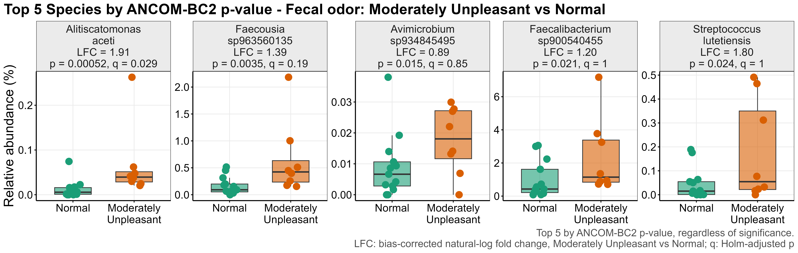
<p class="caption">
Figure 13f. Five lowest-p taxa at Species level (ANCOM-BC2), Moderately
Unpleasant vs Normal.
</p>

</div>

***Alitiscatomonas aceti*** repeats the genus result (LFC 1.91, q =
0.0294; fails the sensitivity analysis). No other species reaches q \<
0.05.

**Moderately Unpleasant vs Normal overall.** No difference between the
two groups is detected: no taxon is robustly different, the abundant
taxa have nearly equal means, and the only q \< 0.05 results
(*Alitiscatomonas*, *A. aceti*) are rare and fail the sensitivity
analysis. This matches the intermixed samples of these two groups in the
PCoA (Figure 10c) and their near-identical group means (Section 7.3).

### 10.3.2 Unpleasant vs Normal

``` r
ps_ab <- ps |>
  ps_filter(fecal_odor %in% c("Normal", "Unpleasant")) |>                       # only the two groups compared
  ps_mutate(fecal_odor = factor(fecal_odor, levels = c("Normal", "Unpleasant")))      # Normal = reference
res <- ANCOMBC::ancombc2(data = ps_ab, tax_level = "Genus", fix_formula = "fecal_odor",
                         p_adj_method = "holm", prv_cut = 0.10, pseudo_sens = TRUE)
res$res   # lfc_, p_, q_ and passed_ss_ columns: Unpleasant vs Normal
# script: run_ancombc2_safe(ps_genus, "Genus", contrasts$fecal_odor__Unpleasant_vs_Normal, bias_ps = ps)
```

<table>
<caption>
Table 19. ANCOM-BC2 summary per level, Unpleasant vs Normal
(results/gtdbtk/ancombc2_results_by_level_fecal_odor_Unpleasant_vs_Normal.xlsx,
sheet ‘Summary’)
</caption>
<thead>
<tr>
<th align="center">
Level
</th>
<th align="center">
Tested
</th>
<th align="center">
Pseudo-count fit
</th>
<th align="center">
Wilcoxon p \< 0.05
</th>
<th align="center">
q \< 0.05
</th>
<th align="center">
Robust
</th>
<th align="center">
Higher in Unpleasant
</th>
<th align="center">
Higher in Normal
</th>
</tr>
</thead>
<tbody>
<tr>
<td align="center">
Phylum
</td>
<td align="center">
5
</td>
<td align="center">
0
</td>
<td align="center">
4
</td>
<td align="center">
3
</td>
<td align="center">
1
</td>
<td align="center">
1
</td>
<td align="center">
0
</td>
</tr>
<tr>
<td align="center">
Class
</td>
<td align="center">
8
</td>
<td align="center">
0
</td>
<td align="center">
6
</td>
<td align="center">
6
</td>
<td align="center">
3
</td>
<td align="center">
3
</td>
<td align="center">
0
</td>
</tr>
<tr>
<td align="center">
Order
</td>
<td align="center">
11
</td>
<td align="center">
0
</td>
<td align="center">
8
</td>
<td align="center">
8
</td>
<td align="center">
5
</td>
<td align="center">
5
</td>
<td align="center">
0
</td>
</tr>
<tr>
<td align="center">
Family
</td>
<td align="center">
17
</td>
<td align="center">
0
</td>
<td align="center">
14
</td>
<td align="center">
12
</td>
<td align="center">
8
</td>
<td align="center">
6
</td>
<td align="center">
2
</td>
</tr>
<tr>
<td align="center">
Genus
</td>
<td align="center">
38
</td>
<td align="center">
0
</td>
<td align="center">
28
</td>
<td align="center">
17
</td>
<td align="center">
9
</td>
<td align="center">
8
</td>
<td align="center">
1
</td>
</tr>
<tr>
<td align="center">
Species
</td>
<td align="center">
57
</td>
<td align="center">
0
</td>
<td align="center">
38
</td>
<td align="center">
22
</td>
<td align="center">
15
</td>
<td align="center">
13
</td>
<td align="center">
2
</td>
</tr>
</tbody>
</table>

This comparison uses the 22 Normal and Unpleasant samples, with the bias
estimated from 497 MAGs; all taxa were tested in the primary fit. It
gives by far the most differences of any comparison: 68 taxa reach q \<
0.05 across the six levels and 41 of them are robust, most of them
higher in Unpleasant (Table 19).

##### Phylum

<table>
<caption>
Table 20a. ANCOM-BC2, Phylum, Unpleasant vs Normal (5 taxa; ten lowest
p). Present = samples with reads, Normal/Unpleasant.
</caption>
<thead>
<tr>
<th align="center">
Taxon
</th>
<th align="center">
Normal %
</th>
<th align="center">
Unpleasant %
</th>
<th align="center">
Present
</th>
<th align="center">
LFC
</th>
<th align="center">
p
</th>
<th align="center">
q
</th>
<th align="center">
Wilcoxon p
</th>
<th align="center">
Robust
</th>
<th align="center">
Fit
</th>
</tr>
</thead>
<tbody>
<tr>
<td align="center">
Bacillota_I
</td>
<td align="center">
69.1035
</td>
<td align="center">
16.5758
</td>
<td align="center">
13/9
</td>
<td align="center">
-1.52
</td>
<td align="center">
4.1e-05
</td>
<td align="center">
0.0002
</td>
<td align="center">
0.0001
</td>
<td align="center">
no
</td>
<td align="center">
primary
</td>
</tr>
<tr>
<td align="center">
Bacillota
</td>
<td align="center">
19.0172
</td>
<td align="center">
60.4878
</td>
<td align="center">
13/9
</td>
<td align="center">
1.47
</td>
<td align="center">
0.0005
</td>
<td align="center">
0.0019
</td>
<td align="center">
0.0001
</td>
<td align="center">
yes
</td>
<td align="center">
primary
</td>
</tr>
<tr>
<td align="center">
Fusobacteriota
</td>
<td align="center">
0.0764
</td>
<td align="center">
0.4761
</td>
<td align="center">
11/8
</td>
<td align="center">
2.35
</td>
<td align="center">
0.0008
</td>
<td align="center">
0.0024
</td>
<td align="center">
0.0134
</td>
<td align="center">
no
</td>
<td align="center">
primary
</td>
</tr>
<tr>
<td align="center">
Actinomycetota
</td>
<td align="center">
11.6916
</td>
<td align="center">
22.3939
</td>
<td align="center">
13/9
</td>
<td align="center">
0.81
</td>
<td align="center">
0.0417
</td>
<td align="center">
0.0834
</td>
<td align="center">
0.0008
</td>
<td align="center">
no
</td>
<td align="center">
primary
</td>
</tr>
<tr>
<td align="center">
Bacteroidota
</td>
<td align="center">
0.1113
</td>
<td align="center">
0.0664
</td>
<td align="center">
12/8
</td>
<td align="center">
-0.13
</td>
<td align="center">
0.8596
</td>
<td align="center">
0.8596
</td>
<td align="center">
0.6642
</td>
<td align="center">
no
</td>
<td align="center">
primary
</td>
</tr>
</tbody>
</table>

<div class="figure" style="text-align: center">


<p class="caption">
Figure 14a. Five lowest-p taxa at Phylum level (ANCOM-BC2), Unpleasant
vs Normal.
</p>

</div>

- **Robust:** Bacillota is higher in Unpleasant (19.0% vs 60.5%; LFC
  1.47, q = 0.0019).
- **q \< 0.05 but not robust:** Bacillota_I is lower (69.1% vs 16.6%;
  LFC -1.52, q = 0.0002) and Fusobacteriota higher (LFC 2.35, q =
  0.0024); both fail the sensitivity analysis.

##### Class

<table>
<caption>
Table 20b. ANCOM-BC2, Class, Unpleasant vs Normal (8 taxa; ten lowest
p). Present = samples with reads, Normal/Unpleasant.
</caption>
<thead>
<tr>
<th align="center">
Taxon
</th>
<th align="center">
Normal %
</th>
<th align="center">
Unpleasant %
</th>
<th align="center">
Present
</th>
<th align="center">
LFC
</th>
<th align="center">
p
</th>
<th align="center">
q
</th>
<th align="center">
Wilcoxon p
</th>
<th align="center">
Robust
</th>
<th align="center">
Fit
</th>
</tr>
</thead>
<tbody>
<tr>
<td align="center">
Bacilli_A
</td>
<td align="center">
69.1035
</td>
<td align="center">
16.5758
</td>
<td align="center">
13/9
</td>
<td align="center">
-1.52
</td>
<td align="center">
7.5e-05
</td>
<td align="center">
0.0006
</td>
<td align="center">
0.0001
</td>
<td align="center">
no
</td>
<td align="center">
primary
</td>
</tr>
<tr>
<td align="center">
Clostridia
</td>
<td align="center">
12.0580
</td>
<td align="center">
43.1558
</td>
<td align="center">
13/9
</td>
<td align="center">
1.59
</td>
<td align="center">
0.0004
</td>
<td align="center">
0.0031
</td>
<td align="center">
0.0001
</td>
<td align="center">
yes
</td>
<td align="center">
primary
</td>
</tr>
<tr>
<td align="center">
Peptococcia
</td>
<td align="center">
2.9617
</td>
<td align="center">
16.2830
</td>
<td align="center">
13/9
</td>
<td align="center">
2.27
</td>
<td align="center">
0.0005
</td>
<td align="center">
0.0031
</td>
<td align="center">
0.0002
</td>
<td align="center">
yes
</td>
<td align="center">
primary
</td>
</tr>
<tr>
<td align="center">
Fusobacteriia
</td>
<td align="center">
0.0764
</td>
<td align="center">
0.4761
</td>
<td align="center">
11/8
</td>
<td align="center">
2.35
</td>
<td align="center">
0.0009
</td>
<td align="center">
0.0046
</td>
<td align="center">
0.0134
</td>
<td align="center">
no
</td>
<td align="center">
primary
</td>
</tr>
<tr>
<td align="center">
Actinomycetes
</td>
<td align="center">
5.5067
</td>
<td align="center">
1.6730
</td>
<td align="center">
13/9
</td>
<td align="center">
-1.98
</td>
<td align="center">
0.0015
</td>
<td align="center">
0.0060
</td>
<td align="center">
0.0033
</td>
<td align="center">
no
</td>
<td align="center">
primary
</td>
</tr>
<tr>
<td align="center">
Coriobacteriia
</td>
<td align="center">
6.1849
</td>
<td align="center">
20.7208
</td>
<td align="center">
13/9
</td>
<td align="center">
1.37
</td>
<td align="center">
0.0025
</td>
<td align="center">
0.0074
</td>
<td align="center">
0.0001
</td>
<td align="center">
yes
</td>
<td align="center">
primary
</td>
</tr>
<tr>
<td align="center">
Bacilli
</td>
<td align="center">
3.9974
</td>
<td align="center">
1.0490
</td>
<td align="center">
13/9
</td>
<td align="center">
-1.45
</td>
<td align="center">
0.0928
</td>
<td align="center">
0.1856
</td>
<td align="center">
0.1608
</td>
<td align="center">
no
</td>
<td align="center">
primary
</td>
</tr>
<tr>
<td align="center">
Bacteroidia
</td>
<td align="center">
0.1113
</td>
<td align="center">
0.0664
</td>
<td align="center">
12/8
</td>
<td align="center">
-0.13
</td>
<td align="center">
0.8609
</td>
<td align="center">
0.8609
</td>
<td align="center">
0.6642
</td>
<td align="center">
no
</td>
<td align="center">
primary
</td>
</tr>
</tbody>
</table>

<div class="figure" style="text-align: center">


<p class="caption">
Figure 14b. Five lowest-p taxa at Class level (ANCOM-BC2), Unpleasant vs
Normal.
</p>

</div>

- **Robust, higher in Unpleasant:** Peptococcia (LFC 2.27), Clostridia
  (LFC 1.59), and Coriobacteriia (LFC 1.37).
- **q \< 0.05 but not robust:** Bacilli_A, Fusobacteriia, and
  Actinomycetes; the drop of Bacilli_A (69.1% vs 16.6%) fails the
  sensitivity analysis.

##### Order

<table>
<caption>
Table 20c. ANCOM-BC2, Order, Unpleasant vs Normal (11 taxa; ten lowest
p). Present = samples with reads, Normal/Unpleasant.
</caption>
<thead>
<tr>
<th align="center">
Taxon
</th>
<th align="center">
Normal %
</th>
<th align="center">
Unpleasant %
</th>
<th align="center">
Present
</th>
<th align="center">
LFC
</th>
<th align="center">
p
</th>
<th align="center">
q
</th>
<th align="center">
Wilcoxon p
</th>
<th align="center">
Robust
</th>
<th align="center">
Fit
</th>
</tr>
</thead>
<tbody>
<tr>
<td align="center">
Erysipelotrichales
</td>
<td align="center">
69.0068
</td>
<td align="center">
16.4409
</td>
<td align="center">
13/9
</td>
<td align="center">
-1.53
</td>
<td align="center">
0.0002
</td>
<td align="center">
0.0017
</td>
<td align="center">
0.0001
</td>
<td align="center">
no
</td>
<td align="center">
primary
</td>
</tr>
<tr>
<td align="center">
Peptostreptococcales
</td>
<td align="center">
1.6588
</td>
<td align="center">
6.2841
</td>
<td align="center">
13/9
</td>
<td align="center">
1.81
</td>
<td align="center">
0.0005
</td>
<td align="center">
0.0052
</td>
<td align="center">
0.0002
</td>
<td align="center">
yes
</td>
<td align="center">
primary
</td>
</tr>
<tr>
<td align="center">
Peptococcales
</td>
<td align="center">
2.9617
</td>
<td align="center">
16.2830
</td>
<td align="center">
13/9
</td>
<td align="center">
2.27
</td>
<td align="center">
0.0006
</td>
<td align="center">
0.0052
</td>
<td align="center">
0.0002
</td>
<td align="center">
yes
</td>
<td align="center">
primary
</td>
</tr>
<tr>
<td align="center">
Oscillospirales
</td>
<td align="center">
0.6800
</td>
<td align="center">
4.9331
</td>
<td align="center">
13/9
</td>
<td align="center">
2.18
</td>
<td align="center">
0.0007
</td>
<td align="center">
0.0054
</td>
<td align="center">
0.0013
</td>
<td align="center">
yes
</td>
<td align="center">
primary
</td>
</tr>
<tr>
<td align="center">
Fusobacteriales
</td>
<td align="center">
0.0764
</td>
<td align="center">
0.4761
</td>
<td align="center">
11/8
</td>
<td align="center">
2.35
</td>
<td align="center">
0.0011
</td>
<td align="center">
0.0076
</td>
<td align="center">
0.0134
</td>
<td align="center">
no
</td>
<td align="center">
primary
</td>
</tr>
<tr>
<td align="center">
Lachnospirales
</td>
<td align="center">
9.7193
</td>
<td align="center">
31.9386
</td>
<td align="center">
13/9
</td>
<td align="center">
1.49
</td>
<td align="center">
0.0018
</td>
<td align="center">
0.0108
</td>
<td align="center">
0.0001
</td>
<td align="center">
yes
</td>
<td align="center">
primary
</td>
</tr>
<tr>
<td align="center">
Actinomycetales
</td>
<td align="center">
5.5067
</td>
<td align="center">
1.6730
</td>
<td align="center">
13/9
</td>
<td align="center">
-1.98
</td>
<td align="center">
0.0018
</td>
<td align="center">
0.0108
</td>
<td align="center">
0.0033
</td>
<td align="center">
no
</td>
<td align="center">
primary
</td>
</tr>
<tr>
<td align="center">
Coriobacteriales
</td>
<td align="center">
6.1849
</td>
<td align="center">
20.7208
</td>
<td align="center">
13/9
</td>
<td align="center">
1.37
</td>
<td align="center">
0.0035
</td>
<td align="center">
0.0138
</td>
<td align="center">
0.0001
</td>
<td align="center">
yes
</td>
<td align="center">
primary
</td>
</tr>
<tr>
<td align="center">
Lactobacillales
</td>
<td align="center">
3.9974
</td>
<td align="center">
1.0490
</td>
<td align="center">
13/9
</td>
<td align="center">
-1.45
</td>
<td align="center">
0.0960
</td>
<td align="center">
0.2880
</td>
<td align="center">
0.1608
</td>
<td align="center">
no
</td>
<td align="center">
primary
</td>
</tr>
<tr>
<td align="center">
MOL361
</td>
<td align="center">
0.0967
</td>
<td align="center">
0.1349
</td>
<td align="center">
13/8
</td>
<td align="center">
-0.28
</td>
<td align="center">
0.6533
</td>
<td align="center">
1.0000
</td>
<td align="center">
0.4229
</td>
<td align="center">
no
</td>
<td align="center">
primary
</td>
</tr>
</tbody>
</table>

<div class="figure" style="text-align: center">


<p class="caption">
Figure 14c. Five lowest-p taxa at Order level (ANCOM-BC2), Unpleasant vs
Normal.
</p>

</div>

- **Robust, higher in Unpleasant:** Peptococcales (LFC 2.27),
  Oscillospirales (LFC 2.18), Peptostreptococcales (LFC 1.81),
  Lachnospirales (LFC 1.49), and Coriobacteriales (LFC 1.37).
- **q \< 0.05 but not robust:** Erysipelotrichales, Fusobacteriales, and
  Actinomycetales, including the drop of Erysipelotrichales (69.0% vs
  16.4%).

##### Family

<table>
<caption>
Table 20d. ANCOM-BC2, Family, Unpleasant vs Normal (17 taxa; ten lowest
p). Present = samples with reads, Normal/Unpleasant.
</caption>
<thead>
<tr>
<th align="center">
Taxon
</th>
<th align="center">
Normal %
</th>
<th align="center">
Unpleasant %
</th>
<th align="center">
Present
</th>
<th align="center">
LFC
</th>
<th align="center">
p
</th>
<th align="center">
q
</th>
<th align="center">
Wilcoxon p
</th>
<th align="center">
Robust
</th>
<th align="center">
Fit
</th>
</tr>
</thead>
<tbody>
<tr>
<td align="center">
Eggerthellaceae
</td>
<td align="center">
0.1329
</td>
<td align="center">
0.0106
</td>
<td align="center">
13/6
</td>
<td align="center">
-2.56
</td>
<td align="center">
3.2e-06
</td>
<td align="center">
5.4e-05
</td>
<td align="center">
0.0001
</td>
<td align="center">
yes
</td>
<td align="center">
primary
</td>
</tr>
<tr>
<td align="center">
Atopobiaceae
</td>
<td align="center">
2.3402
</td>
<td align="center">
0.2464
</td>
<td align="center">
13/9
</td>
<td align="center">
-3.30
</td>
<td align="center">
1.6e-05
</td>
<td align="center">
0.0002
</td>
<td align="center">
0.0003
</td>
<td align="center">
yes
</td>
<td align="center">
primary
</td>
</tr>
<tr>
<td align="center">
Erysipelotrichaceae
</td>
<td align="center">
69.0068
</td>
<td align="center">
16.4409
</td>
<td align="center">
13/9
</td>
<td align="center">
-1.53
</td>
<td align="center">
0.0001
</td>
<td align="center">
0.0020
</td>
<td align="center">
0.0001
</td>
<td align="center">
no
</td>
<td align="center">
primary
</td>
</tr>
<tr>
<td align="center">
Coriobacteriaceae
</td>
<td align="center">
3.7118
</td>
<td align="center">
20.4638
</td>
<td align="center">
13/9
</td>
<td align="center">
1.91
</td>
<td align="center">
0.0002
</td>
<td align="center">
0.0033
</td>
<td align="center">
0.0001
</td>
<td align="center">
yes
</td>
<td align="center">
primary
</td>
</tr>
<tr>
<td align="center">
Peptostreptococcaceae
</td>
<td align="center">
1.2662
</td>
<td align="center">
5.1258
</td>
<td align="center">
13/9
</td>
<td align="center">
1.93
</td>
<td align="center">
0.0005
</td>
<td align="center">
0.0061
</td>
<td align="center">
0.0002
</td>
<td align="center">
yes
</td>
<td align="center">
primary
</td>
</tr>
<tr>
<td align="center">
Peptococcaceae
</td>
<td align="center">
2.9617
</td>
<td align="center">
16.2830
</td>
<td align="center">
13/9
</td>
<td align="center">
2.27
</td>
<td align="center">
0.0006
</td>
<td align="center">
0.0067
</td>
<td align="center">
0.0002
</td>
<td align="center">
yes
</td>
<td align="center">
primary
</td>
</tr>
<tr>
<td align="center">
Ruminococcaceae
</td>
<td align="center">
0.5406
</td>
<td align="center">
3.9786
</td>
<td align="center">
13/9
</td>
<td align="center">
2.29
</td>
<td align="center">
0.0008
</td>
<td align="center">
0.0084
</td>
<td align="center">
0.0021
</td>
<td align="center">
yes
</td>
<td align="center">
primary
</td>
</tr>
<tr>
<td align="center">
Fusobacteriaceae
</td>
<td align="center">
0.0764
</td>
<td align="center">
0.4761
</td>
<td align="center">
11/8
</td>
<td align="center">
2.35
</td>
<td align="center">
0.0011
</td>
<td align="center">
0.0106
</td>
<td align="center">
0.0134
</td>
<td align="center">
no
</td>
<td align="center">
primary
</td>
</tr>
<tr>
<td align="center">
Lachnospiraceae
</td>
<td align="center">
9.7193
</td>
<td align="center">
31.9386
</td>
<td align="center">
13/9
</td>
<td align="center">
1.49
</td>
<td align="center">
0.0017
</td>
<td align="center">
0.0154
</td>
<td align="center">
0.0001
</td>
<td align="center">
yes
</td>
<td align="center">
primary
</td>
</tr>
<tr>
<td align="center">
Bifidobacteriaceae
</td>
<td align="center">
5.5067
</td>
<td align="center">
1.6730
</td>
<td align="center">
13/9
</td>
<td align="center">
-1.98
</td>
<td align="center">
0.0018
</td>
<td align="center">
0.0154
</td>
<td align="center">
0.0033
</td>
<td align="center">
no
</td>
<td align="center">
primary
</td>
</tr>
</tbody>
</table>

<div class="figure" style="text-align: center">


<p class="caption">
Figure 14d. Five lowest-p taxa at Family level (ANCOM-BC2), Unpleasant
vs Normal.
</p>

</div>

- **Robust, higher in Unpleasant:** Ruminococcaceae (LFC 2.29),
  Peptococcaceae (LFC 2.27), Peptostreptococcaceae (LFC 1.93),
  Coriobacteriaceae (LFC 1.91), Lachnospiraceae (LFC 1.49), and
  Anaerovoracaceae (LFC 1.45).
- **Robust, higher in Normal:** Atopobiaceae (LFC -3.30) and
  Eggerthellaceae (LFC -2.56); these two Coriobacteriales families
  nearly disappear in Unpleasant samples (Atopobiaceae 2.3% vs 0.2%).
- **q \< 0.05 but not robust:** Erysipelotrichaceae, Fusobacteriaceae,
  Bifidobacteriaceae, and Oscillospiraceae.

##### Genus

<table>
<caption>
Table 20e. ANCOM-BC2, Genus, Unpleasant vs Normal (38 taxa; ten lowest
p). Present = samples with reads, Normal/Unpleasant.
</caption>
<thead>
<tr>
<th align="center">
Taxon
</th>
<th align="center">
Normal %
</th>
<th align="center">
Unpleasant %
</th>
<th align="center">
Present
</th>
<th align="center">
LFC
</th>
<th align="center">
p
</th>
<th align="center">
q
</th>
<th align="center">
Wilcoxon p
</th>
<th align="center">
Robust
</th>
<th align="center">
Fit
</th>
</tr>
</thead>
<tbody>
<tr>
<td align="center">
Adlercreutzia
</td>
<td align="center">
0.1878
</td>
<td align="center">
0.0124
</td>
<td align="center">
13/6
</td>
<td align="center">
-2.56
</td>
<td align="center">
4.4e-06
</td>
<td align="center">
0.0002
</td>
<td align="center">
0.0001
</td>
<td align="center">
no
</td>
<td align="center">
primary
</td>
</tr>
<tr>
<td align="center">
Leptogranulimonas
</td>
<td align="center">
2.6060
</td>
<td align="center">
0.2279
</td>
<td align="center">
13/9
</td>
<td align="center">
-3.20
</td>
<td align="center">
7.3e-05
</td>
<td align="center">
0.0027
</td>
<td align="center">
0.0008
</td>
<td align="center">
yes
</td>
<td align="center">
primary
</td>
</tr>
<tr>
<td align="center">
Granulimonas
</td>
<td align="center">
0.3180
</td>
<td align="center">
0.0259
</td>
<td align="center">
13/8
</td>
<td align="center">
-3.17
</td>
<td align="center">
0.0001
</td>
<td align="center">
0.0051
</td>
<td align="center">
0.0001
</td>
<td align="center">
no
</td>
<td align="center">
primary
</td>
</tr>
<tr>
<td align="center">
Oliverpabstia
</td>
<td align="center">
0.0411
</td>
<td align="center">
0.2126
</td>
<td align="center">
13/9
</td>
<td align="center">
2.26
</td>
<td align="center">
0.0002
</td>
<td align="center">
0.0060
</td>
<td align="center">
0.0005
</td>
<td align="center">
yes
</td>
<td align="center">
primary
</td>
</tr>
<tr>
<td align="center">
Kribbibacterium
</td>
<td align="center">
0.2171
</td>
<td align="center">
0.0271
</td>
<td align="center">
13/6
</td>
<td align="center">
-2.39
</td>
<td align="center">
0.0002
</td>
<td align="center">
0.0068
</td>
<td align="center">
0.0002
</td>
<td align="center">
no
</td>
<td align="center">
primary
</td>
</tr>
<tr>
<td align="center">
Dubosiella
</td>
<td align="center">
3.5368
</td>
<td align="center">
0.4379
</td>
<td align="center">
13/9
</td>
<td align="center">
-2.77
</td>
<td align="center">
0.0002
</td>
<td align="center">
0.0078
</td>
<td align="center">
0.0001
</td>
<td align="center">
no
</td>
<td align="center">
primary
</td>
</tr>
<tr>
<td align="center">
Collinsella
</td>
<td align="center">
5.0897
</td>
<td align="center">
21.8403
</td>
<td align="center">
13/9
</td>
<td align="center">
1.91
</td>
<td align="center">
0.0003
</td>
<td align="center">
0.0093
</td>
<td align="center">
0.0001
</td>
<td align="center">
yes
</td>
<td align="center">
primary
</td>
</tr>
<tr>
<td align="center">
Allobaculum
</td>
<td align="center">
40.6758
</td>
<td align="center">
7.4577
</td>
<td align="center">
13/9
</td>
<td align="center">
-1.40
</td>
<td align="center">
0.0004
</td>
<td align="center">
0.0124
</td>
<td align="center">
0.0001
</td>
<td align="center">
no
</td>
<td align="center">
primary
</td>
</tr>
<tr>
<td align="center">
Alitiscatomonas
</td>
<td align="center">
0.0073
</td>
<td align="center">
0.1652
</td>
<td align="center">
10/9
</td>
<td align="center">
3.04
</td>
<td align="center">
0.0004
</td>
<td align="center">
0.0124
</td>
<td align="center">
0.0007
</td>
<td align="center">
yes
</td>
<td align="center">
primary
</td>
</tr>
<tr>
<td align="center">
Faecalibaculum
</td>
<td align="center">
12.3937
</td>
<td align="center">
1.5192
</td>
<td align="center">
13/9
</td>
<td align="center">
-2.36
</td>
<td align="center">
0.0005
</td>
<td align="center">
0.0135
</td>
<td align="center">
0.0003
</td>
<td align="center">
no
</td>
<td align="center">
primary
</td>
</tr>
</tbody>
</table>

<div class="figure" style="text-align: center">


<p class="caption">
Figure 14e. Five lowest-p taxa at Genus level (ANCOM-BC2), Unpleasant vs
Normal.
</p>

</div>

- **Robust, higher in Unpleasant:** *Alitiscatomonas* (LFC 3.04),
  *Faecalibacterium* (LFC 2.30), *UMGS1590* (LFC 2.27), *Oliverpabstia*
  (LFC 2.26), *Peptacetobacter* (LFC 1.93), *Collinsella* (LFC 1.91),
  *Faecalimonas* (LFC 1.88), and *Blautia* (LFC 1.67).
- **Robust, higher in Normal:** *Leptogranulimonas* (LFC -3.20); 2.6% vs
  0.2%.
- **q \< 0.05 but not robust:** *Adlercreutzia*, *Granulimonas*,
  *Kribbibacterium*, *Dubosiella*, *Allobaculum*, *Faecalibaculum*,
  *Fusobacterium_A*, and *Bifidobacterium*. These include the abundant
  *Allobaculum* (40.7% vs 7.5%), whose decrease fails the sensitivity
  analysis.

##### Species

<table>
<caption>
Table 20f. ANCOM-BC2, Species, Unpleasant vs Normal (57 taxa; ten lowest
p). Present = samples with reads, Normal/Unpleasant.
</caption>
<thead>
<tr>
<th align="center">
Taxon
</th>
<th align="center">
Normal %
</th>
<th align="center">
Unpleasant %
</th>
<th align="center">
Present
</th>
<th align="center">
LFC
</th>
<th align="center">
p
</th>
<th align="center">
q
</th>
<th align="center">
Wilcoxon p
</th>
<th align="center">
Robust
</th>
<th align="center">
Fit
</th>
</tr>
</thead>
<tbody>
<tr>
<td align="center">
Adlercreutzia rubneri
</td>
<td align="center">
0.1206
</td>
<td align="center">
0.0062
</td>
<td align="center">
13/6
</td>
<td align="center">
-2.40
</td>
<td align="center">
7.1e-06
</td>
<td align="center">
0.0004
</td>
<td align="center">
0.0001
</td>
<td align="center">
no
</td>
<td align="center">
primary
</td>
</tr>
<tr>
<td align="center">
Allobaculum stercoricanis
</td>
<td align="center">
0.5630
</td>
<td align="center">
3.2276
</td>
<td align="center">
13/9
</td>
<td align="center">
2.66
</td>
<td align="center">
1.8e-05
</td>
<td align="center">
0.0010
</td>
<td align="center">
0.0001
</td>
<td align="center">
yes
</td>
<td align="center">
primary
</td>
</tr>
<tr>
<td align="center">
Allobaculum sp910577085
</td>
<td align="center">
5.3319
</td>
<td align="center">
0.3194
</td>
<td align="center">
13/9
</td>
<td align="center">
-2.90
</td>
<td align="center">
8.0e-05
</td>
<td align="center">
0.0044
</td>
<td align="center">
0.0002
</td>
<td align="center">
yes
</td>
<td align="center">
primary
</td>
</tr>
<tr>
<td align="center">
Leptogranulimonas caecicola
</td>
<td align="center">
3.6948
</td>
<td align="center">
0.2467
</td>
<td align="center">
13/9
</td>
<td align="center">
-3.20
</td>
<td align="center">
9.1e-05
</td>
<td align="center">
0.0049
</td>
<td align="center">
0.0004
</td>
<td align="center">
yes
</td>
<td align="center">
primary
</td>
</tr>
<tr>
<td align="center">
Allobaculum mucilyticum
</td>
<td align="center">
25.2160
</td>
<td align="center">
2.6077
</td>
<td align="center">
13/9
</td>
<td align="center">
-2.36
</td>
<td align="center">
0.0002
</td>
<td align="center">
0.0128
</td>
<td align="center">
0.0002
</td>
<td align="center">
no
</td>
<td align="center">
primary
</td>
</tr>
<tr>
<td align="center">
Oliverpabstia sp000432335
</td>
<td align="center">
0.0555
</td>
<td align="center">
0.2269
</td>
<td align="center">
13/9
</td>
<td align="center">
2.26
</td>
<td align="center">
0.0002
</td>
<td align="center">
0.0128
</td>
<td align="center">
0.0008
</td>
<td align="center">
yes
</td>
<td align="center">
primary
</td>
</tr>
<tr>
<td align="center">
Kribbibacterium absianum
</td>
<td align="center">
0.3194
</td>
<td align="center">
0.0298
</td>
<td align="center">
13/6
</td>
<td align="center">
-2.39
</td>
<td align="center">
0.0003
</td>
<td align="center">
0.0140
</td>
<td align="center">
0.0001
</td>
<td align="center">
no
</td>
<td align="center">
primary
</td>
</tr>
<tr>
<td align="center">
Dubosiella newyorkensis
</td>
<td align="center">
5.0512
</td>
<td align="center">
0.4645
</td>
<td align="center">
13/9
</td>
<td align="center">
-2.79
</td>
<td align="center">
0.0003
</td>
<td align="center">
0.0145
</td>
<td align="center">
0.0001
</td>
<td align="center">
no
</td>
<td align="center">
primary
</td>
</tr>
<tr>
<td align="center">
Schaedlerella glycyrrhizinilytica_A
</td>
<td align="center">
0.0175
</td>
<td align="center">
0.0602
</td>
<td align="center">
13/9
</td>
<td align="center">
2.08
</td>
<td align="center">
0.0003
</td>
<td align="center">
0.0145
</td>
<td align="center">
0.0001
</td>
<td align="center">
yes
</td>
<td align="center">
primary
</td>
</tr>
<tr>
<td align="center">
Faecalimonas sp900551895
</td>
<td align="center">
0.0077
</td>
<td align="center">
0.2364
</td>
<td align="center">
13/9
</td>
<td align="center">
3.57
</td>
<td align="center">
0.0003
</td>
<td align="center">
0.0146
</td>
<td align="center">
0.0027
</td>
<td align="center">
yes
</td>
<td align="center">
primary
</td>
</tr>
</tbody>
</table>

<div class="figure" style="text-align: center">


<p class="caption">
Figure 14f. Five lowest-p taxa at Species level (ANCOM-BC2), Unpleasant
vs Normal.
</p>

</div>

- **Robust, higher in Unpleasant:** *Faecalimonas sp900551895* (LFC
  3.57), *Alitiscatomonas aceti* (LFC 3.04), *Allobaculum stercoricanis*
  (LFC 2.66), *Collinsella sp902470815* (LFC 2.58), *Faecalibacterium
  sp900540455* (LFC 2.29), *UMGS1590 sp900553245* (LFC 2.27),
  *Oliverpabstia sp000432335* (LFC 2.26), *Faecalimonas umbilicata* (LFC
  2.08), *Schaedlerella glycyrrhizinilytica_A* (LFC 2.08),
  *Peptacetobacter hiranonis* (LFC 1.99), *Peptacetobacter sp900550335*
  (LFC 1.95), *Collinsella intestinalis* (LFC 1.91), and *Blautia
  sp900753905* (LFC 1.83).
- **Robust, higher in Normal:** *Leptogranulimonas caecicola* (LFC
  -3.20) and *Allobaculum sp910577085* (LFC -2.90).
- **q \< 0.05 but not robust:** *Adlercreutzia rubneri*, *Allobaculum
  mucilyticum*, *Kribbibacterium absianum*, *Dubosiella newyorkensis*,
  *Faecalibaculum rodentium*, *Bifidobacterium animalis*, and
  *Fusobacterium_A sp900555845*.
- *Allobaculum* species move in opposite directions: *A. stercoricanis*
  rises (0.6% vs 3.2%), while *A.* sp910577085 and *A. mucilyticum*
  fall.

**Unpleasant vs Normal overall.** This is the comparison that carries
the differences seen in Sections 7–9. Unpleasant samples have robustly
more Clostridia (Lachnospirales, Oscillospirales, Peptostreptococcales),
Peptococcia (UMGS1590) and Coriobacteriia (*Collinsella*), and robustly
less of two minor Coriobacteriales families (Atopobiaceae,
Eggerthellaceae) and *Leptogranulimonas*. The fall of the dominant
Bacillota_I / Erysipelotrichaceae / *Allobaculum* lineage is large and
has q \< 0.05 from Phylum to Species, but fails the sensitivity analysis
from Phylum to Genus (only *Allobaculum* sp910577085 is robust), so it
is reported as probable rather than robust. Because a large drop of one
dominant group raises the relative share of all others, the many “higher
in Unpleasant” results should be read together with that drop.

### 10.3.3 Unpleasant vs Moderately Unpleasant

``` r
ps_ab <- ps |>
  ps_filter(fecal_odor %in% c("Moderately Unpleasant", "Unpleasant")) |>                       # only the two groups compared
  ps_mutate(fecal_odor = factor(fecal_odor, levels = c("Moderately Unpleasant", "Unpleasant")))      # Moderately Unpleasant = reference
res <- ANCOMBC::ancombc2(data = ps_ab, tax_level = "Genus", fix_formula = "fecal_odor",
                         p_adj_method = "holm", prv_cut = 0.10, pseudo_sens = TRUE)
res$res   # lfc_, p_, q_ and passed_ss_ columns: Unpleasant vs Moderately Unpleasant
# script: run_ancombc2_safe(ps_genus, "Genus", contrasts$fecal_odor__Unpleasant_vs_Moderately_Unpleasant, bias_ps = ps)
```

<table>
<caption>
Table 21. ANCOM-BC2 summary per level, Unpleasant vs Moderately
Unpleasant
(results/gtdbtk/ancombc2_results_by_level_fecal_odor_Unpleasant_vs_Moderately_Unpleasant.xlsx,
sheet ‘Summary’)
</caption>
<thead>
<tr>
<th align="center">
Level
</th>
<th align="center">
Tested
</th>
<th align="center">
Pseudo-count fit
</th>
<th align="center">
Wilcoxon p \< 0.05
</th>
<th align="center">
q \< 0.05
</th>
<th align="center">
Robust
</th>
<th align="center">
Higher in Unpleasant
</th>
<th align="center">
Higher in Moderately Unpleasant
</th>
</tr>
</thead>
<tbody>
<tr>
<td align="center">
Phylum
</td>
<td align="center">
5
</td>
<td align="center">
0
</td>
<td align="center">
4
</td>
<td align="center">
3
</td>
<td align="center">
1
</td>
<td align="center">
1
</td>
<td align="center">
0
</td>
</tr>
<tr>
<td align="center">
Class
</td>
<td align="center">
8
</td>
<td align="center">
0
</td>
<td align="center">
6
</td>
<td align="center">
6
</td>
<td align="center">
4
</td>
<td align="center">
3
</td>
<td align="center">
1
</td>
</tr>
<tr>
<td align="center">
Order
</td>
<td align="center">
11
</td>
<td align="center">
0
</td>
<td align="center">
7
</td>
<td align="center">
7
</td>
<td align="center">
5
</td>
<td align="center">
4
</td>
<td align="center">
1
</td>
</tr>
<tr>
<td align="center">
Family
</td>
<td align="center">
17
</td>
<td align="center">
0
</td>
<td align="center">
12
</td>
<td align="center">
9
</td>
<td align="center">
6
</td>
<td align="center">
4
</td>
<td align="center">
2
</td>
</tr>
<tr>
<td align="center">
Genus
</td>
<td align="center">
38
</td>
<td align="center">
0
</td>
<td align="center">
25
</td>
<td align="center">
14
</td>
<td align="center">
2
</td>
<td align="center">
2
</td>
<td align="center">
0
</td>
</tr>
<tr>
<td align="center">
Species
</td>
<td align="center">
57
</td>
<td align="center">
0
</td>
<td align="center">
34
</td>
<td align="center">
17
</td>
<td align="center">
2
</td>
<td align="center">
1
</td>
<td align="center">
1
</td>
</tr>
</tbody>
</table>

This comparison uses the 17 Moderately Unpleasant and Unpleasant
samples, with the bias estimated from 496 MAGs; all taxa were tested in
the primary fit. 56 taxa reach q \< 0.05 and 20 are robust (Table 21).

##### Phylum

<table>
<caption>
Table 22a. ANCOM-BC2, Phylum, Unpleasant vs Moderately Unpleasant (5
taxa; ten lowest p). Present = samples with reads, Moderately
Unpleasant/Unpleasant.
</caption>
<thead>
<tr>
<th align="center">
Taxon
</th>
<th align="center">
Moderately Unpleasant %
</th>
<th align="center">
Unpleasant %
</th>
<th align="center">
Present
</th>
<th align="center">
LFC
</th>
<th align="center">
p
</th>
<th align="center">
q
</th>
<th align="center">
Wilcoxon p
</th>
<th align="center">
Robust
</th>
<th align="center">
Fit
</th>
</tr>
</thead>
<tbody>
<tr>
<td align="center">
Bacillota
</td>
<td align="center">
17.0283
</td>
<td align="center">
60.4878
</td>
<td align="center">
8/9
</td>
<td align="center">
1.72
</td>
<td align="center">
0.0001
</td>
<td align="center">
0.0006
</td>
<td align="center">
0.0006
</td>
<td align="center">
yes
</td>
<td align="center">
primary
</td>
</tr>
<tr>
<td align="center">
Bacillota_I
</td>
<td align="center">
68.9431
</td>
<td align="center">
16.5758
</td>
<td align="center">
8/9
</td>
<td align="center">
-1.31
</td>
<td align="center">
0.0003
</td>
<td align="center">
0.0012
</td>
<td align="center">
0.0006
</td>
<td align="center">
no
</td>
<td align="center">
primary
</td>
</tr>
<tr>
<td align="center">
Fusobacteriota
</td>
<td align="center">
0.0984
</td>
<td align="center">
0.4761
</td>
<td align="center">
7/8
</td>
<td align="center">
2.44
</td>
<td align="center">
0.0012
</td>
<td align="center">
0.0037
</td>
<td align="center">
0.0342
</td>
<td align="center">
no
</td>
<td align="center">
primary
</td>
</tr>
<tr>
<td align="center">
Actinomycetota
</td>
<td align="center">
13.8331
</td>
<td align="center">
22.3939
</td>
<td align="center">
8/9
</td>
<td align="center">
0.87
</td>
<td align="center">
0.0312
</td>
<td align="center">
0.0624
</td>
<td align="center">
0.0237
</td>
<td align="center">
no
</td>
<td align="center">
primary
</td>
</tr>
<tr>
<td align="center">
Bacteroidota
</td>
<td align="center">
0.0971
</td>
<td align="center">
0.0664
</td>
<td align="center">
7/8
</td>
<td align="center">
-0.62
</td>
<td align="center">
0.3012
</td>
<td align="center">
0.3012
</td>
<td align="center">
0.4411
</td>
<td align="center">
no
</td>
<td align="center">
primary
</td>
</tr>
</tbody>
</table>

<div class="figure" style="text-align: center">


<p class="caption">
Figure 15a. Five lowest-p taxa at Phylum level (ANCOM-BC2), Unpleasant
vs Moderately Unpleasant.
</p>

</div>

- **Robust, higher in Unpleasant:** Bacillota (LFC 1.72).
- **Robust, higher in Moderately Unpleasant:** none.
- **q \< 0.05 but not robust:** Bacillota_I and Fusobacteriota.
  Bacillota_I falls from 68.9% to 16.6% (LFC -1.31, q = 0.0012) but
  fails the sensitivity analysis, as in Unpleasant vs Normal.

##### Class

<table>
<caption>
Table 22b. ANCOM-BC2, Class, Unpleasant vs Moderately Unpleasant (8
taxa; ten lowest p). Present = samples with reads, Moderately
Unpleasant/Unpleasant.
</caption>
<thead>
<tr>
<th align="center">
Taxon
</th>
<th align="center">
Moderately Unpleasant %
</th>
<th align="center">
Unpleasant %
</th>
<th align="center">
Present
</th>
<th align="center">
LFC
</th>
<th align="center">
p
</th>
<th align="center">
q
</th>
<th align="center">
Wilcoxon p
</th>
<th align="center">
Robust
</th>
<th align="center">
Fit
</th>
</tr>
</thead>
<tbody>
<tr>
<td align="center">
Clostridia
</td>
<td align="center">
9.8499
</td>
<td align="center">
43.1558
</td>
<td align="center">
8/9
</td>
<td align="center">
1.93
</td>
<td align="center">
7.0e-05
</td>
<td align="center">
0.0006
</td>
<td align="center">
0.0006
</td>
<td align="center">
yes
</td>
<td align="center">
primary
</td>
</tr>
<tr>
<td align="center">
Peptococcia
</td>
<td align="center">
3.6709
</td>
<td align="center">
16.2830
</td>
<td align="center">
8/9
</td>
<td align="center">
1.86
</td>
<td align="center">
0.0004
</td>
<td align="center">
0.0025
</td>
<td align="center">
0.0013
</td>
<td align="center">
yes
</td>
<td align="center">
primary
</td>
</tr>
<tr>
<td align="center">
Bacilli_A
</td>
<td align="center">
68.9431
</td>
<td align="center">
16.5758
</td>
<td align="center">
8/9
</td>
<td align="center">
-1.31
</td>
<td align="center">
0.0005
</td>
<td align="center">
0.0028
</td>
<td align="center">
0.0006
</td>
<td align="center">
no
</td>
<td align="center">
primary
</td>
</tr>
<tr>
<td align="center">
Coriobacteriia
</td>
<td align="center">
5.3643
</td>
<td align="center">
20.7208
</td>
<td align="center">
8/9
</td>
<td align="center">
1.73
</td>
<td align="center">
0.0007
</td>
<td align="center">
0.0033
</td>
<td align="center">
0.0006
</td>
<td align="center">
yes
</td>
<td align="center">
primary
</td>
</tr>
<tr>
<td align="center">
Actinomycetes
</td>
<td align="center">
8.4687
</td>
<td align="center">
1.6730
</td>
<td align="center">
8/9
</td>
<td align="center">
-2.23
</td>
<td align="center">
0.0007
</td>
<td align="center">
0.0033
</td>
<td align="center">
0.0013
</td>
<td align="center">
yes
</td>
<td align="center">
primary
</td>
</tr>
<tr>
<td align="center">
Fusobacteriia
</td>
<td align="center">
0.0984
</td>
<td align="center">
0.4761
</td>
<td align="center">
7/8
</td>
<td align="center">
2.44
</td>
<td align="center">
0.0013
</td>
<td align="center">
0.0040
</td>
<td align="center">
0.0342
</td>
<td align="center">
no
</td>
<td align="center">
primary
</td>
</tr>
<tr>
<td align="center">
Bacilli
</td>
<td align="center">
3.5074
</td>
<td align="center">
1.0490
</td>
<td align="center">
8/9
</td>
<td align="center">
-1.72
</td>
<td align="center">
0.0412
</td>
<td align="center">
0.0824
</td>
<td align="center">
0.0606
</td>
<td align="center">
no
</td>
<td align="center">
primary
</td>
</tr>
<tr>
<td align="center">
Bacteroidia
</td>
<td align="center">
0.0971
</td>
<td align="center">
0.0664
</td>
<td align="center">
7/8
</td>
<td align="center">
-0.62
</td>
<td align="center">
0.3063
</td>
<td align="center">
0.3063
</td>
<td align="center">
0.4411
</td>
<td align="center">
no
</td>
<td align="center">
primary
</td>
</tr>
</tbody>
</table>

<div class="figure" style="text-align: center">


<p class="caption">
Figure 15b. Five lowest-p taxa at Class level (ANCOM-BC2), Unpleasant vs
Moderately Unpleasant.
</p>

</div>

- **Robust, higher in Unpleasant:** Clostridia (LFC 1.93), Peptococcia
  (LFC 1.86), and Coriobacteriia (LFC 1.73).
- **Robust, higher in Moderately Unpleasant:** Actinomycetes (LFC
  -2.23).
- **q \< 0.05 but not robust:** Bacilli_A and Fusobacteriia.

##### Order

<table>
<caption>
Table 22c. ANCOM-BC2, Order, Unpleasant vs Moderately Unpleasant (11
taxa; ten lowest p). Present = samples with reads, Moderately
Unpleasant/Unpleasant.
</caption>
<thead>
<tr>
<th align="center">
Taxon
</th>
<th align="center">
Moderately Unpleasant %
</th>
<th align="center">
Unpleasant %
</th>
<th align="center">
Present
</th>
<th align="center">
LFC
</th>
<th align="center">
p
</th>
<th align="center">
q
</th>
<th align="center">
Wilcoxon p
</th>
<th align="center">
Robust
</th>
<th align="center">
Fit
</th>
</tr>
</thead>
<tbody>
<tr>
<td align="center">
Lachnospirales
</td>
<td align="center">
6.9015
</td>
<td align="center">
31.9386
</td>
<td align="center">
8/9
</td>
<td align="center">
1.96
</td>
<td align="center">
0.0002
</td>
<td align="center">
0.0021
</td>
<td align="center">
0.0006
</td>
<td align="center">
yes
</td>
<td align="center">
primary
</td>
</tr>
<tr>
<td align="center">
Peptococcales
</td>
<td align="center">
3.6709
</td>
<td align="center">
16.2830
</td>
<td align="center">
8/9
</td>
<td align="center">
1.86
</td>
<td align="center">
0.0005
</td>
<td align="center">
0.0053
</td>
<td align="center">
0.0013
</td>
<td align="center">
yes
</td>
<td align="center">
primary
</td>
</tr>
<tr>
<td align="center">
Actinomycetales
</td>
<td align="center">
8.4687
</td>
<td align="center">
1.6730
</td>
<td align="center">
8/9
</td>
<td align="center">
-2.23
</td>
<td align="center">
0.0008
</td>
<td align="center">
0.0074
</td>
<td align="center">
0.0013
</td>
<td align="center">
yes
</td>
<td align="center">
primary
</td>
</tr>
<tr>
<td align="center">
Erysipelotrichales
</td>
<td align="center">
68.8455
</td>
<td align="center">
16.4409
</td>
<td align="center">
8/9
</td>
<td align="center">
-1.31
</td>
<td align="center">
0.0009
</td>
<td align="center">
0.0074
</td>
<td align="center">
0.0006
</td>
<td align="center">
no
</td>
<td align="center">
primary
</td>
</tr>
<tr>
<td align="center">
Coriobacteriales
</td>
<td align="center">
5.3643
</td>
<td align="center">
20.7208
</td>
<td align="center">
8/9
</td>
<td align="center">
1.73
</td>
<td align="center">
0.0010
</td>
<td align="center">
0.0074
</td>
<td align="center">
0.0006
</td>
<td align="center">
yes
</td>
<td align="center">
primary
</td>
</tr>
<tr>
<td align="center">
Peptostreptococcales
</td>
<td align="center">
1.1322
</td>
<td align="center">
6.2841
</td>
<td align="center">
8/9
</td>
<td align="center">
2.66
</td>
<td align="center">
0.0015
</td>
<td align="center">
0.0091
</td>
<td align="center">
0.0006
</td>
<td align="center">
yes
</td>
<td align="center">
primary
</td>
</tr>
<tr>
<td align="center">
Fusobacteriales
</td>
<td align="center">
0.0984
</td>
<td align="center">
0.4761
</td>
<td align="center">
7/8
</td>
<td align="center">
2.44
</td>
<td align="center">
0.0016
</td>
<td align="center">
0.0091
</td>
<td align="center">
0.0342
</td>
<td align="center">
no
</td>
<td align="center">
primary
</td>
</tr>
<tr>
<td align="center">
Oscillospirales
</td>
<td align="center">
1.8162
</td>
<td align="center">
4.9331
</td>
<td align="center">
8/9
</td>
<td align="center">
1.29
</td>
<td align="center">
0.0259
</td>
<td align="center">
0.1036
</td>
<td align="center">
0.0922
</td>
<td align="center">
no
</td>
<td align="center">
primary
</td>
</tr>
<tr>
<td align="center">
Lactobacillales
</td>
<td align="center">
3.5074
</td>
<td align="center">
1.0490
</td>
<td align="center">
8/9
</td>
<td align="center">
-1.72
</td>
<td align="center">
0.0434
</td>
<td align="center">
0.1303
</td>
<td align="center">
0.0606
</td>
<td align="center">
no
</td>
<td align="center">
primary
</td>
</tr>
<tr>
<td align="center">
Bacteroidales
</td>
<td align="center">
0.0971
</td>
<td align="center">
0.0664
</td>
<td align="center">
7/8
</td>
<td align="center">
-0.62
</td>
<td align="center">
0.3163
</td>
<td align="center">
0.6327
</td>
<td align="center">
0.4411
</td>
<td align="center">
no
</td>
<td align="center">
primary
</td>
</tr>
</tbody>
</table>

<div class="figure" style="text-align: center">


<p class="caption">
Figure 15c. Five lowest-p taxa at Order level (ANCOM-BC2), Unpleasant vs
Moderately Unpleasant.
</p>

</div>

- **Robust, higher in Unpleasant:** Peptostreptococcales (LFC 2.66),
  Lachnospirales (LFC 1.96), Peptococcales (LFC 1.86), and
  Coriobacteriales (LFC 1.73).
- **Robust, higher in Moderately Unpleasant:** Actinomycetales (LFC
  -2.23).
- **q \< 0.05 but not robust:** Erysipelotrichales and Fusobacteriales.

##### Family

<table>
<caption>
Table 22d. ANCOM-BC2, Family, Unpleasant vs Moderately Unpleasant (17
taxa; ten lowest p). Present = samples with reads, Moderately
Unpleasant/Unpleasant.
</caption>
<thead>
<tr>
<th align="center">
Taxon
</th>
<th align="center">
Moderately Unpleasant %
</th>
<th align="center">
Unpleasant %
</th>
<th align="center">
Present
</th>
<th align="center">
LFC
</th>
<th align="center">
p
</th>
<th align="center">
q
</th>
<th align="center">
Wilcoxon p
</th>
<th align="center">
Robust
</th>
<th align="center">
Fit
</th>
</tr>
</thead>
<tbody>
<tr>
<td align="center">
Eggerthellaceae
</td>
<td align="center">
0.1039
</td>
<td align="center">
0.0106
</td>
<td align="center">
8/6
</td>
<td align="center">
-2.10
</td>
<td align="center">
0.0002
</td>
<td align="center">
0.0029
</td>
<td align="center">
0.0006
</td>
<td align="center">
no
</td>
<td align="center">
primary
</td>
</tr>
<tr>
<td align="center">
Lachnospiraceae
</td>
<td align="center">
6.9015
</td>
<td align="center">
31.9386
</td>
<td align="center">
8/9
</td>
<td align="center">
1.96
</td>
<td align="center">
0.0002
</td>
<td align="center">
0.0037
</td>
<td align="center">
0.0006
</td>
<td align="center">
yes
</td>
<td align="center">
primary
</td>
</tr>
<tr>
<td align="center">
Coriobacteriaceae
</td>
<td align="center">
3.8070
</td>
<td align="center">
20.4638
</td>
<td align="center">
8/9
</td>
<td align="center">
2.23
</td>
<td align="center">
0.0003
</td>
<td align="center">
0.0051
</td>
<td align="center">
0.0006
</td>
<td align="center">
yes
</td>
<td align="center">
primary
</td>
</tr>
<tr>
<td align="center">
Peptococcaceae
</td>
<td align="center">
3.6709
</td>
<td align="center">
16.2830
</td>
<td align="center">
8/9
</td>
<td align="center">
1.86
</td>
<td align="center">
0.0006
</td>
<td align="center">
0.0088
</td>
<td align="center">
0.0013
</td>
<td align="center">
yes
</td>
<td align="center">
primary
</td>
</tr>
<tr>
<td align="center">
Atopobiaceae
</td>
<td align="center">
1.4534
</td>
<td align="center">
0.2464
</td>
<td align="center">
8/9
</td>
<td align="center">
-2.57
</td>
<td align="center">
0.0009
</td>
<td align="center">
0.0118
</td>
<td align="center">
0.0045
</td>
<td align="center">
yes
</td>
<td align="center">
primary
</td>
</tr>
<tr>
<td align="center">
Bifidobacteriaceae
</td>
<td align="center">
8.4687
</td>
<td align="center">
1.6730
</td>
<td align="center">
8/9
</td>
<td align="center">
-2.23
</td>
<td align="center">
0.0009
</td>
<td align="center">
0.0118
</td>
<td align="center">
0.0013
</td>
<td align="center">
yes
</td>
<td align="center">
primary
</td>
</tr>
<tr>
<td align="center">
Peptostreptococcaceae
</td>
<td align="center">
0.8309
</td>
<td align="center">
5.1258
</td>
<td align="center">
8/9
</td>
<td align="center">
2.75
</td>
<td align="center">
0.0010
</td>
<td align="center">
0.0118
</td>
<td align="center">
0.0006
</td>
<td align="center">
yes
</td>
<td align="center">
primary
</td>
</tr>
<tr>
<td align="center">
Erysipelotrichaceae
</td>
<td align="center">
68.8455
</td>
<td align="center">
16.4409
</td>
<td align="center">
8/9
</td>
<td align="center">
-1.31
</td>
<td align="center">
0.0011
</td>
<td align="center">
0.0118
</td>
<td align="center">
0.0006
</td>
<td align="center">
no
</td>
<td align="center">
primary
</td>
</tr>
<tr>
<td align="center">
Fusobacteriaceae
</td>
<td align="center">
0.0984
</td>
<td align="center">
0.4761
</td>
<td align="center">
7/8
</td>
<td align="center">
2.44
</td>
<td align="center">
0.0017
</td>
<td align="center">
0.0150
</td>
<td align="center">
0.0342
</td>
<td align="center">
no
</td>
<td align="center">
primary
</td>
</tr>
<tr>
<td align="center">
Muribaculaceae
</td>
<td align="center">
0.0890
</td>
<td align="center">
0.0161
</td>
<td align="center">
7/4
</td>
<td align="center">
-1.52
</td>
<td align="center">
0.0110
</td>
<td align="center">
0.0879
</td>
<td align="center">
0.0105
</td>
<td align="center">
no
</td>
<td align="center">
primary
</td>
</tr>
</tbody>
</table>

<div class="figure" style="text-align: center">


<p class="caption">
Figure 15d. Five lowest-p taxa at Family level (ANCOM-BC2), Unpleasant
vs Moderately Unpleasant.
</p>

</div>

- **Robust, higher in Unpleasant:** Peptostreptococcaceae (LFC 2.75),
  Coriobacteriaceae (LFC 2.23), Lachnospiraceae (LFC 1.96), and
  Peptococcaceae (LFC 1.86).
- **Robust, higher in Moderately Unpleasant:** Atopobiaceae (LFC -2.57)
  and Bifidobacteriaceae (LFC -2.23).
- **q \< 0.05 but not robust:** Eggerthellaceae, Erysipelotrichaceae,
  and Fusobacteriaceae. Bifidobacteriaceae (8.5% vs 1.7%) is robustly
  lower in Unpleasant here, whereas against Normal it reaches q \< 0.05
  but is not robust (Section 10.3.2).

##### Genus

<table>
<caption>
Table 22e. ANCOM-BC2, Genus, Unpleasant vs Moderately Unpleasant (38
taxa; ten lowest p). Present = samples with reads, Moderately
Unpleasant/Unpleasant.
</caption>
<thead>
<tr>
<th align="center">
Taxon
</th>
<th align="center">
Moderately Unpleasant %
</th>
<th align="center">
Unpleasant %
</th>
<th align="center">
Present
</th>
<th align="center">
LFC
</th>
<th align="center">
p
</th>
<th align="center">
q
</th>
<th align="center">
Wilcoxon p
</th>
<th align="center">
Robust
</th>
<th align="center">
Fit
</th>
</tr>
</thead>
<tbody>
<tr>
<td align="center">
Fusobacterium_A
</td>
<td align="center">
0.0402
</td>
<td align="center">
0.2997
</td>
<td align="center">
7/8
</td>
<td align="center">
2.53
</td>
<td align="center">
3.1e-05
</td>
<td align="center">
0.0012
</td>
<td align="center">
0.0070
</td>
<td align="center">
no
</td>
<td align="center">
primary
</td>
</tr>
<tr>
<td align="center">
Blautia
</td>
<td align="center">
2.0954
</td>
<td align="center">
8.7373
</td>
<td align="center">
8/9
</td>
<td align="center">
2.11
</td>
<td align="center">
0.0001
</td>
<td align="center">
0.0053
</td>
<td align="center">
0.0013
</td>
<td align="center">
yes
</td>
<td align="center">
primary
</td>
</tr>
<tr>
<td align="center">
Faecalimonas
</td>
<td align="center">
1.7574
</td>
<td align="center">
9.1761
</td>
<td align="center">
8/9
</td>
<td align="center">
2.33
</td>
<td align="center">
0.0002
</td>
<td align="center">
0.0060
</td>
<td align="center">
0.0009
</td>
<td align="center">
no
</td>
<td align="center">
primary
</td>
</tr>
<tr>
<td align="center">
Adlercreutzia
</td>
<td align="center">
0.1499
</td>
<td align="center">
0.0124
</td>
<td align="center">
8/6
</td>
<td align="center">
-2.10
</td>
<td align="center">
0.0002
</td>
<td align="center">
0.0074
</td>
<td align="center">
0.0006
</td>
<td align="center">
no
</td>
<td align="center">
primary
</td>
</tr>
<tr>
<td align="center">
Collinsella
</td>
<td align="center">
5.3039
</td>
<td align="center">
21.8403
</td>
<td align="center">
8/9
</td>
<td align="center">
2.23
</td>
<td align="center">
0.0004
</td>
<td align="center">
0.0135
</td>
<td align="center">
0.0006
</td>
<td align="center">
no
</td>
<td align="center">
primary
</td>
</tr>
<tr>
<td align="center">
Oliverpabstia
</td>
<td align="center">
0.0450
</td>
<td align="center">
0.2126
</td>
<td align="center">
8/9
</td>
<td align="center">
2.23
</td>
<td align="center">
0.0005
</td>
<td align="center">
0.0151
</td>
<td align="center">
0.0033
</td>
<td align="center">
no
</td>
<td align="center">
primary
</td>
</tr>
<tr>
<td align="center">
UMGS1590
</td>
<td align="center">
5.2319
</td>
<td align="center">
17.4515
</td>
<td align="center">
8/9
</td>
<td align="center">
1.86
</td>
<td align="center">
0.0007
</td>
<td align="center">
0.0238
</td>
<td align="center">
0.0018
</td>
<td align="center">
no
</td>
<td align="center">
primary
</td>
</tr>
<tr>
<td align="center">
Kribbibacterium
</td>
<td align="center">
0.3148
</td>
<td align="center">
0.0271
</td>
<td align="center">
8/6
</td>
<td align="center">
-2.45
</td>
<td align="center">
0.0008
</td>
<td align="center">
0.0238
</td>
<td align="center">
0.0009
</td>
<td align="center">
no
</td>
<td align="center">
primary
</td>
</tr>
<tr>
<td align="center">
Allofournierella
</td>
<td align="center">
0.0039
</td>
<td align="center">
0.0531
</td>
<td align="center">
7/9
</td>
<td align="center">
3.07
</td>
<td align="center">
0.0010
</td>
<td align="center">
0.0303
</td>
<td align="center">
0.0045
</td>
<td align="center">
no
</td>
<td align="center">
primary
</td>
</tr>
<tr>
<td align="center">
Bifidobacterium
</td>
<td align="center">
11.9107
</td>
<td align="center">
1.9789
</td>
<td align="center">
8/9
</td>
<td align="center">
-2.23
</td>
<td align="center">
0.0010
</td>
<td align="center">
0.0303
</td>
<td align="center">
0.0013
</td>
<td align="center">
no
</td>
<td align="center">
primary
</td>
</tr>
</tbody>
</table>

<div class="figure" style="text-align: center">


<p class="caption">
Figure 15e. Five lowest-p taxa at Genus level (ANCOM-BC2), Unpleasant vs
Moderately Unpleasant.
</p>

</div>

- **Robust, higher in Unpleasant:** *Peptacetobacter* (LFC 2.75) and
  *Blautia* (LFC 2.11).
- **Robust, higher in Moderately Unpleasant:** none.
- **q \< 0.05 but not robust:** *Fusobacterium_A*, *Faecalimonas*,
  *Adlercreutzia*, *Collinsella*, *Oliverpabstia*, *UMGS1590*,
  *Kribbibacterium*, *Allofournierella*, *Bifidobacterium*, *Blautia_A*,
  *Faecalibaculum*, and *Granulimonas*. Fewer genera are robust than
  against Normal (Section 10.3.2; 2 vs 9); this comparison also has
  fewer samples (17 vs 22).

##### Species

<table>
<caption>
Table 22f. ANCOM-BC2, Species, Unpleasant vs Moderately Unpleasant (57
taxa; ten lowest p). Present = samples with reads, Moderately
Unpleasant/Unpleasant.
</caption>
<thead>
<tr>
<th align="center">
Taxon
</th>
<th align="center">
Moderately Unpleasant %
</th>
<th align="center">
Unpleasant %
</th>
<th align="center">
Present
</th>
<th align="center">
LFC
</th>
<th align="center">
p
</th>
<th align="center">
q
</th>
<th align="center">
Wilcoxon p
</th>
<th align="center">
Robust
</th>
<th align="center">
Fit
</th>
</tr>
</thead>
<tbody>
<tr>
<td align="center">
Allobaculum stercoricanis
</td>
<td align="center">
0.4316
</td>
<td align="center">
3.2276
</td>
<td align="center">
8/9
</td>
<td align="center">
3.04
</td>
<td align="center">
7.2e-06
</td>
<td align="center">
0.0004
</td>
<td align="center">
0.0006
</td>
<td align="center">
yes
</td>
<td align="center">
primary
</td>
</tr>
<tr>
<td align="center">
Fusobacterium_A sp900555845
</td>
<td align="center">
0.0572
</td>
<td align="center">
0.3196
</td>
<td align="center">
7/8
</td>
<td align="center">
2.53
</td>
<td align="center">
2.9e-05
</td>
<td align="center">
0.0016
</td>
<td align="center">
0.0070
</td>
<td align="center">
no
</td>
<td align="center">
primary
</td>
</tr>
<tr>
<td align="center">
Peptacetobacter sp900550335
</td>
<td align="center">
0.2304
</td>
<td align="center">
0.8931
</td>
<td align="center">
7/9
</td>
<td align="center">
2.22
</td>
<td align="center">
3.4e-05
</td>
<td align="center">
0.0019
</td>
<td align="center">
0.0009
</td>
<td align="center">
no
</td>
<td align="center">
primary
</td>
</tr>
<tr>
<td align="center">
Blautia sp900753905
</td>
<td align="center">
0.1568
</td>
<td align="center">
0.4977
</td>
<td align="center">
8/9
</td>
<td align="center">
2.09
</td>
<td align="center">
9.9e-05
</td>
<td align="center">
0.0053
</td>
<td align="center">
0.0006
</td>
<td align="center">
no
</td>
<td align="center">
primary
</td>
</tr>
<tr>
<td align="center">
Faecalimonas sp900551895
</td>
<td align="center">
0.0046
</td>
<td align="center">
0.2364
</td>
<td align="center">
7/9
</td>
<td align="center">
4.03
</td>
<td align="center">
0.0002
</td>
<td align="center">
0.0087
</td>
<td align="center">
0.0033
</td>
<td align="center">
no
</td>
<td align="center">
primary
</td>
</tr>
<tr>
<td align="center">
Allobaculum sp910577085
</td>
<td align="center">
4.4023
</td>
<td align="center">
0.3194
</td>
<td align="center">
8/9
</td>
<td align="center">
-2.71
</td>
<td align="center">
0.0002
</td>
<td align="center">
0.0087
</td>
<td align="center">
0.0006
</td>
<td align="center">
yes
</td>
<td align="center">
primary
</td>
</tr>
<tr>
<td align="center">
Adlercreutzia rubneri
</td>
<td align="center">
0.1011
</td>
<td align="center">
0.0062
</td>
<td align="center">
8/6
</td>
<td align="center">
-1.93
</td>
<td align="center">
0.0002
</td>
<td align="center">
0.0108
</td>
<td align="center">
0.0006
</td>
<td align="center">
no
</td>
<td align="center">
primary
</td>
</tr>
<tr>
<td align="center">
Faecalimonas umbilicata
</td>
<td align="center">
1.7633
</td>
<td align="center">
8.6677
</td>
<td align="center">
8/9
</td>
<td align="center">
2.58
</td>
<td align="center">
0.0002
</td>
<td align="center">
0.0108
</td>
<td align="center">
0.0013
</td>
<td align="center">
no
</td>
<td align="center">
primary
</td>
</tr>
<tr>
<td align="center">
Blautia hansenii
</td>
<td align="center">
2.3063
</td>
<td align="center">
7.9388
</td>
<td align="center">
8/9
</td>
<td align="center">
2.12
</td>
<td align="center">
0.0003
</td>
<td align="center">
0.0171
</td>
<td align="center">
0.0108
</td>
<td align="center">
no
</td>
<td align="center">
primary
</td>
</tr>
<tr>
<td align="center">
Collinsella intestinalis
</td>
<td align="center">
7.0928
</td>
<td align="center">
22.9099
</td>
<td align="center">
8/9
</td>
<td align="center">
2.22
</td>
<td align="center">
0.0004
</td>
<td align="center">
0.0183
</td>
<td align="center">
0.0009
</td>
<td align="center">
no
</td>
<td align="center">
primary
</td>
</tr>
</tbody>
</table>

<div class="figure" style="text-align: center">


<p class="caption">
Figure 15f. Five lowest-p taxa at Species level (ANCOM-BC2), Unpleasant
vs Moderately Unpleasant.
</p>

</div>

- **Robust, higher in Unpleasant:** *Allobaculum stercoricanis* (LFC
  3.04).
- **Robust, higher in Moderately Unpleasant:** *Allobaculum sp910577085*
  (LFC -2.71).
- **q \< 0.05 but not robust:** *Fusobacterium_A sp900555845*,
  *Peptacetobacter sp900550335*, *Blautia sp900753905*, *Faecalimonas
  sp900551895*, *Adlercreutzia rubneri*, *Faecalimonas umbilicata*,
  *Blautia hansenii*, *Collinsella intestinalis*, *Oliverpabstia
  sp000432335*, *Allobaculum mucilyticum*, *UMGS1590 sp900553245*,
  *Schaedlerella glycyrrhizinilytica_A*, *Kribbibacterium absianum*,
  *Collinsella sp902470815*, and *Bifidobacterium globosum*. As against
  Normal, *Allobaculum stercoricanis* rises and *A.* sp910577085 falls
  in Unpleasant samples.

**Unpleasant vs Moderately Unpleasant overall.** The pattern is the same
as Unpleasant vs Normal: Bacillota, Clostridia (Lachnospirales,
Peptostreptococcales), Peptococcia and Coriobacteriia
(Coriobacteriaceae) are robustly higher in Unpleasant, and Atopobiaceae
is robustly lower. Moderately Unpleasant samples therefore resemble
Normal ones (Section 10.3.1), and Unpleasant is the only fecal_odor
group that differs.

**fecal_odor overall.** Of the three comparisons, only those involving
Unpleasant show robust differences. This agrees with the separate
Unpleasant cluster in the PCoA (Figure 10c) and the large R² of
fecal_odor in PERMANOVA (Section 9.3).

------------------------------------------------------------------------

# 11. Summary of the taxonomic analysis

``` r
# Table 23 collects the results already shown, per comparison and in condition order:
#   alpha:      number of the six indices with Wilcoxon p < 0.05 (Section 6)
#   PERMANOVA:  R² and p_adj for all MAGs (Section 9)
#   ANCOM-BC2:  taxa with q < 0.05 and robust taxa, summed over Phylum to Species (Section 10)
sum(anc_g$Summary$Significant_q05); sum(anc_g$Summary$Also_pass_sensitivity)   # e.g. gender
```

<table>
<caption>
Table 23. Overview of the taxonomic results by condition. Alpha: number
of the six indices with nominal Wilcoxon p \< 0.05; ANCOM-BC2: taxa
summed over Phylum to Species.
</caption>
<thead>
<tr>
<th align="center">
Condition
</th>
<th align="center">
Comparison
</th>
<th align="center">
Alpha indices p \< 0.05
</th>
<th align="center">
PERMANOVA R² all MAGs (%)
</th>
<th align="center">
PERMANOVA p_adj
</th>
<th align="center">
ANCOM-BC2 q \< 0.05
</th>
<th align="center">
ANCOM-BC2 robust
</th>
</tr>
</thead>
<tbody>
<tr>
<td align="center">
gender
</td>
<td align="center">
male vs female
</td>
<td align="center">
0
</td>
<td align="center">
2.5
</td>
<td align="center">
0.7730
</td>
<td align="center">
0
</td>
<td align="center">
0
</td>
</tr>
<tr>
<td align="center">
fecal_color
</td>
<td align="center">
Abnormally Dark vs Normal
</td>
<td align="center">
0
</td>
<td align="center">
26.4
</td>
<td align="center">
0.0004
</td>
<td align="center">
3
</td>
<td align="center">
1
</td>
</tr>
<tr>
<td align="center">
fecal_odor
</td>
<td align="center">
all three groups
</td>
<td align="center">

- </td>
  <td align="center">
  59.8
  </td>
  <td align="center">
  0.0001
  </td>
  <td align="center">

  - </td>
    <td align="center">

    - </td>
      </tr>
      <tr>
      <td align="center">
      fecal_odor
      </td>
      <td align="center">
      Moderately Unpleasant vs Normal
      </td>
      <td align="center">
      0
      </td>
      <td align="center">

      - </td>
        <td align="center">

        - </td>
          <td align="center">
          2
          </td>
          <td align="center">
          0
          </td>
          </tr>
          <tr>
          <td align="center">
          fecal_odor
          </td>
          <td align="center">
          Unpleasant vs Normal
          </td>
          <td align="center">
          1
          </td>
          <td align="center">

          - </td>
            <td align="center">

            - </td>
              <td align="center">
              68
              </td>
              <td align="center">
              41
              </td>
              </tr>
              <tr>
              <td align="center">
              fecal_odor
              </td>
              <td align="center">
              Unpleasant vs Moderately Unpleasant
              </td>
              <td align="center">
              2
              </td>
              <td align="center">

              - </td>
                <td align="center">

                - </td>
                  <td align="center">
                  56
                  </td>
                  <td align="center">
                  20
                  </td>
                  </tr>
                  </tbody>
                  </table>

**Community.** The 497 bacterial MAGs are dominated by Bacillota_I
(Erysipelotrichaceae, mainly *Allobaculum*), Bacillota (Lachnospiraceae,
Peptococcaceae) and Actinomycetota (*Collinsella*, *Bifidobacterium*).
Library size does not differ between groups in any condition (Section
4), and all rarefaction curves saturate far below the rarefaction depth
(Section 5). Table 23 summarises the tests for each condition, in the
same order as the rest of the tutorial.

1.  **gender.** No analysis detects a difference: alpha diversity, PCoA,
    PERMANOVA (R² 2.5%, p_adj 0.7730) and ANCOM-BC2 (no taxon with q \<
    0.05) all agree that female and male dogs carry similar communities.
2.  **fecal_color.** Composition differs (R² 26.4%), but Abnormally Dark
    samples are also more variable (PERMDISP significant), and only
    Oscillospirales is robustly different in ANCOM-BC2. The difference
    comes from the 9 Abnormally Dark samples that are also Unpleasant (8
    of them with less than 25% Bacillota_I); the other Abnormally Dark
    samples resemble Normal ones.
3.  **fecal_odor.** The strongest effect (R² 59.8%). Unpleasant samples
    form a separate PCoA cluster and differ from both Normal (41 robust
    taxa) and Moderately Unpleasant (20): more Clostridia
    (Lachnospiraceae, Peptostreptococcaceae), Peptococcia (UMGS1590) and
    Coriobacteriaceae (*Collinsella*), less Atopobiaceae, and a large
    but non-robust fall of Bacillota_I / *Allobaculum*. They also have
    slightly fewer MAGs and less low-abundance rarity. Moderately
    Unpleasant samples do not differ from Normal (no robust taxon).

**Points to keep in mind.** fecal_color and fecal_odor overlap (every
Unpleasant sample is Abnormally Dark; Table 2), so their effects cannot
be separated in these samples, and the main signal is best described as
one group of nine Unpleasant, Abnormally Dark samples. Abundances are
estimated reads of non-dereplicated MAGs (Section 3), alpha-diversity
p-values are not adjusted, and the compositional shift after the fall of
Bacillota_I raises the relative share of other taxa.

------------------------------------------------------------------------

# 12. Functional analysis (COG, EC, Pfam, KEGG KO, KEGG Module, KEGG Pathway)

The six functional groups (Section 1.5) are analysed with the same steps
as the taxonomy, in the order COG, EC, Pfam, KEGG KO, KEGG Module and
KEGG Pathway, and within each group in the order gender, fecal_color and
fecal_odor.

## 12.1 Functional alpha diversity

``` r
ps_cog <- readRDS("phyloseq/ps_function.rds")$COG          # one phyloseq object per group
alpha  <- ps_cog |>
  ps_calc_richness(rank = "unique", index = "observed", varname = "Observed") |>
  ps_calc_diversity(rank = "unique", index = "shannon", varname = "Shannon") |>
  samdat_tbl()
wilcox.test(Shannon ~ gender, data = alpha, exact = FALSE)
```

Functional alpha diversity uses the same six indices as Section 6, with
functional terms (COGs, EC numbers, Pfam families, KOs, modules or
pathways) in place of MAGs, computed on the filtered functional tables
without rarefying. Here **richness** is the number of distinct functions
detected, **Shannon, Simpson and Pielou** describe how evenly the gene
abundance is spread over those functions, and **low-abundance rarity**
is the share of abundance carried by functions below 0.2%.

Each figure has one panel per index, one box per group and one point per
sample, with the two-sided nominal Wilcoxon p (brackets for the three
fecal_odor pairs).

### 12.1.1 COG

``` r
a <- alpha_values(ps_function$COG)                       # six indices, not rarefied
alpha_tests(a, "gender"); alpha_tests(a, "fecal_color"); alpha_tests(a, "fecal_odor")   # Wilcoxon per pair
```

<div class="figure" style="text-align: center">


<p class="caption">
Figure 16a. Functional alpha diversity of COG by gender.
</p>

</div>

<div class="figure" style="text-align: center">


<p class="caption">
Figure 16b. Functional alpha diversity of COG by fecal_color.
</p>

</div>

<div class="figure" style="text-align: center">


<p class="caption">
Figure 16c. Functional alpha diversity of COG by fecal_odor.
</p>

</div>

- **gender (Figure 16a).** No index differs (p ≥ 0.68).
- **fecal_color (Figure 16b).** Richness does not differ (Observed and
  Chao1 p = 0.49), but Shannon (p = 0.015), Simpson (p = 0.017), Pielou
  (p = 0.04) and low-abundance rarity (p = 0.0026) are all higher in
  Abnormally Dark samples.
- **fecal_odor (Figure 16c).** The same four indices are higher in
  Unpleasant than in Normal (p = 0.00014–0.0033) and than in Moderately
  Unpleasant (p = 0.0009–0.0081); Normal and Moderately Unpleasant do
  not differ (p ≥ 0.64), and richness does not differ in any pair (p ≥
  0.74).

### 12.1.2 EC

``` r
a <- alpha_values(ps_function$EC)                       # six indices, not rarefied
alpha_tests(a, "gender"); alpha_tests(a, "fecal_color"); alpha_tests(a, "fecal_odor")   # Wilcoxon per pair
```

<div class="figure" style="text-align: center">


<p class="caption">
Figure 17a. Functional alpha diversity of EC by gender.
</p>

</div>

<div class="figure" style="text-align: center">


<p class="caption">
Figure 17b. Functional alpha diversity of EC by fecal_color.
</p>

</div>

<div class="figure" style="text-align: center">


<p class="caption">
Figure 17c. Functional alpha diversity of EC by fecal_odor.
</p>

</div>

- **gender (Figure 17a).** No index differs (p ≥ 0.32).
- **fecal_color (Figure 17b).** Only low-abundance rarity is higher in
  Abnormally Dark samples (p = 0.023); richness, diversity and evenness
  do not differ (p ≥ 0.16).
- **fecal_odor (Figure 17c).** Low-abundance rarity is higher in
  Unpleasant than in Normal (p = 0.0076) and Moderately Unpleasant (p =
  0.0081); Simpson is marginally higher in Unpleasant than in Normal (p
  = 0.053). No other index or pair differs (p ≥ 0.11).

### 12.1.3 Pfam

``` r
a <- alpha_values(ps_function$Pfam)                       # six indices, not rarefied
alpha_tests(a, "gender"); alpha_tests(a, "fecal_color"); alpha_tests(a, "fecal_odor")   # Wilcoxon per pair
```

<div class="figure" style="text-align: center">


<p class="caption">
Figure 18a. Functional alpha diversity of Pfam by gender.
</p>

</div>

<div class="figure" style="text-align: center">


<p class="caption">
Figure 18b. Functional alpha diversity of Pfam by fecal_color.
</p>

</div>

<div class="figure" style="text-align: center">


<p class="caption">
Figure 18c. Functional alpha diversity of Pfam by fecal_odor.
</p>

</div>

- **gender (Figure 18a).** No index differs (p ≥ 0.42).
- **fecal_color (Figure 18b).** Only low-abundance rarity is higher in
  Abnormally Dark samples (p = 0.044).
- **fecal_odor (Figure 18c).** Against Normal, Unpleasant samples have
  higher low-abundance rarity (p = 0.019) and lower Simpson (p = 0.045);
  the same differences against Moderately Unpleasant are marginal (p =
  0.061). Normal and Moderately Unpleasant do not differ (p ≥ 0.80).

### 12.1.4 KEGG KO

``` r
a <- alpha_values(ps_function$KEGG_KO)                       # six indices, not rarefied
alpha_tests(a, "gender"); alpha_tests(a, "fecal_color"); alpha_tests(a, "fecal_odor")   # Wilcoxon per pair
```

<div class="figure" style="text-align: center">


<p class="caption">
Figure 19a. Functional alpha diversity of KEGG KO by gender.
</p>

</div>

<div class="figure" style="text-align: center">


<p class="caption">
Figure 19b. Functional alpha diversity of KEGG KO by fecal_color.
</p>

</div>

<div class="figure" style="text-align: center">


<p class="caption">
Figure 19c. Functional alpha diversity of KEGG KO by fecal_odor.
</p>

</div>

- **gender (Figure 19a).** No index differs (p ≥ 0.65).
- **fecal_color (Figure 19b).** No index differs (p ≥ 0.57).
- **fecal_odor (Figure 19c).** No index differs in any pair (p ≥ 0.35).

KEGG KO, the most detailed KEGG level, is the only group with no
difference in any condition.

### 12.1.5 KEGG Module

``` r
a <- alpha_values(ps_function$KEGG_Module)                       # six indices, not rarefied
alpha_tests(a, "gender"); alpha_tests(a, "fecal_color"); alpha_tests(a, "fecal_odor")   # Wilcoxon per pair
```

<div class="figure" style="text-align: center">


<p class="caption">
Figure 20a. Functional alpha diversity of KEGG Module by gender.
</p>

</div>

<div class="figure" style="text-align: center">


<p class="caption">
Figure 20b. Functional alpha diversity of KEGG Module by fecal_color.
</p>

</div>

<div class="figure" style="text-align: center">


<p class="caption">
Figure 20c. Functional alpha diversity of KEGG Module by fecal_odor.
</p>

</div>

- **gender (Figure 20a).** No index differs (p ≥ 0.26).
- **fecal_color (Figure 20b).** Only Simpson is lower in Abnormally Dark
  samples (p = 0.04).
- **fecal_odor (Figure 20c).** Unpleasant samples have lower Shannon and
  Simpson than Normal (p = 0.011 and 0.00011) and than Moderately
  Unpleasant (p = 0.0024 and 0.00064), and lower Pielou than Moderately
  Unpleasant (p = 0.039). Low-abundance rarity is higher in Moderately
  Unpleasant than in both Normal (p = 0.019) and Unpleasant (p = 0.018).
  Richness does not differ (p ≥ 0.47).

### 12.1.6 KEGG Pathway

``` r
a <- alpha_values(ps_function$KEGG_Pathway)                       # six indices, not rarefied
alpha_tests(a, "gender"); alpha_tests(a, "fecal_color"); alpha_tests(a, "fecal_odor")   # Wilcoxon per pair
```

<div class="figure" style="text-align: center">


<p class="caption">
Figure 21a. Functional alpha diversity of KEGG Pathway by gender.
</p>

</div>

<div class="figure" style="text-align: center">


<p class="caption">
Figure 21b. Functional alpha diversity of KEGG Pathway by fecal_color.
</p>

</div>

<div class="figure" style="text-align: center">


<p class="caption">
Figure 21c. Functional alpha diversity of KEGG Pathway by fecal_odor.
</p>

</div>

- **gender (Figure 21a).** No index differs (p ≥ 0.26).
- **fecal_color (Figure 21b).** Simpson (p = 0.0065) and low-abundance
  rarity (p = 0.00095) are lower in Abnormally Dark samples.
- **fecal_odor (Figure 21c).** Unpleasant samples have lower Simpson and
  low-abundance rarity than Normal (p = 0.00024 and 0.00014) and than
  Moderately Unpleasant (both p = 0.0009), and lower Shannon than Normal
  (p = 0.028). Normal and Moderately Unpleasant do not differ (p ≥
  0.29).

### 12.1.7 Summary of functional alpha diversity

Gender has no effect on functional alpha diversity in any group. For
fecal_color and fecal_odor, the number of functions never differs; the
differences are in how abundance is spread over them, and they come from
the Unpleasant (Abnormally Dark) samples. Against Normal and Moderately
Unpleasant samples, these have higher low-abundance rarity for COG and
EC (for Pfam only against Normal) and more even COG profiles, but less
diverse KEGG Module and KEGG Pathway profiles. KEGG KO shows no
difference. All p-values are nominal.

## 12.2 Functional beta diversity

``` r
ps_cog |> tax_transform("compositional", rank = "unique") |>
  dist_calc("bray") |> ord_calc(method = "PCoA") |>
  ord_plot(colour = "gender")
```

Functional beta diversity compares the functional profiles of the
samples: Bray-Curtis dissimilarity on the relative abundance of all
functional terms in a group, ordinated by PCoA, drawn as in Section 8
(one point per sample, dashed hull per group). Each group has three
panels, coloured by gender (a), fecal_color (b) and fecal_odor (c).

### 12.2.1 COG

``` r
ps_function$COG |> tax_transform("compositional", rank = "unique") |> dist_calc("bray") |>
  ord_calc(method = "PCoA") |> ord_plot(colour = "gender")   # also "fecal_color", "fecal_odor"
```

<div class="figure" style="text-align: center">


<p class="caption">
Figure 22a. Bray-Curtis PCoA of COG, coloured by gender.
</p>

</div>

<div class="figure" style="text-align: center">


<p class="caption">
Figure 22b. Bray-Curtis PCoA of COG, coloured by fecal_color.
</p>

</div>

<div class="figure" style="text-align: center">


<p class="caption">
Figure 22c. Bray-Curtis PCoA of COG, coloured by fecal_odor.
</p>

</div>

MDS1 explains 61.5% and MDS2 8.6% of the variation.

### 12.2.2 EC

``` r
ps_function$EC |> tax_transform("compositional", rank = "unique") |> dist_calc("bray") |>
  ord_calc(method = "PCoA") |> ord_plot(colour = "gender")   # also "fecal_color", "fecal_odor"
```

<div class="figure" style="text-align: center">


<p class="caption">
Figure 23a. Bray-Curtis PCoA of EC, coloured by gender.
</p>

</div>

<div class="figure" style="text-align: center">


<p class="caption">
Figure 23b. Bray-Curtis PCoA of EC, coloured by fecal_color.
</p>

</div>

<div class="figure" style="text-align: center">


<p class="caption">
Figure 23c. Bray-Curtis PCoA of EC, coloured by fecal_odor.
</p>

</div>

MDS1 explains 60.3% and MDS2 10.1% of the variation.

### 12.2.3 Pfam

``` r
ps_function$Pfam |> tax_transform("compositional", rank = "unique") |> dist_calc("bray") |>
  ord_calc(method = "PCoA") |> ord_plot(colour = "gender")   # also "fecal_color", "fecal_odor"
```

<div class="figure" style="text-align: center">


<p class="caption">
Figure 24a. Bray-Curtis PCoA of Pfam, coloured by gender.
</p>

</div>

<div class="figure" style="text-align: center">


<p class="caption">
Figure 24b. Bray-Curtis PCoA of Pfam, coloured by fecal_color.
</p>

</div>

<div class="figure" style="text-align: center">


<p class="caption">
Figure 24c. Bray-Curtis PCoA of Pfam, coloured by fecal_odor.
</p>

</div>

MDS1 explains 60.2% and MDS2 9.1% of the variation.

### 12.2.4 KEGG KO

``` r
ps_function$KEGG_KO |> tax_transform("compositional", rank = "unique") |> dist_calc("bray") |>
  ord_calc(method = "PCoA") |> ord_plot(colour = "gender")   # also "fecal_color", "fecal_odor"
```

<div class="figure" style="text-align: center">


<p class="caption">
Figure 25a. Bray-Curtis PCoA of KEGG KO, coloured by gender.
</p>

</div>

<div class="figure" style="text-align: center">


<p class="caption">
Figure 25b. Bray-Curtis PCoA of KEGG KO, coloured by fecal_color.
</p>

</div>

<div class="figure" style="text-align: center">


<p class="caption">
Figure 25c. Bray-Curtis PCoA of KEGG KO, coloured by fecal_odor.
</p>

</div>

MDS1 explains 59.5% and MDS2 10.6% of the variation.

### 12.2.5 KEGG Module

``` r
ps_function$KEGG_Module |> tax_transform("compositional", rank = "unique") |> dist_calc("bray") |>
  ord_calc(method = "PCoA") |> ord_plot(colour = "gender")   # also "fecal_color", "fecal_odor"
```

<div class="figure" style="text-align: center">


<p class="caption">
Figure 26a. Bray-Curtis PCoA of KEGG Module, coloured by gender.
</p>

</div>

<div class="figure" style="text-align: center">


<p class="caption">
Figure 26b. Bray-Curtis PCoA of KEGG Module, coloured by fecal_color.
</p>

</div>

<div class="figure" style="text-align: center">


<p class="caption">
Figure 26c. Bray-Curtis PCoA of KEGG Module, coloured by fecal_odor.
</p>

</div>

MDS1 explains 60.1% and MDS2 13.2% of the variation.

### 12.2.6 KEGG Pathway

``` r
ps_function$KEGG_Pathway |> tax_transform("compositional", rank = "unique") |> dist_calc("bray") |>
  ord_calc(method = "PCoA") |> ord_plot(colour = "gender")   # also "fecal_color", "fecal_odor"
```

<div class="figure" style="text-align: center">


<p class="caption">
Figure 27a. Bray-Curtis PCoA of KEGG Pathway, coloured by gender.
</p>

</div>

<div class="figure" style="text-align: center">


<p class="caption">
Figure 27b. Bray-Curtis PCoA of KEGG Pathway, coloured by fecal_color.
</p>

</div>

<div class="figure" style="text-align: center">


<p class="caption">
Figure 27c. Bray-Curtis PCoA of KEGG Pathway, coloured by fecal_odor.
</p>

</div>

MDS1 explains 70.9% and MDS2 6.8% of the variation.

### 12.2.7 Summary of functional beta diversity

All six groups show the same structure as the MAG taxonomy (Section 8),
with MDS1 explaining 59.5-70.9% of the variation:

1.  **gender.** Female and male samples are intermixed and their hulls
    largely overlap in every group.
2.  **fecal_color.** Normal samples all fall in the right-hand cluster
    of MDS1; Abnormally Dark samples spread across both clusters, with
    S2, S3, S4, S6 and S7 among the Normal samples and the rest on the
    left.
3.  **fecal_odor.** The nine Unpleasant samples (S1, S8, S9, S11, S13,
    S14, S15, S17, S29) form a separate cluster on the left of MDS1 in
    every group, whose hull does not touch the others; Normal and
    Moderately Unpleasant samples are intermixed.

The functional profiles therefore follow the taxonomic shift: the
Unpleasant samples differ in both community composition and functional
potential, while gender has no visible effect.

## 12.3 Functional PERMANOVA

``` r
d <- ps_cog |> tax_transform("compositional", rank = "unique") |> dist_calc("bray")
d |> dist_permanova(variables = "gender", n_perms = 9999, seed = 2026) |> perm_get()  # PERMANOVA
d |> dist_bdisp(variables = "gender") |> bdisp_get()                                  # PERMDISP
```

PERMANOVA and PERMDISP are run as in Section 9 (Bray-Curtis, 9,999
permutations), once per functional group on all its features; p-values
are BH-adjusted across the six groups (p_adj). Each table has one row
per group: number of features, R², PERMANOVA p and p_adj, and PERMDISP p
and p_adj.

### 12.3.1 gender

``` r
for (g in names(ps_function)) {                    # COG, EC, Pfam, KEGG KO, Module, Pathway
  d <- ps_function[[g]] |> tax_transform("compositional", rank = "unique") |> dist_calc("bray")
  print(d |> dist_permanova(variables = "gender", n_perms = 9999, seed = 2026) |> perm_get())
  print(d |> dist_bdisp(variables = "gender", method = "centroid") |> bdisp_get())
}
# p_adj = p.adjust(p, "BH") across the six groups
```

<table>
<caption>
Table 24a. Functional PERMANOVA and PERMDISP by gender (Bray-Curtis,
9,999 permutations; p_adj = BH across groups)
</caption>
<thead>
<tr>
<th align="center">
Group
</th>
<th align="center">
Features
</th>
<th align="center">
R² (%)
</th>
<th align="center">
p
</th>
<th align="center">
p_adj
</th>
<th align="center">
PERMDISP p
</th>
<th align="center">
PERMDISP p_adj
</th>
</tr>
</thead>
<tbody>
<tr>
<td align="center">
COG
</td>
<td align="center">
3,198
</td>
<td align="center">
1.98
</td>
<td align="center">
0.6150
</td>
<td align="center">
0.7440
</td>
<td align="center">
0.6840
</td>
<td align="center">
0.9140
</td>
</tr>
<tr>
<td align="center">
EC
</td>
<td align="center">
2,024
</td>
<td align="center">
1.91
</td>
<td align="center">
0.6500
</td>
<td align="center">
0.7440
</td>
<td align="center">
0.9140
</td>
<td align="center">
0.9140
</td>
</tr>
<tr>
<td align="center">
Pfam
</td>
<td align="center">
4,328
</td>
<td align="center">
2.01
</td>
<td align="center">
0.6180
</td>
<td align="center">
0.7440
</td>
<td align="center">
0.7180
</td>
<td align="center">
0.9140
</td>
</tr>
<tr>
<td align="center">
KEGG KO
</td>
<td align="center">
5,654
</td>
<td align="center">
1.90
</td>
<td align="center">
0.6600
</td>
<td align="center">
0.7440
</td>
<td align="center">
0.8560
</td>
<td align="center">
0.9140
</td>
</tr>
<tr>
<td align="center">
KEGG Module
</td>
<td align="center">
255
</td>
<td align="center">
1.58
</td>
<td align="center">
0.7440
</td>
<td align="center">
0.7440
</td>
<td align="center">
0.8510
</td>
<td align="center">
0.9140
</td>
</tr>
<tr>
<td align="center">
KEGG Pathway
</td>
<td align="center">
144
</td>
<td align="center">
1.37
</td>
<td align="center">
0.7140
</td>
<td align="center">
0.7440
</td>
<td align="center">
0.8240
</td>
<td align="center">
0.9140
</td>
</tr>
</tbody>
</table>

Gender explains only 1.37% to 2.01% of the functional variation, and
neither PERMANOVA (p_adj ≥ 0.7440) nor PERMDISP is significant in any
group.

### 12.3.2 fecal_color

``` r
for (g in names(ps_function)) {                    # COG, EC, Pfam, KEGG KO, Module, Pathway
  d <- ps_function[[g]] |> tax_transform("compositional", rank = "unique") |> dist_calc("bray")
  print(d |> dist_permanova(variables = "fecal_color", n_perms = 9999, seed = 2026) |> perm_get())
  print(d |> dist_bdisp(variables = "fecal_color", method = "centroid") |> bdisp_get())
}
# p_adj = p.adjust(p, "BH") across the six groups
```

<table>
<caption>
Table 24b. Functional PERMANOVA and PERMDISP by fecal_color
(Bray-Curtis, 9,999 permutations; p_adj = BH across groups)
</caption>
<thead>
<tr>
<th align="center">
Group
</th>
<th align="center">
Features
</th>
<th align="center">
R² (%)
</th>
<th align="center">
p
</th>
<th align="center">
p_adj
</th>
<th align="center">
PERMDISP p
</th>
<th align="center">
PERMDISP p_adj
</th>
</tr>
</thead>
<tbody>
<tr>
<td align="center">
COG
</td>
<td align="center">
3,198
</td>
<td align="center">
21.95
</td>
<td align="center">
0.0015
</td>
<td align="center">
0.0024
</td>
<td align="center">
0.0012
</td>
<td align="center">
0.0039
</td>
</tr>
<tr>
<td align="center">
EC
</td>
<td align="center">
2,024
</td>
<td align="center">
21.26
</td>
<td align="center">
0.0020
</td>
<td align="center">
0.0024
</td>
<td align="center">
0.0176
</td>
<td align="center">
0.0264
</td>
</tr>
<tr>
<td align="center">
Pfam
</td>
<td align="center">
4,328
</td>
<td align="center">
21.76
</td>
<td align="center">
0.0014
</td>
<td align="center">
0.0024
</td>
<td align="center">
0.0013
</td>
<td align="center">
0.0039
</td>
</tr>
<tr>
<td align="center">
KEGG KO
</td>
<td align="center">
5,654
</td>
<td align="center">
20.73
</td>
<td align="center">
0.0020
</td>
<td align="center">
0.0024
</td>
<td align="center">
0.0156
</td>
<td align="center">
0.0264
</td>
</tr>
<tr>
<td align="center">
KEGG Module
</td>
<td align="center">
255
</td>
<td align="center">
19.19
</td>
<td align="center">
0.0032
</td>
<td align="center">
0.0032
</td>
<td align="center">
0.1120
</td>
<td align="center">
0.1120
</td>
</tr>
<tr>
<td align="center">
KEGG Pathway
</td>
<td align="center">
144
</td>
<td align="center">
25.17
</td>
<td align="center">
0.0015
</td>
<td align="center">
0.0024
</td>
<td align="center">
0.0343
</td>
<td align="center">
0.0412
</td>
</tr>
</tbody>
</table>

fecal_color explains 19.19% to 25.17% of the variation and is
significant in every group (p_adj ≤ 0.0032). PERMDISP is also
significant for COG, EC, Pfam, KEGG KO, and KEGG Pathway, where
Abnormally Dark samples are more spread out (Figures 22b–27b); only for
KEGG Module is the result a pure shift of the centroid.

### 12.3.3 fecal_odor

``` r
for (g in names(ps_function)) {                    # COG, EC, Pfam, KEGG KO, Module, Pathway
  d <- ps_function[[g]] |> tax_transform("compositional", rank = "unique") |> dist_calc("bray")
  print(d |> dist_permanova(variables = "fecal_odor", n_perms = 9999, seed = 2026) |> perm_get())
  print(d |> dist_bdisp(variables = "fecal_odor", method = "centroid") |> bdisp_get())
}
# p_adj = p.adjust(p, "BH") across the six groups
```

<table>
<caption>
Table 24c. Functional PERMANOVA and PERMDISP by fecal_odor (Bray-Curtis,
9,999 permutations; p_adj = BH across groups)
</caption>
<thead>
<tr>
<th align="center">
Group
</th>
<th align="center">
Features
</th>
<th align="center">
R² (%)
</th>
<th align="center">
p
</th>
<th align="center">
p_adj
</th>
<th align="center">
PERMDISP p
</th>
<th align="center">
PERMDISP p_adj
</th>
</tr>
</thead>
<tbody>
<tr>
<td align="center">
COG
</td>
<td align="center">
3,198
</td>
<td align="center">
53.03
</td>
<td align="center">
0.0001
</td>
<td align="center">
0.0001
</td>
<td align="center">
0.0318
</td>
<td align="center">
0.0477
</td>
</tr>
<tr>
<td align="center">
EC
</td>
<td align="center">
2,024
</td>
<td align="center">
50.67
</td>
<td align="center">
0.0001
</td>
<td align="center">
0.0001
</td>
<td align="center">
0.0084
</td>
<td align="center">
0.0196
</td>
</tr>
<tr>
<td align="center">
Pfam
</td>
<td align="center">
4,328
</td>
<td align="center">
52.00
</td>
<td align="center">
0.0001
</td>
<td align="center">
0.0001
</td>
<td align="center">
0.0604
</td>
<td align="center">
0.0725
</td>
</tr>
<tr>
<td align="center">
KEGG KO
</td>
<td align="center">
5,654
</td>
<td align="center">
50.02
</td>
<td align="center">
0.0001
</td>
<td align="center">
0.0001
</td>
<td align="center">
0.0098
</td>
<td align="center">
0.0196
</td>
</tr>
<tr>
<td align="center">
KEGG Module
</td>
<td align="center">
255
</td>
<td align="center">
47.63
</td>
<td align="center">
0.0001
</td>
<td align="center">
0.0001
</td>
<td align="center">
0.0071
</td>
<td align="center">
0.0196
</td>
</tr>
<tr>
<td align="center">
KEGG Pathway
</td>
<td align="center">
144
</td>
<td align="center">
56.28
</td>
<td align="center">
0.0001
</td>
<td align="center">
0.0001
</td>
<td align="center">
0.1520
</td>
<td align="center">
0.1520
</td>
</tr>
</tbody>
</table>

fecal_odor has the largest effect, explaining 47.63% to 56.28% of the
variation (p = 0.0001 in every group). PERMDISP is significant for COG,
EC, KEGG KO, and KEGG Module, but not for Pfam and KEGG Pathway, where
the large R² therefore reflects a genuine difference in functional
composition, matching the separate Unpleasant cluster in Figures
22c–27c.

### 12.3.4 Summary of functional PERMANOVA

The functional results mirror the taxonomic ones (Section 9) at slightly
lower R²: gender has no effect (about 2%), fecal_color a moderate effect
(about 20%) that partly reflects the larger spread of Abnormally Dark
samples, and fecal_odor the strongest effect (about 50%), carried by the
Unpleasant samples. KEGG Pathway gives the highest R² for both faecal
conditions.

## 12.4 Functional differential abundance (ANCOM-BC2)

``` r
res <- ANCOMBC::ancombc2(data = ps_cog, fix_formula = "gender",
                         p_adj_method = "holm", prv_cut = 0.10, pseudo_sens = TRUE)
```

ANCOM-BC2 is run as in Section 10, once per functional group and
comparison, with q-values Holm-adjusted over the features of each group.
For KEGG KO, COG, EC and Pfam the sampling bias is estimated from the
group’s own features; for KEGG Module and KEGG Pathway it is estimated
from the KEGG KO features. Features that the primary fit cannot estimate
are refitted with a pseudo-count of 1 (marked *pseudo 1* in the
figures). A feature is **robust** when q \< 0.05 and it passes the
sensitivity analysis. Each group has a table of the ten lowest-p
features and a figure of the five lowest-p features, shown regardless of
significance.

### 12.4.1 gender: male vs female

``` r
ps_ab <- ps_function$COG |>
  ps_filter(gender %in% c("female", "male")) |>                       # only the two groups compared
  ps_mutate(gender = factor(gender, levels = c("female", "male")))      # female = reference
res <- ANCOMBC::ancombc2(data = ps_ab, tax_level = NULL, fix_formula = "gender",
                         p_adj_method = "holm", prv_cut = 0.10, pseudo_sens = TRUE)
res$res   # lfc_, p_, q_ and passed_ss_ columns: male vs female
# script: run_ancombc2_safe(ps_function$COG, "COG", contrasts$gender);
#         KEGG Module / Pathway use bias_ps = ps_function$KEGG_KO
```

<table>
<caption>
Table 25. Functional ANCOM-BC2 summary, male vs female
(results/function/ancombc2_results_by_group_gender.xlsx, sheet
‘Summary’)
</caption>
<thead>
<tr>
<th align="center">
Group
</th>
<th align="center">
Tested
</th>
<th align="center">
Pseudo-count fit
</th>
<th align="center">
Wilcoxon p \< 0.05
</th>
<th align="center">
q \< 0.05
</th>
<th align="center">
Robust
</th>
<th align="center">
Higher in male
</th>
<th align="center">
Higher in female
</th>
</tr>
</thead>
<tbody>
<tr>
<td align="center">
COG
</td>
<td align="center">
3,198
</td>
<td align="center">
294
</td>
<td align="center">
83
</td>
<td align="center">
1
</td>
<td align="center">
0
</td>
<td align="center">
0
</td>
<td align="center">
0
</td>
</tr>
<tr>
<td align="center">
EC
</td>
<td align="center">
2,024
</td>
<td align="center">
348
</td>
<td align="center">
49
</td>
<td align="center">
3
</td>
<td align="center">
0
</td>
<td align="center">
0
</td>
<td align="center">
0
</td>
</tr>
<tr>
<td align="center">
Pfam
</td>
<td align="center">
4,328
</td>
<td align="center">
575
</td>
<td align="center">
110
</td>
<td align="center">
1
</td>
<td align="center">
0
</td>
<td align="center">
0
</td>
<td align="center">
0
</td>
</tr>
<tr>
<td align="center">
KEGG KO
</td>
<td align="center">
5,654
</td>
<td align="center">
1105
</td>
<td align="center">
138
</td>
<td align="center">
6
</td>
<td align="center">
0
</td>
<td align="center">
0
</td>
<td align="center">
0
</td>
</tr>
<tr>
<td align="center">
KEGG Module
</td>
<td align="center">
255
</td>
<td align="center">
30
</td>
<td align="center">
8
</td>
<td align="center">
0
</td>
<td align="center">
0
</td>
<td align="center">
0
</td>
<td align="center">
0
</td>
</tr>
<tr>
<td align="center">
KEGG Pathway
</td>
<td align="center">
144
</td>
<td align="center">
3
</td>
<td align="center">
2
</td>
<td align="center">
0
</td>
<td align="center">
0
</td>
<td align="center">
0
</td>
<td align="center">
0
</td>
</tr>
</tbody>
</table>

All features of every group were tested (2355 of them with the
pseudo-count fit). Only 11 of 15,603 features reach q \< 0.05, all fail
the sensitivity analysis, and **no feature is robust in any group**
(Table 25).

#### COG

<table>
<caption>
Table 26a. ANCOM-BC2, COG, male vs female (3,198 features; ten lowest
p). Present = samples with reads, female/male.
</caption>
<thead>
<tr>
<th align="center">
Feature
</th>
<th align="center">
Name
</th>
<th align="center">
female %
</th>
<th align="center">
male %
</th>
<th align="center">
Present
</th>
<th align="center">
LFC
</th>
<th align="center">
p
</th>
<th align="center">
q
</th>
<th align="center">
Wilcoxon p
</th>
<th align="center">
Robust
</th>
<th align="center">
Fit
</th>
</tr>
</thead>
<tbody>
<tr>
<td align="center">
COG3540
</td>
<td align="center">
Phosphodiesterase/alkaline phosphatase D
</td>
<td align="center">
0.0003
</td>
<td align="center">
0.0000
</td>
<td align="center">
7/3
</td>
<td align="center">
-2.20
</td>
<td align="center">
1.2e-05
</td>
<td align="center">
0.0376
</td>
<td align="center">
0.6661
</td>
<td align="center">
no
</td>
<td align="center">
primary
</td>
</tr>
<tr>
<td align="center">
COG0815
</td>
<td align="center">
Apolipoprotein N-acyltransferase
</td>
<td align="center">
0.0002
</td>
<td align="center">
0.0000
</td>
<td align="center">
8/3
</td>
<td align="center">
-1.44
</td>
<td align="center">
2.7e-05
</td>
<td align="center">
0.0877
</td>
<td align="center">
0.4020
</td>
<td align="center">
no
</td>
<td align="center">
primary
</td>
</tr>
<tr>
<td align="center">
COG4271
</td>
<td align="center">
Predicted nucleotide-binding protein containing TIR -like domain
</td>
<td align="center">
0.0001
</td>
<td align="center">
0.0005
</td>
<td align="center">
6/1
</td>
<td align="center">
3.00
</td>
<td align="center">
3.5e-05
</td>
<td align="center">
0.1112
</td>
<td align="center">
0.4275
</td>
<td align="center">
no
</td>
<td align="center">
primary
</td>
</tr>
<tr>
<td align="center">
COG4336
</td>
<td align="center">
5-oxoproline utilization protein PxpI/YcsI, D-glutamate cyclase/UPF0317
family
</td>
<td align="center">
0.0003
</td>
<td align="center">
0.0003
</td>
<td align="center">
13/2
</td>
<td align="center">
1.08
</td>
<td align="center">
6.3e-05
</td>
<td align="center">
0.2008
</td>
<td align="center">
0.2085
</td>
<td align="center">
no
</td>
<td align="center">
primary
</td>
</tr>
<tr>
<td align="center">
COG4199
</td>
<td align="center">
ssDNA-specific exonuclease RecJ
</td>
<td align="center">
0.0002
</td>
<td align="center">
0.0010
</td>
<td align="center">
13/3
</td>
<td align="center">
1.90
</td>
<td align="center">
8.8e-05
</td>
<td align="center">
0.2823
</td>
<td align="center">
0.5668
</td>
<td align="center">
no
</td>
<td align="center">
primary
</td>
</tr>
<tr>
<td align="center">
COG2932
</td>
<td align="center">
Phage repressor protein C, contains Cro/C1-type HTH and peptidase S24
domains
</td>
<td align="center">
0.0080
</td>
<td align="center">
0.0177
</td>
<td align="center">
21/9
</td>
<td align="center">
0.86
</td>
<td align="center">
0.0002
</td>
<td align="center">
0.5327
</td>
<td align="center">
0.0008
</td>
<td align="center">
no
</td>
<td align="center">
primary
</td>
</tr>
<tr>
<td align="center">
COG4696
</td>
<td align="center">
NTP pyrophosphatase, MazG superfamily
</td>
<td align="center">
0.0002
</td>
<td align="center">
0.0005
</td>
<td align="center">
12/3
</td>
<td align="center">
1.44
</td>
<td align="center">
0.0002
</td>
<td align="center">
0.5737
</td>
<td align="center">
0.6633
</td>
<td align="center">
no
</td>
<td align="center">
primary
</td>
</tr>
<tr>
<td align="center">
COG4550
</td>
<td align="center">
Cell fate regulator YmcA, YheA/YmcA/DUF963 family (controls sporulation,
competence, biofilm development)
</td>
<td align="center">
0.0002
</td>
<td align="center">
0.0003
</td>
<td align="center">
9/2
</td>
<td align="center">
1.24
</td>
<td align="center">
0.0002
</td>
<td align="center">
0.5824
</td>
<td align="center">
0.5296
</td>
<td align="center">
no
</td>
<td align="center">
primary
</td>
</tr>
<tr>
<td align="center">
COG4819
</td>
<td align="center">
Ethanolamine utilization protein EutA, reactivase of ethanolamine
ammonia-lyase
</td>
<td align="center">
0.0013
</td>
<td align="center">
0.0002
</td>
<td align="center">
12/4
</td>
<td align="center">
-1.55
</td>
<td align="center">
0.0002
</td>
<td align="center">
0.5943
</td>
<td align="center">
0.1893
</td>
<td align="center">
no
</td>
<td align="center">
primary
</td>
</tr>
<tr>
<td align="center">
COG4394
</td>
<td align="center">
Elongation factor P Arg32-rhamnosyltransferase EarP
</td>
<td align="center">
0.0006
</td>
<td align="center">
0.0001
</td>
<td align="center">
10/4
</td>
<td align="center">
-1.68
</td>
<td align="center">
0.0003
</td>
<td align="center">
0.9264
</td>
<td align="center">
0.4763
</td>
<td align="center">
no
</td>
<td align="center">
primary
</td>
</tr>
</tbody>
</table>

<div class="figure" style="text-align: center">


<p class="caption">
Figure 28a. Five lowest-p COG features (ANCOM-BC2), male vs female.
</p>

</div>

**No robust feature.** 1 feature reaches q \< 0.05 but fails the
sensitivity analysis: COG3540 (Phosphodiesterase/alkaline phosphatase D;
LFC -2.20).

#### EC

<table>
<caption>
Table 26b. ANCOM-BC2, EC, male vs female (2,024 features; ten lowest p).
Present = samples with reads, female/male.
</caption>
<thead>
<tr>
<th align="center">
Feature
</th>
<th align="center">
Name
</th>
<th align="center">
female %
</th>
<th align="center">
male %
</th>
<th align="center">
Present
</th>
<th align="center">
LFC
</th>
<th align="center">
p
</th>
<th align="center">
q
</th>
<th align="center">
Wilcoxon p
</th>
<th align="center">
Robust
</th>
<th align="center">
Fit
</th>
</tr>
</thead>
<tbody>
<tr>
<td align="center">
1.5.1.51
</td>
<td align="center">
N-\[(2S)-2-amino-2-carboxyethyl\]-L-glutamate dehydrogenase
</td>
<td align="center">
0.0004
</td>
<td align="center">
0.0000
</td>
<td align="center">
11/1
</td>
<td align="center">
-2.78
</td>
<td align="center">
1.2e-07
</td>
<td align="center">
0.0002
</td>
<td align="center">
0.0246
</td>
<td align="center">
no
</td>
<td align="center">
primary
</td>
</tr>
<tr>
<td align="center">
5.1.3.23
</td>
<td align="center">
UDP-2,3-diacetamido-2,3-dideoxyglucuronic acid 2-epimerase
</td>
<td align="center">
0.0004
</td>
<td align="center">
0.0000
</td>
<td align="center">
13/1
</td>
<td align="center">
-1.86
</td>
<td align="center">
1.6e-06
</td>
<td align="center">
0.0033
</td>
<td align="center">
0.0080
</td>
<td align="center">
no
</td>
<td align="center">
primary
</td>
</tr>
<tr>
<td align="center">
2.3.1.41
</td>
<td align="center">
beta-ketoacyl-\[acyl-carrier-protein\] synthase I
</td>
<td align="center">
0.0005
</td>
<td align="center">
0.0001
</td>
<td align="center">
13/4
</td>
<td align="center">
-1.48
</td>
<td align="center">
7.3e-06
</td>
<td align="center">
0.0148
</td>
<td align="center">
0.0728
</td>
<td align="center">
no
</td>
<td align="center">
primary
</td>
</tr>
<tr>
<td align="center">
5.1.3.38
</td>
<td align="center">
D-erythrulose 1-phosphate 3-epimerase
</td>
<td align="center">
0.0001
</td>
<td align="center">
0.0002
</td>
<td align="center">
7/1
</td>
<td align="center">
1.64
</td>
<td align="center">
0.0002
</td>
<td align="center">
0.4936
</td>
<td align="center">
0.3230
</td>
<td align="center">
no
</td>
<td align="center">
primary
</td>
</tr>
<tr>
<td align="center">
2.3.1.243
</td>
<td align="center">
acyl-Kdo2-lipid IVA acyltransferase
</td>
<td align="center">
0.0002
</td>
<td align="center">
0.0001
</td>
<td align="center">
5/4
</td>
<td align="center">
-1.37
</td>
<td align="center">
0.0003
</td>
<td align="center">
0.6138
</td>
<td align="center">
0.5767
</td>
<td align="center">
no
</td>
<td align="center">
primary
</td>
</tr>
<tr>
<td align="center">
2.6.1.98
</td>
<td align="center">
UDP-2-acetamido-2-deoxy-ribo-hexuluronate aminotransferase
</td>
<td align="center">
0.0002
</td>
<td align="center">
0.0002
</td>
<td align="center">
7/1
</td>
<td align="center">
1.59
</td>
<td align="center">
0.0003
</td>
<td align="center">
0.6403
</td>
<td align="center">
0.3230
</td>
<td align="center">
no
</td>
<td align="center">
primary
</td>
</tr>
<tr>
<td align="center">
2.8.1.8
</td>
<td align="center">
lipoyl synthase
</td>
<td align="center">
0.0007
</td>
<td align="center">
0.0002
</td>
<td align="center">
7/4
</td>
<td align="center">
-1.13
</td>
<td align="center">
0.0004
</td>
<td align="center">
0.8570
</td>
<td align="center">
0.8751
</td>
<td align="center">
no
</td>
<td align="center">
primary
</td>
</tr>
<tr>
<td align="center">
3.2.1.141
</td>
<td align="center">
4-alpha-D-{(1-\>4)-alpha-D-glucano}trehalose trehalohydrolase
</td>
<td align="center">
0.0024
</td>
<td align="center">
0.0005
</td>
<td align="center">
18/6
</td>
<td align="center">
-1.54
</td>
<td align="center">
0.0006
</td>
<td align="center">
1.0000
</td>
<td align="center">
0.0151
</td>
<td align="center">
no
</td>
<td align="center">
primary
</td>
</tr>
<tr>
<td align="center">
2.7.1.74
</td>
<td align="center">
deoxycytidine kinase
</td>
<td align="center">
0.0006
</td>
<td align="center">
0.0004
</td>
<td align="center">
14/2
</td>
<td align="center">
0.82
</td>
<td align="center">
0.0008
</td>
<td align="center">
1.0000
</td>
<td align="center">
0.1454
</td>
<td align="center">
no
</td>
<td align="center">
primary
</td>
</tr>
<tr>
<td align="center">
1.5.1.40
</td>
<td align="center">
8-hydroxy-5-deazaflavin:NADPH oxidoreductase
</td>
<td align="center">
0.0002
</td>
<td align="center">
0.0000
</td>
<td align="center">
6/2
</td>
<td align="center">
-1.28
</td>
<td align="center">
0.0008
</td>
<td align="center">
1.0000
</td>
<td align="center">
0.5808
</td>
<td align="center">
no
</td>
<td align="center">
primary
</td>
</tr>
</tbody>
</table>

<div class="figure" style="text-align: center">


<p class="caption">
Figure 28b. Five lowest-p EC features (ANCOM-BC2), male vs female.
</p>

</div>

**No robust feature.** 3 features reach q \< 0.05 but fail the
sensitivity analysis: 1.5.1.51
(N-\[(2S)-2-amino-2-carboxyethyl\]-L-glutamate dehydrogenase; LFC
-2.78); 5.1.3.23 (UDP-2,3-diacetamido-2,3-dideoxyglucuronic acid
2-epimerase; LFC -1.86); 2.3.1.41
(beta-ketoacyl-\[acyl-carrier-protein\] synthase I; LFC -1.48).

#### Pfam

<table>
<caption>
Table 26c. ANCOM-BC2, Pfam, male vs female (4,328 features; ten lowest
p). Present = samples with reads, female/male.
</caption>
<thead>
<tr>
<th align="center">
Feature
</th>
<th align="center">
Name
</th>
<th align="center">
female %
</th>
<th align="center">
male %
</th>
<th align="center">
Present
</th>
<th align="center">
LFC
</th>
<th align="center">
p
</th>
<th align="center">
q
</th>
<th align="center">
Wilcoxon p
</th>
<th align="center">
Robust
</th>
<th align="center">
Fit
</th>
</tr>
</thead>
<tbody>
<tr>
<td align="center">
MULE
</td>
<td align="center">
MULE transposase domain
</td>
<td align="center">
0.0002
</td>
<td align="center">
0.0006
</td>
<td align="center">
10/1
</td>
<td align="center">
2.71
</td>
<td align="center">
5.3e-07
</td>
<td align="center">
0.0023
</td>
<td align="center">
0.1287
</td>
<td align="center">
no
</td>
<td align="center">
primary
</td>
</tr>
<tr>
<td align="center">
Prok-E2_B
</td>
<td align="center">
Prokaryotic E2 family B
</td>
<td align="center">
0.0002
</td>
<td align="center">
0.0000
</td>
<td align="center">
13/0
</td>
<td align="center">
-1.54
</td>
<td align="center">
2.0e-05
</td>
<td align="center">
0.0882
</td>
<td align="center">
0.0037
</td>
<td align="center">
no
</td>
<td align="center">
pseudo-count 1
</td>
</tr>
<tr>
<td align="center">
CHASE2
</td>
<td align="center">
CHASE2 domain
</td>
<td align="center">
0.0001
</td>
<td align="center">
0.0000
</td>
<td align="center">
5/6
</td>
<td align="center">
-1.49
</td>
<td align="center">
4.8e-05
</td>
<td align="center">
0.2089
</td>
<td align="center">
0.1732
</td>
<td align="center">
no
</td>
<td align="center">
primary
</td>
</tr>
<tr>
<td align="center">
BAGE
</td>
<td align="center">
B melanoma antigen family
</td>
<td align="center">
0.0001
</td>
<td align="center">
0.0000
</td>
<td align="center">
5/4
</td>
<td align="center">
-1.86
</td>
<td align="center">
6.9e-05
</td>
<td align="center">
0.2984
</td>
<td align="center">
0.6154
</td>
<td align="center">
no
</td>
<td align="center">
primary
</td>
</tr>
<tr>
<td align="center">
Phage_rep_O
</td>
<td align="center">
Bacteriophage replication protein O
</td>
<td align="center">
0.0002
</td>
<td align="center">
0.0004
</td>
<td align="center">
8/4
</td>
<td align="center">
1.54
</td>
<td align="center">
7.3e-05
</td>
<td align="center">
0.3150
</td>
<td align="center">
0.4587
</td>
<td align="center">
no
</td>
<td align="center">
primary
</td>
</tr>
<tr>
<td align="center">
Phage_head_fibr
</td>
<td align="center">
Head fiber protein
</td>
<td align="center">
0.0017
</td>
<td align="center">
0.0110
</td>
<td align="center">
14/6
</td>
<td align="center">
2.24
</td>
<td align="center">
7.3e-05
</td>
<td align="center">
0.3159
</td>
<td align="center">
0.1464
</td>
<td align="center">
no
</td>
<td align="center">
primary
</td>
</tr>
<tr>
<td align="center">
DUF2335
</td>
<td align="center">
Predicted membrane protein (DUF2335)
</td>
<td align="center">
0.0004
</td>
<td align="center">
0.0002
</td>
<td align="center">
8/7
</td>
<td align="center">
-1.11
</td>
<td align="center">
0.0001
</td>
<td align="center">
0.4864
</td>
<td align="center">
0.4983
</td>
<td align="center">
no
</td>
<td align="center">
primary
</td>
</tr>
<tr>
<td align="center">
Zot
</td>
<td align="center">
Zonular occludens toxin (Zot)
</td>
<td align="center">
0.0000
</td>
<td align="center">
0.0001
</td>
<td align="center">
6/1
</td>
<td align="center">
2.10
</td>
<td align="center">
0.0001
</td>
<td align="center">
0.5292
</td>
<td align="center">
0.4275
</td>
<td align="center">
no
</td>
<td align="center">
primary
</td>
</tr>
<tr>
<td align="center">
Polysacc_deac_3
</td>
<td align="center">
Putative polysaccharide deacetylase
</td>
<td align="center">
0.0000
</td>
<td align="center">
0.0000
</td>
<td align="center">
6/3
</td>
<td align="center">
-1.36
</td>
<td align="center">
0.0001
</td>
<td align="center">
0.6244
</td>
<td align="center">
0.8233
</td>
<td align="center">
no
</td>
<td align="center">
primary
</td>
</tr>
<tr>
<td align="center">
CBP_BcsQ
</td>
<td align="center">
Cellulose biosynthesis protein BcsQ
</td>
<td align="center">
0.0000
</td>
<td align="center">
0.0000
</td>
<td align="center">
7/1
</td>
<td align="center">
-1.75
</td>
<td align="center">
0.0001
</td>
<td align="center">
0.6287
</td>
<td align="center">
0.1629
</td>
<td align="center">
no
</td>
<td align="center">
primary
</td>
</tr>
</tbody>
</table>

<div class="figure" style="text-align: center">


<p class="caption">
Figure 28c. Five lowest-p Pfam features (ANCOM-BC2), male vs female.
</p>

</div>

**No robust feature.** 1 feature reaches q \< 0.05 but fails the
sensitivity analysis: MULE (MULE transposase domain; LFC 2.71).

#### KEGG KO

<table>
<caption>
Table 26d. ANCOM-BC2, KEGG KO, male vs female (5,654 features; ten
lowest p). Present = samples with reads, female/male.
</caption>
<thead>
<tr>
<th align="center">
Feature
</th>
<th align="center">
Name
</th>
<th align="center">
female %
</th>
<th align="center">
male %
</th>
<th align="center">
Present
</th>
<th align="center">
LFC
</th>
<th align="center">
p
</th>
<th align="center">
q
</th>
<th align="center">
Wilcoxon p
</th>
<th align="center">
Robust
</th>
<th align="center">
Fit
</th>
</tr>
</thead>
<tbody>
<tr>
<td align="center">
K21721
</td>
<td align="center">
sbnB; N-\[(2S)-2-amino-2-carboxyethyl\]-L-glutamate dehydrogenase
\[EC:1.5.1.51\]
</td>
<td align="center">
0.0002
</td>
<td align="center">
0.0000
</td>
<td align="center">
11/1
</td>
<td align="center">
-2.64
</td>
<td align="center">
2.8e-07
</td>
<td align="center">
0.0016
</td>
<td align="center">
0.0246
</td>
<td align="center">
no
</td>
<td align="center">
primary
</td>
</tr>
<tr>
<td align="center">
K13019
</td>
<td align="center">
wbpI, wlbD; UDP-GlcNAc3NAcA epimerase \[EC:5.1.3.23\]
</td>
<td align="center">
0.0002
</td>
<td align="center">
0.0000
</td>
<td align="center">
13/1
</td>
<td align="center">
-1.93
</td>
<td align="center">
1.1e-06
</td>
<td align="center">
0.0062
</td>
<td align="center">
0.0080
</td>
<td align="center">
no
</td>
<td align="center">
primary
</td>
</tr>
<tr>
<td align="center">
K07645
</td>
<td align="center">
qseC; two-component system, OmpR family, sensor histidine kinase QseC
\[EC:2.7.13.3\]
</td>
<td align="center">
0.0007
</td>
<td align="center">
0.0001
</td>
<td align="center">
15/5
</td>
<td align="center">
-1.61
</td>
<td align="center">
2.7e-06
</td>
<td align="center">
0.0151
</td>
<td align="center">
0.0302
</td>
<td align="center">
no
</td>
<td align="center">
primary
</td>
</tr>
<tr>
<td align="center">
K17206
</td>
<td align="center">
xltB; putative xylitol transport system permease protein
</td>
<td align="center">
0.0000
</td>
<td align="center">
0.0001
</td>
<td align="center">
8/1
</td>
<td align="center">
2.59
</td>
<td align="center">
3.6e-06
</td>
<td align="center">
0.0202
</td>
<td align="center">
0.2411
</td>
<td align="center">
no
</td>
<td align="center">
primary
</td>
</tr>
<tr>
<td align="center">
K00647
</td>
<td align="center">
fabB; 3-oxoacyl-\[acyl-carrier-protein\] synthase I \[EC:2.3.1.41\]
</td>
<td align="center">
0.0003
</td>
<td align="center">
0.0000
</td>
<td align="center">
13/4
</td>
<td align="center">
-1.47
</td>
<td align="center">
7.7e-06
</td>
<td align="center">
0.0437
</td>
<td align="center">
0.0728
</td>
<td align="center">
no
</td>
<td align="center">
primary
</td>
</tr>
<tr>
<td align="center">
K02850
</td>
<td align="center">
waaY, rfaY; heptose II phosphotransferase \[EC:2.7.1.-\]
</td>
<td align="center">
0.0013
</td>
<td align="center">
0.0001
</td>
<td align="center">
9/5
</td>
<td align="center">
-1.88
</td>
<td align="center">
8.1e-06
</td>
<td align="center">
0.0456
</td>
<td align="center">
0.8442
</td>
<td align="center">
no
</td>
<td align="center">
primary
</td>
</tr>
<tr>
<td align="center">
K13308
</td>
<td align="center">
desI, eryCIV; dTDP-4-amino-4,6-dideoxy-D-glucose transaminase
\[EC:2.6.1.33\]
</td>
<td align="center">
0.0003
</td>
<td align="center">
0.0003
</td>
<td align="center">
12/1
</td>
<td align="center">
1.61
</td>
<td align="center">
9.1e-06
</td>
<td align="center">
0.0517
</td>
<td align="center">
0.0642
</td>
<td align="center">
no
</td>
<td align="center">
primary
</td>
</tr>
<tr>
<td align="center">
K08312
</td>
<td align="center">
nudE; ADP compounds hydrolase \[EC:3.6.1.-\]
</td>
<td align="center">
0.0002
</td>
<td align="center">
0.0000
</td>
<td align="center">
7/1
</td>
<td align="center">
-2.34
</td>
<td align="center">
1.6e-05
</td>
<td align="center">
0.0894
</td>
<td align="center">
0.1629
</td>
<td align="center">
no
</td>
<td align="center">
primary
</td>
</tr>
<tr>
<td align="center">
K07693
</td>
<td align="center">
desR; two-component system, NarL family, response regulator DesR
</td>
<td align="center">
0.0004
</td>
<td align="center">
0.0012
</td>
<td align="center">
13/5
</td>
<td align="center">
1.35
</td>
<td align="center">
2.3e-05
</td>
<td align="center">
0.1280
</td>
<td align="center">
0.3260
</td>
<td align="center">
no
</td>
<td align="center">
primary
</td>
</tr>
<tr>
<td align="center">
K05571
</td>
<td align="center">
mnhG, mrpG; multicomponent Na+:H+ antiporter subunit G
</td>
<td align="center">
0.0001
</td>
<td align="center">
0.0000
</td>
<td align="center">
7/1
</td>
<td align="center">
-2.28
</td>
<td align="center">
2.6e-05
</td>
<td align="center">
0.1473
</td>
<td align="center">
0.1629
</td>
<td align="center">
no
</td>
<td align="center">
primary
</td>
</tr>
</tbody>
</table>

<div class="figure" style="text-align: center">


<p class="caption">
Figure 28d. Five lowest-p KEGG KO features (ANCOM-BC2), male vs female.
</p>

</div>

**No robust feature.** 6 features reach q \< 0.05 but fail the
sensitivity analysis: K21721 (sbnB;
N-\[(2S)-2-amino-2-carboxyethyl\]-L-glutamate dehydrogenase
\[EC:1.5.1.51\]; LFC -2.64); K13019 (wbpI, wlbD; UDP-GlcNAc3NAcA
epimerase \[EC:5.1.3.23\]; LFC -1.93); K07645 (qseC; two-component
system, OmpR family, sensor histidine kinase QseC \[EC:2.7.13.3\]; LFC
-1.61); K17206 (xltB; putative xylitol transport system permease
protein; LFC 2.59); K00647 (fabB; 3-oxoacyl-\[acyl-carrier-protein\]
synthase I \[EC:2.3.1.41\]; LFC -1.47); and 1 more.

#### KEGG Module

<table>
<caption>
Table 26e. ANCOM-BC2, KEGG Module, male vs female (255 features; ten
lowest p). Present = samples with reads, female/male.
</caption>
<thead>
<tr>
<th align="center">
Feature
</th>
<th align="center">
Name
</th>
<th align="center">
female %
</th>
<th align="center">
male %
</th>
<th align="center">
Present
</th>
<th align="center">
LFC
</th>
<th align="center">
p
</th>
<th align="center">
q
</th>
<th align="center">
Wilcoxon p
</th>
<th align="center">
Robust
</th>
<th align="center">
Fit
</th>
</tr>
</thead>
<tbody>
<tr>
<td align="center">
M00730
</td>
<td align="center">
Cationic antimicrobial peptide (CAMP) resistance, VraFG transporter
</td>
<td align="center">
0.0001
</td>
<td align="center">
0.0003
</td>
<td align="center">
8/3
</td>
<td align="center">
1.05
</td>
<td align="center">
0.0005
</td>
<td align="center">
0.1320
</td>
<td align="center">
0.7934
</td>
<td align="center">
no
</td>
<td align="center">
primary
</td>
</tr>
<tr>
<td align="center">
M00787
</td>
<td align="center">
Bacilysin biosynthesis, prephenate =\> bacilysin
</td>
<td align="center">
0.0003
</td>
<td align="center">
0.0007
</td>
<td align="center">
6/2
</td>
<td align="center">
1.28
</td>
<td align="center">
0.0007
</td>
<td align="center">
0.1726
</td>
<td align="center">
1.0000
</td>
<td align="center">
no
</td>
<td align="center">
primary
</td>
</tr>
<tr>
<td align="center">
M00804
</td>
<td align="center">
Complete nitrification, comammox, ammonia =\> nitrite =\> nitrate
</td>
<td align="center">
0.0011
</td>
<td align="center">
0.0025
</td>
<td align="center">
12/4
</td>
<td align="center">
1.11
</td>
<td align="center">
0.0014
</td>
<td align="center">
0.3438
</td>
<td align="center">
0.9050
</td>
<td align="center">
no
</td>
<td align="center">
primary
</td>
</tr>
<tr>
<td align="center">
M00044
</td>
<td align="center">
Tyrosine degradation, tyrosine =\> homogentisate
</td>
<td align="center">
0.0019
</td>
<td align="center">
0.0000
</td>
<td align="center">
9/0
</td>
<td align="center">
-1.29
</td>
<td align="center">
0.0016
</td>
<td align="center">
0.3932
</td>
<td align="center">
0.0256
</td>
<td align="center">
no
</td>
<td align="center">
pseudo-count 1
</td>
</tr>
<tr>
<td align="center">
M00815
</td>
<td align="center">
Validamycin A biosynthesis, sedoheptulopyranose-7P =\> validamycin A
</td>
<td align="center">
0.0033
</td>
<td align="center">
0.0013
</td>
<td align="center">
19/8
</td>
<td align="center">
-1.01
</td>
<td align="center">
0.0026
</td>
<td align="center">
0.6419
</td>
<td align="center">
0.0333
</td>
<td align="center">
no
</td>
<td align="center">
primary
</td>
</tr>
<tr>
<td align="center">
M00769
</td>
<td align="center">
Multidrug resistance, efflux pump MexPQ-OpmE
</td>
<td align="center">
0.0003
</td>
<td align="center">
0.0000
</td>
<td align="center">
6/1
</td>
<td align="center">
-0.97
</td>
<td align="center">
0.0033
</td>
<td align="center">
0.8226
</td>
<td align="center">
0.2462
</td>
<td align="center">
no
</td>
<td align="center">
primary
</td>
</tr>
<tr>
<td align="center">
M00155
</td>
<td align="center">
Cytochrome c oxidase, prokaryotes
</td>
<td align="center">
0.0021
</td>
<td align="center">
0.0001
</td>
<td align="center">
3/1
</td>
<td align="center">
-2.78
</td>
<td align="center">
0.0054
</td>
<td align="center">
1.0000
</td>
<td align="center">
0.7594
</td>
<td align="center">
no
</td>
<td align="center">
primary
</td>
</tr>
<tr>
<td align="center">
M00620
</td>
<td align="center">
Incomplete reductive citrate cycle, acetyl-CoA =\> oxoglutarate
</td>
<td align="center">
0.2107
</td>
<td align="center">
0.1690
</td>
<td align="center">
21/9
</td>
<td align="center">
-0.23
</td>
<td align="center">
0.0058
</td>
<td align="center">
1.0000
</td>
<td align="center">
0.0087
</td>
<td align="center">
no
</td>
<td align="center">
primary
</td>
</tr>
<tr>
<td align="center">
M00078
</td>
<td align="center">
Heparan sulfate degradation
</td>
<td align="center">
0.0828
</td>
<td align="center">
0.0418
</td>
<td align="center">
21/9
</td>
<td align="center">
-0.67
</td>
<td align="center">
0.0117
</td>
<td align="center">
1.0000
</td>
<td align="center">
0.0145
</td>
<td align="center">
no
</td>
<td align="center">
primary
</td>
</tr>
<tr>
<td align="center">
M00541
</td>
<td align="center">
Benzoyl-CoA degradation, benzoyl-CoA =\> 3-hydroxypimeloyl-CoA
</td>
<td align="center">
0.0626
</td>
<td align="center">
0.0329
</td>
<td align="center">
21/8
</td>
<td align="center">
-0.55
</td>
<td align="center">
0.0320
</td>
<td align="center">
1.0000
</td>
<td align="center">
0.0210
</td>
<td align="center">
no
</td>
<td align="center">
primary
</td>
</tr>
</tbody>
</table>

<div class="figure" style="text-align: center">


<p class="caption">
Figure 28e. Five lowest-p KEGG Module features (ANCOM-BC2), male vs
female.
</p>

</div>

**No robust feature.** No feature reaches q \< 0.05; the lowest is
M00730 (Cationic antimicrobial peptide (CAMP) resistance, VraFG
transporter; q = 0.1320).

#### KEGG Pathway

<table>
<caption>
Table 26f. ANCOM-BC2, KEGG Pathway, male vs female (144 features; ten
lowest p). Present = samples with reads, female/male.
</caption>
<thead>
<tr>
<th align="center">
Feature
</th>
<th align="center">
Name
</th>
<th align="center">
female %
</th>
<th align="center">
male %
</th>
<th align="center">
Present
</th>
<th align="center">
LFC
</th>
<th align="center">
p
</th>
<th align="center">
q
</th>
<th align="center">
Wilcoxon p
</th>
<th align="center">
Robust
</th>
<th align="center">
Fit
</th>
</tr>
</thead>
<tbody>
<tr>
<td align="center">
ko01057
</td>
<td align="center">
Biosynthesis of type II polyketide products
</td>
<td align="center">
0.0000
</td>
<td align="center">
0.0000
</td>
<td align="center">
6/1
</td>
<td align="center">
-1.44
</td>
<td align="center">
0.0006
</td>
<td align="center">
0.0874
</td>
<td align="center">
0.2462
</td>
<td align="center">
no
</td>
<td align="center">
primary
</td>
</tr>
<tr>
<td align="center">
ko01059
</td>
<td align="center">
Biosynthesis of enediyne antibiotics
</td>
<td align="center">
0.0001
</td>
<td align="center">
0.0000
</td>
<td align="center">
6/1
</td>
<td align="center">
-1.63
</td>
<td align="center">
0.0010
</td>
<td align="center">
0.1431
</td>
<td align="center">
0.2994
</td>
<td align="center">
no
</td>
<td align="center">
primary
</td>
</tr>
<tr>
<td align="center">
ko00909
</td>
<td align="center">
Sesquiterpenoid and triterpenoid biosynthesis
</td>
<td align="center">
0.0001
</td>
<td align="center">
0.0000
</td>
<td align="center">
7/2
</td>
<td align="center">
-0.54
</td>
<td align="center">
0.0241
</td>
<td align="center">
1.0000
</td>
<td align="center">
0.4025
</td>
<td align="center">
no
</td>
<td align="center">
primary
</td>
</tr>
<tr>
<td align="center">
ko01040
</td>
<td align="center">
Biosynthesis of unsaturated fatty acids
</td>
<td align="center">
0.0326
</td>
<td align="center">
0.0389
</td>
<td align="center">
21/9
</td>
<td align="center">
0.18
</td>
<td align="center">
0.0274
</td>
<td align="center">
1.0000
</td>
<td align="center">
0.0128
</td>
<td align="center">
no
</td>
<td align="center">
primary
</td>
</tr>
<tr>
<td align="center">
ko00750
</td>
<td align="center">
Vitamin B6 metabolism
</td>
<td align="center">
0.1160
</td>
<td align="center">
0.1321
</td>
<td align="center">
21/9
</td>
<td align="center">
0.14
</td>
<td align="center">
0.0430
</td>
<td align="center">
1.0000
</td>
<td align="center">
0.0145
</td>
<td align="center">
no
</td>
<td align="center">
primary
</td>
</tr>
<tr>
<td align="center">
ko00365
</td>
<td align="center">
Furfural degradation
</td>
<td align="center">
0.0001
</td>
<td align="center">
0.0000
</td>
<td align="center">
5/1
</td>
<td align="center">
-0.50
</td>
<td align="center">
0.0724
</td>
<td align="center">
1.0000
</td>
<td align="center">
0.3998
</td>
<td align="center">
no
</td>
<td align="center">
primary
</td>
</tr>
<tr>
<td align="center">
ko00906
</td>
<td align="center">
Carotenoid biosynthesis
</td>
<td align="center">
0.0015
</td>
<td align="center">
0.0006
</td>
<td align="center">
19/7
</td>
<td align="center">
-0.38
</td>
<td align="center">
0.0946
</td>
<td align="center">
1.0000
</td>
<td align="center">
0.0632
</td>
<td align="center">
no
</td>
<td align="center">
primary
</td>
</tr>
<tr>
<td align="center">
ko00791
</td>
<td align="center">
Atrazine degradation
</td>
<td align="center">
0.0061
</td>
<td align="center">
0.0044
</td>
<td align="center">
21/9
</td>
<td align="center">
-0.54
</td>
<td align="center">
0.1201
</td>
<td align="center">
1.0000
</td>
<td align="center">
0.2579
</td>
<td align="center">
no
</td>
<td align="center">
primary
</td>
</tr>
<tr>
<td align="center">
ko01052
</td>
<td align="center">
Type I polyketide structures
</td>
<td align="center">
0.0002
</td>
<td align="center">
0.0000
</td>
<td align="center">
4/0
</td>
<td align="center">
-0.44
</td>
<td align="center">
0.1328
</td>
<td align="center">
1.0000
</td>
<td align="center">
0.1802
</td>
<td align="center">
no
</td>
<td align="center">
pseudo-count 1
</td>
</tr>
<tr>
<td align="center">
ko00625
</td>
<td align="center">
Chloroalkane and chloroalkene degradation
</td>
<td align="center">
0.0474
</td>
<td align="center">
0.0541
</td>
<td align="center">
21/9
</td>
<td align="center">
0.15
</td>
<td align="center">
0.1519
</td>
<td align="center">
1.0000
</td>
<td align="center">
0.0940
</td>
<td align="center">
no
</td>
<td align="center">
primary
</td>
</tr>
</tbody>
</table>

<div class="figure" style="text-align: center">


<p class="caption">
Figure 28f. Five lowest-p KEGG Pathway features (ANCOM-BC2), male vs
female.
</p>

</div>

**No robust feature.** No feature reaches q \< 0.05; the lowest is
ko01057 (Biosynthesis of type II polyketide products; q = 0.0874).

**gender overall.** No function differs robustly between female and male
dogs. The features with the lowest p-values are rare (mean relative
abundance mostly 0.001% or less) and present in only a few samples of
one group, as the boxplots show. For example, the lowest-p KEGG KO
(K21721) and EC (1.5.1.51) are the same enzyme, found in 11 of 21 female
but 1 of 9 male samples. This agrees with the absence of gender effects
in functional alpha diversity, beta diversity and PERMANOVA (Sections
12.1–12.3) and in the taxonomy (Section 10.1).

### 12.4.2 fecal_color: Abnormally Dark vs Normal

``` r
ps_ab <- ps_function$COG |>
  ps_filter(fecal_color %in% c("Normal", "Abnormally Dark")) |>                       # only the two groups compared
  ps_mutate(fecal_color = factor(fecal_color, levels = c("Normal", "Abnormally Dark")))      # Normal = reference
res <- ANCOMBC::ancombc2(data = ps_ab, tax_level = NULL, fix_formula = "fecal_color",
                         p_adj_method = "holm", prv_cut = 0.10, pseudo_sens = TRUE)
res$res   # lfc_, p_, q_ and passed_ss_ columns: Abnormally Dark vs Normal
# script: run_ancombc2_safe(ps_function$COG, "COG", contrasts$fecal_color);
#         KEGG Module / Pathway use bias_ps = ps_function$KEGG_KO
```

<table>
<caption>
Table 27. Functional ANCOM-BC2 summary, Abnormally Dark vs Normal
(results/function/ancombc2_results_by_group_fecal_color.xlsx, sheet
‘Summary’)
</caption>
<thead>
<tr>
<th align="center">
Group
</th>
<th align="center">
Tested
</th>
<th align="center">
Pseudo-count fit
</th>
<th align="center">
Wilcoxon p \< 0.05
</th>
<th align="center">
q \< 0.05
</th>
<th align="center">
Robust
</th>
<th align="center">
Higher in Abnormally Dark
</th>
<th align="center">
Higher in Normal
</th>
</tr>
</thead>
<tbody>
<tr>
<td align="center">
COG
</td>
<td align="center">
3,198
</td>
<td align="center">
277
</td>
<td align="center">
1250
</td>
<td align="center">
6
</td>
<td align="center">
0
</td>
<td align="center">
0
</td>
<td align="center">
0
</td>
</tr>
<tr>
<td align="center">
EC
</td>
<td align="center">
2,024
</td>
<td align="center">
329
</td>
<td align="center">
657
</td>
<td align="center">
9
</td>
<td align="center">
0
</td>
<td align="center">
0
</td>
<td align="center">
0
</td>
</tr>
<tr>
<td align="center">
Pfam
</td>
<td align="center">
4,328
</td>
<td align="center">
538
</td>
<td align="center">
1498
</td>
<td align="center">
4
</td>
<td align="center">
0
</td>
<td align="center">
0
</td>
<td align="center">
0
</td>
</tr>
<tr>
<td align="center">
KEGG KO
</td>
<td align="center">
5,654
</td>
<td align="center">
1043
</td>
<td align="center">
1612
</td>
<td align="center">
4
</td>
<td align="center">
0
</td>
<td align="center">
0
</td>
<td align="center">
0
</td>
</tr>
<tr>
<td align="center">
KEGG Module
</td>
<td align="center">
255
</td>
<td align="center">
26
</td>
<td align="center">
94
</td>
<td align="center">
7
</td>
<td align="center">
0
</td>
<td align="center">
0
</td>
<td align="center">
0
</td>
</tr>
<tr>
<td align="center">
KEGG Pathway
</td>
<td align="center">
144
</td>
<td align="center">
3
</td>
<td align="center">
62
</td>
<td align="center">
0
</td>
<td align="center">
0
</td>
<td align="center">
0
</td>
<td align="center">
0
</td>
</tr>
</tbody>
</table>

All features were tested (2216 with the pseudo-count fit). Many more
features than for gender have a nominal Wilcoxon p \< 0.05 (5,173 vs
390), and 30 reach q \< 0.05, but all of them fail the sensitivity
analysis, so **no feature is robust in any group** (Table 27).

#### COG

<table>
<caption>
Table 28a. ANCOM-BC2, COG, Abnormally Dark vs Normal (3,198 features;
ten lowest p). Present = samples with reads, Normal/Abnormally Dark.
</caption>
<thead>
<tr>
<th align="center">
Feature
</th>
<th align="center">
Name
</th>
<th align="center">
Normal %
</th>
<th align="center">
Abnormally Dark %
</th>
<th align="center">
Present
</th>
<th align="center">
LFC
</th>
<th align="center">
p
</th>
<th align="center">
q
</th>
<th align="center">
Wilcoxon p
</th>
<th align="center">
Robust
</th>
<th align="center">
Fit
</th>
</tr>
</thead>
<tbody>
<tr>
<td align="center">
COG1062
</td>
<td align="center">
Zn-dependent alcohol/formaldehyde dehydrogenase
</td>
<td align="center">
0.0003
</td>
<td align="center">
0.0001
</td>
<td align="center">
7/7
</td>
<td align="center">
-1.93
</td>
<td align="center">
3.3e-07
</td>
<td align="center">
0.0010
</td>
<td align="center">
0.4703
</td>
<td align="center">
no
</td>
<td align="center">
primary
</td>
</tr>
<tr>
<td align="center">
COG4421
</td>
<td align="center">
Predicted N-acetylglucosamine transferase involved in capsular
polysaccharide biosynthesis, GT61 family
</td>
<td align="center">
0.0001
</td>
<td align="center">
0.0012
</td>
<td align="center">
6/8
</td>
<td align="center">
2.08
</td>
<td align="center">
8.7e-07
</td>
<td align="center">
0.0028
</td>
<td align="center">
0.0446
</td>
<td align="center">
no
</td>
<td align="center">
primary
</td>
</tr>
<tr>
<td align="center">
COG2377
</td>
<td align="center">
1,6-Anhydro-N-acetylmuramate kinase
</td>
<td align="center">
0.0004
</td>
<td align="center">
0.0030
</td>
<td align="center">
11/13
</td>
<td align="center">
1.54
</td>
<td align="center">
2.5e-06
</td>
<td align="center">
0.0081
</td>
<td align="center">
0.0002
</td>
<td align="center">
no
</td>
<td align="center">
primary
</td>
</tr>
<tr>
<td align="center">
COG1923
</td>
<td align="center">
sRNA-binding regulator protein Hfq
</td>
<td align="center">
0.0002
</td>
<td align="center">
0.0010
</td>
<td align="center">
11/13
</td>
<td align="center">
1.34
</td>
<td align="center">
6.2e-06
</td>
<td align="center">
0.0197
</td>
<td align="center">
0.0005
</td>
<td align="center">
no
</td>
<td align="center">
primary
</td>
</tr>
<tr>
<td align="center">
COG3839
</td>
<td align="center">
ABC-type sugar transport system, ATPase component MalK
</td>
<td align="center">
0.0006
</td>
<td align="center">
0.0001
</td>
<td align="center">
7/7
</td>
<td align="center">
-1.65
</td>
<td align="center">
9.7e-06
</td>
<td align="center">
0.0311
</td>
<td align="center">
0.5575
</td>
<td align="center">
no
</td>
<td align="center">
primary
</td>
</tr>
<tr>
<td align="center">
COG1157
</td>
<td align="center">
Flagellar biosynthesis/Type III secretion system ATPase
FliI/YscN/InvC/EscN, SctN family
</td>
<td align="center">
0.0003
</td>
<td align="center">
0.0011
</td>
<td align="center">
10/7
</td>
<td align="center">
1.70
</td>
<td align="center">
1.0e-05
</td>
<td align="center">
0.0335
</td>
<td align="center">
0.5583
</td>
<td align="center">
no
</td>
<td align="center">
primary
</td>
</tr>
<tr>
<td align="center">
COG2313
</td>
<td align="center">
Pseudouridine-5’-phosphate glycosidase (pseudoU degradation)
</td>
<td align="center">
0.0007
</td>
<td align="center">
0.0028
</td>
<td align="center">
14/14
</td>
<td align="center">
1.34
</td>
<td align="center">
1.6e-05
</td>
<td align="center">
0.0513
</td>
<td align="center">
0.0001
</td>
<td align="center">
no
</td>
<td align="center">
primary
</td>
</tr>
<tr>
<td align="center">
COG0435
</td>
<td align="center">
Glutathionyl-hydroquinone reductase
</td>
<td align="center">
0.0006
</td>
<td align="center">
0.0000
</td>
<td align="center">
3/5
</td>
<td align="center">
-2.69
</td>
<td align="center">
1.7e-05
</td>
<td align="center">
0.0531
</td>
<td align="center">
0.5216
</td>
<td align="center">
no
</td>
<td align="center">
primary
</td>
</tr>
<tr>
<td align="center">
COG5437
</td>
<td align="center">
Phage tail protein, TP901-1 family
</td>
<td align="center">
0.0001
</td>
<td align="center">
0.0012
</td>
<td align="center">
8/10
</td>
<td align="center">
1.73
</td>
<td align="center">
1.9e-05
</td>
<td align="center">
0.0616
</td>
<td align="center">
0.0120
</td>
<td align="center">
no
</td>
<td align="center">
primary
</td>
</tr>
<tr>
<td align="center">
COG1469
</td>
<td align="center">
GTP cyclohydrolase FolE2
</td>
<td align="center">
0.0003
</td>
<td align="center">
0.0017
</td>
<td align="center">
10/11
</td>
<td align="center">
1.58
</td>
<td align="center">
2.1e-05
</td>
<td align="center">
0.0669
</td>
<td align="center">
0.0154
</td>
<td align="center">
no
</td>
<td align="center">
primary
</td>
</tr>
</tbody>
</table>

<div class="figure" style="text-align: center">


<p class="caption">
Figure 29a. Five lowest-p COG features (ANCOM-BC2), Abnormally Dark vs
Normal.
</p>

</div>

**No robust feature.** 6 features reach q \< 0.05 but fail the
sensitivity analysis: COG1062 (Zn-dependent alcohol/formaldehyde
dehydrogenase; LFC -1.93); COG4421 (Predicted N-acetylglucosamine
transferase involved in capsular polysaccharide biosynthesis, GT61
family; LFC 2.08); COG2377 (1,6-Anhydro-N-acetylmuramate kinase; LFC
1.54); COG1923 (sRNA-binding regulator protein Hfq; LFC 1.34); COG3839
(ABC-type sugar transport system, ATPase component MalK; LFC -1.65); and
1 more.

#### EC

<table>
<caption>
Table 28b. ANCOM-BC2, EC, Abnormally Dark vs Normal (2,024 features; ten
lowest p). Present = samples with reads, Normal/Abnormally Dark.
</caption>
<thead>
<tr>
<th align="center">
Feature
</th>
<th align="center">
Name
</th>
<th align="center">
Normal %
</th>
<th align="center">
Abnormally Dark %
</th>
<th align="center">
Present
</th>
<th align="center">
LFC
</th>
<th align="center">
p
</th>
<th align="center">
q
</th>
<th align="center">
Wilcoxon p
</th>
<th align="center">
Robust
</th>
<th align="center">
Fit
</th>
</tr>
</thead>
<tbody>
<tr>
<td align="center">
2.7.1.170
</td>
<td align="center">
anhydro-N-acetylmuramic acid kinase
</td>
<td align="center">
0.0012
</td>
<td align="center">
0.0081
</td>
<td align="center">
11/13
</td>
<td align="center">
1.56
</td>
<td align="center">
2.5e-06
</td>
<td align="center">
0.0051
</td>
<td align="center">
0.0002
</td>
<td align="center">
no
</td>
<td align="center">
primary
</td>
</tr>
<tr>
<td align="center">
4.1.1.85
</td>
<td align="center">
3-dehydro-L-gulonate-6-phosphate decarboxylase
</td>
<td align="center">
0.0002
</td>
<td align="center">
0.0011
</td>
<td align="center">
6/2
</td>
<td align="center">
2.78
</td>
<td align="center">
2.6e-06
</td>
<td align="center">
0.0053
</td>
<td align="center">
0.2977
</td>
<td align="center">
no
</td>
<td align="center">
primary
</td>
</tr>
<tr>
<td align="center">
3.4.21.62
</td>
<td align="center">
subtilisin
</td>
<td align="center">
0.0001
</td>
<td align="center">
0.0005
</td>
<td align="center">
5/6
</td>
<td align="center">
1.59
</td>
<td align="center">
3.6e-06
</td>
<td align="center">
0.0072
</td>
<td align="center">
0.1858
</td>
<td align="center">
no
</td>
<td align="center">
primary
</td>
</tr>
<tr>
<td align="center">
4.2.1.70
</td>
<td align="center">
pseudouridylate synthase
</td>
<td align="center">
0.0020
</td>
<td align="center">
0.0075
</td>
<td align="center">
14/14
</td>
<td align="center">
1.36
</td>
<td align="center">
1.1e-05
</td>
<td align="center">
0.0216
</td>
<td align="center">
7.2e-05
</td>
<td align="center">
no
</td>
<td align="center">
primary
</td>
</tr>
<tr>
<td align="center">
5.1.3.35
</td>
<td align="center">
2-epi-5-epi-valiolone 7-phosphate 2-epimerase
</td>
<td align="center">
0.0001
</td>
<td align="center">
0.0009
</td>
<td align="center">
4/10
</td>
<td align="center">
1.68
</td>
<td align="center">
1.2e-05
</td>
<td align="center">
0.0252
</td>
<td align="center">
0.0020
</td>
<td align="center">
no
</td>
<td align="center">
primary
</td>
</tr>
<tr>
<td align="center">
1.8.5.7
</td>
<td align="center">
glutathionyl-hydroquinone reductase
</td>
<td align="center">
0.0017
</td>
<td align="center">
0.0001
</td>
<td align="center">
3/5
</td>
<td align="center">
-2.66
</td>
<td align="center">
1.8e-05
</td>
<td align="center">
0.0354
</td>
<td align="center">
0.5216
</td>
<td align="center">
no
</td>
<td align="center">
primary
</td>
</tr>
<tr>
<td align="center">
2.4.1.152
</td>
<td align="center">
4-galactosyl-N-acetylglucosaminide 3-alpha-L-fucosyltransferase
</td>
<td align="center">
0.0000
</td>
<td align="center">
0.0012
</td>
<td align="center">
1/9
</td>
<td align="center">
1.65
</td>
<td align="center">
2.3e-05
</td>
<td align="center">
0.0458
</td>
<td align="center">
0.0006
</td>
<td align="center">
no
</td>
<td align="center">
primary
</td>
</tr>
<tr>
<td align="center">
2.4.1.65
</td>
<td align="center">
3-galactosyl-N-acetylglucosaminide 4-alpha-L-fucosyltransferase
</td>
<td align="center">
0.0000
</td>
<td align="center">
0.0012
</td>
<td align="center">
1/9
</td>
<td align="center">
1.65
</td>
<td align="center">
2.3e-05
</td>
<td align="center">
0.0458
</td>
<td align="center">
0.0006
</td>
<td align="center">
no
</td>
<td align="center">
primary
</td>
</tr>
<tr>
<td align="center">
4.1.1.86
</td>
<td align="center">
diaminobutyrate decarboxylase
</td>
<td align="center">
0.0005
</td>
<td align="center">
0.0014
</td>
<td align="center">
15/13
</td>
<td align="center">
1.26
</td>
<td align="center">
2.3e-05
</td>
<td align="center">
0.0469
</td>
<td align="center">
0.0014
</td>
<td align="center">
no
</td>
<td align="center">
primary
</td>
</tr>
<tr>
<td align="center">
2.7.10.1
</td>
<td align="center">
receptor protein-tyrosine kinase
</td>
<td align="center">
0.0005
</td>
<td align="center">
0.0033
</td>
<td align="center">
11/10
</td>
<td align="center">
1.83
</td>
<td align="center">
3.2e-05
</td>
<td align="center">
0.0646
</td>
<td align="center">
0.0803
</td>
<td align="center">
no
</td>
<td align="center">
primary
</td>
</tr>
</tbody>
</table>

<div class="figure" style="text-align: center">


<p class="caption">
Figure 29b. Five lowest-p EC features (ANCOM-BC2), Abnormally Dark vs
Normal.
</p>

</div>

**No robust feature.** 9 features reach q \< 0.05 but fail the
sensitivity analysis: 2.7.1.170 (anhydro-N-acetylmuramic acid kinase;
LFC 1.56); 4.1.1.85 (3-dehydro-L-gulonate-6-phosphate decarboxylase; LFC
2.78); 3.4.21.62 (subtilisin; LFC 1.59); 4.2.1.70 (pseudouridylate
synthase; LFC 1.36); 5.1.3.35 (2-epi-5-epi-valiolone 7-phosphate
2-epimerase; LFC 1.68); and 4 more.

#### Pfam

<table>
<caption>
Table 28c. ANCOM-BC2, Pfam, Abnormally Dark vs Normal (4,328 features;
ten lowest p). Present = samples with reads, Normal/Abnormally Dark.
</caption>
<thead>
<tr>
<th align="center">
Feature
</th>
<th align="center">
Name
</th>
<th align="center">
Normal %
</th>
<th align="center">
Abnormally Dark %
</th>
<th align="center">
Present
</th>
<th align="center">
LFC
</th>
<th align="center">
p
</th>
<th align="center">
q
</th>
<th align="center">
Wilcoxon p
</th>
<th align="center">
Robust
</th>
<th align="center">
Fit
</th>
</tr>
</thead>
<tbody>
<tr>
<td align="center">
zf-trcl
</td>
<td align="center">
Probable zinc-ribbon domain
</td>
<td align="center">
0.0003
</td>
<td align="center">
0.0021
</td>
<td align="center">
13/14
</td>
<td align="center">
1.68
</td>
<td align="center">
1.6e-06
</td>
<td align="center">
0.0070
</td>
<td align="center">
2.9e-05
</td>
<td align="center">
no
</td>
<td align="center">
primary
</td>
</tr>
<tr>
<td align="center">
AnmK
</td>
<td align="center">
Anhydro-N-acetylmuramic acid kinase
</td>
<td align="center">
0.0005
</td>
<td align="center">
0.0035
</td>
<td align="center">
11/13
</td>
<td align="center">
1.53
</td>
<td align="center">
2.8e-06
</td>
<td align="center">
0.0121
</td>
<td align="center">
0.0002
</td>
<td align="center">
no
</td>
<td align="center">
primary
</td>
</tr>
<tr>
<td align="center">
Hfq
</td>
<td align="center">
Hfq protein
</td>
<td align="center">
0.0003
</td>
<td align="center">
0.0011
</td>
<td align="center">
11/13
</td>
<td align="center">
1.34
</td>
<td align="center">
5.8e-06
</td>
<td align="center">
0.0251
</td>
<td align="center">
0.0005
</td>
<td align="center">
no
</td>
<td align="center">
primary
</td>
</tr>
<tr>
<td align="center">
DUF2238
</td>
<td align="center">
Predicted membrane protein (DUF2238)
</td>
<td align="center">
0.0003
</td>
<td align="center">
0.0013
</td>
<td align="center">
10/11
</td>
<td align="center">
1.30
</td>
<td align="center">
1.1e-05
</td>
<td align="center">
0.0463
</td>
<td align="center">
0.0075
</td>
<td align="center">
no
</td>
<td align="center">
primary
</td>
</tr>
<tr>
<td align="center">
Glyco_transf_64
</td>
<td align="center">
Glycosyl transferase family 64 domain
</td>
<td align="center">
0.0000
</td>
<td align="center">
0.0002
</td>
<td align="center">
4/5
</td>
<td align="center">
1.66
</td>
<td align="center">
1.2e-05
</td>
<td align="center">
0.0504
</td>
<td align="center">
0.2703
</td>
<td align="center">
no
</td>
<td align="center">
primary
</td>
</tr>
<tr>
<td align="center">
Rhamno_transf
</td>
<td align="center">
Putative rhamnosyl transferase
</td>
<td align="center">
0.0002
</td>
<td align="center">
0.0000
</td>
<td align="center">
8/1
</td>
<td align="center">
-1.62
</td>
<td align="center">
1.2e-05
</td>
<td align="center">
0.0513
</td>
<td align="center">
0.0083
</td>
<td align="center">
no
</td>
<td align="center">
primary
</td>
</tr>
<tr>
<td align="center">
Indigoidine_A
</td>
<td align="center">
Indigoidine synthase A like protein
</td>
<td align="center">
0.0009
</td>
<td align="center">
0.0033
</td>
<td align="center">
14/14
</td>
<td align="center">
1.34
</td>
<td align="center">
1.5e-05
</td>
<td align="center">
0.0630
</td>
<td align="center">
0.0001
</td>
<td align="center">
no
</td>
<td align="center">
primary
</td>
</tr>
<tr>
<td align="center">
TraX
</td>
<td align="center">
TraX protein
</td>
<td align="center">
0.0194
</td>
<td align="center">
0.0338
</td>
<td align="center">
16/14
</td>
<td align="center">
0.54
</td>
<td align="center">
1.5e-05
</td>
<td align="center">
0.0654
</td>
<td align="center">
0.0002
</td>
<td align="center">
no
</td>
<td align="center">
primary
</td>
</tr>
<tr>
<td align="center">
Glucos_trans_II
</td>
<td align="center">
Glucosyl transferase GtrII
</td>
<td align="center">
0.0042
</td>
<td align="center">
0.0138
</td>
<td align="center">
15/14
</td>
<td align="center">
1.08
</td>
<td align="center">
1.6e-05
</td>
<td align="center">
0.0679
</td>
<td align="center">
0.0003
</td>
<td align="center">
no
</td>
<td align="center">
primary
</td>
</tr>
<tr>
<td align="center">
Cas_Csd1
</td>
<td align="center">
CRISPR-associated protein (Cas_Csd1)
</td>
<td align="center">
0.0059
</td>
<td align="center">
0.0180
</td>
<td align="center">
16/14
</td>
<td align="center">
1.04
</td>
<td align="center">
1.7e-05
</td>
<td align="center">
0.0718
</td>
<td align="center">
0.0002
</td>
<td align="center">
no
</td>
<td align="center">
primary
</td>
</tr>
</tbody>
</table>

<div class="figure" style="text-align: center">


<p class="caption">
Figure 29c. Five lowest-p Pfam features (ANCOM-BC2), Abnormally Dark vs
Normal.
</p>

</div>

**No robust feature.** 4 features reach q \< 0.05 but fail the
sensitivity analysis: zf-trcl (Probable zinc-ribbon domain; LFC 1.68);
AnmK (Anhydro-N-acetylmuramic acid kinase; LFC 1.53); Hfq (Hfq protein;
LFC 1.34); DUF2238 (Predicted membrane protein (DUF2238); LFC 1.30).

#### KEGG KO

<table>
<caption>
Table 28d. ANCOM-BC2, KEGG KO, Abnormally Dark vs Normal (5,654
features; ten lowest p). Present = samples with reads, Normal/Abnormally
Dark.
</caption>
<thead>
<tr>
<th align="center">
Feature
</th>
<th align="center">
Name
</th>
<th align="center">
Normal %
</th>
<th align="center">
Abnormally Dark %
</th>
<th align="center">
Present
</th>
<th align="center">
LFC
</th>
<th align="center">
p
</th>
<th align="center">
q
</th>
<th align="center">
Wilcoxon p
</th>
<th align="center">
Robust
</th>
<th align="center">
Fit
</th>
</tr>
</thead>
<tbody>
<tr>
<td align="center">
K09001
</td>
<td align="center">
anmK; anhydro-N-acetylmuramic acid kinase \[EC:2.7.1.170\]
</td>
<td align="center">
0.0007
</td>
<td align="center">
0.0044
</td>
<td align="center">
11/13
</td>
<td align="center">
1.55
</td>
<td align="center">
2.6e-06
</td>
<td align="center">
0.0149
</td>
<td align="center">
0.0002
</td>
<td align="center">
no
</td>
<td align="center">
primary
</td>
</tr>
<tr>
<td align="center">
K03078
</td>
<td align="center">
ulaD, sgaH, sgbH; 3-dehydro-L-gulonate-6-phosphate decarboxylase
\[EC:4.1.1.85\]
</td>
<td align="center">
0.0001
</td>
<td align="center">
0.0006
</td>
<td align="center">
6/2
</td>
<td align="center">
2.77
</td>
<td align="center">
2.9e-06
</td>
<td align="center">
0.0163
</td>
<td align="center">
0.2977
</td>
<td align="center">
no
</td>
<td align="center">
primary
</td>
</tr>
<tr>
<td align="center">
K01342
</td>
<td align="center">
aprE; subtilisin \[EC:3.4.21.62\]
</td>
<td align="center">
0.0000
</td>
<td align="center">
0.0001
</td>
<td align="center">
5/6
</td>
<td align="center">
1.53
</td>
<td align="center">
6.1e-06
</td>
<td align="center">
0.0345
</td>
<td align="center">
0.2023
</td>
<td align="center">
no
</td>
<td align="center">
primary
</td>
</tr>
<tr>
<td align="center">
K03666
</td>
<td align="center">
hfq; host factor-I protein
</td>
<td align="center">
0.0003
</td>
<td align="center">
0.0015
</td>
<td align="center">
11/13
</td>
<td align="center">
1.37
</td>
<td align="center">
7.5e-06
</td>
<td align="center">
0.0423
</td>
<td align="center">
0.0004
</td>
<td align="center">
no
</td>
<td align="center">
primary
</td>
</tr>
<tr>
<td align="center">
K00638
</td>
<td align="center">
catB; chloramphenicol O-acetyltransferase type B \[EC:2.3.1.28\]
</td>
<td align="center">
0.0000
</td>
<td align="center">
0.0008
</td>
<td align="center">
4/4
</td>
<td align="center">
2.98
</td>
<td align="center">
9.1e-06
</td>
<td align="center">
0.0514
</td>
<td align="center">
0.5391
</td>
<td align="center">
no
</td>
<td align="center">
primary
</td>
</tr>
<tr>
<td align="center">
K16329
</td>
<td align="center">
psuG; pseudouridylate synthase \[EC:4.2.1.70\]
</td>
<td align="center">
0.0011
</td>
<td align="center">
0.0041
</td>
<td align="center">
14/14
</td>
<td align="center">
1.36
</td>
<td align="center">
1.1e-05
</td>
<td align="center">
0.0604
</td>
<td align="center">
0.0001
</td>
<td align="center">
no
</td>
<td align="center">
primary
</td>
</tr>
<tr>
<td align="center">
K19421
</td>
<td align="center">
epsC; polysaccharide biosynthesis protein EpsC
</td>
<td align="center">
0.0001
</td>
<td align="center">
0.0011
</td>
<td align="center">
5/9
</td>
<td align="center">
1.42
</td>
<td align="center">
1.3e-05
</td>
<td align="center">
0.0712
</td>
<td align="center">
0.0115
</td>
<td align="center">
no
</td>
<td align="center">
primary
</td>
</tr>
<tr>
<td align="center">
K19974
</td>
<td align="center">
acbO; 2-epi-5-epi-valiolone 7-phosphate 2-epimerase \[EC:5.1.3.35\]
</td>
<td align="center">
0.0000
</td>
<td align="center">
0.0005
</td>
<td align="center">
4/10
</td>
<td align="center">
1.67
</td>
<td align="center">
1.3e-05
</td>
<td align="center">
0.0732
</td>
<td align="center">
0.0020
</td>
<td align="center">
no
</td>
<td align="center">
primary
</td>
</tr>
<tr>
<td align="center">
K09007
</td>
<td align="center">
folE2; GTP cyclohydrolase IB \[EC:3.5.4.16\]
</td>
<td align="center">
0.0004
</td>
<td align="center">
0.0026
</td>
<td align="center">
10/11
</td>
<td align="center">
1.74
</td>
<td align="center">
1.5e-05
</td>
<td align="center">
0.0826
</td>
<td align="center">
0.0122
</td>
<td align="center">
no
</td>
<td align="center">
primary
</td>
</tr>
<tr>
<td align="center">
K07393
</td>
<td align="center">
ECM4, yqjG; glutathionyl-hydroquinone reductase \[EC:1.8.5.7\]
</td>
<td align="center">
0.0009
</td>
<td align="center">
0.0001
</td>
<td align="center">
3/5
</td>
<td align="center">
-2.66
</td>
<td align="center">
1.8e-05
</td>
<td align="center">
0.1000
</td>
<td align="center">
0.5216
</td>
<td align="center">
no
</td>
<td align="center">
primary
</td>
</tr>
</tbody>
</table>

<div class="figure" style="text-align: center">


<p class="caption">
Figure 29d. Five lowest-p KEGG KO features (ANCOM-BC2), Abnormally Dark
vs Normal.
</p>

</div>

**No robust feature.** 4 features reach q \< 0.05 but fail the
sensitivity analysis: K09001 (anmK; anhydro-N-acetylmuramic acid kinase
\[EC:2.7.1.170\]; LFC 1.55); K03078 (ulaD, sgaH, sgbH;
3-dehydro-L-gulonate-6-phosphate decarboxylase \[EC:4.1.1.85\]; LFC
2.77); K01342 (aprE; subtilisin \[EC:3.4.21.62\]; LFC 1.53); K03666
(hfq; host factor-I protein; LFC 1.37).

#### KEGG Module

<table>
<caption>
Table 28e. ANCOM-BC2, KEGG Module, Abnormally Dark vs Normal (255
features; ten lowest p). Present = samples with reads, Normal/Abnormally
Dark.
</caption>
<thead>
<tr>
<th align="center">
Feature
</th>
<th align="center">
Name
</th>
<th align="center">
Normal %
</th>
<th align="center">
Abnormally Dark %
</th>
<th align="center">
Present
</th>
<th align="center">
LFC
</th>
<th align="center">
p
</th>
<th align="center">
q
</th>
<th align="center">
Wilcoxon p
</th>
<th align="center">
Robust
</th>
<th align="center">
Fit
</th>
</tr>
</thead>
<tbody>
<tr>
<td align="center">
M00537
</td>
<td align="center">
Xylene degradation, xylene =\> methylbenzoate
</td>
<td align="center">
0.0009
</td>
<td align="center">
0.0002
</td>
<td align="center">
5/5
</td>
<td align="center">
-1.55
</td>
<td align="center">
2.5e-05
</td>
<td align="center">
0.0064
</td>
<td align="center">
0.7663
</td>
<td align="center">
no
</td>
<td align="center">
primary
</td>
</tr>
<tr>
<td align="center">
M00538
</td>
<td align="center">
Toluene degradation, toluene =\> benzoate
</td>
<td align="center">
0.0009
</td>
<td align="center">
0.0002
</td>
<td align="center">
5/5
</td>
<td align="center">
-1.55
</td>
<td align="center">
2.5e-05
</td>
<td align="center">
0.0064
</td>
<td align="center">
0.7663
</td>
<td align="center">
no
</td>
<td align="center">
primary
</td>
</tr>
<tr>
<td align="center">
M00660
</td>
<td align="center">
Xanthomonas spp. pathogenicity signature, T3SS and effectors
</td>
<td align="center">
0.0005
</td>
<td align="center">
0.0022
</td>
<td align="center">
6/7
</td>
<td align="center">
1.56
</td>
<td align="center">
2.7e-05
</td>
<td align="center">
0.0070
</td>
<td align="center">
0.1753
</td>
<td align="center">
no
</td>
<td align="center">
primary
</td>
</tr>
<tr>
<td align="center">
M00542
</td>
<td align="center">
EHEC/EPEC pathogenicity signature, T3SS and effectors
</td>
<td align="center">
0.0005
</td>
<td align="center">
0.0024
</td>
<td align="center">
6/7
</td>
<td align="center">
1.51
</td>
<td align="center">
3.7e-05
</td>
<td align="center">
0.0093
</td>
<td align="center">
0.1903
</td>
<td align="center">
no
</td>
<td align="center">
primary
</td>
</tr>
<tr>
<td align="center">
M00842
</td>
<td align="center">
Tetrahydrobiopterin biosynthesis, GTP =\> BH4
</td>
<td align="center">
0.0262
</td>
<td align="center">
0.0379
</td>
<td align="center">
16/14
</td>
<td align="center">
0.48
</td>
<td align="center">
8.3e-05
</td>
<td align="center">
0.0209
</td>
<td align="center">
0.0011
</td>
<td align="center">
no
</td>
<td align="center">
primary
</td>
</tr>
<tr>
<td align="center">
M00843
</td>
<td align="center">
L-threo-Tetrahydrobiopterin biosynthesis, GTP =\> L-threo-BH4
</td>
<td align="center">
0.0262
</td>
<td align="center">
0.0379
</td>
<td align="center">
16/14
</td>
<td align="center">
0.48
</td>
<td align="center">
8.3e-05
</td>
<td align="center">
0.0209
</td>
<td align="center">
0.0011
</td>
<td align="center">
no
</td>
<td align="center">
primary
</td>
</tr>
<tr>
<td align="center">
M00814
</td>
<td align="center">
Acarbose biosynthesis, sedoheptulopyranose-7P =\> acarbose
</td>
<td align="center">
0.0018
</td>
<td align="center">
0.0065
</td>
<td align="center">
14/14
</td>
<td align="center">
1.24
</td>
<td align="center">
0.0001
</td>
<td align="center">
0.0295
</td>
<td align="center">
0.0004
</td>
<td align="center">
no
</td>
<td align="center">
primary
</td>
</tr>
<tr>
<td align="center">
M00815
</td>
<td align="center">
Validamycin A biosynthesis, sedoheptulopyranose-7P =\> validamycin A
</td>
<td align="center">
0.0017
</td>
<td align="center">
0.0039
</td>
<td align="center">
14/13
</td>
<td align="center">
0.98
</td>
<td align="center">
0.0007
</td>
<td align="center">
0.1623
</td>
<td align="center">
0.0119
</td>
<td align="center">
no
</td>
<td align="center">
primary
</td>
</tr>
<tr>
<td align="center">
M00740
</td>
<td align="center">
Methylaspartate cycle
</td>
<td align="center">
0.5848
</td>
<td align="center">
0.8458
</td>
<td align="center">
16/14
</td>
<td align="center">
0.45
</td>
<td align="center">
0.0009
</td>
<td align="center">
0.2285
</td>
<td align="center">
0.0083
</td>
<td align="center">
no
</td>
<td align="center">
primary
</td>
</tr>
<tr>
<td align="center">
M00702
</td>
<td align="center">
Multidrug resistance, efflux pump NorB
</td>
<td align="center">
0.0169
</td>
<td align="center">
0.0073
</td>
<td align="center">
16/14
</td>
<td align="center">
-1.47
</td>
<td align="center">
0.0015
</td>
<td align="center">
0.3657
</td>
<td align="center">
0.0050
</td>
<td align="center">
no
</td>
<td align="center">
primary
</td>
</tr>
</tbody>
</table>

<div class="figure" style="text-align: center">


<p class="caption">
Figure 29e. Five lowest-p KEGG Module features (ANCOM-BC2), Abnormally
Dark vs Normal.
</p>

</div>

**No robust feature.** 7 features reach q \< 0.05 but fail the
sensitivity analysis: M00537 (Xylene degradation, xylene =\>
methylbenzoate; LFC -1.55); M00538 (Toluene degradation, toluene =\>
benzoate; LFC -1.55); M00660 (Xanthomonas spp. pathogenicity signature,
T3SS and effectors; LFC 1.56); M00542 (EHEC/EPEC pathogenicity
signature, T3SS and effectors; LFC 1.51); M00842 (Tetrahydrobiopterin
biosynthesis, GTP =\> BH4; LFC 0.48); and 2 more.

#### KEGG Pathway

<table>
<caption>
Table 28f. ANCOM-BC2, KEGG Pathway, Abnormally Dark vs Normal (144
features; ten lowest p). Present = samples with reads, Normal/Abnormally
Dark.
</caption>
<thead>
<tr>
<th align="center">
Feature
</th>
<th align="center">
Name
</th>
<th align="center">
Normal %
</th>
<th align="center">
Abnormally Dark %
</th>
<th align="center">
Present
</th>
<th align="center">
LFC
</th>
<th align="center">
p
</th>
<th align="center">
q
</th>
<th align="center">
Wilcoxon p
</th>
<th align="center">
Robust
</th>
<th align="center">
Fit
</th>
</tr>
</thead>
<tbody>
<tr>
<td align="center">
ko00121
</td>
<td align="center">
Secondary bile acid biosynthesis
</td>
<td align="center">
0.0789
</td>
<td align="center">
0.0472
</td>
<td align="center">
16/14
</td>
<td align="center">
-0.58
</td>
<td align="center">
0.0006
</td>
<td align="center">
0.0897
</td>
<td align="center">
0.0022
</td>
<td align="center">
no
</td>
<td align="center">
primary
</td>
</tr>
<tr>
<td align="center">
ko00361
</td>
<td align="center">
Chlorocyclohexane and chlorobenzene degradation
</td>
<td align="center">
0.0216
</td>
<td align="center">
0.0116
</td>
<td align="center">
16/14
</td>
<td align="center">
-0.84
</td>
<td align="center">
0.0010
</td>
<td align="center">
0.1372
</td>
<td align="center">
0.0044
</td>
<td align="center">
no
</td>
<td align="center">
primary
</td>
</tr>
<tr>
<td align="center">
ko00790
</td>
<td align="center">
Folate biosynthesis
</td>
<td align="center">
0.2945
</td>
<td align="center">
0.3930
</td>
<td align="center">
16/14
</td>
<td align="center">
0.32
</td>
<td align="center">
0.0011
</td>
<td align="center">
0.1546
</td>
<td align="center">
0.0044
</td>
<td align="center">
no
</td>
<td align="center">
primary
</td>
</tr>
<tr>
<td align="center">
ko00780
</td>
<td align="center">
Biotin metabolism
</td>
<td align="center">
0.1270
</td>
<td align="center">
0.1915
</td>
<td align="center">
16/14
</td>
<td align="center">
0.43
</td>
<td align="center">
0.0014
</td>
<td align="center">
0.1908
</td>
<td align="center">
0.0119
</td>
<td align="center">
no
</td>
<td align="center">
primary
</td>
</tr>
<tr>
<td align="center">
ko00020
</td>
<td align="center">
Citrate cycle (TCA cycle)
</td>
<td align="center">
0.1575
</td>
<td align="center">
0.1922
</td>
<td align="center">
16/14
</td>
<td align="center">
0.24
</td>
<td align="center">
0.0018
</td>
<td align="center">
0.2549
</td>
<td align="center">
0.0050
</td>
<td align="center">
no
</td>
<td align="center">
primary
</td>
</tr>
<tr>
<td align="center">
ko00410
</td>
<td align="center">
beta-Alanine metabolism
</td>
<td align="center">
0.0365
</td>
<td align="center">
0.0496
</td>
<td align="center">
16/14
</td>
<td align="center">
0.34
</td>
<td align="center">
0.0019
</td>
<td align="center">
0.2589
</td>
<td align="center">
0.0034
</td>
<td align="center">
no
</td>
<td align="center">
primary
</td>
</tr>
<tr>
<td align="center">
ko00643
</td>
<td align="center">
Styrene degradation
</td>
<td align="center">
0.0177
</td>
<td align="center">
0.0104
</td>
<td align="center">
16/14
</td>
<td align="center">
-0.77
</td>
<td align="center">
0.0021
</td>
<td align="center">
0.2852
</td>
<td align="center">
0.0134
</td>
<td align="center">
no
</td>
<td align="center">
primary
</td>
</tr>
<tr>
<td align="center">
ko00333
</td>
<td align="center">
Prodigiosin biosynthesis
</td>
<td align="center">
0.0299
</td>
<td align="center">
0.0417
</td>
<td align="center">
16/14
</td>
<td align="center">
0.36
</td>
<td align="center">
0.0023
</td>
<td align="center">
0.3127
</td>
<td align="center">
0.0073
</td>
<td align="center">
no
</td>
<td align="center">
primary
</td>
</tr>
<tr>
<td align="center">
ko00623
</td>
<td align="center">
Toluene degradation
</td>
<td align="center">
0.0077
</td>
<td align="center">
0.0037
</td>
<td align="center">
16/13
</td>
<td align="center">
-1.67
</td>
<td align="center">
0.0025
</td>
<td align="center">
0.3468
</td>
<td align="center">
0.0094
</td>
<td align="center">
no
</td>
<td align="center">
primary
</td>
</tr>
<tr>
<td align="center">
ko00860
</td>
<td align="center">
Porphyrin metabolism
</td>
<td align="center">
0.4665
</td>
<td align="center">
0.7120
</td>
<td align="center">
16/14
</td>
<td align="center">
0.44
</td>
<td align="center">
0.0026
</td>
<td align="center">
0.3468
</td>
<td align="center">
0.0083
</td>
<td align="center">
no
</td>
<td align="center">
primary
</td>
</tr>
</tbody>
</table>

<div class="figure" style="text-align: center">


<p class="caption">
Figure 29f. Five lowest-p KEGG Pathway features (ANCOM-BC2), Abnormally
Dark vs Normal.
</p>

</div>

**No robust feature.** No feature reaches q \< 0.05; the lowest is
ko00121 (Secondary bile acid biosynthesis; q = 0.0897).

**fecal_color overall.** No function is robustly different, but the q \<
0.05 results are consistent across groups and mostly higher in
Abnormally Dark samples: the same functions appear in several groups,
such as anhydro-N-acetylmuramic acid kinase (COG2377, EC 2.7.1.170,
K09001, Pfam AnmK), the RNA chaperone Hfq (COG1923, K03666, Pfam Hfq),
subtilisin (EC 3.4.21.62, K01342) and 3-dehydro-L-gulonate-6-phosphate
decarboxylase (EC 4.1.1.85, K03078). The boxplots show that these rises
are carried by part of the Abnormally Dark group, as for the taxa
(Section 10.2), which is why they fail the sensitivity analysis. KEGG
Pathway has no feature with q \< 0.05.

### 12.4.3 fecal_odor

As for the taxonomy (Section 10.3), each pair of fecal_odor groups is
tested separately, using only the samples of those two groups.

#### 12.4.3.1 Moderately Unpleasant vs Normal

``` r
ps_ab <- ps_function$COG |>
  ps_filter(fecal_odor %in% c("Normal", "Moderately Unpleasant")) |>                       # only the two groups compared
  ps_mutate(fecal_odor = factor(fecal_odor, levels = c("Normal", "Moderately Unpleasant")))      # Normal = reference
res <- ANCOMBC::ancombc2(data = ps_ab, tax_level = NULL, fix_formula = "fecal_odor",
                         p_adj_method = "holm", prv_cut = 0.10, pseudo_sens = TRUE)
res$res   # lfc_, p_, q_ and passed_ss_ columns: Moderately Unpleasant vs Normal
# script: run_ancombc2_safe(ps_function$COG, "COG", contrasts$fecal_odor__Moderately_Unpleasant_vs_Normal);
#         KEGG Module / Pathway use bias_ps = ps_function$KEGG_KO
```

<table>
<caption>
Table 29. Functional ANCOM-BC2 summary, Moderately Unpleasant vs Normal
(results/function/ancombc2_results_by_group_fecal_odor_Moderately_Unpleasant_vs_Normal.xlsx,
sheet ‘Summary’)
</caption>
<thead>
<tr>
<th align="center">
Group
</th>
<th align="center">
Tested
</th>
<th align="center">
Pseudo-count fit
</th>
<th align="center">
Wilcoxon p \< 0.05
</th>
<th align="center">
q \< 0.05
</th>
<th align="center">
Robust
</th>
<th align="center">
Higher in Moderately Unpleasant
</th>
<th align="center">
Higher in Normal
</th>
</tr>
</thead>
<tbody>
<tr>
<td align="center">
COG
</td>
<td align="center">
3,150
</td>
<td align="center">
344
</td>
<td align="center">
90
</td>
<td align="center">
1
</td>
<td align="center">
0
</td>
<td align="center">
0
</td>
<td align="center">
0
</td>
</tr>
<tr>
<td align="center">
EC
</td>
<td align="center">
1,976
</td>
<td align="center">
360
</td>
<td align="center">
52
</td>
<td align="center">
0
</td>
<td align="center">
0
</td>
<td align="center">
0
</td>
<td align="center">
0
</td>
</tr>
<tr>
<td align="center">
Pfam
</td>
<td align="center">
4,198
</td>
<td align="center">
626
</td>
<td align="center">
127
</td>
<td align="center">
0
</td>
<td align="center">
0
</td>
<td align="center">
0
</td>
<td align="center">
0
</td>
</tr>
<tr>
<td align="center">
KEGG KO
</td>
<td align="center">
5,455
</td>
<td align="center">
1230
</td>
<td align="center">
142
</td>
<td align="center">
0
</td>
<td align="center">
0
</td>
<td align="center">
0
</td>
<td align="center">
0
</td>
</tr>
<tr>
<td align="center">
KEGG Module
</td>
<td align="center">
249
</td>
<td align="center">
28
</td>
<td align="center">
8
</td>
<td align="center">
2
</td>
<td align="center">
0
</td>
<td align="center">
0
</td>
<td align="center">
0
</td>
</tr>
<tr>
<td align="center">
KEGG Pathway
</td>
<td align="center">
143
</td>
<td align="center">
3
</td>
<td align="center">
3
</td>
<td align="center">
0
</td>
<td align="center">
0
</td>
<td align="center">
0
</td>
<td align="center">
0
</td>
</tr>
</tbody>
</table>

This comparison uses the 21 Normal and Moderately Unpleasant samples;
features absent from both groups are dropped, so slightly fewer features
are tested than for the other comparisons. Only 3 of 15,171 features
reach q \< 0.05, all fail the sensitivity analysis, and **no feature is
robust in any group** (Table 29).

##### COG

<table>
<caption>
Table 30a. ANCOM-BC2, COG, Moderately Unpleasant vs Normal (3,150
features; ten lowest p). Present = samples with reads, Normal/Moderately
Unpleasant.
</caption>
<thead>
<tr>
<th align="center">
Feature
</th>
<th align="center">
Name
</th>
<th align="center">
Normal %
</th>
<th align="center">
Moderately Unpleasant %
</th>
<th align="center">
Present
</th>
<th align="center">
LFC
</th>
<th align="center">
p
</th>
<th align="center">
q
</th>
<th align="center">
Wilcoxon p
</th>
<th align="center">
Robust
</th>
<th align="center">
Fit
</th>
</tr>
</thead>
<tbody>
<tr>
<td align="center">
COG1062
</td>
<td align="center">
Zn-dependent alcohol/formaldehyde dehydrogenase
</td>
<td align="center">
0.0004
</td>
<td align="center">
0.0001
</td>
<td align="center">
6/4
</td>
<td align="center">
-2.03
</td>
<td align="center">
2.4e-06
</td>
<td align="center">
0.0077
</td>
<td align="center">
0.4574
</td>
<td align="center">
no
</td>
<td align="center">
primary
</td>
</tr>
<tr>
<td align="center">
COG2888
</td>
<td align="center">
Predicted RNA-binding protein involved in translation, contains
Zn-ribbon domain, DUF1610 family
</td>
<td align="center">
0.0029
</td>
<td align="center">
0.0067
</td>
<td align="center">
13/8
</td>
<td align="center">
0.85
</td>
<td align="center">
3.1e-05
</td>
<td align="center">
0.0989
</td>
<td align="center">
0.0002
</td>
<td align="center">
no
</td>
<td align="center">
primary
</td>
</tr>
<tr>
<td align="center">
COG4421
</td>
<td align="center">
Predicted N-acetylglucosamine transferase involved in capsular
polysaccharide biosynthesis, GT61 family
</td>
<td align="center">
0.0001
</td>
<td align="center">
0.0011
</td>
<td align="center">
4/5
</td>
<td align="center">
2.32
</td>
<td align="center">
0.0001
</td>
<td align="center">
0.3330
</td>
<td align="center">
0.0448
</td>
<td align="center">
no
</td>
<td align="center">
primary
</td>
</tr>
<tr>
<td align="center">
COG3519
</td>
<td align="center">
Type VI secretion system baseplate component TssF/VasA
</td>
<td align="center">
0.0005
</td>
<td align="center">
0.0000
</td>
<td align="center">
6/1
</td>
<td align="center">
-2.10
</td>
<td align="center">
0.0002
</td>
<td align="center">
0.6939
</td>
<td align="center">
0.0844
</td>
<td align="center">
no
</td>
<td align="center">
primary
</td>
</tr>
<tr>
<td align="center">
COG1310
</td>
<td align="center">
Predicted metalloprotease (deubiquitase), contains Jab1/MPN domain
metalloenzyme (JAMM) motif
</td>
<td align="center">
0.0001
</td>
<td align="center">
0.0000
</td>
<td align="center">
6/3
</td>
<td align="center">
-1.17
</td>
<td align="center">
0.0002
</td>
<td align="center">
0.7569
</td>
<td align="center">
0.2968
</td>
<td align="center">
no
</td>
<td align="center">
primary
</td>
</tr>
<tr>
<td align="center">
COG4776
</td>
<td align="center">
Exoribonuclease II
</td>
<td align="center">
0.0003
</td>
<td align="center">
0.0000
</td>
<td align="center">
5/2
</td>
<td align="center">
-1.60
</td>
<td align="center">
0.0004
</td>
<td align="center">
1.0000
</td>
<td align="center">
0.3211
</td>
<td align="center">
no
</td>
<td align="center">
primary
</td>
</tr>
<tr>
<td align="center">
COG1111
</td>
<td align="center">
ERCC4-related helicase
</td>
<td align="center">
0.0013
</td>
<td align="center">
0.0001
</td>
<td align="center">
7/5
</td>
<td align="center">
-2.06
</td>
<td align="center">
0.0006
</td>
<td align="center">
1.0000
</td>
<td align="center">
0.5716
</td>
<td align="center">
no
</td>
<td align="center">
primary
</td>
</tr>
<tr>
<td align="center">
COG5513
</td>
<td align="center">
Chagasin-like inhibitor of cysteine peptidase, I42 family
</td>
<td align="center">
0.0000
</td>
<td align="center">
0.0002
</td>
<td align="center">
3/3
</td>
<td align="center">
1.74
</td>
<td align="center">
0.0006
</td>
<td align="center">
1.0000
</td>
<td align="center">
0.2965
</td>
<td align="center">
no
</td>
<td align="center">
primary
</td>
</tr>
<tr>
<td align="center">
COG1462
</td>
<td align="center">
Type VIII secretion (curli biogenesis) system outer membrane channel
CsgG
</td>
<td align="center">
0.0003
</td>
<td align="center">
0.0000
</td>
<td align="center">
5/2
</td>
<td align="center">
-1.48
</td>
<td align="center">
0.0007
</td>
<td align="center">
1.0000
</td>
<td align="center">
0.3211
</td>
<td align="center">
no
</td>
<td align="center">
primary
</td>
</tr>
<tr>
<td align="center">
COG2173
</td>
<td align="center">
D-alanyl-D-alanine dipeptidase
</td>
<td align="center">
0.0005
</td>
<td align="center">
0.0002
</td>
<td align="center">
4/6
</td>
<td align="center">
-2.19
</td>
<td align="center">
0.0007
</td>
<td align="center">
1.0000
</td>
<td align="center">
0.3282
</td>
<td align="center">
no
</td>
<td align="center">
primary
</td>
</tr>
</tbody>
</table>

<div class="figure" style="text-align: center">


<p class="caption">
Figure 30a. Five lowest-p COG features (ANCOM-BC2), Moderately
Unpleasant vs Normal.
</p>

</div>

**No robust feature.** 1 feature reaches q \< 0.05 but fails the
sensitivity analysis: COG1062 (Zn-dependent alcohol/formaldehyde
dehydrogenase; LFC -2.03).

##### EC

<table>
<caption>
Table 30b. ANCOM-BC2, EC, Moderately Unpleasant vs Normal (1,976
features; ten lowest p). Present = samples with reads, Normal/Moderately
Unpleasant.
</caption>
<thead>
<tr>
<th align="center">
Feature
</th>
<th align="center">
Name
</th>
<th align="center">
Normal %
</th>
<th align="center">
Moderately Unpleasant %
</th>
<th align="center">
Present
</th>
<th align="center">
LFC
</th>
<th align="center">
p
</th>
<th align="center">
q
</th>
<th align="center">
Wilcoxon p
</th>
<th align="center">
Robust
</th>
<th align="center">
Fit
</th>
</tr>
</thead>
<tbody>
<tr>
<td align="center">
1.6.99.1
</td>
<td align="center">
NADPH dehydrogenase
</td>
<td align="center">
0.0023
</td>
<td align="center">
0.0002
</td>
<td align="center">
2/4
</td>
<td align="center">
-3.72
</td>
<td align="center">
0.0001
</td>
<td align="center">
0.2001
</td>
<td align="center">
0.2204
</td>
<td align="center">
no
</td>
<td align="center">
primary
</td>
</tr>
<tr>
<td align="center">
1.1.1.90
</td>
<td align="center">
aryl-alcohol dehydrogenase
</td>
<td align="center">
0.0007
</td>
<td align="center">
0.0001
</td>
<td align="center">
4/3
</td>
<td align="center">
-1.76
</td>
<td align="center">
0.0002
</td>
<td align="center">
0.3082
</td>
<td align="center">
0.8630
</td>
<td align="center">
no
</td>
<td align="center">
primary
</td>
</tr>
<tr>
<td align="center">
3.6.1.25
</td>
<td align="center">
triphosphatase
</td>
<td align="center">
0.0002
</td>
<td align="center">
0.0013
</td>
<td align="center">
5/5
</td>
<td align="center">
1.47
</td>
<td align="center">
0.0002
</td>
<td align="center">
0.4514
</td>
<td align="center">
0.0784
</td>
<td align="center">
no
</td>
<td align="center">
primary
</td>
</tr>
<tr>
<td align="center">
1.1.1.122
</td>
<td align="center">
D-threo-aldose 1-dehydrogenase
</td>
<td align="center">
0.0005
</td>
<td align="center">
0.0001
</td>
<td align="center">
6/2
</td>
<td align="center">
-1.79
</td>
<td align="center">
0.0003
</td>
<td align="center">
0.5211
</td>
<td align="center">
0.1715
</td>
<td align="center">
no
</td>
<td align="center">
primary
</td>
</tr>
<tr>
<td align="center">
2.4.1.348
</td>
<td align="center">
N-acetyl-alpha-D-glucosaminyl-diphospho-ditrans,octacis-undecaprenol
3-alpha-mannosyltransferase
</td>
<td align="center">
0.0003
</td>
<td align="center">
0.0000
</td>
<td align="center">
6/2
</td>
<td align="center">
-1.64
</td>
<td align="center">
0.0003
</td>
<td align="center">
0.5847
</td>
<td align="center">
0.1715
</td>
<td align="center">
no
</td>
<td align="center">
primary
</td>
</tr>
<tr>
<td align="center">
1.13.11.15
</td>
<td align="center">
3,4-dihydroxyphenylacetate 2,3-dioxygenase
</td>
<td align="center">
0.0004
</td>
<td align="center">
0.0000
</td>
<td align="center">
4/1
</td>
<td align="center">
-2.68
</td>
<td align="center">
0.0007
</td>
<td align="center">
1.0000
</td>
<td align="center">
0.2864
</td>
<td align="center">
no
</td>
<td align="center">
primary
</td>
</tr>
<tr>
<td align="center">
2.1.1.265
</td>
<td align="center">
tellurite methyltransferase
</td>
<td align="center">
0.0001
</td>
<td align="center">
0.0006
</td>
<td align="center">
6/3
</td>
<td align="center">
1.61
</td>
<td align="center">
0.0007
</td>
<td align="center">
1.0000
</td>
<td align="center">
0.9360
</td>
<td align="center">
no
</td>
<td align="center">
primary
</td>
</tr>
<tr>
<td align="center">
4.1.1.77
</td>
<td align="center">
2-oxo-3-hexenedioate decarboxylase
</td>
<td align="center">
0.0005
</td>
<td align="center">
0.0000
</td>
<td align="center">
7/0
</td>
<td align="center">
-1.43
</td>
<td align="center">
0.0012
</td>
<td align="center">
1.0000
</td>
<td align="center">
0.0177
</td>
<td align="center">
no
</td>
<td align="center">
pseudo-count 1
</td>
</tr>
<tr>
<td align="center">
2.6.1.84
</td>
<td align="center">
arginine–pyruvate transaminase
</td>
<td align="center">
0.0007
</td>
<td align="center">
0.0000
</td>
<td align="center">
6/1
</td>
<td align="center">
-1.52
</td>
<td align="center">
0.0013
</td>
<td align="center">
1.0000
</td>
<td align="center">
0.0844
</td>
<td align="center">
no
</td>
<td align="center">
primary
</td>
</tr>
<tr>
<td align="center">
6.3.2.14
</td>
<td align="center">
enterobactin synthase
</td>
<td align="center">
0.0000
</td>
<td align="center">
0.0003
</td>
<td align="center">
3/2
</td>
<td align="center">
1.99
</td>
<td align="center">
0.0016
</td>
<td align="center">
1.0000
</td>
<td align="center">
0.7345
</td>
<td align="center">
no
</td>
<td align="center">
primary
</td>
</tr>
</tbody>
</table>

<div class="figure" style="text-align: center">


<p class="caption">
Figure 30b. Five lowest-p EC features (ANCOM-BC2), Moderately Unpleasant
vs Normal.
</p>

</div>

**No robust feature.** No feature reaches q \< 0.05; the lowest is
1.6.99.1 (NADPH dehydrogenase; q = 0.2001).

##### Pfam

<table>
<caption>
Table 30c. ANCOM-BC2, Pfam, Moderately Unpleasant vs Normal (4,198
features; ten lowest p). Present = samples with reads, Normal/Moderately
Unpleasant.
</caption>
<thead>
<tr>
<th align="center">
Feature
</th>
<th align="center">
Name
</th>
<th align="center">
Normal %
</th>
<th align="center">
Moderately Unpleasant %
</th>
<th align="center">
Present
</th>
<th align="center">
LFC
</th>
<th align="center">
p
</th>
<th align="center">
q
</th>
<th align="center">
Wilcoxon p
</th>
<th align="center">
Robust
</th>
<th align="center">
Fit
</th>
</tr>
</thead>
<tbody>
<tr>
<td align="center">
DUF4953
</td>
<td align="center">
Met-zincin
</td>
<td align="center">
0.0002
</td>
<td align="center">
0.0001
</td>
<td align="center">
8/6
</td>
<td align="center">
-1.40
</td>
<td align="center">
1.4e-05
</td>
<td align="center">
0.0581
</td>
<td align="center">
0.2235
</td>
<td align="center">
no
</td>
<td align="center">
primary
</td>
</tr>
<tr>
<td align="center">
DoxD
</td>
<td align="center">
TQO small subunit DoxD
</td>
<td align="center">
0.0002
</td>
<td align="center">
0.0003
</td>
<td align="center">
11/2
</td>
<td align="center">
1.63
</td>
<td align="center">
6.0e-05
</td>
<td align="center">
0.2503
</td>
<td align="center">
0.1464
</td>
<td align="center">
no
</td>
<td align="center">
primary
</td>
</tr>
<tr>
<td align="center">
FlaE
</td>
<td align="center">
Flagellar basal body protein FlaE
</td>
<td align="center">
0.0002
</td>
<td align="center">
0.0000
</td>
<td align="center">
6/6
</td>
<td align="center">
-1.46
</td>
<td align="center">
6.0e-05
</td>
<td align="center">
0.2521
</td>
<td align="center">
0.9099
</td>
<td align="center">
no
</td>
<td align="center">
primary
</td>
</tr>
<tr>
<td align="center">
LapD_MoxY_N
</td>
<td align="center">
LapD/MoxY periplasmic domain
</td>
<td align="center">
0.0002
</td>
<td align="center">
0.0003
</td>
<td align="center">
10/2
</td>
<td align="center">
1.69
</td>
<td align="center">
0.0001
</td>
<td align="center">
0.5810
</td>
<td align="center">
0.2133
</td>
<td align="center">
no
</td>
<td align="center">
primary
</td>
</tr>
<tr>
<td align="center">
RNA_pol
</td>
<td align="center">
DNA-dependent RNA polymerase
</td>
<td align="center">
0.0003
</td>
<td align="center">
0.0001
</td>
<td align="center">
3/6
</td>
<td align="center">
-1.65
</td>
<td align="center">
0.0002
</td>
<td align="center">
0.8730
</td>
<td align="center">
0.1176
</td>
<td align="center">
no
</td>
<td align="center">
primary
</td>
</tr>
<tr>
<td align="center">
RPOL_N
</td>
<td align="center">
DNA-directed RNA polymerase N-terminal
</td>
<td align="center">
0.0003
</td>
<td align="center">
0.0001
</td>
<td align="center">
3/6
</td>
<td align="center">
-1.65
</td>
<td align="center">
0.0002
</td>
<td align="center">
0.8730
</td>
<td align="center">
0.1176
</td>
<td align="center">
no
</td>
<td align="center">
primary
</td>
</tr>
<tr>
<td align="center">
TetR_C_2
</td>
<td align="center">
MAATS-type transcriptional repressor, C-terminal region
</td>
<td align="center">
0.0001
</td>
<td align="center">
0.0000
</td>
<td align="center">
7/3
</td>
<td align="center">
-1.30
</td>
<td align="center">
0.0002
</td>
<td align="center">
0.9410
</td>
<td align="center">
0.1479
</td>
<td align="center">
no
</td>
<td align="center">
primary
</td>
</tr>
<tr>
<td align="center">
OapA
</td>
<td align="center">
Opacity-associated protein A LysM-like domain
</td>
<td align="center">
0.0002
</td>
<td align="center">
0.0000
</td>
<td align="center">
6/5
</td>
<td align="center">
-1.70
</td>
<td align="center">
0.0003
</td>
<td align="center">
1.0000
</td>
<td align="center">
0.7592
</td>
<td align="center">
no
</td>
<td align="center">
primary
</td>
</tr>
<tr>
<td align="center">
YjbH
</td>
<td align="center">
Exopolysaccharide biosynthesis protein YbjH
</td>
<td align="center">
0.0002
</td>
<td align="center">
0.0006
</td>
<td align="center">
7/4
</td>
<td align="center">
1.51
</td>
<td align="center">
0.0003
</td>
<td align="center">
1.0000
</td>
<td align="center">
0.4665
</td>
<td align="center">
no
</td>
<td align="center">
primary
</td>
</tr>
<tr>
<td align="center">
Secretin_N
</td>
<td align="center">
Bacterial type II/III secretion system short domain
</td>
<td align="center">
0.0002
</td>
<td align="center">
0.0003
</td>
<td align="center">
8/2
</td>
<td align="center">
1.60
</td>
<td align="center">
0.0003
</td>
<td align="center">
1.0000
</td>
<td align="center">
0.3282
</td>
<td align="center">
no
</td>
<td align="center">
primary
</td>
</tr>
</tbody>
</table>

<div class="figure" style="text-align: center">


<p class="caption">
Figure 30c. Five lowest-p Pfam features (ANCOM-BC2), Moderately
Unpleasant vs Normal.
</p>

</div>

**No robust feature.** No feature reaches q \< 0.05; the lowest is
DUF4953 (Met-zincin; q = 0.0581).

##### KEGG KO

<table>
<caption>
Table 30d. ANCOM-BC2, KEGG KO, Moderately Unpleasant vs Normal (5,455
features; ten lowest p). Present = samples with reads, Normal/Moderately
Unpleasant.
</caption>
<thead>
<tr>
<th align="center">
Feature
</th>
<th align="center">
Name
</th>
<th align="center">
Normal %
</th>
<th align="center">
Moderately Unpleasant %
</th>
<th align="center">
Present
</th>
<th align="center">
LFC
</th>
<th align="center">
p
</th>
<th align="center">
q
</th>
<th align="center">
Wilcoxon p
</th>
<th align="center">
Robust
</th>
<th align="center">
Fit
</th>
</tr>
</thead>
<tbody>
<tr>
<td align="center">
K20530
</td>
<td align="center">
trbE; type IV secretion system protein TrbE \[EC:7.4.2.8\]
</td>
<td align="center">
0.0003
</td>
<td align="center">
0.0000
</td>
<td align="center">
6/2
</td>
<td align="center">
-2.47
</td>
<td align="center">
5.1e-05
</td>
<td align="center">
0.2799
</td>
<td align="center">
0.1715
</td>
<td align="center">
no
</td>
<td align="center">
primary
</td>
</tr>
<tr>
<td align="center">
K00354
</td>
<td align="center">
E1.6.99.1; NADPH2 dehydrogenase \[EC:1.6.99.1\]
</td>
<td align="center">
0.0013
</td>
<td align="center">
0.0001
</td>
<td align="center">
2/4
</td>
<td align="center">
-3.71
</td>
<td align="center">
0.0001
</td>
<td align="center">
0.5712
</td>
<td align="center">
0.2204
</td>
<td align="center">
no
</td>
<td align="center">
primary
</td>
</tr>
<tr>
<td align="center">
K20073
</td>
<td align="center">
mapZ, locZ; mid-cell-anchored protein Z
</td>
<td align="center">
0.0001
</td>
<td align="center">
0.0005
</td>
<td align="center">
4/3
</td>
<td align="center">
2.09
</td>
<td align="center">
0.0002
</td>
<td align="center">
1.0000
</td>
<td align="center">
0.4374
</td>
<td align="center">
no
</td>
<td align="center">
primary
</td>
</tr>
<tr>
<td align="center">
K18446
</td>
<td align="center">
ygiF; triphosphatase \[EC:3.6.1.25\]
</td>
<td align="center">
0.0001
</td>
<td align="center">
0.0007
</td>
<td align="center">
5/5
</td>
<td align="center">
1.48
</td>
<td align="center">
0.0002
</td>
<td align="center">
1.0000
</td>
<td align="center">
0.0784
</td>
<td align="center">
no
</td>
<td align="center">
primary
</td>
</tr>
<tr>
<td align="center">
K00064
</td>
<td align="center">
E1.1.1.122; D-threo-aldose 1-dehydrogenase \[EC:1.1.1.122\]
</td>
<td align="center">
0.0003
</td>
<td align="center">
0.0000
</td>
<td align="center">
6/2
</td>
<td align="center">
-1.77
</td>
<td align="center">
0.0003
</td>
<td align="center">
1.0000
</td>
<td align="center">
0.1715
</td>
<td align="center">
no
</td>
<td align="center">
primary
</td>
</tr>
<tr>
<td align="center">
K19421
</td>
<td align="center">
epsC; polysaccharide biosynthesis protein EpsC
</td>
<td align="center">
0.0001
</td>
<td align="center">
0.0009
</td>
<td align="center">
4/5
</td>
<td align="center">
1.51
</td>
<td align="center">
0.0003
</td>
<td align="center">
1.0000
</td>
<td align="center">
0.0448
</td>
<td align="center">
no
</td>
<td align="center">
primary
</td>
</tr>
<tr>
<td align="center">
K00055
</td>
<td align="center">
E1.1.1.90; aryl-alcohol dehydrogenase \[EC:1.1.1.90\]
</td>
<td align="center">
0.0003
</td>
<td align="center">
0.0001
</td>
<td align="center">
4/3
</td>
<td align="center">
-1.74
</td>
<td align="center">
0.0004
</td>
<td align="center">
1.0000
</td>
<td align="center">
0.8630
</td>
<td align="center">
no
</td>
<td align="center">
primary
</td>
</tr>
<tr>
<td align="center">
K17467
</td>
<td align="center">
dgaD; D-glucosaminate PTS system EIID component
</td>
<td align="center">
0.0001
</td>
<td align="center">
0.0006
</td>
<td align="center">
4/1
</td>
<td align="center">
3.17
</td>
<td align="center">
0.0004
</td>
<td align="center">
1.0000
</td>
<td align="center">
0.4975
</td>
<td align="center">
no
</td>
<td align="center">
primary
</td>
</tr>
<tr>
<td align="center">
K07811
</td>
<td align="center">
torA; trimethylamine-N-oxide reductase (cytochrome c) \[EC:1.7.2.3\]
</td>
<td align="center">
0.0001
</td>
<td align="center">
0.0001
</td>
<td align="center">
7/3
</td>
<td align="center">
1.26
</td>
<td align="center">
0.0005
</td>
<td align="center">
1.0000
</td>
<td align="center">
0.9688
</td>
<td align="center">
no
</td>
<td align="center">
primary
</td>
</tr>
<tr>
<td align="center">
K12944
</td>
<td align="center">
nudI; nucleoside triphosphatase \[EC:3.6.1.-\]
</td>
<td align="center">
0.0001
</td>
<td align="center">
0.0003
</td>
<td align="center">
8/6
</td>
<td align="center">
1.13
</td>
<td align="center">
0.0005
</td>
<td align="center">
1.0000
</td>
<td align="center">
0.0425
</td>
<td align="center">
no
</td>
<td align="center">
primary
</td>
</tr>
</tbody>
</table>

<div class="figure" style="text-align: center">


<p class="caption">
Figure 30d. Five lowest-p KEGG KO features (ANCOM-BC2), Moderately
Unpleasant vs Normal.
</p>

</div>

**No robust feature.** No feature reaches q \< 0.05; the lowest is
K20530 (trbE; type IV secretion system protein TrbE \[EC:7.4.2.8\]; q =
0.2799).

##### KEGG Module

<table>
<caption>
Table 30e. ANCOM-BC2, KEGG Module, Moderately Unpleasant vs Normal (249
features; ten lowest p). Present = samples with reads, Normal/Moderately
Unpleasant.
</caption>
<thead>
<tr>
<th align="center">
Feature
</th>
<th align="center">
Name
</th>
<th align="center">
Normal %
</th>
<th align="center">
Moderately Unpleasant %
</th>
<th align="center">
Present
</th>
<th align="center">
LFC
</th>
<th align="center">
p
</th>
<th align="center">
q
</th>
<th align="center">
Wilcoxon p
</th>
<th align="center">
Robust
</th>
<th align="center">
Fit
</th>
</tr>
</thead>
<tbody>
<tr>
<td align="center">
M00537
</td>
<td align="center">
Xylene degradation, xylene =\> methylbenzoate
</td>
<td align="center">
0.0010
</td>
<td align="center">
0.0002
</td>
<td align="center">
4/3
</td>
<td align="center">
-1.74
</td>
<td align="center">
0.0001
</td>
<td align="center">
0.0357
</td>
<td align="center">
0.8630
</td>
<td align="center">
no
</td>
<td align="center">
primary
</td>
</tr>
<tr>
<td align="center">
M00538
</td>
<td align="center">
Toluene degradation, toluene =\> benzoate
</td>
<td align="center">
0.0010
</td>
<td align="center">
0.0002
</td>
<td align="center">
4/3
</td>
<td align="center">
-1.74
</td>
<td align="center">
0.0001
</td>
<td align="center">
0.0357
</td>
<td align="center">
0.8630
</td>
<td align="center">
no
</td>
<td align="center">
primary
</td>
</tr>
<tr>
<td align="center">
M00358
</td>
<td align="center">
Coenzyme M biosynthesis
</td>
<td align="center">
0.0016
</td>
<td align="center">
0.0000
</td>
<td align="center">
4/1
</td>
<td align="center">
-2.35
</td>
<td align="center">
0.0009
</td>
<td align="center">
0.2116
</td>
<td align="center">
0.2864
</td>
<td align="center">
no
</td>
<td align="center">
primary
</td>
</tr>
<tr>
<td align="center">
M00814
</td>
<td align="center">
Acarbose biosynthesis, sedoheptulopyranose-7P =\> acarbose
</td>
<td align="center">
0.0014
</td>
<td align="center">
0.0047
</td>
<td align="center">
11/8
</td>
<td align="center">
1.10
</td>
<td align="center">
0.0012
</td>
<td align="center">
0.3022
</td>
<td align="center">
0.0021
</td>
<td align="center">
no
</td>
<td align="center">
primary
</td>
</tr>
<tr>
<td align="center">
M00730
</td>
<td align="center">
Cationic antimicrobial peptide (CAMP) resistance, VraFG transporter
</td>
<td align="center">
0.0002
</td>
<td align="center">
0.0003
</td>
<td align="center">
6/2
</td>
<td align="center">
1.05
</td>
<td align="center">
0.0020
</td>
<td align="center">
0.4885
</td>
<td align="center">
0.5901
</td>
<td align="center">
no
</td>
<td align="center">
primary
</td>
</tr>
<tr>
<td align="center">
M00744
</td>
<td align="center">
Cationic antimicrobial peptide (CAMP) resistance, protease PgtE
</td>
<td align="center">
0.0006
</td>
<td align="center">
0.0002
</td>
<td align="center">
6/4
</td>
<td align="center">
-1.20
</td>
<td align="center">
0.0031
</td>
<td align="center">
0.7470
</td>
<td align="center">
0.6111
</td>
<td align="center">
no
</td>
<td align="center">
primary
</td>
</tr>
<tr>
<td align="center">
M00835
</td>
<td align="center">
Pyocyanine biosynthesis, chorismate =\> pyocyanine
</td>
<td align="center">
0.0024
</td>
<td align="center">
0.0048
</td>
<td align="center">
10/7
</td>
<td align="center">
1.11
</td>
<td align="center">
0.0045
</td>
<td align="center">
1.0000
</td>
<td align="center">
0.0589
</td>
<td align="center">
no
</td>
<td align="center">
primary
</td>
</tr>
<tr>
<td align="center">
M00815
</td>
<td align="center">
Validamycin A biosynthesis, sedoheptulopyranose-7P =\> validamycin A
</td>
<td align="center">
0.0013
</td>
<td align="center">
0.0037
</td>
<td align="center">
11/8
</td>
<td align="center">
0.96
</td>
<td align="center">
0.0045
</td>
<td align="center">
1.0000
</td>
<td align="center">
0.0042
</td>
<td align="center">
no
</td>
<td align="center">
primary
</td>
</tr>
<tr>
<td align="center">
M00131
</td>
<td align="center">
Inositol phosphate metabolism, Ins(1,3,4,5)P4 =\> Ins(1,3,4)P3 =\>
myo-inositol
</td>
<td align="center">
0.0845
</td>
<td align="center">
0.1153
</td>
<td align="center">
13/8
</td>
<td align="center">
0.34
</td>
<td align="center">
0.0054
</td>
<td align="center">
1.0000
</td>
<td align="center">
0.0125
</td>
<td align="center">
no
</td>
<td align="center">
primary
</td>
</tr>
<tr>
<td align="center">
M00797
</td>
<td align="center">
dTDP-D-desosamine biosynthesis
</td>
<td align="center">
0.0015
</td>
<td align="center">
0.0006
</td>
<td align="center">
5/3
</td>
<td align="center">
-1.17
</td>
<td align="center">
0.0094
</td>
<td align="center">
1.0000
</td>
<td align="center">
0.7092
</td>
<td align="center">
no
</td>
<td align="center">
primary
</td>
</tr>
</tbody>
</table>

<div class="figure" style="text-align: center">


<p class="caption">
Figure 30e. Five lowest-p KEGG Module features (ANCOM-BC2), Moderately
Unpleasant vs Normal.
</p>

</div>

**No robust feature.** 2 features reach q \< 0.05 but fail the
sensitivity analysis: M00537 (Xylene degradation, xylene =\>
methylbenzoate; LFC -1.74); M00538 (Toluene degradation, toluene =\>
benzoate; LFC -1.74).

##### KEGG Pathway

<table>
<caption>
Table 30f. ANCOM-BC2, KEGG Pathway, Moderately Unpleasant vs Normal (143
features; ten lowest p). Present = samples with reads, Normal/Moderately
Unpleasant.
</caption>
<thead>
<tr>
<th align="center">
Feature
</th>
<th align="center">
Name
</th>
<th align="center">
Normal %
</th>
<th align="center">
Moderately Unpleasant %
</th>
<th align="center">
Present
</th>
<th align="center">
LFC
</th>
<th align="center">
p
</th>
<th align="center">
q
</th>
<th align="center">
Wilcoxon p
</th>
<th align="center">
Robust
</th>
<th align="center">
Fit
</th>
</tr>
</thead>
<tbody>
<tr>
<td align="center">
ko00909
</td>
<td align="center">
Sesquiterpenoid and triterpenoid biosynthesis
</td>
<td align="center">
0.0001
</td>
<td align="center">
0.0000
</td>
<td align="center">
6/1
</td>
<td align="center">
-1.28
</td>
<td align="center">
0.0008
</td>
<td align="center">
0.1117
</td>
<td align="center">
0.0844
</td>
<td align="center">
no
</td>
<td align="center">
primary
</td>
</tr>
<tr>
<td align="center">
ko01059
</td>
<td align="center">
Biosynthesis of enediyne antibiotics
</td>
<td align="center">
0.0002
</td>
<td align="center">
0.0000
</td>
<td align="center">
5/1
</td>
<td align="center">
-1.90
</td>
<td align="center">
0.0029
</td>
<td align="center">
0.4147
</td>
<td align="center">
0.1594
</td>
<td align="center">
no
</td>
<td align="center">
primary
</td>
</tr>
<tr>
<td align="center">
ko00785
</td>
<td align="center">
Lipoic acid metabolism
</td>
<td align="center">
0.0132
</td>
<td align="center">
0.0183
</td>
<td align="center">
13/8
</td>
<td align="center">
0.34
</td>
<td align="center">
0.0382
</td>
<td align="center">
1.0000
</td>
<td align="center">
0.0550
</td>
<td align="center">
no
</td>
<td align="center">
primary
</td>
</tr>
<tr>
<td align="center">
ko05111
</td>
<td align="center">
Biofilm formation - Vibrio cholerae
</td>
<td align="center">
0.1493
</td>
<td align="center">
0.1275
</td>
<td align="center">
13/8
</td>
<td align="center">
-0.16
</td>
<td align="center">
0.0393
</td>
<td align="center">
1.0000
</td>
<td align="center">
0.0390
</td>
<td align="center">
no
</td>
<td align="center">
primary
</td>
</tr>
<tr>
<td align="center">
ko01052
</td>
<td align="center">
Type I polyketide structures
</td>
<td align="center">
0.0002
</td>
<td align="center">
0.0000
</td>
<td align="center">
2/1
</td>
<td align="center">
-2.21
</td>
<td align="center">
0.0505
</td>
<td align="center">
1.0000
</td>
<td align="center">
0.8120
</td>
<td align="center">
no
</td>
<td align="center">
primary
</td>
</tr>
<tr>
<td align="center">
ko00311
</td>
<td align="center">
Penicillin and cephalosporin biosynthesis
</td>
<td align="center">
0.0394
</td>
<td align="center">
0.0302
</td>
<td align="center">
13/8
</td>
<td align="center">
-0.23
</td>
<td align="center">
0.0594
</td>
<td align="center">
1.0000
</td>
<td align="center">
0.1195
</td>
<td align="center">
no
</td>
<td align="center">
primary
</td>
</tr>
<tr>
<td align="center">
ko00440
</td>
<td align="center">
Phosphonate and phosphinate metabolism
</td>
<td align="center">
0.0719
</td>
<td align="center">
0.0863
</td>
<td align="center">
13/8
</td>
<td align="center">
0.17
</td>
<td align="center">
0.0697
</td>
<td align="center">
1.0000
</td>
<td align="center">
0.0550
</td>
<td align="center">
no
</td>
<td align="center">
primary
</td>
</tr>
<tr>
<td align="center">
ko03050
</td>
<td align="center">
Proteasome
</td>
<td align="center">
0.0162
</td>
<td align="center">
0.0240
</td>
<td align="center">
13/8
</td>
<td align="center">
0.41
</td>
<td align="center">
0.0835
</td>
<td align="center">
1.0000
</td>
<td align="center">
0.1195
</td>
<td align="center">
no
</td>
<td align="center">
primary
</td>
</tr>
<tr>
<td align="center">
ko00650
</td>
<td align="center">
Butanoate metabolism
</td>
<td align="center">
0.3556
</td>
<td align="center">
0.3202
</td>
<td align="center">
13/8
</td>
<td align="center">
-0.11
</td>
<td align="center">
0.1214
</td>
<td align="center">
1.0000
</td>
<td align="center">
0.1032
</td>
<td align="center">
no
</td>
<td align="center">
primary
</td>
</tr>
<tr>
<td align="center">
ko00984
</td>
<td align="center">
Steroid degradation
</td>
<td align="center">
0.0004
</td>
<td align="center">
0.0002
</td>
<td align="center">
10/6
</td>
<td align="center">
-0.59
</td>
<td align="center">
0.1351
</td>
<td align="center">
1.0000
</td>
<td align="center">
0.4440
</td>
<td align="center">
no
</td>
<td align="center">
primary
</td>
</tr>
</tbody>
</table>

<div class="figure" style="text-align: center">


<p class="caption">
Figure 30f. Five lowest-p KEGG Pathway features (ANCOM-BC2), Moderately
Unpleasant vs Normal.
</p>

</div>

**No robust feature.** No feature reaches q \< 0.05; the lowest is
ko00909 (Sesquiterpenoid and triterpenoid biosynthesis; q = 0.1117).

**Moderately Unpleasant vs Normal overall.** No function differs
robustly. The three q \< 0.05 features (COG1062 and the xylene and
toluene degradation modules M00537 and M00538, which share their KOs)
are lower in Moderately Unpleasant samples but are carried by a few
Normal samples, as the boxplots show. As for the taxa (Section 10.3.1),
Moderately Unpleasant and Normal samples have the same functional
profile.

#### 12.4.3.2 Unpleasant vs Normal

``` r
ps_ab <- ps_function$COG |>
  ps_filter(fecal_odor %in% c("Normal", "Unpleasant")) |>                       # only the two groups compared
  ps_mutate(fecal_odor = factor(fecal_odor, levels = c("Normal", "Unpleasant")))      # Normal = reference
res <- ANCOMBC::ancombc2(data = ps_ab, tax_level = NULL, fix_formula = "fecal_odor",
                         p_adj_method = "holm", prv_cut = 0.10, pseudo_sens = TRUE)
res$res   # lfc_, p_, q_ and passed_ss_ columns: Unpleasant vs Normal
# script: run_ancombc2_safe(ps_function$COG, "COG", contrasts$fecal_odor__Unpleasant_vs_Normal);
#         KEGG Module / Pathway use bias_ps = ps_function$KEGG_KO
```

<table>
<caption>
Table 31. Functional ANCOM-BC2 summary, Unpleasant vs Normal
(results/function/ancombc2_results_by_group_fecal_odor_Unpleasant_vs_Normal.xlsx,
sheet ‘Summary’)
</caption>
<thead>
<tr>
<th align="center">
Group
</th>
<th align="center">
Tested
</th>
<th align="center">
Pseudo-count fit
</th>
<th align="center">
Wilcoxon p \< 0.05
</th>
<th align="center">
q \< 0.05
</th>
<th align="center">
Robust
</th>
<th align="center">
Higher in Unpleasant
</th>
<th align="center">
Higher in Normal
</th>
</tr>
</thead>
<tbody>
<tr>
<td align="center">
COG
</td>
<td align="center">
3,173
</td>
<td align="center">
322
</td>
<td align="center">
1649
</td>
<td align="center">
319
</td>
<td align="center">
44
</td>
<td align="center">
19
</td>
<td align="center">
25
</td>
</tr>
<tr>
<td align="center">
EC
</td>
<td align="center">
2,004
</td>
<td align="center">
376
</td>
<td align="center">
900
</td>
<td align="center">
187
</td>
<td align="center">
28
</td>
<td align="center">
6
</td>
<td align="center">
22
</td>
</tr>
<tr>
<td align="center">
Pfam
</td>
<td align="center">
4,267
</td>
<td align="center">
599
</td>
<td align="center">
1991
</td>
<td align="center">
292
</td>
<td align="center">
40
</td>
<td align="center">
4
</td>
<td align="center">
36
</td>
</tr>
<tr>
<td align="center">
KEGG KO
</td>
<td align="center">
5,532
</td>
<td align="center">
1211
</td>
<td align="center">
2162
</td>
<td align="center">
287
</td>
<td align="center">
30
</td>
<td align="center">
0
</td>
<td align="center">
30
</td>
</tr>
<tr>
<td align="center">
KEGG Module
</td>
<td align="center">
254
</td>
<td align="center">
32
</td>
<td align="center">
129
</td>
<td align="center">
40
</td>
<td align="center">
5
</td>
<td align="center">
1
</td>
<td align="center">
4
</td>
</tr>
<tr>
<td align="center">
KEGG Pathway
</td>
<td align="center">
144
</td>
<td align="center">
3
</td>
<td align="center">
83
</td>
<td align="center">
23
</td>
<td align="center">
3
</td>
<td align="center">
0
</td>
<td align="center">
3
</td>
</tr>
</tbody>
</table>

This comparison uses the 22 Normal and Unpleasant samples. It is the
only functional comparison with robust results: 1,148 features reach q
\< 0.05 and **150 are robust**, 120 of them higher in Normal and 30
higher in Unpleasant (Table 31). The pseudo-count fit (*pseudo 1* in the
figures) is needed for features absent from all Unpleasant samples, such
as COG1503, K21493 and Mo-co_dimer.

##### COG

<table>
<caption>
Table 32a. ANCOM-BC2, COG, Unpleasant vs Normal (3,173 features; ten
lowest p). Present = samples with reads, Normal/Unpleasant.
</caption>
<thead>
<tr>
<th align="center">
Feature
</th>
<th align="center">
Name
</th>
<th align="center">
Normal %
</th>
<th align="center">
Unpleasant %
</th>
<th align="center">
Present
</th>
<th align="center">
LFC
</th>
<th align="center">
p
</th>
<th align="center">
q
</th>
<th align="center">
Wilcoxon p
</th>
<th align="center">
Robust
</th>
<th align="center">
Fit
</th>
</tr>
</thead>
<tbody>
<tr>
<td align="center">
COG1503
</td>
<td align="center">
Peptide chain release factor 1 (eRF1)
</td>
<td align="center">
0.0010
</td>
<td align="center">
0.0000
</td>
<td align="center">
13/0
</td>
<td align="center">
-4.08
</td>
<td align="center">
2.3e-14
</td>
<td align="center">
7.2e-11
</td>
<td align="center">
6.0e-05
</td>
<td align="center">
yes
</td>
<td align="center">
pseudo-count 1
</td>
</tr>
<tr>
<td align="center">
COG1149
</td>
<td align="center">
MinD superfamily P-loop ATPase, contains an inserted ferredoxin domain
</td>
<td align="center">
0.0205
</td>
<td align="center">
0.0475
</td>
<td align="center">
13/9
</td>
<td align="center">
0.85
</td>
<td align="center">
3.6e-09
</td>
<td align="center">
1.1e-05
</td>
<td align="center">
0.0001
</td>
<td align="center">
no
</td>
<td align="center">
primary
</td>
</tr>
<tr>
<td align="center">
COG3548
</td>
<td align="center">
pH-regulated proton channel, TMEM175/DUF1211 family
</td>
<td align="center">
0.0101
</td>
<td align="center">
0.0007
</td>
<td align="center">
13/6
</td>
<td align="center">
-2.44
</td>
<td align="center">
3.6e-09
</td>
<td align="center">
1.2e-05
</td>
<td align="center">
0.0001
</td>
<td align="center">
no
</td>
<td align="center">
primary
</td>
</tr>
<tr>
<td align="center">
COG1514
</td>
<td align="center">
RNA 2’,3’-cyclic phosphodiesterase (2’-5’ RNA ligase)
</td>
<td align="center">
0.0100
</td>
<td align="center">
0.0017
</td>
<td align="center">
13/9
</td>
<td align="center">
-1.84
</td>
<td align="center">
4.2e-09
</td>
<td align="center">
1.3e-05
</td>
<td align="center">
0.0001
</td>
<td align="center">
yes
</td>
<td align="center">
primary
</td>
</tr>
<tr>
<td align="center">
COG0864
</td>
<td align="center">
Metal-responsive transcriptional regulator, contains CopG/Arc/MetJ
DNA-binding domain
</td>
<td align="center">
0.0021
</td>
<td align="center">
0.0059
</td>
<td align="center">
13/9
</td>
<td align="center">
1.09
</td>
<td align="center">
5.0e-09
</td>
<td align="center">
1.6e-05
</td>
<td align="center">
0.0001
</td>
<td align="center">
no
</td>
<td align="center">
primary
</td>
</tr>
<tr>
<td align="center">
COG2377
</td>
<td align="center">
1,6-Anhydro-N-acetylmuramate kinase
</td>
<td align="center">
0.0005
</td>
<td align="center">
0.0040
</td>
<td align="center">
9/9
</td>
<td align="center">
1.77
</td>
<td align="center">
1.1e-08
</td>
<td align="center">
3.4e-05
</td>
<td align="center">
0.0001
</td>
<td align="center">
no
</td>
<td align="center">
primary
</td>
</tr>
<tr>
<td align="center">
COG1859
</td>
<td align="center">
RNA:NAD 2’-phosphotransferase, TPT1/KptA family
</td>
<td align="center">
0.0016
</td>
<td align="center">
0.0071
</td>
<td align="center">
13/9
</td>
<td align="center">
1.62
</td>
<td align="center">
1.2e-08
</td>
<td align="center">
3.7e-05
</td>
<td align="center">
0.0001
</td>
<td align="center">
yes
</td>
<td align="center">
primary
</td>
</tr>
<tr>
<td align="center">
COG0588
</td>
<td align="center">
Phosphoglycerate mutase (BPG-dependent)
</td>
<td align="center">
0.0381
</td>
<td align="center">
0.0051
</td>
<td align="center">
13/7
</td>
<td align="center">
-1.89
</td>
<td align="center">
1.4e-08
</td>
<td align="center">
4.3e-05
</td>
<td align="center">
0.0001
</td>
<td align="center">
no
</td>
<td align="center">
primary
</td>
</tr>
<tr>
<td align="center">
COG1433
</td>
<td align="center">
Predicted Fe-Mo cluster-binding protein, NifX family
</td>
<td align="center">
0.0170
</td>
<td align="center">
0.0431
</td>
<td align="center">
13/9
</td>
<td align="center">
0.97
</td>
<td align="center">
1.6e-08
</td>
<td align="center">
5.1e-05
</td>
<td align="center">
0.0001
</td>
<td align="center">
no
</td>
<td align="center">
primary
</td>
</tr>
<tr>
<td align="center">
COG1733
</td>
<td align="center">
DNA-binding transcriptional regulator, HxlR family
</td>
<td align="center">
0.0216
</td>
<td align="center">
0.0066
</td>
<td align="center">
13/9
</td>
<td align="center">
-1.25
</td>
<td align="center">
1.8e-08
</td>
<td align="center">
5.8e-05
</td>
<td align="center">
0.0001
</td>
<td align="center">
yes
</td>
<td align="center">
primary
</td>
</tr>
</tbody>
</table>

<div class="figure" style="text-align: center">


<p class="caption">
Figure 31a. Five lowest-p COG features (ANCOM-BC2), Unpleasant vs
Normal.
</p>

</div>

**44 robust features** (25 higher in Normal, 19 higher in Unpleasant;
275 more with q \< 0.05 fail the sensitivity analysis). Lowest q, higher
in Normal: COG1503 (Peptide chain release factor 1 (eRF1); LFC -4.08);
COG1514 (RNA 2’,3’-cyclic phosphodiesterase (2’-5’ RNA ligase); LFC
-1.84); COG1733 (DNA-binding transcriptional regulator, HxlR family; LFC
-1.25); COG0114 (Fumarate hydratase class II; LFC -1.68); COG2761
(Predicted dithiol-disulfide isomerase, DsbA/YjbH family (virulence,
stress resistance); LFC -1.41); and 20 more. Lowest q, higher in
Unpleasant: COG1859 (RNA:NAD 2’-phosphotransferase, TPT1/KptA family;
LFC 1.62); COG3420 (Nitrous oxide reductase accessory protein NosD,
contains tandem CASH domains; LFC 1.34); COG1720 (tRNA (Thr-GGU) A37
N6-methylase; LFC 1.30); COG0797 (Peptidoglycan lytic transglycosylase
RlpA, contains C-terminal SPOR domain; LFC 1.39); COG1539
(Dihydroneopterin aldolase; LFC 1.07); and 14 more.

##### EC

<table>
<caption>
Table 32b. ANCOM-BC2, EC, Unpleasant vs Normal (2,004 features; ten
lowest p). Present = samples with reads, Normal/Unpleasant.
</caption>
<thead>
<tr>
<th align="center">
Feature
</th>
<th align="center">
Name
</th>
<th align="center">
Normal %
</th>
<th align="center">
Unpleasant %
</th>
<th align="center">
Present
</th>
<th align="center">
LFC
</th>
<th align="center">
p
</th>
<th align="center">
q
</th>
<th align="center">
Wilcoxon p
</th>
<th align="center">
Robust
</th>
<th align="center">
Fit
</th>
</tr>
</thead>
<tbody>
<tr>
<td align="center">
3.1.4.58
</td>
<td align="center">
RNA 2’,3’-cyclic 3’-phosphodiesterase
</td>
<td align="center">
0.0268
</td>
<td align="center">
0.0028
</td>
<td align="center">
13/9
</td>
<td align="center">
-2.11
</td>
<td align="center">
5.0e-10
</td>
<td align="center">
1.0e-06
</td>
<td align="center">
0.0001
</td>
<td align="center">
yes
</td>
<td align="center">
primary
</td>
</tr>
<tr>
<td align="center">
3.2.1.80
</td>
<td align="center">
fructan beta-fructosidase
</td>
<td align="center">
0.1801
</td>
<td align="center">
0.0293
</td>
<td align="center">
13/9
</td>
<td align="center">
-1.74
</td>
<td align="center">
1.1e-08
</td>
<td align="center">
2.2e-05
</td>
<td align="center">
0.0001
</td>
<td align="center">
yes
</td>
<td align="center">
primary
</td>
</tr>
<tr>
<td align="center">
2.7.1.170
</td>
<td align="center">
anhydro-N-acetylmuramic acid kinase
</td>
<td align="center">
0.0014
</td>
<td align="center">
0.0106
</td>
<td align="center">
9/9
</td>
<td align="center">
1.79
</td>
<td align="center">
1.6e-08
</td>
<td align="center">
3.2e-05
</td>
<td align="center">
0.0001
</td>
<td align="center">
no
</td>
<td align="center">
primary
</td>
</tr>
<tr>
<td align="center">
1.5.1.28
</td>
<td align="center">
opine dehydrogenase
</td>
<td align="center">
0.0123
</td>
<td align="center">
0.0395
</td>
<td align="center">
13/9
</td>
<td align="center">
1.27
</td>
<td align="center">
3.4e-08
</td>
<td align="center">
6.7e-05
</td>
<td align="center">
0.0001
</td>
<td align="center">
yes
</td>
<td align="center">
primary
</td>
</tr>
<tr>
<td align="center">
2.7.7.76
</td>
<td align="center">
molybdenum cofactor cytidylyltransferase
</td>
<td align="center">
0.0121
</td>
<td align="center">
0.0414
</td>
<td align="center">
13/9
</td>
<td align="center">
1.40
</td>
<td align="center">
7.1e-08
</td>
<td align="center">
0.0001
</td>
<td align="center">
0.0001
</td>
<td align="center">
yes
</td>
<td align="center">
primary
</td>
</tr>
<tr>
<td align="center">
4.1.1.86
</td>
<td align="center">
diaminobutyrate decarboxylase
</td>
<td align="center">
0.0004
</td>
<td align="center">
0.0018
</td>
<td align="center">
12/9
</td>
<td align="center">
1.68
</td>
<td align="center">
7.7e-08
</td>
<td align="center">
0.0002
</td>
<td align="center">
0.0001
</td>
<td align="center">
no
</td>
<td align="center">
primary
</td>
</tr>
<tr>
<td align="center">
2.8.4.5
</td>
<td align="center">
tRNA (N(6)-L-threonylcarbamoyladenosine(37)-C(2))-methylthiotransferase
</td>
<td align="center">
0.0728
</td>
<td align="center">
0.1584
</td>
<td align="center">
13/9
</td>
<td align="center">
0.89
</td>
<td align="center">
8.5e-08
</td>
<td align="center">
0.0002
</td>
<td align="center">
0.0001
</td>
<td align="center">
no
</td>
<td align="center">
primary
</td>
</tr>
<tr>
<td align="center">
3.1.1.1
</td>
<td align="center">
carboxylesterase
</td>
<td align="center">
0.0273
</td>
<td align="center">
0.0026
</td>
<td align="center">
13/9
</td>
<td align="center">
-2.53
</td>
<td align="center">
1.2e-07
</td>
<td align="center">
0.0002
</td>
<td align="center">
0.0001
</td>
<td align="center">
yes
</td>
<td align="center">
primary
</td>
</tr>
<tr>
<td align="center">
3.2.1.86
</td>
<td align="center">
6-phospho-beta-glucosidase
</td>
<td align="center">
0.8078
</td>
<td align="center">
0.1838
</td>
<td align="center">
13/9
</td>
<td align="center">
-1.42
</td>
<td align="center">
1.5e-07
</td>
<td align="center">
0.0003
</td>
<td align="center">
0.0001
</td>
<td align="center">
yes
</td>
<td align="center">
primary
</td>
</tr>
<tr>
<td align="center">
2.1.1.224
</td>
<td align="center">
23S rRNA (adenine(2503)-C(8))-methyltransferase
</td>
<td align="center">
0.0058
</td>
<td align="center">
0.0001
</td>
<td align="center">
12/4
</td>
<td align="center">
-2.60
</td>
<td align="center">
1.7e-07
</td>
<td align="center">
0.0003
</td>
<td align="center">
0.0005
</td>
<td align="center">
no
</td>
<td align="center">
primary
</td>
</tr>
</tbody>
</table>

<div class="figure" style="text-align: center">


<p class="caption">
Figure 31b. Five lowest-p EC features (ANCOM-BC2), Unpleasant vs Normal.
</p>

</div>

**28 robust features** (22 higher in Normal, 6 higher in Unpleasant; 159
more with q \< 0.05 fail the sensitivity analysis). Lowest q, higher in
Normal: 3.1.4.58 (RNA 2’,3’-cyclic 3’-phosphodiesterase; LFC -2.11);
3.2.1.80 (fructan beta-fructosidase; LFC -1.74); 3.1.1.1
(carboxylesterase; LFC -2.53); 3.2.1.86 (6-phospho-beta-glucosidase; LFC
-1.42); 1.7.2.2 (nitrite reductase (cytochrome; ammonia-forming); LFC
-2.20); and 17 more. Lowest q, higher in Unpleasant: 1.5.1.28 (opine
dehydrogenase; LFC 1.27); 2.7.7.76 (molybdenum cofactor
cytidylyltransferase; LFC 1.40); 4.1.1.50 (adenosylmethionine
decarboxylase; LFC 1.48); 4.3.1.4 (formimidoyltetrahydrofolate
cyclodeaminase; LFC 1.15); 3.6.1.45 (UDP-sugar diphosphatase; LFC 1.41);
and 1 more.

##### Pfam

<table>
<caption>
Table 32c. ANCOM-BC2, Pfam, Unpleasant vs Normal (4,267 features; ten
lowest p). Present = samples with reads, Normal/Unpleasant.
</caption>
<thead>
<tr>
<th align="center">
Feature
</th>
<th align="center">
Name
</th>
<th align="center">
Normal %
</th>
<th align="center">
Unpleasant %
</th>
<th align="center">
Present
</th>
<th align="center">
LFC
</th>
<th align="center">
p
</th>
<th align="center">
q
</th>
<th align="center">
Wilcoxon p
</th>
<th align="center">
Robust
</th>
<th align="center">
Fit
</th>
</tr>
</thead>
<tbody>
<tr>
<td align="center">
LigT_PEase
</td>
<td align="center">
LigT like Phosphoesterase
</td>
<td align="center">
0.0108
</td>
<td align="center">
0.0013
</td>
<td align="center">
13/9
</td>
<td align="center">
-2.13
</td>
<td align="center">
1.8e-10
</td>
<td align="center">
7.6e-07
</td>
<td align="center">
0.0001
</td>
<td align="center">
yes
</td>
<td align="center">
primary
</td>
</tr>
<tr>
<td align="center">
Mo-co_dimer
</td>
<td align="center">
Mo-co oxidoreductase dimerisation domain
</td>
<td align="center">
0.0006
</td>
<td align="center">
0.0000
</td>
<td align="center">
12/0
</td>
<td align="center">
-3.26
</td>
<td align="center">
6.8e-10
</td>
<td align="center">
2.9e-06
</td>
<td align="center">
0.0002
</td>
<td align="center">
yes
</td>
<td align="center">
pseudo-count 1
</td>
</tr>
<tr>
<td align="center">
Cytochrom_C552
</td>
<td align="center">
Cytochrome c552
</td>
<td align="center">
0.0013
</td>
<td align="center">
0.0001
</td>
<td align="center">
13/6
</td>
<td align="center">
-2.40
</td>
<td align="center">
8.7e-10
</td>
<td align="center">
3.7e-06
</td>
<td align="center">
0.0001
</td>
<td align="center">
yes
</td>
<td align="center">
primary
</td>
</tr>
<tr>
<td align="center">
RyR
</td>
<td align="center">
RyR domain
</td>
<td align="center">
0.0039
</td>
<td align="center">
0.0001
</td>
<td align="center">
13/3
</td>
<td align="center">
-2.65
</td>
<td align="center">
1.3e-09
</td>
<td align="center">
5.6e-06
</td>
<td align="center">
9.2e-05
</td>
<td align="center">
yes
</td>
<td align="center">
primary
</td>
</tr>
<tr>
<td align="center">
Asp_protease_2
</td>
<td align="center">
Aspartyl protease
</td>
<td align="center">
0.0032
</td>
<td align="center">
0.0001
</td>
<td align="center">
13/5
</td>
<td align="center">
-3.35
</td>
<td align="center">
2.5e-09
</td>
<td align="center">
1.1e-05
</td>
<td align="center">
0.0001
</td>
<td align="center">
yes
</td>
<td align="center">
primary
</td>
</tr>
<tr>
<td align="center">
vWF_A
</td>
<td align="center">
von Willebrand factor
</td>
<td align="center">
0.0003
</td>
<td align="center">
0.0000
</td>
<td align="center">
12/0
</td>
<td align="center">
-2.62
</td>
<td align="center">
2.8e-09
</td>
<td align="center">
1.2e-05
</td>
<td align="center">
0.0002
</td>
<td align="center">
yes
</td>
<td align="center">
pseudo-count 1
</td>
</tr>
<tr>
<td align="center">
MazG-like
</td>
<td align="center">
MazG-like family
</td>
<td align="center">
0.0076
</td>
<td align="center">
0.0014
</td>
<td align="center">
13/9
</td>
<td align="center">
-1.72
</td>
<td align="center">
3.1e-09
</td>
<td align="center">
1.3e-05
</td>
<td align="center">
0.0001
</td>
<td align="center">
yes
</td>
<td align="center">
primary
</td>
</tr>
<tr>
<td align="center">
SoxG
</td>
<td align="center">
Sarcosine oxidase, gamma subunit family
</td>
<td align="center">
0.0005
</td>
<td align="center">
0.0000
</td>
<td align="center">
13/1
</td>
<td align="center">
-2.88
</td>
<td align="center">
3.6e-09
</td>
<td align="center">
1.5e-05
</td>
<td align="center">
7.2e-05
</td>
<td align="center">
yes
</td>
<td align="center">
primary
</td>
</tr>
<tr>
<td align="center">
Octopine_DH
</td>
<td align="center">
NAD/NADP octopine/nopaline dehydrogenase, alpha-helical domain
</td>
<td align="center">
0.0033
</td>
<td align="center">
0.0096
</td>
<td align="center">
13/9
</td>
<td align="center">
1.05
</td>
<td align="center">
6.7e-09
</td>
<td align="center">
2.8e-05
</td>
<td align="center">
0.0001
</td>
<td align="center">
no
</td>
<td align="center">
primary
</td>
</tr>
<tr>
<td align="center">
Cas_Cas7
</td>
<td align="center">
CRISPR-associated protein Cas7
</td>
<td align="center">
0.0037
</td>
<td align="center">
0.0154
</td>
<td align="center">
13/9
</td>
<td align="center">
1.46
</td>
<td align="center">
9.7e-09
</td>
<td align="center">
4.1e-05
</td>
<td align="center">
0.0001
</td>
<td align="center">
yes
</td>
<td align="center">
primary
</td>
</tr>
</tbody>
</table>

<div class="figure" style="text-align: center">


<p class="caption">
Figure 31c. Five lowest-p Pfam features (ANCOM-BC2), Unpleasant vs
Normal.
</p>

</div>

**40 robust features** (36 higher in Normal, 4 higher in Unpleasant; 252
more with q \< 0.05 fail the sensitivity analysis). Lowest q, higher in
Normal: LigT_PEase (LigT like Phosphoesterase; LFC -2.13); Mo-co_dimer
(Mo-co oxidoreductase dimerisation domain; LFC -3.26); Cytochrom_C552
(Cytochrome c552; LFC -2.40); RyR (RyR domain; LFC -2.65);
Asp_protease_2 (Aspartyl protease; LFC -3.35); and 31 more. Lowest q,
higher in Unpleasant: Cas_Cas7 (CRISPR-associated protein Cas7; LFC
1.46); PTS_2-RNA (RNA 2’-phosphotransferase, Tpt1 / KptA family; LFC
1.61); AAT (Acyl-coenzyme A:6-aminopenicillanic acid acyl-transferase;
LFC 1.62); Thiol_cytolys_C (Thiol-activated cytolysin beta sandwich
domain; LFC 2.67).

##### KEGG KO

<table>
<caption>
Table 32d. ANCOM-BC2, KEGG KO, Unpleasant vs Normal (5,532 features; ten
lowest p). Present = samples with reads, Normal/Unpleasant.
</caption>
<thead>
<tr>
<th align="center">
Feature
</th>
<th align="center">
Name
</th>
<th align="center">
Normal %
</th>
<th align="center">
Unpleasant %
</th>
<th align="center">
Present
</th>
<th align="center">
LFC
</th>
<th align="center">
p
</th>
<th align="center">
q
</th>
<th align="center">
Wilcoxon p
</th>
<th align="center">
Robust
</th>
<th align="center">
Fit
</th>
</tr>
</thead>
<tbody>
<tr>
<td align="center">
K21493
</td>
<td align="center">
yxiD; toxin YxiD \[EC:3.1.-.-\]
</td>
<td align="center">
0.0027
</td>
<td align="center">
0.0000
</td>
<td align="center">
13/0
</td>
<td align="center">
-4.34
</td>
<td align="center">
6.0e-16
</td>
<td align="center">
3.3e-12
</td>
<td align="center">
6.0e-05
</td>
<td align="center">
yes
</td>
<td align="center">
pseudo-count 1
</td>
</tr>
<tr>
<td align="center">
K01975
</td>
<td align="center">
thpR; RNA 2’,3’-cyclic 3’-phosphodiesterase \[EC:3.1.4.58\]
</td>
<td align="center">
0.0148
</td>
<td align="center">
0.0015
</td>
<td align="center">
13/9
</td>
<td align="center">
-2.13
</td>
<td align="center">
4.1e-10
</td>
<td align="center">
2.3e-06
</td>
<td align="center">
0.0001
</td>
<td align="center">
yes
</td>
<td align="center">
primary
</td>
</tr>
<tr>
<td align="center">
K22391
</td>
<td align="center">
E3.5.4.16; GTP cyclohydrolase I \[EC:3.5.4.16\]
</td>
<td align="center">
0.0019
</td>
<td align="center">
0.0000
</td>
<td align="center">
12/3
</td>
<td align="center">
-3.27
</td>
<td align="center">
4.2e-09
</td>
<td align="center">
2.3e-05
</td>
<td align="center">
0.0004
</td>
<td align="center">
yes
</td>
<td align="center">
primary
</td>
</tr>
<tr>
<td align="center">
K19046
</td>
<td align="center">
casB, cse2; CRISPR system Cascade subunit CasB
</td>
<td align="center">
0.0225
</td>
<td align="center">
0.0028
</td>
<td align="center">
13/9
</td>
<td align="center">
-2.16
</td>
<td align="center">
6.9e-09
</td>
<td align="center">
3.8e-05
</td>
<td align="center">
0.0001
</td>
<td align="center">
yes
</td>
<td align="center">
primary
</td>
</tr>
<tr>
<td align="center">
K03332
</td>
<td align="center">
fruA; fructan beta-fructosidase \[EC:3.2.1.80\]
</td>
<td align="center">
0.0995
</td>
<td align="center">
0.0160
</td>
<td align="center">
13/9
</td>
<td align="center">
-1.75
</td>
<td align="center">
8.3e-09
</td>
<td align="center">
4.6e-05
</td>
<td align="center">
0.0001
</td>
<td align="center">
yes
</td>
<td align="center">
primary
</td>
</tr>
<tr>
<td align="center">
K02771
</td>
<td align="center">
levG; fructose PTS system EIID component
</td>
<td align="center">
0.0051
</td>
<td align="center">
0.0005
</td>
<td align="center">
13/7
</td>
<td align="center">
-2.12
</td>
<td align="center">
1.2e-08
</td>
<td align="center">
6.5e-05
</td>
<td align="center">
0.0001
</td>
<td align="center">
no
</td>
<td align="center">
primary
</td>
</tr>
<tr>
<td align="center">
K06610
</td>
<td align="center">
iolF; MFS transporter, SP family, inositol transporter
</td>
<td align="center">
0.0058
</td>
<td align="center">
0.0003
</td>
<td align="center">
13/5
</td>
<td align="center">
-2.62
</td>
<td align="center">
1.7e-08
</td>
<td align="center">
9.6e-05
</td>
<td align="center">
0.0001
</td>
<td align="center">
no
</td>
<td align="center">
primary
</td>
</tr>
<tr>
<td align="center">
K02567
</td>
<td align="center">
napA; nitrate reductase (cytochrome) \[EC:1.9.6.1\]
</td>
<td align="center">
0.0023
</td>
<td align="center">
0.0002
</td>
<td align="center">
13/6
</td>
<td align="center">
-2.21
</td>
<td align="center">
1.8e-08
</td>
<td align="center">
0.0001
</td>
<td align="center">
0.0001
</td>
<td align="center">
no
</td>
<td align="center">
primary
</td>
</tr>
<tr>
<td align="center">
K09001
</td>
<td align="center">
anmK; anhydro-N-acetylmuramic acid kinase \[EC:2.7.1.170\]
</td>
<td align="center">
0.0008
</td>
<td align="center">
0.0058
</td>
<td align="center">
9/9
</td>
<td align="center">
1.78
</td>
<td align="center">
1.9e-08
</td>
<td align="center">
0.0001
</td>
<td align="center">
0.0001
</td>
<td align="center">
no
</td>
<td align="center">
primary
</td>
</tr>
<tr>
<td align="center">
K18828
</td>
<td align="center">
mvpA, vapC; tRNA(fMet)-specific endonuclease VapC \[EC:3.1.-.-\]
</td>
<td align="center">
0.0004
</td>
<td align="center">
0.0000
</td>
<td align="center">
12/0
</td>
<td align="center">
-2.38
</td>
<td align="center">
2.4e-08
</td>
<td align="center">
0.0001
</td>
<td align="center">
0.0002
</td>
<td align="center">
yes
</td>
<td align="center">
pseudo-count 1
</td>
</tr>
</tbody>
</table>

<div class="figure" style="text-align: center">


<p class="caption">
Figure 31d. Five lowest-p KEGG KO features (ANCOM-BC2), Unpleasant vs
Normal.
</p>

</div>

**30 robust features** (30 higher in Normal, 0 higher in Unpleasant; 257
more with q \< 0.05 fail the sensitivity analysis). Lowest q, higher in
Normal: K21493 (yxiD; toxin YxiD \[EC:3.1.-.-\]; LFC -4.34); K01975
(thpR; RNA 2’,3’-cyclic 3’-phosphodiesterase \[EC:3.1.4.58\]; LFC
-2.13); K22391 (E3.5.4.16; GTP cyclohydrolase I \[EC:3.5.4.16\]; LFC
-3.27); K19046 (casB, cse2; CRISPR system Cascade subunit CasB; LFC
-2.16); K03332 (fruA; fructan beta-fructosidase \[EC:3.2.1.80\]; LFC
-1.75); and 25 more.

##### KEGG Module

<table>
<caption>
Table 32e. ANCOM-BC2, KEGG Module, Unpleasant vs Normal (254 features;
ten lowest p). Present = samples with reads, Normal/Unpleasant.
</caption>
<thead>
<tr>
<th align="center">
Feature
</th>
<th align="center">
Name
</th>
<th align="center">
Normal %
</th>
<th align="center">
Unpleasant %
</th>
<th align="center">
Present
</th>
<th align="center">
LFC
</th>
<th align="center">
p
</th>
<th align="center">
q
</th>
<th align="center">
Wilcoxon p
</th>
<th align="center">
Robust
</th>
<th align="center">
Fit
</th>
</tr>
</thead>
<tbody>
<tr>
<td align="center">
M00118
</td>
<td align="center">
Glutathione biosynthesis, glutamate =\> glutathione
</td>
<td align="center">
0.2974
</td>
<td align="center">
0.0815
</td>
<td align="center">
13/9
</td>
<td align="center">
-1.12
</td>
<td align="center">
1.3e-07
</td>
<td align="center">
3.4e-05
</td>
<td align="center">
0.0001
</td>
<td align="center">
yes
</td>
<td align="center">
primary
</td>
</tr>
<tr>
<td align="center">
M00740
</td>
<td align="center">
Methylaspartate cycle
</td>
<td align="center">
0.5861
</td>
<td align="center">
0.9878
</td>
<td align="center">
13/9
</td>
<td align="center">
0.71
</td>
<td align="center">
2.8e-07
</td>
<td align="center">
7.0e-05
</td>
<td align="center">
0.0001
</td>
<td align="center">
no
</td>
<td align="center">
primary
</td>
</tr>
<tr>
<td align="center">
M00842
</td>
<td align="center">
Tetrahydrobiopterin biosynthesis, GTP =\> BH4
</td>
<td align="center">
0.0273
</td>
<td align="center">
0.0423
</td>
<td align="center">
13/9
</td>
<td align="center">
0.63
</td>
<td align="center">
8.9e-07
</td>
<td align="center">
0.0002
</td>
<td align="center">
0.0007
</td>
<td align="center">
no
</td>
<td align="center">
primary
</td>
</tr>
<tr>
<td align="center">
M00843
</td>
<td align="center">
L-threo-Tetrahydrobiopterin biosynthesis, GTP =\> L-threo-BH4
</td>
<td align="center">
0.0273
</td>
<td align="center">
0.0423
</td>
<td align="center">
13/9
</td>
<td align="center">
0.63
</td>
<td align="center">
8.9e-07
</td>
<td align="center">
0.0002
</td>
<td align="center">
0.0007
</td>
<td align="center">
no
</td>
<td align="center">
primary
</td>
</tr>
<tr>
<td align="center">
M00133
</td>
<td align="center">
Polyamine biosynthesis, arginine =\> agmatine =\> putrescine =\>
spermidine
</td>
<td align="center">
0.5171
</td>
<td align="center">
1.0517
</td>
<td align="center">
13/9
</td>
<td align="center">
0.95
</td>
<td align="center">
2.0e-06
</td>
<td align="center">
0.0005
</td>
<td align="center">
0.0001
</td>
<td align="center">
no
</td>
<td align="center">
primary
</td>
</tr>
<tr>
<td align="center">
M00144
</td>
<td align="center">
NADH:quinone oxidoreductase, prokaryotes
</td>
<td align="center">
0.8196
</td>
<td align="center">
1.4029
</td>
<td align="center">
13/9
</td>
<td align="center">
0.75
</td>
<td align="center">
2.0e-06
</td>
<td align="center">
0.0005
</td>
<td align="center">
0.0001
</td>
<td align="center">
no
</td>
<td align="center">
primary
</td>
</tr>
<tr>
<td align="center">
M00338
</td>
<td align="center">
Cysteine biosynthesis, homocysteine + serine =\> cysteine
</td>
<td align="center">
0.0154
</td>
<td align="center">
0.0016
</td>
<td align="center">
13/4
</td>
<td align="center">
-1.35
</td>
<td align="center">
3.0e-06
</td>
<td align="center">
0.0007
</td>
<td align="center">
9.8e-05
</td>
<td align="center">
yes
</td>
<td align="center">
primary
</td>
</tr>
<tr>
<td align="center">
M00122
</td>
<td align="center">
Cobalamin biosynthesis, cobyrinate a,c-diamide =\> cobalamin
</td>
<td align="center">
0.7270
</td>
<td align="center">
1.3702
</td>
<td align="center">
13/9
</td>
<td align="center">
0.87
</td>
<td align="center">
3.1e-06
</td>
<td align="center">
0.0008
</td>
<td align="center">
0.0001
</td>
<td align="center">
no
</td>
<td align="center">
primary
</td>
</tr>
<tr>
<td align="center">
M00038
</td>
<td align="center">
Tryptophan metabolism, tryptophan =\> kynurenine =\> 2-aminomuconate
</td>
<td align="center">
0.0073
</td>
<td align="center">
0.0245
</td>
<td align="center">
13/9
</td>
<td align="center">
1.59
</td>
<td align="center">
3.2e-06
</td>
<td align="center">
0.0008
</td>
<td align="center">
0.0001
</td>
<td align="center">
yes
</td>
<td align="center">
primary
</td>
</tr>
<tr>
<td align="center">
M00123
</td>
<td align="center">
Biotin biosynthesis, pimeloyl-ACP/CoA =\> biotin
</td>
<td align="center">
0.0779
</td>
<td align="center">
0.1545
</td>
<td align="center">
13/9
</td>
<td align="center">
0.93
</td>
<td align="center">
3.7e-06
</td>
<td align="center">
0.0009
</td>
<td align="center">
0.0004
</td>
<td align="center">
no
</td>
<td align="center">
primary
</td>
</tr>
</tbody>
</table>

<div class="figure" style="text-align: center">


<p class="caption">
Figure 31e. Five lowest-p KEGG Module features (ANCOM-BC2), Unpleasant
vs Normal.
</p>

</div>

**5 robust features** (4 higher in Normal, 1 higher in Unpleasant; 35
more with q \< 0.05 fail the sensitivity analysis). Lowest q, higher in
Normal: M00118 (Glutathione biosynthesis, glutamate =\> glutathione; LFC
-1.12); M00338 (Cysteine biosynthesis, homocysteine + serine =\>
cysteine; LFC -1.35); M00702 (Multidrug resistance, efflux pump NorB;
LFC -2.22); M00580 (Pentose phosphate pathway, archaea, fructose-6P =\>
ribose-5P; LFC -1.86). Lowest q, higher in Unpleasant: M00038
(Tryptophan metabolism, tryptophan =\> kynurenine =\> 2-aminomuconate;
LFC 1.59).

##### KEGG Pathway

<table>
<caption>
Table 32f. ANCOM-BC2, KEGG Pathway, Unpleasant vs Normal (144 features;
ten lowest p). Present = samples with reads, Normal/Unpleasant.
</caption>
<thead>
<tr>
<th align="center">
Feature
</th>
<th align="center">
Name
</th>
<th align="center">
Normal %
</th>
<th align="center">
Unpleasant %
</th>
<th align="center">
Present
</th>
<th align="center">
LFC
</th>
<th align="center">
p
</th>
<th align="center">
q
</th>
<th align="center">
Wilcoxon p
</th>
<th align="center">
Robust
</th>
<th align="center">
Fit
</th>
</tr>
</thead>
<tbody>
<tr>
<td align="center">
ko00121
</td>
<td align="center">
Secondary bile acid biosynthesis
</td>
<td align="center">
0.0792
</td>
<td align="center">
0.0306
</td>
<td align="center">
13/9
</td>
<td align="center">
-0.88
</td>
<td align="center">
2.1e-07
</td>
<td align="center">
3.0e-05
</td>
<td align="center">
0.0001
</td>
<td align="center">
no
</td>
<td align="center">
primary
</td>
</tr>
<tr>
<td align="center">
ko00643
</td>
<td align="center">
Styrene degradation
</td>
<td align="center">
0.0176
</td>
<td align="center">
0.0050
</td>
<td align="center">
13/9
</td>
<td align="center">
-1.25
</td>
<td align="center">
2.7e-07
</td>
<td align="center">
3.8e-05
</td>
<td align="center">
0.0001
</td>
<td align="center">
yes
</td>
<td align="center">
primary
</td>
</tr>
<tr>
<td align="center">
ko00780
</td>
<td align="center">
Biotin metabolism
</td>
<td align="center">
0.1284
</td>
<td align="center">
0.2297
</td>
<td align="center">
13/9
</td>
<td align="center">
0.70
</td>
<td align="center">
6.8e-07
</td>
<td align="center">
9.7e-05
</td>
<td align="center">
0.0001
</td>
<td align="center">
no
</td>
<td align="center">
primary
</td>
</tr>
<tr>
<td align="center">
ko00361
</td>
<td align="center">
Chlorocyclohexane and chlorobenzene degradation
</td>
<td align="center">
0.0207
</td>
<td align="center">
0.0058
</td>
<td align="center">
13/9
</td>
<td align="center">
-1.27
</td>
<td align="center">
1.1e-06
</td>
<td align="center">
0.0002
</td>
<td align="center">
0.0001
</td>
<td align="center">
yes
</td>
<td align="center">
primary
</td>
</tr>
<tr>
<td align="center">
ko00860
</td>
<td align="center">
Porphyrin metabolism
</td>
<td align="center">
0.4768
</td>
<td align="center">
0.8605
</td>
<td align="center">
13/9
</td>
<td align="center">
0.71
</td>
<td align="center">
1.6e-06
</td>
<td align="center">
0.0002
</td>
<td align="center">
0.0001
</td>
<td align="center">
no
</td>
<td align="center">
primary
</td>
</tr>
<tr>
<td align="center">
ko00790
</td>
<td align="center">
Folate biosynthesis
</td>
<td align="center">
0.2928
</td>
<td align="center">
0.4486
</td>
<td align="center">
13/9
</td>
<td align="center">
0.51
</td>
<td align="center">
1.8e-06
</td>
<td align="center">
0.0003
</td>
<td align="center">
0.0001
</td>
<td align="center">
no
</td>
<td align="center">
primary
</td>
</tr>
<tr>
<td align="center">
ko00333
</td>
<td align="center">
Prodigiosin biosynthesis
</td>
<td align="center">
0.0305
</td>
<td align="center">
0.0490
</td>
<td align="center">
13/9
</td>
<td align="center">
0.58
</td>
<td align="center">
3.5e-06
</td>
<td align="center">
0.0005
</td>
<td align="center">
0.0001
</td>
<td align="center">
no
</td>
<td align="center">
primary
</td>
</tr>
<tr>
<td align="center">
ko00020
</td>
<td align="center">
Citrate cycle (TCA cycle)
</td>
<td align="center">
0.1582
</td>
<td align="center">
0.2122
</td>
<td align="center">
13/9
</td>
<td align="center">
0.38
</td>
<td align="center">
4.3e-06
</td>
<td align="center">
0.0006
</td>
<td align="center">
0.0001
</td>
<td align="center">
no
</td>
<td align="center">
primary
</td>
</tr>
<tr>
<td align="center">
ko02060
</td>
<td align="center">
Phosphotransferase system (PTS)
</td>
<td align="center">
1.5590
</td>
<td align="center">
0.7693
</td>
<td align="center">
13/9
</td>
<td align="center">
-0.63
</td>
<td align="center">
1.9e-05
</td>
<td align="center">
0.0025
</td>
<td align="center">
0.0001
</td>
<td align="center">
no
</td>
<td align="center">
primary
</td>
</tr>
<tr>
<td align="center">
ko00622
</td>
<td align="center">
Xylene degradation
</td>
<td align="center">
0.0010
</td>
<td align="center">
0.0026
</td>
<td align="center">
13/9
</td>
<td align="center">
1.23
</td>
<td align="center">
2.4e-05
</td>
<td align="center">
0.0033
</td>
<td align="center">
0.0011
</td>
<td align="center">
no
</td>
<td align="center">
primary
</td>
</tr>
</tbody>
</table>

<div class="figure" style="text-align: center">


<p class="caption">
Figure 31f. Five lowest-p KEGG Pathway features (ANCOM-BC2), Unpleasant
vs Normal.
</p>

</div>

**3 robust features** (3 higher in Normal, 0 higher in Unpleasant; 20
more with q \< 0.05 fail the sensitivity analysis). Lowest q, higher in
Normal: ko00643 (Styrene degradation; LFC -1.25); ko00361
(Chlorocyclohexane and chlorobenzene degradation; LFC -1.27); ko00623
(Toluene degradation; LFC -2.71).

**Unpleasant vs Normal overall.** Many functions that are common in
Normal samples are much lower or absent in Unpleasant samples, which is
why most robust features (120 of 150) are higher in Normal. These
include RNA repair (RNA 2’,3’-cyclic phosphodiesterase: COG1514, EC
3.1.4.58, K01975, Pfam LigT_PEase), fructan degradation (fructan
beta-fructosidase: EC 3.2.1.80, K03332), toxin-antitoxin and CRISPR
genes (K21493, K18828, K19046), glutathione and cysteine biosynthesis
(M00118, M00338) and aromatic-compound degradation pathways (styrene,
chlorocyclohexane and toluene degradation). The few functions higher in
Unpleasant include opine dehydrogenase (EC 1.5.1.28), molybdenum
cofactor cytidylyltransferase (EC 2.7.7.76) and tryptophan-to-kynurenine
metabolism (M00038). The same enzyme often appears in several groups,
and the boxplots show little overlap between the two groups, so these
results follow the taxonomic shift of the Unpleasant samples (Section
10.3.2).

#### 12.4.3.3 Unpleasant vs Moderately Unpleasant

``` r
ps_ab <- ps_function$COG |>
  ps_filter(fecal_odor %in% c("Moderately Unpleasant", "Unpleasant")) |>                       # only the two groups compared
  ps_mutate(fecal_odor = factor(fecal_odor, levels = c("Moderately Unpleasant", "Unpleasant")))      # Moderately Unpleasant = reference
res <- ANCOMBC::ancombc2(data = ps_ab, tax_level = NULL, fix_formula = "fecal_odor",
                         p_adj_method = "holm", prv_cut = 0.10, pseudo_sens = TRUE)
res$res   # lfc_, p_, q_ and passed_ss_ columns: Unpleasant vs Moderately Unpleasant
# script: run_ancombc2_safe(ps_function$COG, "COG", contrasts$fecal_odor__Unpleasant_vs_Moderately_Unpleasant);
#         KEGG Module / Pathway use bias_ps = ps_function$KEGG_KO
```

<table>
<caption>
Table 33. Functional ANCOM-BC2 summary, Unpleasant vs Moderately
Unpleasant
(results/function/ancombc2_results_by_group_fecal_odor_Unpleasant_vs_Moderately_Unpleasant.xlsx,
sheet ‘Summary’)
</caption>
<thead>
<tr>
<th align="center">
Group
</th>
<th align="center">
Tested
</th>
<th align="center">
Pseudo-count fit
</th>
<th align="center">
Wilcoxon p \< 0.05
</th>
<th align="center">
q \< 0.05
</th>
<th align="center">
Robust
</th>
<th align="center">
Higher in Unpleasant
</th>
<th align="center">
Higher in Moderately Unpleasant
</th>
</tr>
</thead>
<tbody>
<tr>
<td align="center">
COG
</td>
<td align="center">
3,060
</td>
<td align="center">
211
</td>
<td align="center">
1623
</td>
<td align="center">
351
</td>
<td align="center">
17
</td>
<td align="center">
5
</td>
<td align="center">
12
</td>
</tr>
<tr>
<td align="center">
EC
</td>
<td align="center">
1,846
</td>
<td align="center">
196
</td>
<td align="center">
877
</td>
<td align="center">
169
</td>
<td align="center">
8
</td>
<td align="center">
2
</td>
<td align="center">
6
</td>
</tr>
<tr>
<td align="center">
Pfam
</td>
<td align="center">
4,100
</td>
<td align="center">
444
</td>
<td align="center">
1986
</td>
<td align="center">
328
</td>
<td align="center">
19
</td>
<td align="center">
1
</td>
<td align="center">
18
</td>
</tr>
<tr>
<td align="center">
KEGG KO
</td>
<td align="center">
5,217
</td>
<td align="center">
798
</td>
<td align="center">
2116
</td>
<td align="center">
259
</td>
<td align="center">
12
</td>
<td align="center">
1
</td>
<td align="center">
11
</td>
</tr>
<tr>
<td align="center">
KEGG Module
</td>
<td align="center">
241
</td>
<td align="center">
19
</td>
<td align="center">
123
</td>
<td align="center">
43
</td>
<td align="center">
2
</td>
<td align="center">
0
</td>
<td align="center">
2
</td>
</tr>
<tr>
<td align="center">
KEGG Pathway
</td>
<td align="center">
143
</td>
<td align="center">
2
</td>
<td align="center">
87
</td>
<td align="center">
29
</td>
<td align="center">
3
</td>
<td align="center">
0
</td>
<td align="center">
3
</td>
</tr>
</tbody>
</table>

This comparison uses the 17 Moderately Unpleasant and Unpleasant
samples. 1,179 features reach q \< 0.05 and **61 are robust**, 52 of
them higher in Moderately Unpleasant and 9 higher in Unpleasant (Table
33). Fewer features are robust than against Normal (150), as this
comparison has fewer samples (17 vs 22).

##### COG

<table>
<caption>
Table 34a. ANCOM-BC2, COG, Unpleasant vs Moderately Unpleasant (3,060
features; ten lowest p). Present = samples with reads, Moderately
Unpleasant/Unpleasant.
</caption>
<thead>
<tr>
<th align="center">
Feature
</th>
<th align="center">
Name
</th>
<th align="center">
Moderately Unpleasant %
</th>
<th align="center">
Unpleasant %
</th>
<th align="center">
Present
</th>
<th align="center">
LFC
</th>
<th align="center">
p
</th>
<th align="center">
q
</th>
<th align="center">
Wilcoxon p
</th>
<th align="center">
Robust
</th>
<th align="center">
Fit
</th>
</tr>
</thead>
<tbody>
<tr>
<td align="center">
COG1503
</td>
<td align="center">
Peptide chain release factor 1 (eRF1)
</td>
<td align="center">
0.0009
</td>
<td align="center">
0.0000
</td>
<td align="center">
8/0
</td>
<td align="center">
-3.96
</td>
<td align="center">
4.7e-11
</td>
<td align="center">
1.4e-07
</td>
<td align="center">
0.0002
</td>
<td align="center">
yes
</td>
<td align="center">
pseudo-count 1
</td>
</tr>
<tr>
<td align="center">
COG1514
</td>
<td align="center">
RNA 2’,3’-cyclic phosphodiesterase (2’-5’ RNA ligase)
</td>
<td align="center">
0.0096
</td>
<td align="center">
0.0017
</td>
<td align="center">
8/9
</td>
<td align="center">
-1.82
</td>
<td align="center">
1.3e-08
</td>
<td align="center">
4.0e-05
</td>
<td align="center">
0.0006
</td>
<td align="center">
yes
</td>
<td align="center">
primary
</td>
</tr>
<tr>
<td align="center">
COG2761
</td>
<td align="center">
Predicted dithiol-disulfide isomerase, DsbA/YjbH family (virulence,
stress resistance)
</td>
<td align="center">
0.0126
</td>
<td align="center">
0.0032
</td>
<td align="center">
8/9
</td>
<td align="center">
-1.41
</td>
<td align="center">
2.9e-08
</td>
<td align="center">
8.8e-05
</td>
<td align="center">
0.0006
</td>
<td align="center">
yes
</td>
<td align="center">
primary
</td>
</tr>
<tr>
<td align="center">
COG2172
</td>
<td align="center">
Anti-sigma regulatory factor (Ser/Thr protein kinase)
</td>
<td align="center">
0.0084
</td>
<td align="center">
0.0208
</td>
<td align="center">
8/9
</td>
<td align="center">
0.92
</td>
<td align="center">
3.2e-08
</td>
<td align="center">
9.9e-05
</td>
<td align="center">
0.0006
</td>
<td align="center">
no
</td>
<td align="center">
primary
</td>
</tr>
<tr>
<td align="center">
COG5418
</td>
<td align="center">
Predicted conserved protein, DUF523 domain
</td>
<td align="center">
0.0006
</td>
<td align="center">
0.0058
</td>
<td align="center">
7/9
</td>
<td align="center">
2.20
</td>
<td align="center">
3.5e-08
</td>
<td align="center">
0.0001
</td>
<td align="center">
0.0006
</td>
<td align="center">
no
</td>
<td align="center">
primary
</td>
</tr>
<tr>
<td align="center">
COG4866
</td>
<td align="center">
N-Acyltransferase, similar to phosphatidylglycerol lysyltransferase
</td>
<td align="center">
0.0055
</td>
<td align="center">
0.0200
</td>
<td align="center">
8/9
</td>
<td align="center">
1.30
</td>
<td align="center">
4.3e-08
</td>
<td align="center">
0.0001
</td>
<td align="center">
0.0006
</td>
<td align="center">
yes
</td>
<td align="center">
primary
</td>
</tr>
<tr>
<td align="center">
COG1733
</td>
<td align="center">
DNA-binding transcriptional regulator, HxlR family
</td>
<td align="center">
0.0251
</td>
<td align="center">
0.0066
</td>
<td align="center">
8/9
</td>
<td align="center">
-1.39
</td>
<td align="center">
5.6e-08
</td>
<td align="center">
0.0002
</td>
<td align="center">
0.0006
</td>
<td align="center">
yes
</td>
<td align="center">
primary
</td>
</tr>
<tr>
<td align="center">
COG0416
</td>
<td align="center">
Acyl-ACP:phosphate acyltransferase (fatty acid/phospholipid
biosynthesis)
</td>
<td align="center">
0.0242
</td>
<td align="center">
0.0609
</td>
<td align="center">
8/9
</td>
<td align="center">
0.94
</td>
<td align="center">
6.6e-08
</td>
<td align="center">
0.0002
</td>
<td align="center">
0.0006
</td>
<td align="center">
no
</td>
<td align="center">
primary
</td>
</tr>
<tr>
<td align="center">
COG3404
</td>
<td align="center">
Formiminotetrahydrofolate cyclodeaminase
</td>
<td align="center">
0.0086
</td>
<td align="center">
0.0205
</td>
<td align="center">
8/9
</td>
<td align="center">
0.89
</td>
<td align="center">
7.8e-08
</td>
<td align="center">
0.0002
</td>
<td align="center">
0.0006
</td>
<td align="center">
no
</td>
<td align="center">
primary
</td>
</tr>
<tr>
<td align="center">
COG2263
</td>
<td align="center">
Predicted RNA methylase
</td>
<td align="center">
0.0097
</td>
<td align="center">
0.0371
</td>
<td align="center">
8/9
</td>
<td align="center">
1.36
</td>
<td align="center">
8.7e-08
</td>
<td align="center">
0.0003
</td>
<td align="center">
0.0006
</td>
<td align="center">
yes
</td>
<td align="center">
primary
</td>
</tr>
</tbody>
</table>

<div class="figure" style="text-align: center">


<p class="caption">
Figure 32a. Five lowest-p COG features (ANCOM-BC2), Unpleasant vs
Moderately Unpleasant.
</p>

</div>

**17 robust features** (12 higher in Moderately Unpleasant, 5 higher in
Unpleasant; 334 more with q \< 0.05 fail the sensitivity analysis).
Lowest q, higher in Moderately Unpleasant: COG1503 (Peptide chain
release factor 1 (eRF1); LFC -3.96); COG1514 (RNA 2’,3’-cyclic
phosphodiesterase (2’-5’ RNA ligase); LFC -1.82); COG2761 (Predicted
dithiol-disulfide isomerase, DsbA/YjbH family (virulence, stress
resistance); LFC -1.41); COG1733 (DNA-binding transcriptional regulator,
HxlR family; LFC -1.39); COG0114 (Fumarate hydratase class II; LFC
-1.69); and 7 more. Lowest q, higher in Unpleasant: COG4866
(N-Acyltransferase, similar to phosphatidylglycerol lysyltransferase;
LFC 1.30); COG2263 (Predicted RNA methylase; LFC 1.36); COG1561
(Endoribonuclease YloC, YicC family; LFC 1.23); COG2431 (Lysine export
protein LysO/YbjE, DUF340 family; LFC 1.35); COG0850 (Septum
site-determining protein MinC; LFC 1.88).

##### EC

<table>
<caption>
Table 34b. ANCOM-BC2, EC, Unpleasant vs Moderately Unpleasant (1,846
features; ten lowest p). Present = samples with reads, Moderately
Unpleasant/Unpleasant.
</caption>
<thead>
<tr>
<th align="center">
Feature
</th>
<th align="center">
Name
</th>
<th align="center">
Moderately Unpleasant %
</th>
<th align="center">
Unpleasant %
</th>
<th align="center">
Present
</th>
<th align="center">
LFC
</th>
<th align="center">
p
</th>
<th align="center">
q
</th>
<th align="center">
Wilcoxon p
</th>
<th align="center">
Robust
</th>
<th align="center">
Fit
</th>
</tr>
</thead>
<tbody>
<tr>
<td align="center">
3.1.4.58
</td>
<td align="center">
RNA 2’,3’-cyclic 3’-phosphodiesterase
</td>
<td align="center">
0.0247
</td>
<td align="center">
0.0028
</td>
<td align="center">
8/9
</td>
<td align="center">
-2.10
</td>
<td align="center">
1.6e-09
</td>
<td align="center">
2.9e-06
</td>
<td align="center">
0.0006
</td>
<td align="center">
yes
</td>
<td align="center">
primary
</td>
</tr>
<tr>
<td align="center">
4.2.2.10
</td>
<td align="center">
pectin lyase
</td>
<td align="center">
0.0017
</td>
<td align="center">
0.0000
</td>
<td align="center">
8/0
</td>
<td align="center">
-3.47
</td>
<td align="center">
1.4e-08
</td>
<td align="center">
2.6e-05
</td>
<td align="center">
0.0002
</td>
<td align="center">
yes
</td>
<td align="center">
pseudo-count 1
</td>
</tr>
<tr>
<td align="center">
2.7.11.1
</td>
<td align="center">
non-specific serine/threonine protein kinase
</td>
<td align="center">
0.6906
</td>
<td align="center">
0.2233
</td>
<td align="center">
8/9
</td>
<td align="center">
-1.06
</td>
<td align="center">
8.9e-08
</td>
<td align="center">
0.0002
</td>
<td align="center">
0.0006
</td>
<td align="center">
no
</td>
<td align="center">
primary
</td>
</tr>
<tr>
<td align="center">
3.2.1.80
</td>
<td align="center">
fructan beta-fructosidase
</td>
<td align="center">
0.1504
</td>
<td align="center">
0.0293
</td>
<td align="center">
8/9
</td>
<td align="center">
-1.59
</td>
<td align="center">
1.9e-07
</td>
<td align="center">
0.0003
</td>
<td align="center">
0.0006
</td>
<td align="center">
no
</td>
<td align="center">
primary
</td>
</tr>
<tr>
<td align="center">
1.1.1.159
</td>
<td align="center">
7alpha-hydroxysteroid dehydrogenase
</td>
<td align="center">
0.0139
</td>
<td align="center">
0.0333
</td>
<td align="center">
8/9
</td>
<td align="center">
0.97
</td>
<td align="center">
2.6e-07
</td>
<td align="center">
0.0005
</td>
<td align="center">
0.0006
</td>
<td align="center">
no
</td>
<td align="center">
primary
</td>
</tr>
<tr>
<td align="center">
2.8.4.5
</td>
<td align="center">
tRNA (N(6)-L-threonylcarbamoyladenosine(37)-C(2))-methylthiotransferase
</td>
<td align="center">
0.0662
</td>
<td align="center">
0.1584
</td>
<td align="center">
8/9
</td>
<td align="center">
0.97
</td>
<td align="center">
3.8e-07
</td>
<td align="center">
0.0007
</td>
<td align="center">
0.0006
</td>
<td align="center">
no
</td>
<td align="center">
primary
</td>
</tr>
<tr>
<td align="center">
3.5.4.5
</td>
<td align="center">
cytidine deaminase
</td>
<td align="center">
0.0449
</td>
<td align="center">
0.1071
</td>
<td align="center">
8/9
</td>
<td align="center">
0.97
</td>
<td align="center">
4.1e-07
</td>
<td align="center">
0.0008
</td>
<td align="center">
0.0006
</td>
<td align="center">
no
</td>
<td align="center">
primary
</td>
</tr>
<tr>
<td align="center">
3.1.1.81
</td>
<td align="center">
quorum-quenching N-acyl-homoserine lactonase
</td>
<td align="center">
0.0201
</td>
<td align="center">
0.0006
</td>
<td align="center">
8/5
</td>
<td align="center">
-3.12
</td>
<td align="center">
4.6e-07
</td>
<td align="center">
0.0008
</td>
<td align="center">
0.0006
</td>
<td align="center">
no
</td>
<td align="center">
primary
</td>
</tr>
<tr>
<td align="center">
6.3.2.2
</td>
<td align="center">
glutamate–cysteine ligase
</td>
<td align="center">
0.1075
</td>
<td align="center">
0.0317
</td>
<td align="center">
8/9
</td>
<td align="center">
-1.18
</td>
<td align="center">
6.0e-07
</td>
<td align="center">
0.0011
</td>
<td align="center">
0.0006
</td>
<td align="center">
no
</td>
<td align="center">
primary
</td>
</tr>
<tr>
<td align="center">
3.8.1.2
</td>
<td align="center">
(S)-2-haloacid dehalogenase
</td>
<td align="center">
0.0994
</td>
<td align="center">
0.0247
</td>
<td align="center">
8/9
</td>
<td align="center">
-1.41
</td>
<td align="center">
6.5e-07
</td>
<td align="center">
0.0012
</td>
<td align="center">
0.0006
</td>
<td align="center">
no
</td>
<td align="center">
primary
</td>
</tr>
</tbody>
</table>

<div class="figure" style="text-align: center">


<p class="caption">
Figure 32b. Five lowest-p EC features (ANCOM-BC2), Unpleasant vs
Moderately Unpleasant.
</p>

</div>

**8 robust features** (6 higher in Moderately Unpleasant, 2 higher in
Unpleasant; 161 more with q \< 0.05 fail the sensitivity analysis).
Lowest q, higher in Moderately Unpleasant: 3.1.4.58 (RNA 2’,3’-cyclic
3’-phosphodiesterase; LFC -2.10); 4.2.2.10 (pectin lyase; LFC -3.47);
3.1.1.1 (carboxylesterase; LFC -2.49); 2.8.3.1 (propionate
CoA-transferase; LFC -2.41); 2.7.1.208
(protein-N(pi)-phosphohistidine–maltose phosphotransferase; LFC -1.67);
and 1 more. Lowest q, higher in Unpleasant: 3.11.1.1
(phosphonoacetaldehyde hydrolase; LFC 2.53); 1.1.1.284
(S-(hydroxymethyl)glutathione dehydrogenase; LFC 2.24).

##### Pfam

<table>
<caption>
Table 34c. ANCOM-BC2, Pfam, Unpleasant vs Moderately Unpleasant (4,100
features; ten lowest p). Present = samples with reads, Moderately
Unpleasant/Unpleasant.
</caption>
<thead>
<tr>
<th align="center">
Feature
</th>
<th align="center">
Name
</th>
<th align="center">
Moderately Unpleasant %
</th>
<th align="center">
Unpleasant %
</th>
<th align="center">
Present
</th>
<th align="center">
LFC
</th>
<th align="center">
p
</th>
<th align="center">
q
</th>
<th align="center">
Wilcoxon p
</th>
<th align="center">
Robust
</th>
<th align="center">
Fit
</th>
</tr>
</thead>
<tbody>
<tr>
<td align="center">
LigT_PEase
</td>
<td align="center">
LigT like Phosphoesterase
</td>
<td align="center">
0.0101
</td>
<td align="center">
0.0013
</td>
<td align="center">
8/9
</td>
<td align="center">
-2.11
</td>
<td align="center">
8.2e-10
</td>
<td align="center">
3.4e-06
</td>
<td align="center">
0.0006
</td>
<td align="center">
yes
</td>
<td align="center">
primary
</td>
</tr>
<tr>
<td align="center">
DUF3670
</td>
<td align="center">
SNF2 Helicase protein
</td>
<td align="center">
0.0249
</td>
<td align="center">
0.0011
</td>
<td align="center">
8/9
</td>
<td align="center">
-3.35
</td>
<td align="center">
9.1e-09
</td>
<td align="center">
3.7e-05
</td>
<td align="center">
0.0006
</td>
<td align="center">
yes
</td>
<td align="center">
primary
</td>
</tr>
<tr>
<td align="center">
HxlR
</td>
<td align="center">
HxlR-like helix-turn-helix
</td>
<td align="center">
0.0315
</td>
<td align="center">
0.0079
</td>
<td align="center">
8/9
</td>
<td align="center">
-1.43
</td>
<td align="center">
6.3e-08
</td>
<td align="center">
0.0003
</td>
<td align="center">
0.0006
</td>
<td align="center">
yes
</td>
<td align="center">
primary
</td>
</tr>
<tr>
<td align="center">
ASL_C
</td>
<td align="center">
Adenylosuccinate lyase C-terminal
</td>
<td align="center">
0.0105
</td>
<td align="center">
0.0032
</td>
<td align="center">
8/9
</td>
<td align="center">
-1.21
</td>
<td align="center">
7.1e-08
</td>
<td align="center">
0.0003
</td>
<td align="center">
0.0006
</td>
<td align="center">
no
</td>
<td align="center">
primary
</td>
</tr>
<tr>
<td align="center">
Trypsin
</td>
<td align="center">
Trypsin
</td>
<td align="center">
0.0199
</td>
<td align="center">
0.0042
</td>
<td align="center">
8/9
</td>
<td align="center">
-1.64
</td>
<td align="center">
8.5e-08
</td>
<td align="center">
0.0003
</td>
<td align="center">
0.0006
</td>
<td align="center">
yes
</td>
<td align="center">
primary
</td>
</tr>
<tr>
<td align="center">
CRISPR_Cse2
</td>
<td align="center">
CRISPR-associated protein Cse2 (CRISPR_cse2)
</td>
<td align="center">
0.0165
</td>
<td align="center">
0.0021
</td>
<td align="center">
8/9
</td>
<td align="center">
-2.29
</td>
<td align="center">
8.6e-08
</td>
<td align="center">
0.0004
</td>
<td align="center">
0.0006
</td>
<td align="center">
yes
</td>
<td align="center">
primary
</td>
</tr>
<tr>
<td align="center">
MazG-like
</td>
<td align="center">
MazG-like family
</td>
<td align="center">
0.0074
</td>
<td align="center">
0.0014
</td>
<td align="center">
8/9
</td>
<td align="center">
-1.69
</td>
<td align="center">
9.4e-08
</td>
<td align="center">
0.0004
</td>
<td align="center">
0.0006
</td>
<td align="center">
yes
</td>
<td align="center">
primary
</td>
</tr>
<tr>
<td align="center">
SWIM
</td>
<td align="center">
SWIM zinc finger
</td>
<td align="center">
0.0786
</td>
<td align="center">
0.0247
</td>
<td align="center">
8/9
</td>
<td align="center">
-1.19
</td>
<td align="center">
1.1e-07
</td>
<td align="center">
0.0004
</td>
<td align="center">
0.0006
</td>
<td align="center">
no
</td>
<td align="center">
primary
</td>
</tr>
<tr>
<td align="center">
Ion_trans_2
</td>
<td align="center">
Ion channel
</td>
<td align="center">
0.0338
</td>
<td align="center">
0.0062
</td>
<td align="center">
8/9
</td>
<td align="center">
-1.83
</td>
<td align="center">
1.1e-07
</td>
<td align="center">
0.0005
</td>
<td align="center">
0.0006
</td>
<td align="center">
yes
</td>
<td align="center">
primary
</td>
</tr>
<tr>
<td align="center">
Cas_CT1975
</td>
<td align="center">
CT1975-like protein
</td>
<td align="center">
0.0367
</td>
<td align="center">
0.0046
</td>
<td align="center">
8/9
</td>
<td align="center">
-2.33
</td>
<td align="center">
1.3e-07
</td>
<td align="center">
0.0005
</td>
<td align="center">
0.0006
</td>
<td align="center">
yes
</td>
<td align="center">
primary
</td>
</tr>
</tbody>
</table>

<div class="figure" style="text-align: center">


<p class="caption">
Figure 32c. Five lowest-p Pfam features (ANCOM-BC2), Unpleasant vs
Moderately Unpleasant.
</p>

</div>

**19 robust features** (18 higher in Moderately Unpleasant, 1 higher in
Unpleasant; 309 more with q \< 0.05 fail the sensitivity analysis).
Lowest q, higher in Moderately Unpleasant: LigT_PEase (LigT like
Phosphoesterase; LFC -2.11); DUF3670 (SNF2 Helicase protein; LFC -3.35);
HxlR (HxlR-like helix-turn-helix; LFC -1.43); Trypsin (Trypsin; LFC
-1.64); CRISPR_Cse2 (CRISPR-associated protein Cse2 (CRISPR_cse2); LFC
-2.29); and 13 more. Lowest q, higher in Unpleasant: TaqI_C (TaqI-like
C-terminal specificity domain; LFC 2.04).

##### KEGG KO

<table>
<caption>
Table 34d. ANCOM-BC2, KEGG KO, Unpleasant vs Moderately Unpleasant
(5,217 features; ten lowest p). Present = samples with reads, Moderately
Unpleasant/Unpleasant.
</caption>
<thead>
<tr>
<th align="center">
Feature
</th>
<th align="center">
Name
</th>
<th align="center">
Moderately Unpleasant %
</th>
<th align="center">
Unpleasant %
</th>
<th align="center">
Present
</th>
<th align="center">
LFC
</th>
<th align="center">
p
</th>
<th align="center">
q
</th>
<th align="center">
Wilcoxon p
</th>
<th align="center">
Robust
</th>
<th align="center">
Fit
</th>
</tr>
</thead>
<tbody>
<tr>
<td align="center">
K21493
</td>
<td align="center">
yxiD; toxin YxiD \[EC:3.1.-.-\]
</td>
<td align="center">
0.0025
</td>
<td align="center">
0.0000
</td>
<td align="center">
8/0
</td>
<td align="center">
-4.46
</td>
<td align="center">
6.4e-11
</td>
<td align="center">
3.4e-07
</td>
<td align="center">
0.0002
</td>
<td align="center">
yes
</td>
<td align="center">
pseudo-count 1
</td>
</tr>
<tr>
<td align="center">
K01975
</td>
<td align="center">
thpR; RNA 2’,3’-cyclic 3’-phosphodiesterase \[EC:3.1.4.58\]
</td>
<td align="center">
0.0137
</td>
<td align="center">
0.0015
</td>
<td align="center">
8/9
</td>
<td align="center">
-2.10
</td>
<td align="center">
1.7e-09
</td>
<td align="center">
8.9e-06
</td>
<td align="center">
0.0006
</td>
<td align="center">
yes
</td>
<td align="center">
primary
</td>
</tr>
<tr>
<td align="center">
K04045
</td>
<td align="center">
hscC; molecular chaperone HscC
</td>
<td align="center">
0.0047
</td>
<td align="center">
0.0219
</td>
<td align="center">
8/9
</td>
<td align="center">
1.63
</td>
<td align="center">
2.9e-08
</td>
<td align="center">
0.0001
</td>
<td align="center">
0.0006
</td>
<td align="center">
no
</td>
<td align="center">
primary
</td>
</tr>
<tr>
<td align="center">
K19046
</td>
<td align="center">
casB, cse2; CRISPR system Cascade subunit CasB
</td>
<td align="center">
0.0229
</td>
<td align="center">
0.0028
</td>
<td align="center">
8/9
</td>
<td align="center">
-2.19
</td>
<td align="center">
5.3e-08
</td>
<td align="center">
0.0003
</td>
<td align="center">
0.0006
</td>
<td align="center">
yes
</td>
<td align="center">
primary
</td>
</tr>
<tr>
<td align="center">
K01560
</td>
<td align="center">
E3.8.1.2; 2-haloacid dehalogenase \[EC:3.8.1.2\]
</td>
<td align="center">
0.0449
</td>
<td align="center">
0.0099
</td>
<td align="center">
8/9
</td>
<td align="center">
-1.49
</td>
<td align="center">
6.3e-08
</td>
<td align="center">
0.0003
</td>
<td align="center">
0.0006
</td>
<td align="center">
no
</td>
<td align="center">
primary
</td>
</tr>
<tr>
<td align="center">
K08282
</td>
<td align="center">
E2.7.11.1; non-specific serine/threonine protein kinase \[EC:2.7.11.1\]
</td>
<td align="center">
0.1810
</td>
<td align="center">
0.0306
</td>
<td align="center">
8/9
</td>
<td align="center">
-1.72
</td>
<td align="center">
1.5e-07
</td>
<td align="center">
0.0008
</td>
<td align="center">
0.0006
</td>
<td align="center">
no
</td>
<td align="center">
primary
</td>
</tr>
<tr>
<td align="center">
K03332
</td>
<td align="center">
fruA; fructan beta-fructosidase \[EC:3.2.1.80\]
</td>
<td align="center">
0.0832
</td>
<td align="center">
0.0160
</td>
<td align="center">
8/9
</td>
<td align="center">
-1.59
</td>
<td align="center">
1.8e-07
</td>
<td align="center">
0.0010
</td>
<td align="center">
0.0006
</td>
<td align="center">
no
</td>
<td align="center">
primary
</td>
</tr>
<tr>
<td align="center">
K19124
</td>
<td align="center">
casC, cse4; CRISPR system Cascade subunit CasC
</td>
<td align="center">
0.0498
</td>
<td align="center">
0.0058
</td>
<td align="center">
8/9
</td>
<td align="center">
-2.30
</td>
<td align="center">
2.0e-07
</td>
<td align="center">
0.0011
</td>
<td align="center">
0.0006
</td>
<td align="center">
yes
</td>
<td align="center">
primary
</td>
</tr>
<tr>
<td align="center">
K01679
</td>
<td align="center">
E4.2.1.2B, fumC, FH; fumarate hydratase, class II \[EC:4.2.1.2\]
</td>
<td align="center">
0.0618
</td>
<td align="center">
0.0116
</td>
<td align="center">
8/9
</td>
<td align="center">
-1.67
</td>
<td align="center">
2.1e-07
</td>
<td align="center">
0.0011
</td>
<td align="center">
0.0006
</td>
<td align="center">
no
</td>
<td align="center">
primary
</td>
</tr>
<tr>
<td align="center">
K01919
</td>
<td align="center">
gshA, egtA; glutamate—cysteine ligase \[EC:6.3.2.2\]
</td>
<td align="center">
0.0578
</td>
<td align="center">
0.0163
</td>
<td align="center">
8/9
</td>
<td align="center">
-1.20
</td>
<td align="center">
2.7e-07
</td>
<td align="center">
0.0014
</td>
<td align="center">
0.0006
</td>
<td align="center">
no
</td>
<td align="center">
primary
</td>
</tr>
</tbody>
</table>

<div class="figure" style="text-align: center">


<p class="caption">
Figure 32d. Five lowest-p KEGG KO features (ANCOM-BC2), Unpleasant vs
Moderately Unpleasant.
</p>

</div>

**12 robust features** (11 higher in Moderately Unpleasant, 1 higher in
Unpleasant; 247 more with q \< 0.05 fail the sensitivity analysis).
Lowest q, higher in Moderately Unpleasant: K21493 (yxiD; toxin YxiD
\[EC:3.1.-.-\]; LFC -4.46); K01975 (thpR; RNA 2’,3’-cyclic
3’-phosphodiesterase \[EC:3.1.4.58\]; LFC -2.10); K19046 (casB, cse2;
CRISPR system Cascade subunit CasB; LFC -2.19); K19124 (casC, cse4;
CRISPR system Cascade subunit CasC; LFC -2.30); K01732 (E4.2.2.10;
pectin lyase \[EC:4.2.2.10\]; LFC -2.93); and 6 more. Lowest q, higher
in Unpleasant: K05306 (phnX; phosphonoacetaldehyde hydrolase
\[EC:3.11.1.1\]; LFC 2.53).

##### KEGG Module

<table>
<caption>
Table 34e. ANCOM-BC2, KEGG Module, Unpleasant vs Moderately Unpleasant
(241 features; ten lowest p). Present = samples with reads, Moderately
Unpleasant/Unpleasant.
</caption>
<thead>
<tr>
<th align="center">
Feature
</th>
<th align="center">
Name
</th>
<th align="center">
Moderately Unpleasant %
</th>
<th align="center">
Unpleasant %
</th>
<th align="center">
Present
</th>
<th align="center">
LFC
</th>
<th align="center">
p
</th>
<th align="center">
q
</th>
<th align="center">
Wilcoxon p
</th>
<th align="center">
Robust
</th>
<th align="center">
Fit
</th>
</tr>
</thead>
<tbody>
<tr>
<td align="center">
M00118
</td>
<td align="center">
Glutathione biosynthesis, glutamate =\> glutathione
</td>
<td align="center">
0.3146
</td>
<td align="center">
0.0815
</td>
<td align="center">
8/9
</td>
<td align="center">
-1.19
</td>
<td align="center">
1.2e-07
</td>
<td align="center">
3.0e-05
</td>
<td align="center">
0.0006
</td>
<td align="center">
no
</td>
<td align="center">
primary
</td>
</tr>
<tr>
<td align="center">
M00144
</td>
<td align="center">
NADH:quinone oxidoreductase, prokaryotes
</td>
<td align="center">
0.7854
</td>
<td align="center">
1.4029
</td>
<td align="center">
8/9
</td>
<td align="center">
0.76
</td>
<td align="center">
3.6e-07
</td>
<td align="center">
8.5e-05
</td>
<td align="center">
0.0006
</td>
<td align="center">
no
</td>
<td align="center">
primary
</td>
</tr>
<tr>
<td align="center">
M00740
</td>
<td align="center">
Methylaspartate cycle
</td>
<td align="center">
0.5861
</td>
<td align="center">
0.9878
</td>
<td align="center">
8/9
</td>
<td align="center">
0.71
</td>
<td align="center">
9.6e-07
</td>
<td align="center">
0.0002
</td>
<td align="center">
0.0006
</td>
<td align="center">
no
</td>
<td align="center">
primary
</td>
</tr>
<tr>
<td align="center">
M00122
</td>
<td align="center">
Cobalamin biosynthesis, cobyrinate a,c-diamide =\> cobalamin
</td>
<td align="center">
0.6693
</td>
<td align="center">
1.3702
</td>
<td align="center">
8/9
</td>
<td align="center">
0.93
</td>
<td align="center">
1.2e-06
</td>
<td align="center">
0.0003
</td>
<td align="center">
0.0006
</td>
<td align="center">
no
</td>
<td align="center">
primary
</td>
</tr>
<tr>
<td align="center">
M00133
</td>
<td align="center">
Polyamine biosynthesis, arginine =\> agmatine =\> putrescine =\>
spermidine
</td>
<td align="center">
0.4616
</td>
<td align="center">
1.0517
</td>
<td align="center">
8/9
</td>
<td align="center">
1.05
</td>
<td align="center">
1.8e-06
</td>
<td align="center">
0.0004
</td>
<td align="center">
0.0006
</td>
<td align="center">
no
</td>
<td align="center">
primary
</td>
</tr>
<tr>
<td align="center">
M00123
</td>
<td align="center">
Biotin biosynthesis, pimeloyl-ACP/CoA =\> biotin
</td>
<td align="center">
0.0746
</td>
<td align="center">
0.1545
</td>
<td align="center">
8/9
</td>
<td align="center">
0.92
</td>
<td align="center">
1.9e-06
</td>
<td align="center">
0.0004
</td>
<td align="center">
0.0009
</td>
<td align="center">
no
</td>
<td align="center">
primary
</td>
</tr>
<tr>
<td align="center">
M00573
</td>
<td align="center">
Biotin biosynthesis, BioI pathway, long-chain-acyl-ACP =\> pimeloyl-ACP
=\> biotin
</td>
<td align="center">
0.0746
</td>
<td align="center">
0.1545
</td>
<td align="center">
8/9
</td>
<td align="center">
0.92
</td>
<td align="center">
1.9e-06
</td>
<td align="center">
0.0004
</td>
<td align="center">
0.0009
</td>
<td align="center">
no
</td>
<td align="center">
primary
</td>
</tr>
<tr>
<td align="center">
M00577
</td>
<td align="center">
Biotin biosynthesis, BioW pathway, pimelate =\> pimeloyl-CoA =\> biotin
</td>
<td align="center">
0.0759
</td>
<td align="center">
0.1545
</td>
<td align="center">
8/9
</td>
<td align="center">
0.90
</td>
<td align="center">
2.3e-06
</td>
<td align="center">
0.0005
</td>
<td align="center">
0.0013
</td>
<td align="center">
no
</td>
<td align="center">
primary
</td>
</tr>
<tr>
<td align="center">
M00159
</td>
<td align="center">
V/A-type ATPase, prokaryotes
</td>
<td align="center">
1.1768
</td>
<td align="center">
2.5838
</td>
<td align="center">
8/9
</td>
<td align="center">
0.99
</td>
<td align="center">
3.0e-06
</td>
<td align="center">
0.0007
</td>
<td align="center">
0.0006
</td>
<td align="center">
no
</td>
<td align="center">
primary
</td>
</tr>
<tr>
<td align="center">
M00572
</td>
<td align="center">
Pimeloyl-ACP biosynthesis, BioC-BioH pathway, malonyl-ACP =\>
pimeloyl-ACP
</td>
<td align="center">
0.3814
</td>
<td align="center">
0.5987
</td>
<td align="center">
8/9
</td>
<td align="center">
0.63
</td>
<td align="center">
3.7e-06
</td>
<td align="center">
0.0009
</td>
<td align="center">
0.0013
</td>
<td align="center">
no
</td>
<td align="center">
primary
</td>
</tr>
</tbody>
</table>

<div class="figure" style="text-align: center">


<p class="caption">
Figure 32e. Five lowest-p KEGG Module features (ANCOM-BC2), Unpleasant
vs Moderately Unpleasant.
</p>

</div>

**2 robust features** (2 higher in Moderately Unpleasant, 0 higher in
Unpleasant; 41 more with q \< 0.05 fail the sensitivity analysis).
Lowest q, higher in Moderately Unpleasant: M00580 (Pentose phosphate
pathway, archaea, fructose-6P =\> ribose-5P; LFC -1.90); M00741
(Propanoyl-CoA metabolism, propanoyl-CoA =\> succinyl-CoA; LFC -1.81).

##### KEGG Pathway

<table>
<caption>
Table 34f. ANCOM-BC2, KEGG Pathway, Unpleasant vs Moderately Unpleasant
(143 features; ten lowest p). Present = samples with reads, Moderately
Unpleasant/Unpleasant.
</caption>
<thead>
<tr>
<th align="center">
Feature
</th>
<th align="center">
Name
</th>
<th align="center">
Moderately Unpleasant %
</th>
<th align="center">
Unpleasant %
</th>
<th align="center">
Present
</th>
<th align="center">
LFC
</th>
<th align="center">
p
</th>
<th align="center">
q
</th>
<th align="center">
Wilcoxon p
</th>
<th align="center">
Robust
</th>
<th align="center">
Fit
</th>
</tr>
</thead>
<tbody>
<tr>
<td align="center">
ko00121
</td>
<td align="center">
Secondary bile acid biosynthesis
</td>
<td align="center">
0.0773
</td>
<td align="center">
0.0306
</td>
<td align="center">
8/9
</td>
<td align="center">
-0.85
</td>
<td align="center">
1.8e-07
</td>
<td align="center">
2.5e-05
</td>
<td align="center">
0.0006
</td>
<td align="center">
no
</td>
<td align="center">
primary
</td>
</tr>
<tr>
<td align="center">
ko00361
</td>
<td align="center">
Chlorocyclohexane and chlorobenzene degradation
</td>
<td align="center">
0.0233
</td>
<td align="center">
0.0058
</td>
<td align="center">
8/9
</td>
<td align="center">
-1.40
</td>
<td align="center">
4.9e-07
</td>
<td align="center">
6.9e-05
</td>
<td align="center">
0.0006
</td>
<td align="center">
yes
</td>
<td align="center">
primary
</td>
</tr>
<tr>
<td align="center">
ko00333
</td>
<td align="center">
Prodigiosin biosynthesis
</td>
<td align="center">
0.0281
</td>
<td align="center">
0.0490
</td>
<td align="center">
8/9
</td>
<td align="center">
0.66
</td>
<td align="center">
6.0e-07
</td>
<td align="center">
8.4e-05
</td>
<td align="center">
0.0006
</td>
<td align="center">
no
</td>
<td align="center">
primary
</td>
</tr>
<tr>
<td align="center">
ko00860
</td>
<td align="center">
Porphyrin metabolism
</td>
<td align="center">
0.4362
</td>
<td align="center">
0.8605
</td>
<td align="center">
8/9
</td>
<td align="center">
0.79
</td>
<td align="center">
6.6e-07
</td>
<td align="center">
9.3e-05
</td>
<td align="center">
0.0006
</td>
<td align="center">
no
</td>
<td align="center">
primary
</td>
</tr>
<tr>
<td align="center">
ko00780
</td>
<td align="center">
Biotin metabolism
</td>
<td align="center">
0.1222
</td>
<td align="center">
0.2297
</td>
<td align="center">
8/9
</td>
<td align="center">
0.74
</td>
<td align="center">
9.3e-07
</td>
<td align="center">
0.0001
</td>
<td align="center">
0.0006
</td>
<td align="center">
no
</td>
<td align="center">
primary
</td>
</tr>
<tr>
<td align="center">
ko00643
</td>
<td align="center">
Styrene degradation
</td>
<td align="center">
0.0195
</td>
<td align="center">
0.0050
</td>
<td align="center">
8/9
</td>
<td align="center">
-1.33
</td>
<td align="center">
2.0e-06
</td>
<td align="center">
0.0003
</td>
<td align="center">
0.0006
</td>
<td align="center">
yes
</td>
<td align="center">
primary
</td>
</tr>
<tr>
<td align="center">
ko00330
</td>
<td align="center">
Arginine and proline metabolism
</td>
<td align="center">
0.3135
</td>
<td align="center">
0.4924
</td>
<td align="center">
8/9
</td>
<td align="center">
0.55
</td>
<td align="center">
5.9e-06
</td>
<td align="center">
0.0008
</td>
<td align="center">
0.0006
</td>
<td align="center">
no
</td>
<td align="center">
primary
</td>
</tr>
<tr>
<td align="center">
ko00930
</td>
<td align="center">
Caprolactam degradation
</td>
<td align="center">
0.0015
</td>
<td align="center">
0.0038
</td>
<td align="center">
8/9
</td>
<td align="center">
1.05
</td>
<td align="center">
6.2e-06
</td>
<td align="center">
0.0008
</td>
<td align="center">
0.0006
</td>
<td align="center">
no
</td>
<td align="center">
primary
</td>
</tr>
<tr>
<td align="center">
ko00020
</td>
<td align="center">
Citrate cycle (TCA cycle)
</td>
<td align="center">
0.1556
</td>
<td align="center">
0.2122
</td>
<td align="center">
8/9
</td>
<td align="center">
0.41
</td>
<td align="center">
6.6e-06
</td>
<td align="center">
0.0009
</td>
<td align="center">
0.0006
</td>
<td align="center">
no
</td>
<td align="center">
primary
</td>
</tr>
<tr>
<td align="center">
ko00410
</td>
<td align="center">
beta-Alanine metabolism
</td>
<td align="center">
0.0351
</td>
<td align="center">
0.0567
</td>
<td align="center">
8/9
</td>
<td align="center">
0.59
</td>
<td align="center">
7.1e-06
</td>
<td align="center">
0.0009
</td>
<td align="center">
0.0006
</td>
<td align="center">
no
</td>
<td align="center">
primary
</td>
</tr>
</tbody>
</table>

<div class="figure" style="text-align: center">


<p class="caption">
Figure 32f. Five lowest-p KEGG Pathway features (ANCOM-BC2), Unpleasant
vs Moderately Unpleasant.
</p>

</div>

**3 robust features** (3 higher in Moderately Unpleasant, 0 higher in
Unpleasant; 26 more with q \< 0.05 fail the sensitivity analysis).
Lowest q, higher in Moderately Unpleasant: ko00361 (Chlorocyclohexane
and chlorobenzene degradation; LFC -1.40); ko00643 (Styrene degradation;
LFC -1.33); ko00623 (Toluene degradation; LFC -2.89).

**Unpleasant vs Moderately Unpleasant overall.** The robust features are
largely the same as against Normal (Section 12.4.3.2) and point in the
same direction: RNA 2’,3’-cyclic phosphodiesterase (COG1514, EC
3.1.4.58, K01975, Pfam LigT_PEase), the toxin YxiD (K21493), CRISPR
Cascade subunits (K19046, K19124, K19123; Pfam CRISPR_Cse2),
carboxylesterase (EC 3.1.1.1) and the chlorocyclohexane, styrene and
toluene degradation pathways are all lower in Unpleasant samples.
Moderately Unpleasant samples therefore share the functional profile of
Normal samples.

### 12.4.4 Summary of functional differential abundance

1.  **gender.** No function differs robustly in any group.
2.  **fecal_color.** No function differs robustly; the q \< 0.05 results
    (mostly higher in Abnormally Dark) come from the Unpleasant subset
    of Abnormally Dark samples.
3.  **fecal_odor.** Moderately Unpleasant does not differ from Normal.
    Unpleasant differs robustly from both Normal (150 features) and
    Moderately Unpleasant (61), mostly through functions that are lower
    in Unpleasant samples, such as RNA repair, CRISPR, toxin and
    aromatic-compound degradation genes.

As in the taxonomic analysis, the functional differences belong to the
nine Unpleasant (and Abnormally Dark) samples.

## 12.5 Summary of the functional analysis

The six functional groups (COG, EC, Pfam, KEGG KO, KEGG Module, KEGG
Pathway) give a consistent picture that mirrors the taxonomy (Section
11):

1.  **gender.** No effect in any analysis: functional alpha diversity,
    PCoA, PERMANOVA (R² 1.37–2.01%) and ANCOM-BC2 (no robust feature).
2.  **fecal_color.** Functional composition differs (R² 19.19–25.17%),
    but Abnormally Dark samples are also more variable and no feature is
    robust in ANCOM-BC2; the signal comes from the Abnormally Dark
    samples that are also Unpleasant.
3.  **fecal_odor.** The strongest effect (R² 47.63–56.28%). Unpleasant
    samples form a separate cluster in every group, have higher
    low-abundance rarity for COG and EC (and Pfam, against Normal) and
    less diverse KEGG Module and Pathway profiles, and differ robustly
    from Normal (150 features) and Moderately Unpleasant (61), mostly
    through functions that are lower in Unpleasant samples, such as RNA
    repair, CRISPR, toxin-antitoxin and aromatic-compound degradation
    genes. Moderately Unpleasant samples do not differ from Normal.

The functional potential therefore changes together with the community:
the nine Unpleasant, Abnormally Dark samples differ in both which
bacteria are present and which functions they carry. As for the
taxonomy, these are estimated gene abundances from assembled contigs,
the alpha-diversity p-values are nominal, and the overlap of fecal_color
and fecal_odor (Table 2) means their effects cannot be separated.

------------------------------------------------------------------------

# 13. Tools and libraries

| Tool                                                   | Version / source                                                              | Role                                                     |
|--------------------------------------------------------|-------------------------------------------------------------------------------|----------------------------------------------------------|
| nf-core/mag \[1, 2\]                                   | 5.5.0 (Nextflow \[7\], nf-core \[8\])                                         | upstream processing                                      |
| fastp \[9\], Bowtie2 \[10\]                            | 1.0.1; 2.4.2 (nf-core/mag 5.5.0 containers)                                   | read QC; PhiX and host removal                           |
| MEGAHIT \[11\], Prodigal \[12\]                        | 1.2.9; 2.6.3                                                                  | assembly; gene prediction                                |
| MetaBAT2 \[13\], MaxBin2 \[14\], MetaBinner \[15\]     | 2.17; 2.2.7; 1.4.4                                                            | binning                                                  |
| Tiara \[16\], DAS Tool \[3\]                           | 1.0.3; 1.1.7                                                                  | domain classification; bin refinement                    |
| CheckM2 \[17\]                                         | 1.1.0                                                                         | MAG completeness and contamination                       |
| GTDB-Tk \[4, 18\], GTDB \[5\]                          | 2.7.2; GTDB release 232 (R11-RS232, April 2026)                               | MAG taxonomy                                             |
| eggNOG-mapper \[6, 22\], eggNOG \[21\], DIAMOND \[23\] | eggNOG-mapper v2 (2.1.x; exact version printed by `1_prepare.sh`), eggNOG 5.0 | functional annotation                                    |
| COG \[24\], ENZYME \[25\], Pfam \[26\], KEGG \[27\]    | downloaded by steps 4 and 6                                                   | term filtering and names                                 |
| phyloseq \[28\]                                        | Bioconductor                                                                  | data handling                                            |
| microViz \[29\]                                        | r-universe                                                                    | aggregation, diversity, ordination, PERMANOVA, bar plots |
| microbiome \[30\]                                      | Bioconductor                                                                  | evenness, rarity                                         |
| vegan \[31\]                                           | CRAN                                                                          | rarefaction, adonis2, betadisper                         |
| ANCOMBC \[32\]                                         | Bioconductor                                                                  | ANCOM-BC2                                                |

------------------------------------------------------------------------

# References

1.  Krakau S, Straub D, Gourlé H, Gabernet G, Nahnsen S. nf-core/mag: a
    best-practice pipeline for metagenome hybrid assembly and binning.
    NAR Genom Bioinform. 2022;4(1):lqac007. <doi:10.1093/nargab/lqac007>
2.  nf-core. nf-core/mag version 5.5.0 \[software\]. Zenodo; 2026 Aug 1.
    <doi:10.5281/zenodo.21735750>
3.  Sieber CMK, Probst AJ, Sharrar A, Thomas BC, Hess M, Tringe SG, et
    al. Recovery of genomes from metagenomes via a dereplication,
    aggregation and scoring strategy. Nat Microbiol. 2018;3(7):836–43.
    <doi:10.1038/s41564-018-0171-1>
4.  Chaumeil PA, Mussig AJ, Hugenholtz P, Parks DH. GTDB-Tk: a toolkit
    to classify genomes with the Genome Taxonomy Database.
    Bioinformatics. 2020;36(6):1925–7.
    <doi:10.1093/bioinformatics/btz848>
5.  Parks DH, Chuvochina M, Rinke C, Mussig AJ, Chaumeil PA,
    Hugenholtz P. GTDB: an ongoing census of bacterial and archaeal
    diversity through a phylogenetically consistent, rank normalized and
    complete genome-based taxonomy. Nucleic Acids Res.
    2022;50(D1):D785–94. <doi:10.1093/nar/gkab776>
6.  Cantalapiedra CP, Hernández-Plaza A, Letunic I, Bork P,
    Huerta-Cepas J. eggNOG-mapper v2: functional annotation, orthology
    assignments, and domain prediction at the metagenomic scale. Mol
    Biol Evol. 2021;38(12):5825–9. <doi:10.1093/molbev/msab293>
7.  Di Tommaso P, Chatzou M, Floden EW, Barja PP, Palumbo E,
    Notredame C. Nextflow enables reproducible computational workflows.
    Nat Biotechnol. 2017;35(4):316–9.
8.  Ewels PA, Peltzer A, Fillinger S, Patel H, Alneberg J, Wilm A, et
    al. The nf-core framework for community-curated bioinformatics
    pipelines. Nat Biotechnol. 2020;38(3):276–8.
9.  Chen S, Zhou Y, Chen Y, Gu J. fastp: an ultra-fast all-in-one FASTQ
    preprocessor. Bioinformatics. 2018;34(17):i884–90.
    <doi:10.1093/bioinformatics/bty560>
10. Langmead B, Salzberg SL. Fast gapped-read alignment with Bowtie 2.
    Nat Methods. 2012;9(4):357–9. <doi:10.1038/nmeth.1923>
11. Li D, Luo R, Liu CM, Leung CM, Ting HF, Sadakane K, et al. MEGAHIT
    v1.0: a fast and scalable metagenome assembler driven by advanced
    methodologies and community practices. Methods. 2016;102:3–11.
    <doi:10.1016/j.ymeth.2016.02.020>
12. Hyatt D, Chen GL, LoCascio PF, Land ML, Larimer FW, Hauser LJ.
    Prodigal: prokaryotic gene recognition and translation initiation
    site identification. BMC Bioinformatics. 2010;11:119.
    <doi:10.1186/1471-2105-11-119>
13. Kang DD, Li F, Kirton E, Thomas A, Egan R, An H, et al. MetaBAT 2:
    an adaptive binning algorithm for robust and efficient genome
    reconstruction from metagenome assemblies. PeerJ. 2019;7:e7359.
    <doi:10.7717/peerj.7359>
14. Wu YW, Simmons BA, Singer SW. MaxBin 2.0: an automated binning
    algorithm to recover genomes from multiple metagenomic datasets.
    Bioinformatics. 2016;32(4):605–7.
    <doi:10.1093/bioinformatics/btv638>
15. Wang Z, Huang P, You R, Sun F, Zhu S. MetaBinner: a high-performance
    and stand-alone ensemble binning method to recover individual
    genomes from complex microbial communities. Genome Biol.
    2023;24(1):1. <doi:10.1186/s13059-022-02832-6>
16. Karlicki M, Antonowicz S, Karnkowska A. Tiara: deep learning-based
    classification system for eukaryotic sequences. Bioinformatics.
    2022;38(2):344–50. <doi:10.1093/bioinformatics/btab672>
17. Chklovski A, Parks DH, Woodcroft BJ, Tyson GW. CheckM2: a rapid,
    scalable and accurate tool for assessing microbial genome quality
    using machine learning. Nat Methods. 2023;20(8):1203–12.
    <doi:10.1038/s41592-023-01940-w>
18. Chaumeil PA, Mussig AJ, Hugenholtz P, Parks DH. GTDB-Tk v2: memory
    friendly classification with the genome taxonomy database.
    Bioinformatics. 2022;38(23):5315–6.
    <doi:10.1093/bioinformatics/btac672>
19. Institute for Cyber-Enabled Research (ICER), Michigan State
    University. Writing and submitting job scripts. MSU HPCC User
    Documentation \[Internet\]. Available from:
    <https://docs.icer.msu.edu/Job_Script_and_Job_Submission/>
20. MSU Bioinformatics Core. Using nf-core pipelines on the MSU HPCC
    \[Internet\]. Available from:
    <https://msubioinformaticscore.github.io/nf-core>
21. Huerta-Cepas J, Szklarczyk D, Heller D, Hernández-Plaza A, Forslund
    SK, Cook H, et al. eggNOG 5.0: a hierarchical, functionally and
    phylogenetically annotated orthology resource based on 5090
    organisms and 2502 viruses. Nucleic Acids Res. 2019;47(D1):D309–14.
    <doi:10.1093/nar/gky1085>
22. eggNOG-mapper wiki: eggNOG-mapper v2.1.5 to v2.1.13 \[Internet\].
    GitHub. Available from:
    <https://github.com/eggnogdb/eggnog-mapper/wiki/eggNOG-mapper-v2.1.5-to-v2.1.13>
23. Buchfink B, Reuter K, Drost HG. Sensitive protein alignments at
    tree-of-life scale using DIAMOND. Nat Methods. 2021;18(4):366–8.
    <doi:10.1038/s41592-021-01101-x>
24. Galperin MY, Vera Alvarez R, Karamycheva S, Makarova KS, Wolf YI,
    Landsman D, Koonin EV. COG database update 2024. Nucleic Acids Res.
    2025;53(D1):D356–63. <doi:10.1093/nar/gkae983>
25. Bairoch A. The ENZYME database in 2000. Nucleic Acids Res.
    2000;28(1):304–5. <doi:10.1093/nar/28.1.304>
26. Paysan-Lafosse T, Andreeva A, Blum M, Chuguransky SR, Grego T,
    Lazaro Pinto B, et al. The Pfam protein families database: embracing
    AI/ML. Nucleic Acids Res. 2025;53(D1):D523–34.
    <doi:10.1093/nar/gkae997>
27. Kanehisa M, Goto S. KEGG: Kyoto Encyclopedia of Genes and Genomes.
    Nucleic Acids Res. 2000;28(1):27–30.
28. McMurdie PJ, Holmes S. phyloseq: an R package for reproducible
    interactive analysis and graphics of microbiome census data. PLoS
    One. 2013;8(4):e61217.
29. Barnett DJM, Arts ICW, Penders J. microViz: an R package for
    microbiome data visualization and statistics. J Open Source Softw.
    2021;6(63):3201.
30. Lahti L, Shetty S, et al. Tools for microbiome analysis in R.
    microbiome R package. Bioconductor; 2017. Available from:
    <https://microbiome.github.io/microbiome>
31. Oksanen J, Simpson GL, Blanchet FG, Kindt R, Legendre P, Minchin PR,
    et al. vegan: Community Ecology Package. R package. Available from:
    <https://CRAN.R-project.org/package=vegan>
32. Lin H, Peddada SD. Multigroup analysis of compositions of
    microbiomes with covariate adjustments and repeated measures. Nat
    Methods. 2024;21(1):83–91.
33. Anderson MJ. A new method for non-parametric multivariate analysis
    of variance. Austral Ecol. 2001;26(1):32–46.
    <doi:10.1111/j.1442-9993.2001.01070.pp.x>
34. Anderson MJ. Distance-based tests for homogeneity of multivariate
    dispersions. Biometrics. 2006;62(1):245–53.
    <doi:10.1111/j.1541-0420.2005.00440.x>
35. Benjamini Y, Hochberg Y. Controlling the false discovery rate: a
    practical and powerful approach to multiple testing. J R Stat Soc
    Series B. 1995;57(1):289–300.
    <doi:10.1111/j.2517-6161.1995.tb02031.x>
36. Holm S. A simple sequentially rejective multiple test procedure.
    Scand J Stat. 1979;6(2):65–70.
